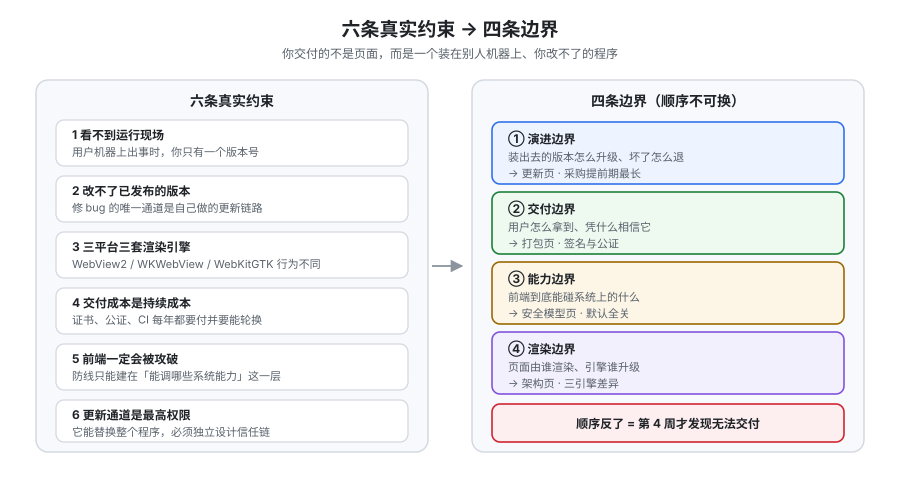

# 概述：桌面应用的六条真实约束

桌面应用的第一个分野不在技术上，而在心态上：**你交付的不是一个页面，而是一个要在别人机器上长期运行、且你无法远程修改的程序。** 这一页不写代码，只讲清六条约束、四条边界和三条路线的判据——它们是后面所有具体做法（架构、权限、打包、更新）的出发点。



## 一、先分清「套壳」和「桌面应用」

绝大多数桌面项目死在同一句话上：**「我们前端已经有了，套个壳就行。」**

| 阶段 | 你会做的事 | 它在什么时候崩 |
| --- | --- | --- |
| 套壳 | `tauri init`、`devUrl` 指向本地 dev server、跑起来能看见页面 | 不崩，因为**只在你的机器上跑过** |
| 有壳没底 | 加一个「读本地文件」功能，顺手把 `fs` 权限开成全盘 | 前端任何一次 XSS 都变成**本地任意文件读取**；而这个隐患在代码评审里看起来只是一行 JSON |
| 能装不能升 | 打了一个包发出去，用户装着 0.1.0 用了半年 | 你修了一个 bug，**没有任何办法送达**——除非让用户自己去下载 |
| 能升不能信 | 接上了自动更新，但更新包没签名 | 更新通道成了最直接的攻击路径：改一次 CDN 或劫持一次 DNS，就能让所有客户端装上一个任意程序 |
| 真正的桌面应用 | 权限逐条授予、安装包签名公证、更新链路带签名校验与回滚 | —— |

::: danger 「套壳思维」的三个具体后果
1. **权限失控**：为了省事把 scope 写成 `$HOME/**`，等于把用户的整个家目录交给前端。正确写法是**只给应用自己的数据目录**，用户要访问别处必须通过系统文件对话框由用户亲手选择。
2. **更新裸奔**：`updater` 插件只配了 `endpoints` 而没生成密钥对，构建时不会有任何提示，运行时也不会有任何报错——**它只是不会校验签名**。
3. **标识漂移**：发布后改 `identifier`，用户的配置、数据库、缓存**全部找不到**，表现是「升级后数据没了」，而这是不可逆的。
:::

## 二、四条边界（后面每一页都在回答其中一条）

| 边界 | 问题 | 谁来回答 | 答错的表现 |
| --- | --- | --- | --- |
| **渲染边界** | 页面由谁渲染、渲染引擎谁负责升级 | [架构与进程模型](../Architecture/index.md) | 同一份 CSS 在三平台表现不一致；某个平台永久卡在一个旧引擎上 |
| **能力边界** | 前端到底能碰系统上的什么东西 | [安全模型](../Security/index.md) | 功能能用，但把系统的门开得比需要的大 |
| **交付边界** | 用户怎么拿到、怎么信任这个程序 | [打包与分发](../Packaging/index.md) | 包能打出来，但用户下载后被操作系统拦下 |
| **演进边界** | 装出去的版本怎么升级、坏了怎么退 | [自动更新](../Updater/index.md) | 老版本永久驻留，或更新通道成为攻击面 |

::: tip 这四条边界的顺序不能换
**先想演进，再做交付，再定能力，最后才写渲染。** 实际项目里大家习惯的顺序恰好相反（先写界面），于是「更新怎么做」变成发布前一周的临时问题，而它恰恰是**采购提前期最长**（签名证书、公证账号）和**改动代价最大**（数据结构、目录布局）的那一条。
:::

## 三、三条路线的判据（不是参数表，是决策条件）

| 判据 | 选 Electron | 选 Tauri | 选 Web / PWA |
| --- | --- | --- | --- |
| 你的引擎必须**在所有机器上完全一致** | ✅ 唯一解（自带 Chromium） | ❌ 三平台三引擎 | —— |
| 你的安装包有**硬性体积/内存上限** | ❌ | ✅ 用系统引擎，包体积可到 **600KB** 级 | ✅（不需要装） |
| 团队**完全没有 Rust**，且不打算有 | ✅ | ⚠️ 官方说法是「多数情况不用写 Rust」，但**打包、签名、sidecar、原生集成绕不开** | ✅ |
| 需要**深度原生集成**（自绘标题栏、系统托盘、串口、文件关联） | ✅ | ✅ 两边都能做，Tauri 走 Rust/Swift/Kotlin，Electron 走 Node/原生模块 | ❌ 做不到 |
| 只要**读写文件 + 发通知 + 托盘** | ✅ | ✅ | ❌ |
| 目标是**必须支持 Windows 7** | ✅ | ❌ **2.12 起已正式放弃** | —— |
| 你需要**移动端复用同一套 UI** | ❌ | ✅ 2.x 支持 iOS / Android | ✅ 但系统能力受限 |

::: info 「WebView 一致性」是 Tauri 的固有代价，不是 bug
三平台分别是 **WebView2（Chromium）/ WKWebView（WebKit）/ WebKitGTK（WebKit）**。这意味着：CSS 新特性、`Intl` 数据、编解码器、甚至 `nullish coalescing` 这类语法糖的可用版本都不同。

它不能被「修好」，只能被**管住**：把渲染基线写进验收标准（见[实战](../Practice/index.md)的判据），并在三平台各跑一遍真机验收。**如果你不能接受这件事，就选 Electron——这是本次决策里最重要的一个「认清自己」。**
:::

## 四、什么时候不该做桌面应用

以下四条命中任意一条，请停下来重新论证：

1. **这个「桌面端」只是为了绕过浏览器限制。** 如果真正的诉求是「本地文件读写」或「后台常驻」，先评估 PWA（文件系统访问 API、后台同步）与浏览器扩展——它们不引入签名、更新、跨平台打包三条长期成本。
2. **你没有能力承担签名与公证的持续成本。** macOS 的 **$99/年**、Windows 的**云 HSM 证书或 Azure Trusted Signing**、以及每年证书轮换带来的 CI 改动，是**每年都要付**的，不是一次性的。
3. **团队里没有第二个人能看懂发布流程。** 桌面应用的发布是一条**多平台、多密钥、多步骤**的流水线。只有一个人会跑，等于没有发布能力。
4. **用户量不足以支撑「更新通道」的运维。** 一个只有内网几十个用户的工具，可能**用共享盘放安装包 + 强提示**就够了——不要为了「自动更新」引入一条需要长期维护、且一旦被攻破就是全量沦陷的通道。

## 五、最小起步三步（每一步都有可验证的收尾）

**第一步：让一个真实窗口跑起来。**

```shell
# 需要 Rust stable（Tauri 2.12 要求 MSRV 1.90）与 Node 20+
rustup default stable
cargo install create-tauri-app --locked      # 或 npm create tauri-app@latest
npm create tauri-app@latest da-notes -- --template vue-ts --manager npm --identifier com.example.danotes
cd da-notes && npm install
npm run tauri dev
```

收尾：窗口出现、修改 `src/App.vue` 后**窗口内热更新生效**（不需要重启 Rust 侧）。再执行 `npm run tauri info`，确认**没有缺失的平台依赖**（缺 WebKitGTK / MSVC Build Tools 都会在这里列出）。

**第二步：证明 IPC 通了，并且权限是「必须显式给」的。**

在 `src-tauri/src/lib.rs` 写一个返回字符串的命令，注册到 `invoke_handler`；然后只在前端调用它、**先不给任何 capability**，观察结果是「调用被拒绝」——这一步的意义是**亲眼看到默认拒绝是真的**。之后再在 `src-tauri/capabilities/default.json` 里补上这条命令的权限，确认调用成功。

收尾：**同一条调用，权限文件里加一行就从「拒绝」变成「成功」**。做不到这一点，说明你还没有真正走通安全模型。

**第三步：打出一个能双击的产物。**

```shell
npm run tauri build
```

收尾：在 `src-tauri/target/release/bundle/` 下找到对应平台的产物（macOS `.dmg`/`.app`、Windows `.msi`/`.exe`、Linux `.deb`/`.rpm`/`.AppImage`），**在本机双击安装并启动成功**。

::: warning 第三步的产物只能自己用，不能给别人用
本机未签名的产物在**你这台机器上**能双击，是因为它没有 `com.apple.quarantine` 属性、也没有走过浏览器下载。**把它通过网盘/邮件发给同事，对方看到的是「已损坏」或 SmartScreen 红屏**——这不是 bug，而是[打包与分发](../Packaging/index.md)要解决的正题。
:::

## 六、本专题的判据风格

本专题所有「验证方式」都遵守同一套写法，与仓库其他专题一致：

1. **能本机跑的，给出命令与期望输出**（例如 `npm run tauri info`、`cargo tauri signer generate`）。
2. **依赖外部条件的，如实标注**（例如「需要 Apple 开发者账号」「需要真实通知渠道」），写成 `⏳ 未跑 + 原因`，**不抄期望值**。
3. **判据唯一**：同一个结论不在两页重复定义。例如「权限是否最小」只在[安全模型](../Security/index.md)判，「更新是否可信」只在[自动更新](../Updater/index.md)判。

## 相关专题

- [架构与进程模型](../Architecture/index.md)：Rust 核心与 WebView 为什么是两个世界
- [安全模型](../Security/index.md)：默认拒绝是怎么落地的
- [打包与分发](../Packaging/index.md)：签名与公证的完整链路
- [实战：一个可安装的本地笔记应用](../Practice/index.md)：把本页的六条约束逐条对应到代码与命令
- [Electron 专题](../../Frame/Electron/index.md)：另一条路线的实现细节

## 参考资料

- Tauri 官方文档 · 入门与前置条件：https://v2.tauri.app/start/prerequisites/
- Tauri 官方文档 · 何时使用 Tauri：https://v2.tauri.app/start/
- Tauri 2.12 发布说明（放弃 Windows 7、MSRV 升到 1.90）：https://v2.tauri.app/blog/tauri-2.12/
- Electron 支持策略（最近三个大版本）：https://www.electronjs.org/docs/latest/tutorial/electron-timelines
