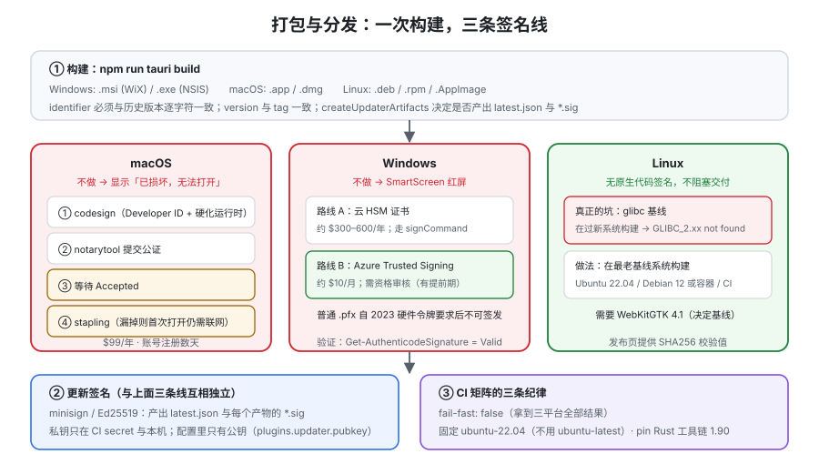

# 打包与分发

打包这一步决定了**用户能不能装、装完系统信不信它**。它的难点不在命令（`npm run tauri build` 就够），而在三件**提前期最长、最容易被拖到最后**的事：Linux 的基线系统、Windows 的签名证书、macOS 的公证。这一页把三平台的产物、WebView2 的五种安装模式、签名与公证的完整链路，以及一条能跑的三平台 CI 讲清楚。



## 一、产物清单：一次 `build` 出什么

```shell
npm run tauri build
# 产物在 src-tauri/target/release/bundle/
```

| 平台 | 产物 | 说明 |
| --- | --- | --- |
| Windows | `.msi`（WiX）、`.exe`（NSIS） | 两个都出。`.msi` 适合域环境批量部署，NSIS 安装器更小、可自定义 |
| macOS | `.app`、`.dmg` | `.app` 是可运行包，`.dmg` 是分发载体；**分发必须同时签名与公证** |
| Linux | `.deb`、`.rpm`、`.AppImage` | `.deb` 定义图标、desktop 文件与依赖；`.AppImage` 免安装但体积最大 |
| 全平台 | `latest.json` + `*.sig` | 仅在 `bundle.createUpdaterArtifacts: true` 时生成，供[自动更新](../Updater/index.md)使用 |

```json [tauri.conf.json（打包相关最小片段）]
{
  "productName": "DA Notes",
  "version": "0.1.0",
  "identifier": "com.example.danotes",
  "build": {
    "devUrl": "http://localhost:5173",
    "frontendDist": "../dist",
    "beforeDevCommand": "npm run dev",
    "beforeBuildCommand": "npm run build"
  },
  "bundle": {
    "active": true,
    "targets": "all",
    "createUpdaterArtifacts": true,
    "icon": ["icons/32x32.png", "icons/128x128.png", "icons/icon.icns", "icons/icon.ico"]
  }
}
```

::: danger `identifier` 是**不可变**的
它同时是：**代码签名标识、应用数据目录名、存储路径与缓存路径的前缀、应用商店提交标识**。

发布后改它，后果是**老用户的应用找不到自己的数据**（表现成「升级后数据没了」），并且操作系统会把它当成一个**全新的应用**（新的权限记录、新的通知授权、新的文件关联）。

**规则：在第一次对外发布之前定好 `identifier`，之后永远不改。** 需要改就当作一次带数据迁移的「换应用」来处理。
:::

## 二、Windows：WebView2 的五种安装模式

Windows 上应用依赖 **WebView2 运行时**。它与 Windows 的关系是：

- **Windows 11 与 Windows 10 1803+ ：随系统分发**（通常已存在）；
- 更老的系统或精简镜像：需要安装。

Tauri 提供五种安装模式，**这是一个「联网依赖 / 安装包体积 / 可离线」的三角取舍**：

| 模式 | 需要联网 | 安装包增量 | 什么时候用 |
| --- | --- | --- | --- |
| `downloadBootstrapper`（**默认**） | 是 | 0MB | 普通 C 端分发；安装包最小 |
| `embedBootstrapper` | 是 | ~1.8MB | 需要在老旧系统上更稳的引导 |
| `offlineInstaller` | **否** | ~127MB | **内网、离线环境、政企交付** |
| `fixedRuntime` | 否 | ~180MB | 需要**锁定 WebView 版本**（自管补丁节奏） |
| `skip` | 否 | 0MB | ⚠️ **不推荐**：不安装也不检查，用户没装就直接白屏 |

```json [离线交付场景]
{
  "bundle": {
    "windows": {
      "webviewInstallMode": { "type": "offlineInstaller" }
    }
  }
}
```

::: warning 两处关于 `webviewInstallMode` 的实测口径
1. **使用系统运行时（默认/引导器模式）在安全上更优**：补丁由 Windows 负责；`fixedRuntime` 意味着**你自己接管了 WebView 的安全更新责任**。
2. **更新包（updater bundle）固定使用 `downloadBootstrapper`**，不受上面的配置影响。这意味着：**即使你的安装包是离线模式，更新链路仍然需要联网**——离线环境要么自建更新源（内网可访问），要么干脆关掉自动更新。
3. `fixedRuntime` 的配置里 `path` 指向解压后的运行时目录（`.cab` 需先展开）。**这个目录会被打进安装包**，注意体积与许可。
:::

**Windows 签名**：见下节第四节。另外两个与体积/运行相关的开关：

| 配置 | 作用 |
| --- | --- |
| `build.windows.staticVCRuntime` | 静态链接 VC 运行时（2.12 起推荐用配置项，旧的 `STATIC_VCRUNTIME` 环境变量已弃用） |
| `bundle.windows.bundleVCRuntime` | 把 VC 运行时 DLL 一起打包（当 sidecar 或其他 DLL **没有**静态链接 VC 运行时、而你不想要求用户装 Redistributable 时用） |

## 三、Linux：最大的坑是「基线系统」

Linux 侧的问题不是「能不能打 deb」，而是**打出来的二进制在别人的机器上跑不起来**。

| 问题 | 原因 | 正确做法 |
| --- | --- | --- |
| `GLIBC_2.xx not found` | glibc 向后兼容、**不向前兼容**。在较新系统上构建 → 要求较新的 glibc | **在你打算支持的最老系统上构建**（官方举例：Ubuntu 22.04 / Debian 12） |
| 缺 `libwebkit2gtk-4.1` | Tauri v2 需要 **WebKitGTK 4.1**，它只在 Ubuntu 22.04+ / Debian 12+ 的**标准仓库**里有 | 基线因此被钉死；老发行版需自行解决依赖 |
| 托盘不显示 | 缺 `libayatana-appindicator3` 等 | 在 `bundle.linux.deb.depends` 里声明依赖；构建机装齐依赖 |
| 从 Dock/图标启动时找不到命令 | **GUI 应用不继承 shell 的 `$PATH`** | 显式处理（官方点出 `fix-path-env-rs`） |
| 三平台渲染不一致 | WebKitGTK 与其他引擎的差异 | 见[概述](../Overview/index.md)：写进验收标准，真机验收 |

依赖安装（构建机）：

```shell
# Debian / Ubuntu 22.04+
sudo apt update
sudo apt install libwebkit2gtk-4.1-dev build-essential curl wget file \
  libxdo-dev libssl-dev libayatana-appindicator3-dev librsvg2-dev \
  libsoup-3.0-dev patchelf

# Fedora 38+
sudo dnf install webkit2gtk4.1-devel openssl-devel curl wget file \
  libappindicator-gtk3-devel librsvg2-devel

# Arch / Manjaro
sudo pacman -S --needed webkit2gtk-4.1 base-devel curl wget file openssl \
  appmenu-gtk-module libappindicator-gtk3 librsvg
```

::: tip 官方推荐：Linux 构建走容器或 CI
原因很直接：**要复现「最老基线系统」，最可靠的办法就是不依赖你本机的发行版版本。** 用固定版本的容器或 CI runner 构建，输出才可复现。
:::

## 四、签名与公证：三条线，三种提前期

这一节是本页**最需要提前启动**的部分。

| 平台 | 需要什么 | 成本 | 提前期 | 不做会怎样 |
| --- | --- | --- | --- | --- |
| **macOS** | Apple Developer Program + Developer ID Application 证书 + `notarytool` 提交与 stapling | **$99/年** | 账号注册通常数天 | 用户下载后看到「**已损坏，无法打开**」，不是警告而是直接打不开 |
| **Windows** | 云 HSM 证书（DigiCert / Sectigo）**或** Azure Trusted Signing | 云 HSM 约 **$300–600/年**；Azure Trusted Signing 约 **$10/月**（需资格审核） | **资格审核 + 证书签发，以周计** | SmartScreen 红屏，用户需要点「仍要运行」 |
| **Linux** | **无原生代码签名** | —— | —— | 无阻塞。通行做法是提供 **SHA256 校验值**（可选再用 GPG 签发布标签） |

::: danger Windows 的 `.pfx` 已不可自行签发
**2023 年的硬件令牌要求**之后，普通 `.pfx` 不再可签发。所以只能：
1. **云 HSM 证书**（贵、需逐次调用 HSM 签名，通常配合自定义 `signCommand`，例如用 `relic` 走 Azure Key Vault）；
2. **Azure Trusted Signing**（便宜，但**需要资格审核**，且审核有提前期）。

**这两条路都必须提前几周启动**，而且要在发布（而非 beta）之前完成。
:::

**macOS 完整链路（四步，缺一不可）：**

| 步 | 做什么 | 关键点 |
| --- | --- | --- |
| ① 签名 | 用 Developer ID Application 证书签 `.app` 与内部二进制 | 必须开 **hardened runtime**；sidecar 与嵌套二进制要**逐层签** |
| ② 提交公证 | `notarytool` 把产物提交给 Apple | 用 App Store Connect API Key 或 Apple ID + App 专用密码 |
| ③ 等待结果 | 轮询直到 `Accepted` | 失败会返回日志，**首次几乎必然会因权限描述/未签名嵌套二进制被拒** |
| ④ **stapling** | 把公证票据**钉到产物上** | **漏掉这一步，用户首次打开仍需联机校验**，离线时会失败 |

Tauri 通过环境变量/配置接入：`APPLE_SIGNING_IDENTITY`（或 `bundle.macOS.signingIdentity`）、`APPLE_CERTIFICATE`、`APPLE_ID` / `APPLE_PASSWORD`（App 专用密码）/ `APPLE_TEAM_ID`，或用 API Key 三件套（`APPLE_API_ISSUER` / `APPLE_API_KEY` / `APPLE_API_KEY_PATH`）。

**测试用「临时签名」**：`signingIdentity` 设为 `"-"`（ad-hoc）。**它只用于本机测试，不能分发**——ad-hoc 签名不满足公证要求。

**验证命令（本机可跑，前提是已有签名产物）：**

```shell
# macOS：校验签名与公证
codesign -vvv --deep --strict "DA Notes.app"
spctl -a -t exec -vvv "DA Notes.app"
xcrun stapler validate "DA Notes.app"

# Windows（PowerShell）：校验 Authenticode 签名
Get-AuthenticodeSignature "DA Notes.exe" | Format-List
```

## 五、体积优化：先量，再减

| 手段 | 典型收益 | 代价 |
| --- | --- | --- |
| `[profile.release]` 设 `opt-level = "s"` / `"z"`、`lto = true`、`codegen-units = 1`、`panic = "abort"`、`strip = true` | 明显 | 编译变慢；`panic = "abort"` 会**放弃栈展开**（崩溃信息变少，慎重） |
| 前端产物做 tree-shaking / 去掉 sourcemap | 中 | 需要正确配置构建工具 |
| 不引入不需要的插件 | 中 | 无（但要注意：**插件的 Rust 与 npm 包都要清干净**） |
| 用 `fixedRuntime` 之外的 WebView 模式 | 大 | 见第二节的取舍 |
| 控制 sidecar 体积 | 可能很大 | 无 |

::: warning `panic = "abort"` 与日志/上报的冲突
它确实能减小体积，但会让**崩溃时无法捕获栈信息**。如果你的桌面应用依赖崩溃上报（见[原生能力](../NativeCapabilities/index.md)的日志与崩溃一节），**这一项要慎重**——省下的几百 KB 可能让你在排障时一无所获。
:::

## 六、三平台 CI：一矩阵 + 一密钥清单

```yaml [.github/workflows/release.yml（结构骨架，省略签名细节）]
name: release
on:
  push:
    tags: ["v*"]

jobs:
  build:
    strategy:
      fail-fast: false
      matrix:
        include:
          - platform: macos-latest   # 同时出 aarch64 与 x86_64
          - platform: windows-latest
          - platform: ubuntu-22.04   # 用最老基线，不是 ubuntu-latest
    runs-on: ${{ matrix.platform }}
    steps:
      - uses: actions/checkout@v4
      - name: Install Linux deps
        if: matrix.platform == 'ubuntu-22.04'
        run: |
          sudo apt update
          sudo apt install -y libwebkit2gtk-4.1-dev libayatana-appindicator3-dev \
            librsvg2-dev patchelf libxdo-dev
      - uses: dtolnay/rust-toolchain@stable
        with:
          toolchain: 1.90.0        # pin：MSRV 策略为 stable-3，必须显式固定
      - uses: actions/setup-node@v4
        with: { node-version: 22 }
      - run: npm ci
      - uses: tauri-apps/tauri-action@v0
        env:
          TAURI_SIGNING_PRIVATE_KEY: ${{ secrets.TAURI_SIGNING_PRIVATE_KEY }}
          TAURI_SIGNING_PRIVATE_KEY_PASSWORD: ${{ secrets.TAURI_SIGNING_PRIVATE_KEY_PASSWORD }}
```

**密钥与秘密清单**（**绝不进仓库**）：

| 用途 | 变量 |
| --- | --- |
| 更新签名（全平台，minisign） | `TAURI_SIGNING_PRIVATE_KEY`、`TAURI_SIGNING_PRIVATE_KEY_PASSWORD` |
| macOS 签名/公证 | `APPLE_CERTIFICATE`、`APPLE_SIGNING_IDENTITY`、`APPLE_ID`、`APPLE_PASSWORD`、`APPLE_TEAM_ID`（或 API Key 三件套） |
| Windows 签名 | 云 HSM 场景用自定义 `signCommand` + 平台凭据；Azure Trusted Signing 用租户/客户端/账户/证书配置四件套 |

::: danger CI 上的四个高危错误
1. **私有密钥以明文写进 `tauri.conf.json`。** 官方文档明确要求：**签名私钥只能在 CI secret 中存在**，配置里只有**公钥**（`plugins.updater.pubkey`）。
2. **用 `ubuntu-latest` 构建 Linux 包。** 基线会随 runner 升级而漂移 → 某天突然在老系统上跑不起来。**固定到 `ubuntu-22.04`。**
3. **不 pin Rust 工具链。** MSRV 策略是 `stable − 3`，**每三个月会自然失效一次**；不 pin 就会出现「什么都没改，CI 突然红」。
4. **`fail-fast: true`（默认）导致一个平台失败就看不到其他平台。** 三平台构建互相独立，应设 `fail-fast: false` 拿到全部结果。
:::

## 七、发布前自查（与[FAQ](../FAQ/index.md)的上线清单互补，此处只管「交付物」）

| 检查项 | 判据 |
| --- | --- |
| 产物齐全 | `target/release/bundle/` 下三平台各自的目标格式都存在 |
| `identifier` 未变 | 与上一版本**逐字符相同** |
| 版本号已升 | `tauri.conf.json` 的 `version` 与 tag 一致 |
| 签名有效 | macOS `codesign -vvv --deep --strict` 通过；Windows `Get-AuthenticodeSignature` 为 `Valid` |
| 公证已 stapling | `xcrun stapler validate` 通过（**不只是提交成功**） |
| 更新产物已生成 | 存在 `latest.json` 与 `*.sig`（前提是开了 `createUpdaterArtifacts`） |
| Linux 校验值已提供 | 发布页附带 SHA256（可选附 GPG 签名的标签） |
| 安装包在**干净机器**上验证过 | 不是在你的开发机上 |

## 验证方式

1. **本机可判：产物与结构。** `npm run tauri build` 后 `ls src-tauri/target/release/bundle/`，确认当前平台的目标格式存在。**把实际目录树记进项目文档。**
2. **本机可判：`tauri info` 不缺依赖。** 输出里没有缺 WebKitGTK / MSVC Build Tools / WebView2 的提示。
3. **本机可判（Linux 构建机）：基线版本记录。** 记录构建机发行版与 glibc 版本（`ldd --version | head -1`），作为「能支持到多老」的依据。
4. ⏳ **未跑（需证书与账号）：签名与公证。** 原因：本机无 Apple 开发者账号与 Windows 签名证书。**如实标注，不抄期望输出。**
5. ⏳ **未跑（需干净机器）：安装验证。** 原因：需要一台未装过本应用的机器（或用全新虚拟机/容器）。开发机上「双击能开」**不能**证明分发可用。

## 相关专题

- [概述：桌面应用的六条真实约束](../Overview/index.md)：交付边界为什么必须最先想
- [自动更新](../Updater/index.md)：`latest.json` 与 `*.sig` 的消费方
- [安全模型](../Security/index.md)：签名是操作系统级的信任，与 capability 是两个层面
- [实战：一个可安装的本地笔记应用](../Practice/index.md)：把本页的步骤串成一条可执行链路
- [Electron 专题](../../Frame/Electron/index.md)：Electron 的打包与签名（对照读）
- [依赖与安全治理](../../../Tools/DependencyGovernance/index.md)：制品与 SBOM、签名与来源的完整治理视角

## 参考资料

- Tauri 官方文档 · 分发总览：https://v2.tauri.app/distribute/
- Tauri 官方文档 · Windows 安装器与 WebView2 安装模式：https://v2.tauri.app/distribute/windows-installer/
- Tauri 官方文档 · Debian 打包与 glibc 基线限制：https://v2.tauri.app/distribute/debian/
- Tauri 官方文档 · macOS 签名与公证：https://v2.tauri.app/distribute/sign/macos/
- Tauri 官方文档 · Windows 代码签名：https://v2.tauri.app/distribute/sign/windows/
- Tauri 官方文档 · GitHub Actions 发布：https://v2.tauri.app/distribute/pipelines/github/
