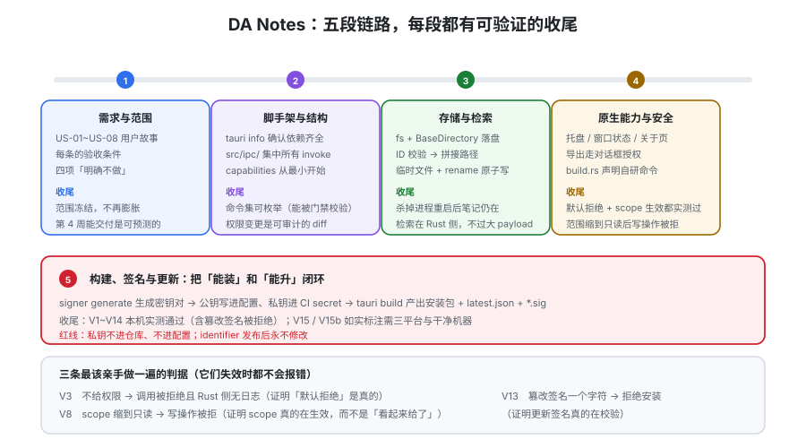

# 实战：一个可安装的本地笔记应用

前面八页讲的是「每一层怎么做对」。这一页把它们串成一条**从零到可安装包**的完整链路：一个 **DA Notes** 本地 Markdown 笔记应用，要求是「能存、能搜、能导出、能自己升级、卸了重装数据还在」。全程只有两个平台依赖：**Rust 工具链**与 **Node.js**（不需要数据库、不需要服务端）。



## 一、需求与范围（先划边界，再动手）

| 编号 | 用户故事 | 验收条件 | 落到哪一层 |
| --- | --- | --- | --- |
| US-01 | 新建/编辑/删除笔记 | 编辑后 1 秒内落盘；删除有二次确认 | [IPC](../IPC/index.md) + `fs` |
| US-02 | 笔记存在应用自己的数据目录 | 卸载重装后数据仍在（数据目录不随安装包删除） | `fs` + `BaseDirectory` |
| US-03 | 按标题/正文搜索 | 输入即时过滤，1000 篇内无卡顿感 | Rust 侧命令（不在前端全量遍历） |
| US-04 | 导出笔记为 `.md` | 用户选择目标位置；取消不报错 | `dialog` + `fs`（用户选择授权） |
| US-05 | 记住窗口大小与位置 | 重启后恢复；显示器变化后仍在可见区域内 | `window-state` |
| US-06 | 关窗口隐藏到托盘，托盘可退出 | 托盘左键唤出主窗口，右键菜单含「退出」 | `system-tray` |
| US-07 | 「关于」显示版本号并支持检查更新 | 有则提示并可下载安装；签名校验失败要拒绝 | [自动更新](../Updater/index.md) |
| US-08 | 出错时能拿到日志 | 有本地日志文件；界面有「导出诊断包」 | `log` + 崩溃处理 |

**明确不做（四项）**：

| 不做 | 理由 |
| --- | --- |
| 云同步 | 一旦引入同步，就要处理冲突合并、账号、服务端——**这是一个独立项目，不是本项目的第四周** |
| 富文本 / 图片粘贴 | 涉及二进制存储与编辑器实现，会把范围扩大一倍 |
| 全文检索索引（FTS） | 先在内存里做朴素匹配，把索引留到「真的卡了」再加 |
| 多语言 | 单语言足够验证链路；国际化见[国际化与无障碍](../../IntlA11y/index.md)专题 |

::: tip 这四项的真正作用
它们让「第 4 周能不能交付」变得**可预测**。桌面项目最常见的失败模式不是技术难题，而是**范围在第 2 周悄悄膨胀**，最后连一个可安装包都没打出来。
:::

## 二、脚手架与工程结构

```shell
# 前置：Rust stable（Tauri 2.12 要求 MSRV 1.90）、Node 20+
rustup default stable
node -v

npm create tauri-app@latest da-notes -- --template vue-ts --manager npm --identifier com.example.danotes
cd da-notes
npm install

# 一次性确认平台依赖齐全（缺什么这里会报）
npm run tauri info

npm run tauri dev
```

```text
da-notes/
├── src/                        # 前端（Vue 3 + TS）
│   ├── ipc/                    # ★ 所有 invoke 集中在这里（见 IPC 页的类型同步）
│   │   ├── notes.ts
│   │   └── files.ts
│   └── components/
├── src-tauri/
│   ├── Cargo.toml
│   ├── build.rs                # ★ 声明自研命令，收住默认放行
│   ├── tauri.conf.json
│   ├── capabilities/
│   │   └── default.json        # ★ 权限唯一入口
│   ├── icons/
│   └── src/
│       ├── lib.rs              # ★ 应用逻辑写这里
│       ├── main.rs             # 不动
│       ├── notes.rs            # 笔记仓储
│       └── search.rs           # 朴素检索
```

**三条工程纪律（从第一天就立住）：**

1. **前端不直接 `import { invoke }` 散落在组件里**——统一走 `src/ipc/`。这样「前端调了哪些命令」是一个可枚举的集合，才能被门禁脚本校验。
2. **Rust 侧按领域分文件**（`notes.rs` / `search.rs`），`lib.rs` 只做注册与装配。
3. **`capabilities/default.json` 从最小开始**，每加一个能力就**单独提交一次**。这样权限变更是可审计、可回滚的。

## 三、第一步：把笔记存下来（`fs` + `BaseDirectory`）

数据目录用**系统约定的应用数据目录**，而不是安装目录旁边——安装目录在更新/重装时可能被整体替换。

```rust [src-tauri/src/notes.rs]
use serde::{Deserialize, Serialize};
use std::path::PathBuf;

#[derive(Debug, Serialize, Deserialize, Clone)]
#[serde(rename_all = "camelCase")]
pub struct NoteMeta {
    pub id: String,
    pub title: String,
    pub updated_at: i64,
}

#[derive(Debug, Serialize, Deserialize, Clone)]
#[serde(rename_all = "camelCase")]
pub struct Note {
    pub id: String,
    pub title: String,
    pub body: String,
    pub updated_at: i64,
}

/// 笔记 ID 只允许「小写字母 + 数字 + 短横线」，从源头掐掉路径穿越
pub fn validate_id(id: &str) -> Result<(), String> {
    if id.is_empty() || id.len() > 64 {
        return Err("note id length out of range".into());
    }
    if !id.chars().all(|c| c.is_ascii_lowercase() || c.is_ascii_digit() || c == '-') {
        return Err("note id must be [a-z0-9-]".into());
    }
    Ok(())
}

pub fn note_path(root: &PathBuf, id: &str) -> Result<PathBuf, String> {
    validate_id(id)?;
    Ok(root.join("notes").join(format!("{id}.md")))
}
```

```rust [src-tauri/src/lib.rs（装配与命令）]
mod notes;
mod search;

use notes::{note_path, Note, NoteMeta};
use std::fs;
use std::path::PathBuf;
use tauri::Manager;

/// 用 AppHandle 拿应用数据目录：这是跨平台唯一可靠的写法
fn notes_root(app: &tauri::AppHandle) -> Result<PathBuf, String> {
    let dir = app
        .path()
        .app_data_dir()
        .map_err(|e| format!("resolve app data dir failed: {e}"))?;
    fs::create_dir_all(dir.join("notes")).map_err(|e| format!("mkdir failed: {e}"))?;
    Ok(dir)
}

#[tauri::command]
fn list_notes(app: tauri::AppHandle) -> Result<Vec<NoteMeta>, String> {
    let root = notes_root(&app)?;
    let mut out = Vec::new();
    for entry in fs::read_dir(root.join("notes")).map_err(|e| e.to_string())? {
        let entry = entry.map_err(|e| e.to_string())?;
        let path = entry.path();
        if path.extension().and_then(|s| s.to_str()) != Some("md") {
            continue;
        }
        let id = match path.file_stem().and_then(|s| s.to_str()) {
            Some(s) => s.to_string(),
            None => continue,
        };
        let body = fs::read_to_string(&path).unwrap_or_default();
        let title = body
            .lines()
            .next()
            .map(|l| l.trim_start_matches('#').trim().to_string())
            .filter(|t| !t.is_empty())
            .unwrap_or_else(|| id.clone());
        let updated_at = entry
            .metadata()
            .ok()
            .and_then(|m| m.modified().ok())
            .and_then(|t| t.duration_since(std::time::UNIX_EPOCH).ok())
            .map(|d| d.as_millis() as i64)
            .unwrap_or(0);
        out.push(NoteMeta { id, title, updated_at });
    }
    out.sort_by(|a, b| b.updated_at.cmp(&a.updated_at));
    Ok(out)
}

#[tauri::command]
fn read_note(app: tauri::AppHandle, id: String) -> Result<Note, String> {
    let root = notes_root(&app)?;
    let path = note_path(&root, &id)?;
    let body = fs::read_to_string(&path).map_err(|e| format!("read failed: {e}"))?;
    let title = body
        .lines()
        .next()
        .map(|l| l.trim_start_matches('#').trim().to_string())
        .filter(|t| !t.is_empty())
        .unwrap_or_else(|| id.clone());
    Ok(Note {
        id,
        title,
        body,
        updated_at: std::time::SystemTime::now()
            .duration_since(std::time::UNIX_EPOCH)
            .map(|d| d.as_millis() as i64)
            .unwrap_or(0),
    })
}

#[tauri::command]
fn save_note(app: tauri::AppHandle, id: String, body: String) -> Result<NoteMeta, String> {
    // 大小上限：桌面端也要有，避免一次误操作把磁盘写满
    if body.len() > 2 * 1024 * 1024 {
        return Err("note too large (max 2MB)".into());
    }
    let root = notes_root(&app)?;
    let path = note_path(&root, &id)?;
    // 先写临时文件再改名：避免写到一半崩溃导致笔记损坏
    let tmp = path.with_extension("md.tmp");
    fs::write(&tmp, &body).map_err(|e| format!("write failed: {e}"))?;
    fs::rename(&tmp, &path).map_err(|e| format!("rename failed: {e}"))?;

    let title = body
        .lines()
        .next()
        .map(|l| l.trim_start_matches('#').trim().to_string())
        .filter(|t| !t.is_empty())
        .unwrap_or_else(|| id.clone());
    Ok(NoteMeta {
        id,
        title,
        updated_at: std::time::SystemTime::now()
            .duration_since(std::time::UNIX_EPOCH)
            .map(|d| d.as_millis() as i64)
            .unwrap_or(0),
    })
}

#[cfg_attr(mobile, tauri::mobile_entry_point)]
pub fn run() {
    tauri::Builder::default()
        .plugin(tauri_plugin_fs::init())
        .plugin(tauri_plugin_dialog::init())
        .plugin(tauri_plugin_store::init())
        .plugin(tauri_plugin_log::Builder::new().build())
        .invoke_handler(tauri::generate_handler![
            list_notes,
            read_note,
            save_note,
            search::search_notes,
            notes::export_note
        ])
        .run(tauri::generate_context!())
        .expect("error while running tauri application");
}
```

::: tip 三个来自前几页的具体做法，留意它们为什么出现在这里
1. **参数用结构体 + `#[serde(rename_all = "camelCase")]`**（见 [IPC](../IPC/index.md) 规则 1）：`Note` 与 `NoteMeta` 都标了它，前端就按 camelCase 收发。
2. **ID 先校验再拼路径**（见[原生能力](../NativeCapabilities/index.md)文件坑 3）：`validate_id` 把「只允许 `[a-z0-9-]`」写进代码，而不是只依赖 scope。
3. **先写 `.tmp` 再 `rename`**：`rename` 在同一文件系统内是原子的，这让「写到一半断电」不会产生半截笔记。**这是本地文件存储与数据库事务最接近的等价物。**
:::

**权限文件（只给到应用自己的数据目录）：**

```json [src-tauri/capabilities/default.json]
{
  "$schema": "../gen/schemas/desktop-schema.json",
  "identifier": "main-capability",
  "description": "主窗口：核心默认 + 应用数据目录读写 + 对话框 + 更新检查",
  "windows": ["main"],
  "permissions": [
    "core:default",
    "core:window:allow-set-title",
    "log:default",
    "dialog:allow-open",
    "dialog:allow-save",
    "dialog:allow-ask",
    "updater:default",
    "process:allow-restart",
    {
      "identifier": "fs:allow-read-text-file",
      "allow": [{ "path": "$APPDATA/**" }]
    },
    {
      "identifier": "fs:allow-write-text-file",
      "allow": [{ "path": "$APPDATA/**" }]
    }
  ]
}
```

:::: danger 注意：上面这份权限**打不开任意位置的文件**
`fs` 的 scope 只有 `$APPDATA/**`。要做「导出到用户选的位置」（US-04），**必须走用户选择授权**：先用 `dialog` 让用户亲手选目标路径，再对该路径获得运行时授权。

写不出文件时的第一反应**不应该是「把 scope 放宽到 `$HOME/**`」**，而应该是「我有没有把用户的这次选择登记为授权」。

（另外：`fs` 相关命令是否需要在 `capabilities` 里逐条列、能列哪些，**以生成出来的 schema 文件为准**——见下方验证 3。）

```ts [src/ipc/notes.ts]
import { invoke } from "@tauri-apps/api/core";

export interface NoteMeta { id: string; title: string; updatedAt: number }
export interface Note extends NoteMeta { body: string }

export const listNotes = () => invoke<NoteMeta[]>("list_notes");
export const readNote = (id: string) => invoke<Note>("read_note", { id });
export const saveNote = (id: string, body: string) =>
  invoke<NoteMeta>("save_note", { id, body });
export const searchNotes = (q: string) => invoke<NoteMeta[]>("search_notes", { q });
```
::::

## 四、第二步：检索放在 Rust 侧

**为什么不在前端做**：笔记正文要全部过 IPC 才能在前端搜索，1000 篇 × 20KB = 20MB 的 JSON 每次都要序列化、传输、反序列化。**这是 [IPC](../IPC/index.md) 第七节「不要用 IPC 传大 payload」的直接应用。**

```rust [src-tauri/src/search.rs]
use crate::notes::{note_path, notes_root, NoteMeta};
use std::fs;

#[tauri::command]
pub fn search_notes(app: tauri::AppHandle, q: String) -> Result<Vec<NoteMeta>, String> {
    let needle = q.trim().to_lowercase();
    if needle.is_empty() {
        return Ok(Vec::new());
    }
    if needle.len() > 128 {
        return Err("query too long".into());
    }
    let root = notes_root(&app)?;
    let mut hits = Vec::new();
    for entry in fs::read_dir(root.join("notes")).map_err(|e| e.to_string())? {
        let entry = entry.map_err(|e| e.to_string())?;
        let path = entry.path();
        let id = match path.file_stem().and_then(|s| s.to_str()) {
            Some(s) => s.to_string(),
            None => continue,
        };
        // 先校验再使用（与 notes.rs 同一套规则）
        if note_path(&root, &id).is_err() {
            continue;
        }
        let body = fs::read_to_string(&path).unwrap_or_default();
        if body.to_lowercase().contains(&needle) {
            let title = body
                .lines()
                .next()
                .map(|l| l.trim_start_matches('#').trim().to_string())
                .unwrap_or_else(|| id.clone());
            hits.push(NoteMeta {
                id,
                title,
                updated_at: entry
                    .metadata()
                    .ok()
                    .and_then(|m| m.modified().ok())
                    .and_then(|t| t.duration_since(std::time::UNIX_EPOCH).ok())
                    .map(|d| d.as_millis() as i64)
                    .unwrap_or(0),
            });
        }
    }
    Ok(hits)
}
```

::: warning 朴素检索的已知上限
这个实现是「每次全量读盘 + 小写匹配」。它的复杂度是 **O(笔记总字节数)**，在 1000 篇 × 20KB 规模下通常几十毫秒级，可以接受。

**它会在什么时候失效**：笔记总量到几百 MB、或需要中文分词/相关度排序时。那时才引入索引（如 `sql` 插件 + FTS），并且**在那之前不要预先复杂化**——这是「明确不做 FTS」这条范围边界的具体兑现。
:::

## 五、第三步：托盘、窗口状态与「关于」

```json [tauri.conf.json（窗口 + 托盘 + 更新 的关键片段）]
{
  "productName": "DA Notes",
  "version": "0.1.0",
  "identifier": "com.example.danotes",
  "app": {
    "windows": [
      { "label": "main", "title": "DA Notes", "width": 1100, "height": 720, "minWidth": 720, "minHeight": 480 }
    ],
    "security": {
      "csp": "default-src 'self'; img-src 'self' asset: http://asset.localhost data:; style-src 'self' 'unsafe-inline'; connect-src 'self' https://releases.example.com",
      "capabilities": ["main-capability"]
    }
  },
  "bundle": {
    "active": true,
    "targets": "all",
    "createUpdaterArtifacts": true
  },
  "plugins": {
    "updater": {
      "pubkey": "dW50cnVzdGVkIGNvbW1lbnQ6...",
      "endpoints": ["https://releases.example.com/{{target}}/{{arch}}/{{current_version}}"],
      "windows": { "installMode": "passive" }
    }
  }
}
```

::: danger 三处配置上的纪律，逐条对应前面某页
1. **`label` 固定为 `main`，`capabilities` 指向它。** 见[安全模型](../Security/index.md)：**capability 按 label 匹配**，改 label 等于改权限归属。
2. **`csp` 的 `connect-src` 只放自己的更新域名。** 写 `*` 会让前端能把数据发到任意主机；`img-src` 里的 `asset:` / `http://asset.localhost` 是[资源协议](../IPC/index.md)能被加载的**必要条件之一**（另一半是权限）。
3. **`pubkey` 是公钥。** 私钥只在 CI secret 与你的本机。见[自动更新](../Updater/index.md)的红线 1。
:::

- **托盘**（`system-tray`）：左键唤出/隐藏 `main` 窗口，右键菜单含「显示主窗口 / 检查更新 / 退出」。**「关闭窗口」绑到「隐藏」**，退出只走托盘菜单——这样 US-06 的「关窗口仍在后台」才是真的。
- **窗口状态**（`window-state`）：交给插件即可，**不要再自己 `set_size`**（见[原生能力](../NativeCapabilities/index.md)的警告）。
- **「关于」页**：必须显示 `ProductName` + `version` + 平台/架构 + 一个「检查更新」按钮 + 一个「导出诊断包」按钮。**版本号显示不是锦上添花，它是所有远程支持的前提条件。**

## 六、第四步：构建、签名与更新（链路闭环）

```shell
# 1) 生成更新签名密钥（私钥只留在本机与 CI secret）
npm run tauri signer generate -- -w ~/.tauri/da-notes.key

# 2) 本地构建（未签名，仅自用）
npm run tauri build

# 3) 带签名构建（在 CI 上执行；本机需先配置平台签名与公证变量）
export TAURI_SIGNING_PRIVATE_KEY="$(cat ~/.tauri/da-notes.key)"
export TAURI_SIGNING_PRIVATE_KEY_PASSWORD=""
npm run tauri build

# 4) 检查产物
ls src-tauri/target/release/bundle/
# macOS:   dmg/  macos/  + latest.json + *.sig
# Windows: msi/  nsis/   + latest.json + *.sig
# Linux:   deb/  rpm/  appimage/  + latest.json + *.sig
```

把三平台的产物与 `latest.json` 上传到更新端点，**用户端就具备了「自动升级」的能力**。完整的三平台 CI、密钥清单、签名与公证细节见[打包与分发](../Packaging/index.md)与[自动更新](../Updater/index.md)——**这里不重复，只做串接**。

## 七、验收判据：V1~V15

| 编号 | 判据 | 类别 | 本机可判？ |
| --- | --- | --- | --- |
| V1 | `npm run tauri info` 无缺失平台依赖 | 环境 | ✅ |
| V2 | `npm run tauri dev` 起窗口；改前端代码窗口内热更新 | 开发链路 | ✅ |
| V3 | **不给权限时调 `list_notes` 被拒绝，且 Rust 侧无日志** | 安全 | ✅ |
| V4 | 授予权限后同一调用成功 | 安全 | ✅ |
| V5 | 新建→保存→**杀掉进程**→重启，笔记仍在 | 数据 | ✅ |
| V6 | 数据落在**应用数据目录**，不在安装目录旁边 | 数据 | ✅ |
| V7 | 导出到用户选定的任意目录成功；**取消选择不报错** | 权限模型 | ✅ |
| V8 | 把 `fs` scope 缩到只读，写操作被拒绝（证明 scope 真的在生效） | 安全 | ✅ |
| V9 | 检索 1000 篇笔记时无明显卡顿（记录实测耗时） | 性能 | ✅ |
| V10 | 关窗口后进程仍在、托盘可唤出；托盘「退出」真的退出 | 原生能力 | ✅ |
| V11 | 窗口大小/位置重启后恢复 | 原生能力 | ✅ |
| V12 | 「关于」显示版本号；置为最新时检查更新给出明确提示 | 更新 | ✅ |
| V13 | **篡改 `latest.json` 的 `signature` 一个字符 → 应用拒绝安装** | 更新/安全 | ✅ |
| V14 | 仓库内检索不到私钥内容（`TAURI_SIGNING_PRIVATE_KEY` 的值） | 安全 | ✅ |
| V15 | 真实升级路径：旧版本安装后自动升到新版本（三平台各一次） | 更新 | ⏳ 需三平台真实安装环境 |
| V15b | 安装包在**干净机器**上可安装并启动 | 交付 | ⏳ 需干净机器/虚拟机 |

::: tip V3 / V8 / V13 是这一页最该亲手做一遍的三条
它们分别证明了**三件事是真的**：默认拒绝是真的、scope 是真在生效的、更新签名是真在校验的。

这三条之所以重要，是因为它们失效时**都不会报错**——V3 失效表现为「功能正常但门开着」，V8 失效表现为「一切正常」，V13 失效表现为「更新装上了（但可能是被篡改的）」。**能自己造出失败，才算真的验证过。**
:::

## 八、第 4 周的交付清单

| 项 | 内容 |
| --- | --- |
| 一键构建 | 一条命令产出当前平台全部产物（CI 上三平台并行） |
| 安装与卸载 | 三平台各有安装/卸载说明；**卸载不删用户数据**（并说明如何手动清理） |
| 更新通道 | 端点可访问、清单与签名齐备、**「检查更新」在界面上可点** |
| 日志与诊断 | 日志落盘 + 轮转；「导出诊断包」可用 |
| 上线验收 | V1~V14 全部实测通过；V15 / V15b 如实标注状态与阻塞原因 |
| 复现文档 | 按本页顺序，一个新同事能在**不问你**的情况下打出第一个安装包 |

::: danger 最后一条常被跳过，但它是唯一能证明「文档有效」的判据
「一个新同事能不问你打出安装包」——这条不通过，说明文档里缺了某个你**已经习以为常**的前置条件（最典型的是 Linux 依赖、Rust 工具链版本、以及平台签名所需的账号权限）。
:::

## 相关专题

- [概述：桌面应用的六条真实约束](../Overview/index.md)：本页每个决策的上游依据
- [架构与进程模型](../Architecture/index.md)：`main.rs` / `lib.rs` 的划分理由
- [IPC 与命令](../IPC/index.md)：命令、事件、Channel 三种原语各用在哪
- [原生能力](../NativeCapabilities/index.md)：托盘、窗口状态、日志、对话框的具体配置
- [安全模型](../Security/index.md)：V3 / V8 对应的三层结构
- [打包与分发](../Packaging/index.md)：三平台 CI 与签名公证
- [自动更新](../Updater/index.md)：V12~V15 对应的信任链
- [常见问题](../FAQ/index.md)：卡住时的分诊表

## 参考资料

- Tauri 官方文档 · 创建项目：https://v2.tauri.app/start/create-project/
- Tauri 官方文档 · 窗口自定义（托盘、菜单）：https://v2.tauri.app/learn/window-customization/
- Tauri 官方文档 · 系统托盘：https://v2.tauri.app/learn/system-tray/
- Tauri 官方文档 · 文件系统插件：https://v2.tauri.app/plugin/file-system/
- Tauri 官方文档 · Updater 插件：https://v2.tauri.app/plugin/updater/
- Vue 3 官方文档（前端部分）：https://cn.vuejs.org/
