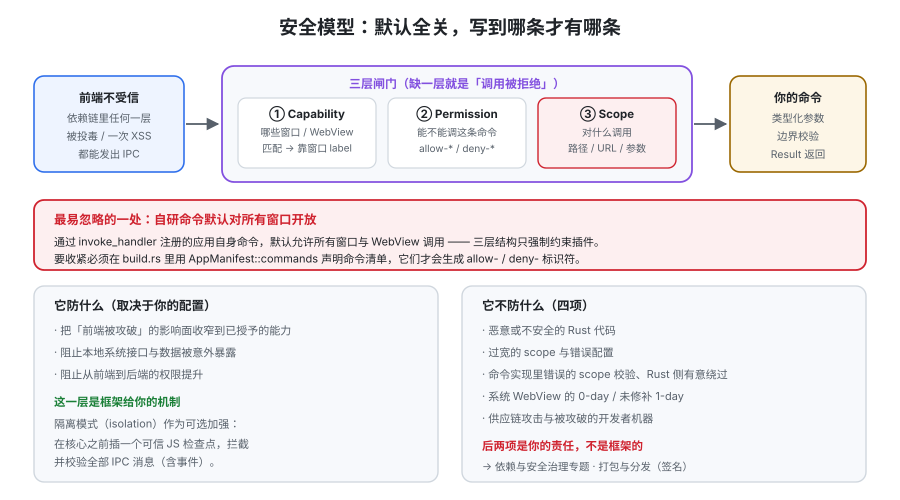

# 安全模型

桌面应用的安全模型与 Web 有一个根本差别：**Web 的安全边界在服务端，桌面的安全边界在「前端能调用哪些系统能力」这一层。** Tauri 2 的设计是**默认全关**——没有任何 capability 匹配的窗口，前端**连一条命令都调不到**。这一页讲清三层结构（capability / permission / scope）的规则、CSP 与隔离模式的位置，以及**这个模型明确不防什么**。



## 一、默认拒绝：先亲手确认一次

::: tip 一句话理解
Tauri 2 里**没有「默认权限」这个东西**。你在 `invoke_handler` 里注册了命令，只代表「这条命令存在」；**能不能被调用，完全由 capability 文件决定**。

这与 Tauri 1.x 的 `allowlist` 是**方向相反**的：1.x 是「在配置里勾掉不要的」，2.x 是「写一条才有一条」。
:::

三层结构的分工：

| 层 | 回答的问题 | 写在哪 | 例子 |
| --- | --- | --- | --- |
| **Capability** | **哪些窗口/WebView** 能拿到哪些权限 | `src-tauri/capabilities/*.json`（或内联在 `tauri.conf.json`） | `"windows": ["main"]` |
| **Permission** | 这个窗口**能不能调用**某个命令 | capability 的 `permissions` 数组 | `"fs:allow-read-text-file"`、`"core:window:allow-set-title"` |
| **Scope** | 调用时**允许碰哪些资源** | permission 的 `allow` / `deny` 子句 | `{ "path": "$APPDATA/**" }`、`{ "url": "https://api.example.com/*" }` |

三层缺一层，效果都是「调用被拒绝」——**这正是前面[IPC](../IPC/index.md)排查路径要保持 ② → ③ → ④ 顺序的原因**。

```json [src-tauri/capabilities/default.json（三层齐备的最小示例）]
{
  "$schema": "../gen/schemas/desktop-schema.json",
  "identifier": "main-capability",
  "description": "主窗口：核心默认能力 + 只读工作区文件 + 由用户选择的写入",
  "windows": ["main"],
  "permissions": [
    "core:default",
    "core:window:allow-set-title",
    "dialog:allow-open",
    "dialog:allow-save",
    {
      "identifier": "fs:allow-read-text-file",
      "allow": [{ "path": "$APPDATA/**" }],
      "deny": [{ "path": "$APPDATA/private/**" }]
    }
  ]
}
```

## 二、权限标识符的命名规则

| 形态 | 含义 | 例子 |
| --- | --- | --- |
| `<plugin>:default` | 该插件/核心的**默认权限集** | `core:default`、`fs:default`、`dialog:default` |
| `<plugin>:allow-<command>` | 允许某条具体命令 | `fs:allow-read-text-file`、`core:window:allow-set-title` |
| `<plugin>:deny-<command>` | 显式拒绝（优先级高于 allow） | `fs:deny-remove-file` |
| 无语缀的 identifier | **你自己注册的命令**（不带插件前缀） | `allow-save-note` |

::: danger 「自研命令默认对所有窗口开放」——这一条最容易被忽略
官方明确写了：**通过 `tauri::Builder::invoke_handler` 注册的应用自身命令，默认允许所有窗口与 WebView 调用。**

也就是说：三层结构只强制约束了**插件**，你自己写的命令会**绕过 capability 默认放行**。要收紧它，必须在 `build.rs` 里用 `AppManifest::commands` 声明命令清单：

```rust [src-tauri/build.rs]
fn main() {
    tauri_build::try_build(
        tauri_build::Attributes::new()
            .app_manifest(tauri_build::AppManifest::new().commands(&["save_note", "list_notes"])),
    )
    .unwrap();
}
```

声明之后，这些命令才会生成 `allow-` / `deny-` 标识符，从而能被 capability 与 scope 约束。

**如果你不做这一步，那么「前端被攻破」的后果就等于「所有自研命令都可被任意窗口调用」**——包括那些你没打算给所有窗口的能力。这是 Tauri 安全实践里**排名第一的遗漏项**。
:::

## 三、Scope：把「能不能」细化为「对什么」

Scope 是这套模型里**最有价值**的一层，也是最容易写宽的一层。

**路径 scope**（`fs`、`dialog` 等）：

| 写法 | 匹配 |
| --- | --- |
| `$APPDATA/*` | 该目录下**一层** |
| `$APPDATA/**` | 该目录下**递归** |
| `$HOME/Documents/report.txt` | 精确文件 |
| `$APPDATA/private/**`（写在 `deny`） | 显式排除 |

**URL scope**（`http`、`opener`、`remote` 等）：按 URLPattern 标准匹配。

```json [URL scope：只允许自己域名下的接口]
{
  "identifier": "http:default",
  "allow": [{ "url": "https://api.example.com/*" }]
}
```

::: danger 四个把 scope 写宽的模式（每一个都等于开了一扇门）
1. **`$HOME/**`。** 等于把用户整个家目录（含 SSH 私钥、源码、浏览器数据）交给前端。
2. **`args: true`。** 在 `shell:execute` 的 scope 里写 `"args": true` 表示「参数任意」——**等价于允许执行任意命令**，因为 `sh -c '...'` 也是参数。正确写法是**枚举允许的参数组合**。
3. **`"url": "*"` 或 `https://*`。** 意味着前端可以把你应用内部的凭据发到任意主机。
4. **`windows: ["*"]`。** 用一个宽 capability 覆盖所有窗口，等同于放弃「按窗口分组授权」这个**唯一**的隔离维度。
:::

**scope 的两个反直觉特性：**

1. **`deny` 优先于 `allow`。** 官方文档写明 deny 应被校验逻辑优先处理。所以「先给宽 allow，再用 deny 排除几个」在语义上是成立的——**但这是一种危险的写法**，因为它把安全性建立在「我漏写了哪些 deny」上。**优先用窄 allow。**
2. **多 capability 合并是并集。** 一个窗口匹配到多个 capability 时，**权限与安全边界会被合并**。官方特别提示：**给「低权限窗口」单独开一个严格 capability 并不能降低它的权限**，只要它还匹配到那个宽 capability。

## 四、「用户选择的路径」怎么合法地扩大范围

这是实际项目里最需要的机制，也是最常被用错的地方。

**错误做法**：因为用户可能选任意位置的文件，所以把 `fs` scope 写成 `$HOME/**`。

**正确做法**：把授权上移到**用户的选择动作**上——

1. `dialog` 让用户亲手选文件/目录（获得一个被用户授权的路径）；
2. 该路径**由用户在运行时授权**给 `fs`（Tauri 支持运行时扩展 scope）；
3. 用 `persisted-scope` 插件把用户的选择**持久化**，下次启动仍然有效。

这样「能访问什么」由**用户的选择**决定，而不是由你在配置里预先放开。**这条机制是「桌面应用可以访问任意文件，但不等于它拥有全盘权限」的技术基础。**

## 五、CSP 与资产协议

WebView 里的页面同样受 CSP 约束，配置项是 `app.security.csp`。

| 要点 | 说明 |
| --- | --- |
| **CSP 默认应该非空** | 不给 CSP 等于放弃「页面只能加载我允许的资源」这一层 |
| **构建期自动注入哈希/nonce** | Tauri 会为内置资源生成 nonce/hash，所以你**不必手工维护脚本哈希** |
| **`connect-src` 要精确到源** | 写 `https:` 或 `*` 会让前端能把数据发到任意地方 |
| **不要出现 `unsafe-eval`** | 它会让「注入字符串然后执行」重新变得可行 |
| **`dangerousDisableAssetCspModification` 不要动** | 名字里的 `dangerous` 是字面意思：它关掉的是「自动为资源注入哈希」的能力 |

::: info 一个很容易搞错的点
**「资源协议」和「CSP」是两回事，缺一不可。** `convertFileSrc` 生成的是协议 URL——**它只解决「用什么地址访问」，不解决「允不允许访问」**。能不能真正加载取决于两个独立条件：CSP 是否允许该协议 + 是否有对应权限。排查「图片加载不出来」时，这两个要分别确认。
:::

## 六、隔离模式（isolation pattern）在防线里的位置

| 防线 | 拦什么 | 拦不住什么 |
| --- | --- | --- |
| Capability / Permission / Scope | 前端**能不能**调用、**对什么**调用 | 你自己命令内部的逻辑错误、过宽的 scope |
| CSP | 页面能加载哪些资源、能连哪些源 | 已加载的合法脚本内部的恶意行为 |
| **隔离模式** | **所有** IPC 消息（含事件）在到达核心前的**内容校验** | Rust 侧的问题；隔离应用自身被污染 |
| 命令内部校验 | 业务语义级的非法输入（如 ID 格式、数值范围） | 不在这里校验的一切 |

**隔离模式解决的是「前端依赖不可信」这一具体威胁**：前端构建链里嵌套几十层依赖，任何一层被投毒都能发 IPC。隔离模式在消息到核心之前插一个**由可信 JS 编写的检查点**，让你可以校验参数、甚至可以拦掉不认识的命令。

三条使用纪律（与[架构与进程模型](../Architecture/index.md)同一口径，此处只强调与安全相关的部分）：

1. **隔离应用零依赖、逐行可读。** 它是检查点，攻破它等于绕过整个模式。
2. **从 isolation 退回 brownfield 必须走评审。** 它是**安全等级的下降**，不是「配置调整」——隔离模式被关掉之后，前端所有 IPC 消息不再经过任何可信检查点。
3. **隔离应用里的代码不能依赖打包器。** Windows 上沙箱 iframe 不加载 ES Module，脚本必须内联。

## 七、威胁模型：这个模型防什么、不防什么

官方文档把边界写得很清楚，**照抄过来比任何转述都可靠**：

| 它能保护（取决于权限与 capability 的配置） | 它不保护 |
| --- | --- |
| 把**前端被攻破**的影响面降到「已授予的能力」 | **恶意或不安全的 Rust 代码** |
| 阻止/减少本地系统接口与数据被（意外）暴露 | **过宽的 scope 与错误配置** |
| 阻止/减少从前端到后端的权限提升 | **命令实现里错误的 scope 校验** |
| —— | **Rust 侧的有意绕过**（写在核心里的代码想做就能做） |
| —— | 系统 WebView 的 **0-day / 未修补的 1-day** |
| —— | **供应链攻击**与被攻破的开发者机器 |

::: tip 这张表最该记住的一句话
**「Tauri 的安全模型保护的是前端那一侧；Rust 侧怎么写，它就怎么执行。」**

所以真正的安全工作有三块，**只有第一块是框架给你的**：
1. 用 capability / permission / scope 收窄前端能力（框架提供机制）；
2. 把每条命令写成「类型化参数 + 边界校验 + 明确 `Result`」（你的责任）；
3. 供应链与构建机安全（你的责任，见[依赖与安全治理](../../../Tools/DependencyGovernance/index.md)）。
:::

## 八、`capabilities/` 的三条工程纪律

1. **一个文件一个用途，`tauri.conf.json` 里按 identifier 引用。** 全部内联在 `tauri.conf.json` 会让「权限变更」在 diff 里淹没于配置噪音中。
2. **权限变更必须走评审。** 把 `capabilities/` 目录视同「安全策略文件」——它的一次改动等价于一次权限变更，**不应该是顺手提交**。
3. **平台差异用 `platforms` 字段表达，而不是复制整份文件。** `"platforms": ["linux", "macOS", "windows"]` 让桌面端专属权限（如 `global-shortcut`）不污染移动端配置。

```json [平台限定：移动端专属能力]
{
  "identifier": "mobile-capability",
  "windows": ["main"],
  "platforms": ["iOS", "android"],
  "permissions": ["nfc:allow-scan", "biometric:allow-authenticate"]
}
```

::: danger `remote` 字段在 Linux 与 Android 上的已知局限
官方明确提示：**在 Linux 和 Android 上，Tauri 无法区分请求来自内嵌的 iframe 还是窗口本身。**

因此**不要在这两个平台上启用 `remote`（允许远程 URL 访问 IPC）**，除非你完整读过该特性的平台特定安全说明。**在另外两个平台「验证通过」不能推出在这两个平台安全。**
:::

## 验证方式

1. **本机可判：默认全关是真的。** 注册一条命令，**不给任何 capability**，从前端调用 → 拒绝；补 `core:default` + 该命令权限 → 成功。**把两次的报错原文都记进项目文档。**
2. **本机可判：deny 优先于 allow。** 给 `fs:allow-read-text-file` 一个含某子目录的 `allow`，同时 `deny` 掉该子目录下的一个文件 → 读那个文件应被拒绝。**这一步证明「排除」确实生效**，而不是你以为生效。
3. **本机可判：多 capability 是并集。** 造两个 capability（一个宽、一个窄），让同一窗口同时匹配 → 确认宽的那份权限**照样生效**。这条判据的价值是让你**永远不再依赖「用窄 capability 收窄宽 capability」这个错误直觉**。
4. **本机可判：自研命令是否被 `AppManifest::commands` 收住。** 加声明前，命令对所有窗口可调用；加声明后，未授予权限的窗口调用被拒绝。**（这一条尤其建议实测，因为它是默认行为里最反直觉的一处。）**
5. ⏳ **未跑（需真实环境）：`remote` 在 Linux / Android 上的行为。** 原因：需要一台 Linux 或 Android 设备与一个可控的远程页面。**不作断言，只标状态。**

## 相关专题

- [架构与进程模型](../Architecture/index.md)：capability 为什么靠窗口 label 匹配
- [IPC 与命令](../IPC/index.md)：权限检查发生在你的代码之前（② → ③ → ④）
- [原生能力](../NativeCapabilities/index.md)：每个插件对应的权限标识符
- [打包与分发](../Packaging/index.md)：签名与公证是另一层「操作系统级」的信任
- [自动更新](../Updater/index.md)：更新通道是安全模型覆盖不到的一环，需单独设计
- [前端安全](../../Others/Security/index.md)：Web 侧的 XSS/CSRF 防线（对照读）
- [依赖与安全治理](../../../Tools/DependencyGovernance/index.md)：供应链是这张表里明确「不防」的一块

## 参考资料

- Tauri 官方文档 · Capabilities：https://v2.tauri.app/security/capabilities/
- Tauri 官方文档 · 权限与 Scope：https://v2.tauri.app/security/permissions/
- Tauri 官方文档 · 隔离模式：https://v2.tauri.app/concept/inter-process-communication/isolation/
- Tauri 官方文档 · CSP：https://v2.tauri.app/security/csp/
- Tauri 官方文档 · 安全总览与威胁模型：https://v2.tauri.app/security/
