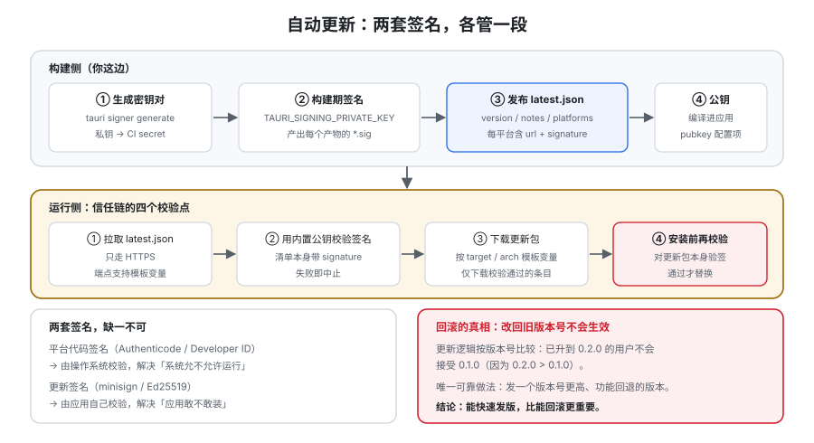

# 自动更新

自动更新是桌面应用**唯一**能把修复送达用户的通道——也是整条链路上**攻击收益最高**的一环：改一次更新清单、劫持一次 DNS，就能让所有客户端在你不知情的情况下装上一个任意程序。这一页讲清 Tauri updater 的信任链怎么建、清单（`latest.json`）长什么样、更新失败与回滚怎么处理，以及灰度该怎么做。



## 一、两套签名，各管一段，缺一不可

这是本节最需要先分清的一件事：

| 签名 | 谁校验 | 解决什么 | 密钥 |
| --- | --- | --- | --- |
| **平台代码签名**（Authenticode / Developer ID） | **操作系统** | 让系统**允许**这个程序运行 | 商业证书 / Apple 开发者证书 |
| **更新签名**（minisign / Ed25519） | **你的应用自己** | 让应用**敢装**这个更新包 | 你自己生成的密钥对 |

::: tip 一句话记住差别
平台签名是「**操作系统信不信这个文件**」；更新签名是「**应用信不信这次更新**」。

**只有平台签名**：如果攻击者能改你的更新源，他拿不到你的证书就装不进去——但很多更新机制会依赖下载源的完整性，仍不保险。
**只有更新签名**：应用敢装，但用户第一次打开就被系统拦下。
**两个都要**，因为它们防的是不同的东西。
:::

## 二、生成密钥对与信任链

```shell
# 生成 minisign 密钥对（私钥务必只存在本机与 CI secret 中）
npm run tauri signer generate -- -w ~/.tauri/da-notes.key
```

生成后会得到**私钥文件**与一段**公钥字符串**。信任链的建立方式：

| 环节 | 内容 |
| --- | --- |
| ① 公钥**编译进应用** | 写进 `tauri.conf.json` 的 `plugins.updater.pubkey`（**是公钥，不是私钥**） |
| ② 构建期产生签名 | 构建时提供 `TAURI_SIGNING_PRIVATE_KEY`（与 `_PASSWORD`），为每个更新产物生成 `*.sig` |
| ③ 发布清单 | 生成 `latest.json`，其中每个平台条目带 `signature` 与 `url` |
| ④ 运行时校验 | 应用下载 `latest.json`，用**内置公钥**校验清单里的签名；通过才下载更新包并安装 |
| ⑤ 安装前再校验 | 安装前对**更新包本身**再校验一次签名 |

::: danger 密钥管理的四条硬红线
1. **私钥绝不进仓库、绝不进 `tauri.conf.json`。** 配置里只放公钥。**任何一次「为了方便把私钥提交上去」都会让整条信任链失效**，而且它在 git 历史里永久存在。
2. **私钥要能轮换，且轮换是有代价的。** 公钥编译进了已发布的应用 → **换了密钥对，老版本就再也无法验证新更新**（除非你保留旧公钥做过渡）。**所以：密钥对一旦开始发布，就按「长期资产」管理，备份要有多份。**
3. **私钥丢失 = 失去更新能力。** 没有私钥就无法为后续版本签名，老用户将永远停在旧版本。**这是最容易发生的灾难性运维事故。**
4. **CI 里的私钥用 secret，且限制在发布分支/tag 上。** 不在 PR 构建里暴露签名密钥。
:::

## 三、`latest.json` 与端点模板

```json [发布产物中的 latest.json（结构示意）]
{
  "version": "0.2.0",
  "notes": "修复了导入大量笔记时的内存占用",
  "pub_date": "2026-10-13T08:00:00Z",
  "platforms": {
    "darwin-aarch64": {
      "signature": "dW50cnVzdGVkIGNvbW1lbnQ6...",
      "url": "https://dl.example.com/da-notes-0.2.0-aarch64.app.tar.gz"
    },
    "darwin-x86_64": { "signature": "...", "url": "..." },
    "windows-x86_64": { "signature": "...", "url": "..." },
    "linux-x86_64": { "signature": "...", "url": "..." }
  }
}
```

**端点（endpoints）** 支持模板变量，由应用运行时的实际环境填充：

| 变量 | 取值 | 例子 |
| --- | --- | --- |
| <span v-pre>`{{target}}`</span> | 平台族 | `darwin` / `windows` / `linux` |
| <span v-pre>`{{arch}}`</span> | 架构 | `x86_64` / `aarch64` / `i686` / `armv7` |
| <span v-pre>`{{current_version}}`</span> | 当前版本 | `0.1.0` |

```json [tauri.conf.json（updater 配置）]
{
  "plugins": {
    "updater": {
      "pubkey": "dW50cnVzdGVkIGNvbW1lbnQ6...",
      "endpoints": [
        "https://releases.example.com/{{target}}/{{arch}}/{{current_version}}"
      ],
      "windows": { "installMode": "passive" }
    }
  }
}
```

::: warning `installMode` 只影响 Windows，且三档语义不同
| 值 | 行为 |
| --- | --- |
| `passive`（默认） | 无交互安装，显示进度 |
| `basicUi` | 显示安装界面 |
| `quiet` | 无任何反馈 |

**`quiet` 的问题不是「不好看」，而是「用户看不到正在发生什么」**——更新过程中应用行为异常时，用户会觉得程序卡死。**除非你的更新在后台静默进行且有无感知的必要，否则保持 `passive`。**
:::

## 四、前端与 Rust 侧的检查更新

```ts [src/ipc/updater.ts（前端主动检查）]
import { check } from "@tauri-apps/plugin-updater";
import { relaunch } from "@tauri-apps/plugin-process";

export async function checkAndInstall(onMsg: (s: string) => void) {
  const update = await check();
  if (!update) return onMsg("已是最新版本");

  await update.downloadAndInstall((event) => {
    switch (event.event) {
      case "Started":
        onMsg(`开始下载（${event.data.contentLength ?? "?"} 字节）`);
        break;
      case "Progress":
        onMsg(`已下载 ${event.data.chunkLength} 字节`);
        break;
      case "Finished":
        onMsg("下载完成，正在安装");
        break;
    }
  });

  await relaunch();   // 安装完成后重启（或提示用户手动重启）
}
```

```rust [src-tauri/src/lib.rs（Rust 侧检查，适合启动时静默检查）]
use tauri_plugin_updater::UpdaterExt;

async fn check_silently(app: tauri::AppHandle) -> tauri_plugin_updater::Result<()> {
    if let Some(update) = app.updater()?.check().await? {
        // 不要静默安装：先让用户知道有更新，再决定何时重启
        println!("update available: {}", update.version);
    }
    Ok(())
}
```

::: danger 更新流程的四个「想当然」
1. **以为 `relaunch()` 是无损的。** 它会重启应用，**未保存的编辑器内容会丢**。正确做法是：下载与安装可以和用户操作并行，但**重启前必须给用户明确的「现在重启 / 稍后」选择**，并在有未保存内容时拦一下。
2. **以为更新失败会「什么都不发生」。** 失败的形态包括：清单拉取失败、签名校验失败、下载中断、安装权限不足、安装后启动失败。**每一种都要有可见反馈**，否则用户只会说「它有时候打不开」。
3. **以为更新一定能成功。** 沙箱化环境、受管企业电脑、被杀软拦截、磁盘空间不足都会让安装静默失败。**必须提供「手动下载安装包」的兜底路径**，并把当前版本号显示在「关于」里——**没有版本号显示，用户连「我在哪个版本」都说不清**。
4. **把更新通道当成「不受安全模型约束的地方」。** 它越过 capability 体系直接在用户机器上替换程序，**是整条链路上权限最高的操作**，必须按最高标准对待（签名校验 + 只走 HTTPS + 清单也签名）。
:::

## 五、灰度与回滚

| 手段 | 做法 | 代价 |
| --- | --- | --- |
| **分批放量** | 端点按 <span v-pre>`{{current_version}}`</span> / 用户分组返回不同 `latest.json`，先给 5% 用户 | 需要自己的服务端逻辑 |
| **按渠道** | 维护 `stable` / `beta` 两条端点，用户可切换 | 需要两条发布流水线 |
| **延迟发布** | 先让「手动检查更新」的用户拿到，观察几天再让自动检查的用户拿到 | 简单，但只覆盖主动用户 |
| **回滚** | **把 `latest.json` 的 `version` 改回旧版本号**，并把 `url`/`signature` 指向旧产物 | 只能回滚到「已发布过的版本」；**低版本号不会被自动升级逻辑接受**——见下方警告 |

::: danger 回滚不是「把旧版本发一遍」这么简单
更新逻辑的比较基础是**版本号**。如果你把 `latest.json` 的 `version` 改回 `0.1.0`，那些已经升到 `0.2.0` 的用户**不会**被「降级」（因为 `0.2.0 > 0.1.0`，应用认为已是最新）。

**唯一可靠的回滚方式是「发一个版本号更高但功能回退的版本」**（例如 `0.2.1` 里撤掉 `0.2.0` 的问题改动）。

**所以：能快速发出版本，比能回滚更重要。** 这就是为什么 CI 的发布流水线必须在第 1 周就跑通，而不是留到第 4 周。
:::

## 六、更新链路的验收判据

| 判据 | 内容 | 可验证性 |
| --- | --- | --- |
| U1 | 清单里有当前平台条目的 `url` 与 `signature` | 本机可判（检查产物） |
| U2 | 应用内**显示当前版本号** | 本机可判（打开「关于」） |
| U3 | 置为「最新版本」时检查更新**不报错、给出明确提示** | 本机可判（把端点指到不存在的新版本） |
| U4 | **签名校验失败时拒绝安装并给出可见错误** | 本机可判：手工篡改 `latest.json` 里的 `signature` 一个字符 → 观察是否拒绝 |
| U5 | 更新前有未保存内容时**能被拦下** | 本机可判（造未保存状态后触发更新） |
| U6 | 更新安装失败时**有兜底路径**（手动下载入口） | 本机可判（检查界面是否存在该入口） |
| U7 | 私钥不在仓库任何位置 | 本机可判（全库检索） |
| U8 | 真实升级路径（旧版 → 新版）在三平台各跑通一次 | ⏳ 需三平台真实安装环境 |

::: tip U4 是这一页最有价值的一条判据
它把「信任链是否真的在生效」变成了一个**可以在一台机器上做完的实验**：篡改清单里的签名 → 应用必须拒绝安装。

如果篡改签名后应用**照装不误**，说明签名校验根本没有生效（最常见的原因是 `pubkey` 是占位符、或构建时没提供私钥因而没生成 `*.sig`）——**而这种情况在「一切正常的发布流程」里不会暴露任何异常**。
:::

## 验证方式

1. **本机可判：密钥对能生成、公钥能进配置。** `npm run tauri signer generate -- -w ~/.tauri/da-notes.key`；把输出的**公钥**填进 `plugins.updater.pubkey`，确认 `tauri.conf.json` 里**没有任何私钥内容**。
2. **本机可判：产物里存在签名。** 开启 `bundle.createUpdaterArtifacts: true` 构建后，确认 `bundle/` 下存在 `latest.json` 与 `*.sig`。
3. **本机可判：签名篡改会被拒绝（U4）。** 手工改一个字符后触发检查更新，确认应用拒绝安装并报错。
4. **本机可判：私钥未泄漏（U7）。** 在仓库内检索私钥文件名的关键片段与 `TAURI_SIGNING_PRIVATE_KEY` 的**值**（不是变量名），确认 0 命中。
5. ⏳ **未跑（需三平台与真实更新源，U8）。** 原因：需要已安装的旧版本、可访问的更新端点与三平台环境。**如实标注，不写「已验证」。**

## 相关专题

- [打包与分发](../Packaging/index.md)：`createUpdaterArtifacts` 与产物关系、CI 密钥清单
- [安全模型](../Security/index.md)：capability 体系管不到更新链路，它需要单独设计
- [概述：桌面应用的六条真实约束](../Overview/index.md)：演进边界为什么排在第一
- [实战：一个可安装的本地笔记应用](../Practice/index.md)：从构建到签名的完整串接
- [Electron 专题 · 自动更新](../../Frame/Electron/AutoUpdate/index.md)：另一条路线的更新实现（对照读）
- [完整项目交付 · 一键部署与上线验收](../../../Others/ProjectDelivery/Delivery/index.md)：把「更新可用」写进上线验收清单

## 参考资料

- Tauri 官方文档 · Updater 插件：https://v2.tauri.app/plugin/updater/
- Tauri 官方文档 · 签名密钥生成与产物：https://v2.tauri.app/distribute/sign/
- Tauri 官方文档 · GitHub Actions 发布流水线：https://v2.tauri.app/distribute/pipelines/github/
- minisign（签名算法与格式）：https://jedisct1.github.io/minisign/
