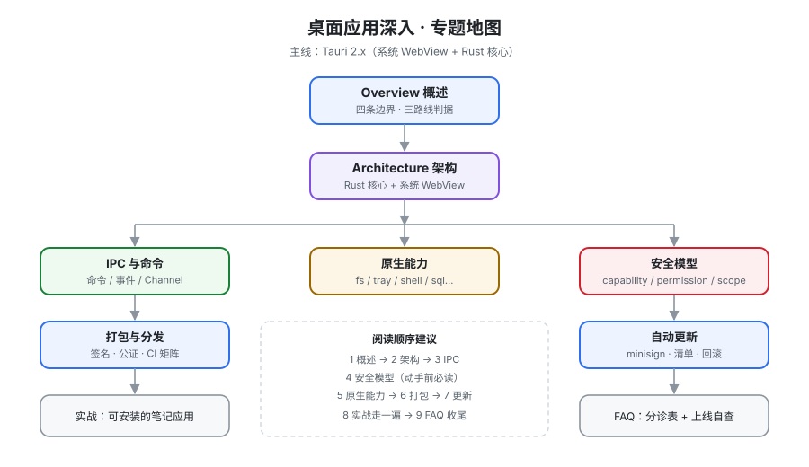

# 桌面应用深入

桌面应用深入讲的是这样一件事：**你写的这段前端代码，从今天起不再跑在用户的浏览器里，而是被装进一个 `.dmg` / `.msi` / `.AppImage`，活在别人的电脑上——你既看不到它、也改不了它，而它要活好几年。** 这和「把网页套个壳」是两件完全不同的事：壳里面每一个能被前端调用的系统能力都要显式授权，每一个安装包都要签名才能不被操作系统拦下，每一次升级都要在用户机器上完成一次可信替换。本专题以 **Tauri 2.x** 为主线（系统 WebView + Rust 核心），讲清架构与进程模型、IPC 与命令、原生能力、安全模型、打包分发与自动更新，并用一个完整的桌面应用实战收尾。

::: tip 一句话理解
Electron 把**一个浏览器**装进用户的电脑，Tauri 把**用户的浏览器**借来用一次——前者买断了渲染引擎（可以自己决定什么时候升级），后者只租了使用权（升级节奏由操作系统说了算）。**体积、内存、更新这三件事的差异，全部来自这一个取舍。**
:::

## 与相邻专题的分工

| 专题 | 讲什么 | 与本专题的关系 |
| --- | --- | --- |
| 本专题 | 以 **Tauri 2.x** 为主线的桌面应用深入：架构与进程模型、IPC、原生能力、安全模型、打包分发、自动更新、完整实战 | —— |
| [Electron 专题](../Frame/Electron/index.md) | **Electron 的实现细节**：主进程/渲染进程、IPC、窗口、菜单、托盘、打包、自动更新、安全实践（19 页） | 两者解决同一问题但内核不同。**Electron 是「自带引擎」，Tauri 是「借用系统引擎」**——[打包](./Packaging/index.md)与[更新](./Updater/index.md)两页会逐条对照差异；安全模型部分两边的**判据完全不同**（Electron 靠关掉危险开关，Tauri 靠默认全关再逐条开） |
| [跨端开发 · 桌面端跨端](../Frame/CrossPlatform/Desktop/index.md) | **选型与跨端视角**：该不该做桌面端、Electron / Tauri / PWA 三路线怎么选、如何与 Web 共用代码 | 那边给出**一句话选择**就收；本专题是选定之后把每一条都做到可交付 |
| [PWA 与离线应用](../PWA/index.md) | 浏览器内的**离线能力**：Service Worker、缓存策略、安装体验 | PWA 的「安装」是把图标加到桌面，**权限、数据、更新全部仍由浏览器代管**；桌面应用自己的进程直接拿系统权限，也自己承担升级责任 |
| [前端安全](../Others/Security/index.md) | Web 侧安全：XSS、CSRF、CSP、依赖安全 | 那边假设**渲染环境是可被攻破的**，防线在服务端；本专题的[安全模型](./Security/index.md)假设**前端一定会被攻破**，防线在「前端能调用哪些系统能力」这一层 |
| [服务端渲染深入](../SSR/index.md) | 渲染位置与渲染模式 | 桌面应用**不做 SSR**：它没有服务端。但 SSR 里的「同构」思路在桌面端有对应物——**同一份前端代码要在开发期的 dev server 与打包后的 `tauri://` 协议下都跑得起来** |
| [测试](../Testing/index.md) | 单元、组件、E2E、覆盖率 | 桌面应用的 E2E 多了一层：**WebDriver 要驱动的是 WebView 而不是浏览器**，见[实战](./Practice/index.md)的验收判据 |
| [WebAssembly](../WebAssembly/index.md) | WASM 的编译与集成 | 两者都要「把非 JS 代码搬到前端附近」，但位置不同：WASM 跑在**页面里**（受浏览器沙箱限制），本专题的 Rust 核心跑在**页面外的独立进程**（能碰系统） |
| [运维 · 监控告警](../../Ops/Monitoring/index.md) | 服务端可观测性三支柱 | 桌面端出事时你**拿不到现场**：进程在用户机器上、崩溃即消失。所以[实战](./Practice/index.md)把本地日志与崩溃上报列为必备能力，而不是可选项 |
| [后端 · 依赖与安全治理](../../Tools/DependencyGovernance/index.md) | SBOM、漏洞扫描、供应链 | 桌面应用的供应链风险被放大：**更新通道本身就是攻击面**，见[自动更新](./Updater/index.md)的信任链设计 |

::: info 版本组织说明
本专题**不建大版本目录**，但**在页内显式标注适用版本**。原因：Tauri 1.x → 2.x 是一次**破坏性换代**（`allowlist` 被整套 `permissions / scopes / capabilities` 取代、插件系统重写、新增移动端），但它发生在 2024-10，早已不是「并行维护的两条线」——1.x 已进入仅安全修复状态，不存在「两条线都要查」的场景。

处理方式：正文一律面向 **Tauri 2.x**；凡与 1.x 有实质差异的地方，用 `::: info` 标注「1.x 是这样、2.x 是这样」，**旧写法保留说明、不删除**。迁移动作本身写在本页的「版本与迁移」小节。

需要看「按大版本建目录」的范例，可参考 [Spring5 / Spring6](../../Backend/Java/Frame/Spring/Spring6/index.md)、[Vue2 / Vue3](../Frame/Vue/index.md)，以及 Spring Boot 的 [v2](../../Backend/Java/Frame/SpringBoot/v2/index.md) / [v3](../../Backend/Java/Frame/SpringBoot/v3/index.md) / [v4](../../Backend/Java/Frame/SpringBoot/v4/index.md)。
:::

## 专题地图

| 页面 | 内容 | 适合谁读 |
| --- | --- | --- |
| [概述：桌面应用的六条真实约束](./Overview/index.md) | 为什么「套壳」会在三个月后崩盘、四条边界、三路线判据、最小起步 | 所有人，先读 |
| [架构与进程模型](./Architecture/index.md) | Rust 核心 + 每窗口一个 WebView、wry/tao、与 Electron 的逐项对照、两种 IPC 模式 | 做技术决策与排障的人，**重点读** |
| [IPC 与命令](./IPC/index.md) | 命令 / 事件 / Channel 三种原语、参数命名与类型、错误传播、大 payload 边界 | 写业务代码的人 |
| [原生能力](./NativeCapabilities/index.md) | 文件、对话框、托盘菜单、通知、剪贴板、全局快捷键、sidecar、单实例、窗口状态 | 需要碰系统的人 |
| [安全模型](./Security/index.md) | 默认拒绝、capabilities / permissions / scopes 三层、CSP 与隔离模式、不防什么 | 所有人，**重点读** |
| [打包与分发](./Packaging/index.md) | 各平台产物、WebView2 五种安装模式、签名与公证三条线、CI 矩阵 | 要发第一个安装包的人 |
| [自动更新](./Updater/index.md) | minisign 信任链、`latest.json` 清单、失败与回滚、灰度策略 | 要长期运营的人 |
| [实战：一个可安装的本地笔记应用](./Practice/index.md) | 从 0 到 `.dmg` / `.msi` / `.AppImage` 的完整流程 + V1~V15 验收判据 | 想看完整落地的人 |
| [常见问题](./FAQ/index.md) | 分诊表、十二问、上线自查清单、术语表 | 所有人 |

## 事实与规格速览（2026-10 口径）

按各官方发布页、`crates.io`、`releases.electronjs.org` 与平台文档核对（检索日 2026-10-13）。**这张表给你一个「当前时间点」的锚，不是选型结论。**

| 对象 | 当前状态 | 需要记住的一句话 |
| --- | --- | --- |
| Tauri | **2.12.0**（2026-09-26），2.12 是 2.x 至今最大的一次更新 | 2.0 稳定版发布于 **2024-10-02**；2.12 起**正式放弃 Windows 7**，并把 MSRV 抬到 **1.90** |
| Tauri MSRV 策略 | **`stable − 3`**，只在 minor/major 版本升级 | 官方明确写了这条策略（[issue #15579](https://github.com/tauri-apps/tauri/issues/15579)）。**这意味着「项目能编过」这件事每三个月会自然失效一次**——CI 里必须 pin 工具链 |
| Tauri 系统 WebView | Windows **WebView2**（随 Win10 1803+ / Win11 系统分发）、macOS/iOS **WKWebView**、Linux **WebKitGTK 4.1** | Linux 侧是**最短的那块板**：`webkit2gtk-4.1` 只在 Ubuntu 22.04+ / Debian 12+ 才进标准仓库，**基线系统因此被钉死** |
| Electron | **44.5.1**（2026-09-29，Chromium 152.0.7977.130 / Node 24.21.0）；44.0 发布于 2026-08-25 | 支持策略是**最近三个大版本**（42 / 43 / 44）。它自带 Chromium，所以**升级节奏由你决定**——这正是它与 Tauri 最本质的差别 |
| Tauri 官方插件 | 30+ 个，版本号跟随 Tauri 主版本（`2.x`） | 插件表里的 Rust MSRV 列仍写着 `1.77.2`（历史值），**以 Tauri 2.12 的 1.90 为准**；不要拿插件表推算工具链下限 |
| 代码签名（macOS） | Apple Developer Program **$99/年** + Developer ID Application 证书 + `notarytool` 提交与 stapling | **未公证的下载在 macOS 上会显示「已损坏，无法打开」**——不是警告，是直接打不开 |
| 代码签名（Windows） | 普通 `.pfx` 自 **2023 年硬件令牌要求**起不再可签发 | 只剩两条路：云 HSM 证书（DigiCert / Sectigo，约 **$300–600/年**）或 **Azure Trusted Signing**（约 **$10/月**，需审核资格）。**这条采购提前期必须以周计** |
| 自动更新签名 | Tauri 自带的 **minisign（Ed25519）** 签名，与平台代码签名是**两套独立机制** | 平台签名让操作系统放行、更新签名让**应用自己**敢装。少任何一层都不算完整 |
| 已知供应链告警 | Tauri 2.12 发布说明中列出的**不再维护** crate：`fxhash`、`paste`、`rustls-pemfile`、`rustybuzz`、`ttf-parser` | 依赖告警不是 Tauri 独有的问题，但**桌面应用的依赖会随安装包一起发到用户机器上并长期驻留**，处置优先级高于服务端 |

::: danger 四个最容易踩的事实性错误
1. **把「构建成功」当成「能装」。** macOS 未公证 = 用户看到「已损坏」；Windows 未签名 = SmartScreen 红屏。这两件事**都不影响构建，也不在本地出现**（本地从源码跑没有 quarantine 属性），只有从网上下载才会暴露。
2. **以为 Linux 只是「多编译一个包」。** Linux 上有三件事同时漂移：WebKitGTK 版本、glibc 基线、发行版桌面环境。**在较新的系统上构建出的二进制，会在较老的系统上报 `GLIBC_2.xx not found`**——正确做法是在**你打算支持的最老系统**上构建（官方建议 Ubuntu 22.04 / Debian 12 或直接用容器/CI）。
3. **以为 `identifier` 可以改。** `bundle.identifier`（反向域名）同时是**签名标识、应用数据目录名、存储路径前缀**。发布之后改它，等于让老用户的应用**找不到自己的数据**，并且被操作系统当成另一个应用。
4. **把前端当成可信的。** Tauri 的安全模型默认**拒绝一切**，而能力授予写在 `capabilities/` 里。如果为了「先跑通」把 `shell:allow-execute` 或宽 `fs` scope 打开，**你实际是在用户机器上开了一个能执行任意命令的通道**，且前端一次 XSS 就等价于一次本地代码执行。
:::

## 版本与迁移（1.x → 2.x）

| 维度 | Tauri 1.x | Tauri 2.x |
| --- | --- | --- |
| 权限模型 | `allowlist`（在 `tauri.conf.json` 里勾选核心 API） | **`capabilities/` + `permissions` + `scopes`**，插件与自研命令统一走同一套 |
| 插件 | 部分能力内建于核心 | **30+ 官方插件**独立发布，跟随 Tauri 主版本号 |
| 移动端 | 不支持 | **支持 iOS / Android**，`#[cfg_attr(mobile, tauri::mobile_entry_point)]`，应用逻辑从 `main.rs` 移到 `lib.rs` |
| 配置项 | 顶层 `tauri` 段 | 拆成 `build` / `app` / `bundle` / `plugins` 四段 |
| 迁移方式 | —— | `npm run tauri migrate`（自动改写配置），权限部分必须人工复核 |

迁移的命令与配置对照写在[打包与分发](./Packaging/index.md)；**本页只做一次总览，避免同一份配置示例在两个页面里分叉**。

## 成熟度自评：你在哪一档

| 档位 | 特征 | 下一步 |
| --- | --- | --- |
| L0 能弹窗 | `tauri dev` 能起、改代码能热更新；关掉终端就没了 | 先跑通一条 `build`，拿到一个能被别人双击的文件 |
| L1 能分发 | 有安装包，但未签名；用户需要自己绕过系统提示 | 走通[签名与公证](./Packaging/index.md)——这是**采购周期最长**的一步，越早开始越好 |
| L2 能更新 | 用户安装了，但升级要重新下载安装包 | 接上[自动更新](./Updater/index.md)，把「用户装的是哪个版本」变成你能知道的事实 |
| L3 能控权 | 前端能碰什么全部写在 `capabilities/` 里，**默认全关** | 逐条审计 scope，并把[隔离模式](./Security/index.md)打开 |
| L4 能运营 | 崩溃有上报、日志有落盘、更新有灰度、回滚有预案 | 保持，并把每次事故变成一条新的自动化判据 |

五档之间的差别不是「用了哪个框架」，而是**「当用户说『它坏了』的时候，你有没有办法在 30 秒内判断是环境问题、你的问题、还是更新带来的问题」**。

## 学习路径

1. **先读[概述](./Overview/index.md)**：确认你要做的是「桌面应用」而不是「装个壳的网页」，这一步决定后面所有取舍。
2. **精读[架构与进程模型](./Architecture/index.md)**：弄清 Rust 核心与 WebView 是两个世界，后面所有现象都能从这里解释。
3. **用 [IPC](./IPC/index.md) 把第一个真实功能做完**：不要停在 `greet` 示例上。
4. **在写第二个功能之前读[安全模型](./Security/index.md)**：权限一旦放开再收，比一开始就不放难得多。
5. **按[原生能力](./NativeCapabilities/index.md)逐项补**，每加一项都回到安全模型确认 scope。
6. **用[打包与分发](./Packaging/index.md) + [自动更新](./Updater/index.md)闭环**，然后对着[实战](./Practice/index.md)的判据走一遍。
7. **最后通读[常见问题](./FAQ/index.md)**，把自查清单当成上线前的最后一道闸。

## 参考资料

- Tauri 官方文档（v2）：https://v2.tauri.app/
- Tauri 发布说明（含 2.12.0 变更与 MSRV 策略）：https://v2.tauri.app/release/tauri/
- Tauri 能力（Capabilities）与权限模型：https://v2.tauri.app/security/capabilities/
- Tauri 进程间通信（brownfield / isolation）：https://v2.tauri.app/concept/inter-process-communication/
- Tauri Windows 安装器与 WebView2 安装模式：https://v2.tauri.app/distribute/windows-installer/
- Tauri Debian 打包与 glibc 基线限制：https://v2.tauri.app/distribute/debian/
- Electron 发布记录：https://releases.electronjs.org/
- Microsoft WebView2 分发文档：https://learn.microsoft.com/microsoft-edge/webview2/concepts/distribution
