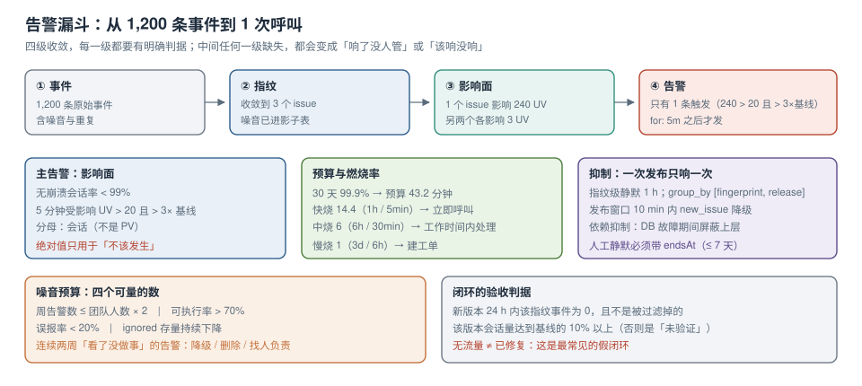

# 告警、预算与闭环

看板是给人「查」的，告警是给人「被打断」的。两者的设计目标完全不同：看板可以有一百个图，告警一周只能响几次——**响多了就没人看，响少了一次就是事故**。

本页讲四件事：**用什么数当告警的输入、阈值该长什么样、怎么让一次发布只响一次、以及响了之后怎么闭环**。



本页判据族 `ETA-A` ~ `ETA-H`，共 8 条。

## 一、告警的输入不该是「错误数」

「5 分钟内错误数 > 100」是最常见的规则，也是最容易失效的规则：大促流量翻十倍，错误数翻十倍是正常的；凌晨流量极低，100 条可能是灾难。

三个更好的输入：

| 输入 | 定义 | 适合回答 | 坑 |
| --- | --- | --- | --- |
| **无崩溃会话率**（crash-free sessions） | 1 − 有 ≥1 条 `error` 的会话数 ÷ 总会话数 | 「多少用户被影响」 | 会话切分规则要先定死（30 min 超时） |
| **影响用户数**（UV affected） | 5 分钟内受影响去重用户数 | 「要不要叫醒人」 | 需要 `user_id` 或稳定的匿名 id |
| **错误预算燃烧率** | 实际错误率 ÷ SLO 允许的错误率 | 「要不要现在动手」 | 需要先有 SLO |

三者的关系：**无崩溃会话率是体检指标（按天看趋势），影响用户数是叫醒指标（按分钟看），燃烧率是决策指标（要不要回滚）**。

```sql [sql/alert-affected-users.sql]
-- 5 分钟窗口内，受「新增或突增」指纹影响的去重用户数
with win as (
  select fingerprint, count(distinct coalesce(user_id, anon_id)) as uv, count(*) as n
  from events
  where ts >= now() - interval '5 minutes'
  group by 1
), base as (
  select fingerprint, count(distinct coalesce(user_id, anon_id)) / 288.0 as uv_per_5m  -- 前 24h 均值
  from events
  where ts >= now() - interval '24 hours' and ts < now() - interval '5 minutes'
  group by 1
)
select w.fingerprint, w.uv, w.n, coalesce(b.uv_per_5m, 0) as base_uv
from win w left join base b using (fingerprint)
where w.uv >= 20 and w.uv > 3 * coalesce(b.uv_per_5m, 0)
order by w.uv desc;
```

::: danger 「错误数突增」规则的两个经典误报
1. **发版瞬间**：新版本首次加载，chunk 名字变了，所有 `Script error.` 的 message 相同但指纹变了 → 「新增 200 个 issue」。
2. **第三方脚本挂掉**：客服/统计脚本的域名 404，一次影响全站。它确实是故障，但**不是你的故障**，应该在采集端就按域名隔离，不进业务告警。
:::

## 二、阈值形态：四种写法与各自的下场

| 形态 | 例子 | 适用 | 失效场景 |
| --- | --- | --- | --- |
| 绝对值 | 错误数 > 100 / 5min | 流量稳定的内部系统 | 有促销、有投放的站点 |
| 比率 | 无崩溃会话率 < 99% | 面向用户的站点 | 会话量极低时抖动大 |
| 同比突增 | 相比上周同时段 +200% | 有周期性流量的业务 | 节假日、活动 |
| 基线偏离（z-score） | 偏离 7 天均值 4σ | 长尾指标（如某接口 5xx） | 基线本身在漂移时反复触发 |

工程建议：**主告警用比率（影响面），辅告警用同比突增（发现新问题）**。绝对值只用于「绝对不该发生」的事，例如「支付回调验签失败 > 0」。

## 三、错误预算与燃烧率：把「要不要回滚」变成算式

先有 SLO，才有预算。以「30 天内 99.9% 的会话无崩溃」为例：

```text
错误预算 = 30 天 × 0.1% = 43.2 分钟（等价的「全部会话都崩」时长）
燃烧率   = 当前错误率 ÷ 允许错误率（0.1%）
```

多窗口告警（SRE Workbook 的做法）把「快烧」与「慢烧」分开：

| 规则 | 长窗 | 短窗 | 燃烧率阈值 | 含义 | 动作 |
| --- | --- | --- | --- | --- | --- |
| 快烧 | 1 h | 5 min | **14.4** | 1 小时烧掉 2% 预算（≈52 秒），预算只够撑 2.08 天 | 立即呼叫，考虑回滚 |
| 中烧 | 6 h | 30 min | **6** | 6 小时烧掉 5% 预算 | 工作时间内处理 |
| 慢烧 | 3 天 | 6 h | **1** | 按当前速度刚好用完预算 | 创建工单，不叫人 |

短窗的作用是**确认长窗的结论仍然成立**：长窗 1 h 燃烧率 20、但最近 5 分钟已经归零，说明故障已经恢复，不该叫人起床。

::: warning 预算不是「可以随便用掉的额度」
错误预算的正确用法是**约束发布节奏**：预算剩余多 → 可以多发；预算快耗尽 → 冻结非必要发布。把它当成「允许出错的配额」会导致团队在月末冲指标，反而更不稳。
:::

## 四、抑制与静默：一次发布只该响一次

告警噪音的 80% 来自「同一个原因被重复触发」。四种抑制手段，按优先级：

| 手段 | 做法 | 效果 |
| --- | --- | --- |
| 指纹级聚合 | 同一 `fingerprint` 在静默窗口（如 1 h）内只发一条 | 把 500 条事件压成 1 条告警 |
| 发布窗口抑制 | 发布后 10 分钟内，`new issue` 类告警降级为「观察」 | 消除发版误报 |
| 依赖抑制 | 数据库故障期间，抑制依赖它的上层告警 | 避免「一个根因 50 条告警」 |
| 人工静默 | 带原因与到期时间的 `silence` | 处理已知问题时屏蔽 |

```yaml [alertmanager/rules.yaml]
route:
  group_by: ["fingerprint", "release"]
  group_wait: 30s          # 首次等待，攒一攒再发
  group_interval: 5m
  repeat_interval: 4h      # 同一条告警的重发间隔
  routes:
    - matchers: ['severity="P0"']
      receiver: oncall-pager
      repeat_interval: 30m
    - matchers: ['kind="new_issue"']
      receiver: slack-web
      mute_time_intervals: ["deploy-window"]   # 发布窗口静默
```

::: danger 静默必须带到期时间
没有到期时间的静默会永久生效，且三个月后没人记得它的存在。规则：`silence` 必须有 `endsAt`，最长 7 天，到期自动失效并留一条审计记录。
:::

## 五、分级与响应：三级就够

| 级别 | 判据 | 通知方式 | 响应时限 |
| --- | --- | --- | --- |
| P0 | 核心链路不可用，或影响用户数 > 1% | 电话 / 值班呼叫 | 15 分钟内有人接手 |
| P1 | 非核心链路故障，或影响 0.1%~1% | 群消息 @值班 | 1 小时内 |
| P2 | 单点问题、体验退化（p75 超预算 20%） | 工单 | 次工作日 |

分级的关键不是「写几个级别」，而是**每个级别都有唯一的判定条件**。判定条件里出现「视情况而定」的，等于没有分级。

## 六、噪音预算：把「忽略」当成一个受管的数

健康的告警系统有三个可量的指标：

| 指标 | 算法 | 健康区间 |
| --- | --- | --- |
| 周告警数 | 所有通道合计 | 团队人数 × 2 以内（超过就不可能每条都看） |
| 可执行率（actionable ratio） | 有实际动作的告警 ÷ 总告警 | > 70% |
| 误报率 | 事后判定「无需处理」的比例 | < 20% |
| 忽略存量 | `ignored` 且未到期的 issue 数 | 持续下降；持续上升说明在用「忽略」掩盖问题 |

可执行率是最该盯的一个。一个告警如果连续两周都「看了但没做事」，它要么该降级、要么该删掉、要么说明它指向的问题没人负责——三种情况都需要处理，而不是继续响。

## 七、闭环：从告警到「不再响」

```text
1. 告警 → 2. 认领（owner）→ 3. 定位（栈 + 回放 + 版本）→ 4. 修复（PR 关联 issue）
→ 5. 验证（新版本上该指纹事件为 0）→ 6. 回归检测（更高版本再次出现则重开）
```

第 5 步的判据必须具体：**「新版本发布后 24 小时内，该指纹的事件数 = 0，且不是被过滤规则丢掉的」**。只写「已修复」的闭环，一个月后会以「回归」的形式回来。

```sql [sql/verify-fix.sql]
-- 验证某指纹在指定版本之后是否真的不再出现
select release, count(*) as n, min(ts) as first_seen, max(ts) as last_seen
from events
where fingerprint = $1
  and ts >= now() - interval '7 days'
group by release
order by first_seen desc;
-- 期望：修复版本及其之后 n=0（该版本需要至少有一些流量，否则判为「未验证」而不是「已修复」）
```

::: tip 「无流量」不等于「已修复」
新版本刚发布、还没多少用户时，该指纹自然是 0。判据要加一条：**该版本的会话数达到基线的一定比例（如 10%）之后仍为 0**，才算验证通过。否则你会把「还没人用」当成「修好了」。
:::

## 八、本页判据

| 编号 | 判据 | 看什么现象 | 不满足时改哪里 |
| --- | --- | --- | --- |
| `ETA-A` | 告警输入是影响面而非绝对数 | 规则里出现 UV 或崩溃会话率 | 改规则；绝对值只用于「不该发生」 |
| `ETA-B` | 有 SLO 与错误预算 | 文档里写了窗口与目标 | 先定 SLO |
| `ETA-C` | 多窗口燃烧率告警 | 快烧 14.4 / 慢烧 1 两条规则 | 补短窗确认 |
| `ETA-D` | 指纹级静默 | 同一 issue 1 小时内只响一次 | 加 `group_by` 与静默窗口 |
| `ETA-E` | 发布窗口抑制 | 有 `deploy-window` 静默区间 | 配静默；由发布事件驱动 |
| `ETA-F` | 静默带到期时间 | 所有 `silence` 有 `endsAt` ≤ 7 天 | 加约束 |
| `ETA-G` | 有噪音预算指标 | 周告警数与可执行率可见 | 补统计 |
| `ETA-H` | 闭环有可执行验证 | 修复验证带「流量达标 + 事件为 0」 | 加流量门槛 |

## 参考资料

- Google SRE Workbook：*Alerting on SLOs*（多窗口多燃烧率、14.4 / 6 / 1 的来源与推导）
- Sentry Docs：*Alerts*（issue alerts 与 metric alerts 的区别、`resolve` 的回归语义）、*Ownership rules*
- Prometheus Alertmanager：*Configuration*（`group_by`、`repeat_interval`、`mute_time_intervals`）
- web.dev：*Core Web Vitals* 阈值（体验退化的预算口径）
- 本仓库：[指纹、合并与噪音治理](../Grouping/index.md)（`resolved` 与回归的判定）、[真实用户度量与软导航](../WebVitals/index.md)（p75 预算）、[可观测性工程](../../../Ops/Observability/Overview/index.md)（指标与告警的分层）
