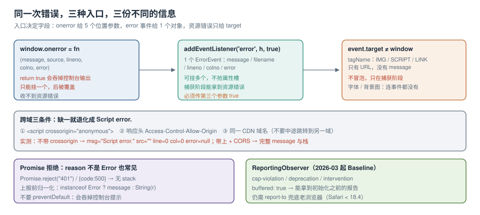

# 采集点与跨域盲区

上一页说明了「有七类异常」，这一页说明**每一个采集点到底能拿到什么、拿不到什么**。差别不在 API 名字，而在三个具体的地方：捕获阶段与冒泡阶段的区别、`crossorigin` 与 CORS 的组合、以及框架把错误吃掉之后还剩什么。



本页判据族 `ETC-A` ~ `ETC-H`，共 8 条。

## 一、`window.onerror` 与 `error` 事件：同一次错误，两种入口

它们不是两个事件。**一次未捕获的运行时错误会先派发一个 `ErrorEvent`**，`onerror` 只是这个事件的一个属性处理器。差别在签名与副作用：

| 维度 | `window.onerror = fn` | `addEventListener('error', fn, true)` |
| --- | --- | --- |
| 参数 | 5 个位置参数：`message, source, lineno, colno, error` | 1 个 `ErrorEvent`（`event.error` 才是 Error 对象） |
| 资源错误 | **收不到** | 收得到（`event.target` 是元素） |
| 返回值 | `return true` 会**阻止控制台默认打印** | 无返回值语义，只能 `preventDefault()` |
| 多次赋值 | 后赋值覆盖前一个（只能一个处理器） | 可注册多个，按注册顺序执行 |
| 执行顺序 | 先注册者先执行 | 与 `onerror` 混排在同一队列，按注册顺序 |

实际影响：如果 SDK 里写了 `window.onerror = handler`，**业务方后来再写一次就会把 SDK 覆盖掉**。这就是为什么成熟的 SDK 一律用 `addEventListener`——它不与任何人抢那个唯一的属性槽。

```typescript [src/telemetry/capture.ts]
// 运行时错误：优先用 addEventListener，避免与业务抢 onerror
window.addEventListener("error", (e) => {
  // 资源错误：target 是元素；运行时错误：target 是 window
  if (e.target && e.target !== window) {
    const el = e.target as HTMLImageElement;
    report({
      kind: "resource",
      where: el.currentSrc || el.src || (el as HTMLLinkElement).href,
      context: { tag: el.tagName, phase: "capture" },
    });
    return;
  }
  const err = (e as ErrorEvent).error;
  report({
    kind: "runtime",
    where: { file: e.filename, line: e.lineno, col: e.colno },
    // 有 Error 对象才有栈；跨域时这里是 undefined
    stack: err && err.stack ? String(err.stack) : null,
    message: e.message,
  });
}, true); // ← 第三个参数必须是 true，否则资源错误收不到
```

::: danger `addEventListener('error')` 不加 `true` 就永远收不到 404
资源加载失败的事件**不冒泡**，只在捕获阶段经过 `window`。漏掉第三个参数 `true` 是这类「监控装了但 404 全丢」的唯一原因，且本地极难发现——因为你在 DevTools 里能看到红色的 404，就以为监控也看到了。
:::

## 二、资源错误：七种元素与一个彻底的盲区

捕获阶段拿到的资源错误只有一个可用信息：**哪个元素失败了**。不同元素的失败语义完全不同：

| 元素 | 失败事件 | 能拿到的 | 注意 |
| --- | --- | --- | --- |
| `<script>` | `error` | `src` | 与「脚本执行抛错」是两件事，别混为一类 |
| `<link rel=stylesheet>` | `error` | `href` | 样式失败常导致「页面能用但错位」，容易被当成 UI bug |
| `` | `error` | `currentSrc` / `src` | 懒加载图未进入视口时不会触发，属正常 |
| `<video>` / `<audio>` | `error` | `src` | 还要看 `mediaElement.error.code` 才知道是解码还是网络 |
| `<iframe>` | `error` | `src` | 只能知道加载失败，内部错误完全隔离 |
| `@font-face` 字体 | **无事件** | 无 | 只能用 `document.fonts.check()` 轮询或 `FontFace.load()` 的 Promise 捕获 |
| CSS `background-image` | **无事件** | 无 | 同样只能靠 Resource Timing 反查 |

字体与背景图是真正的盲区。可用的替代手段是 Resource Timing：**遍历条目，找出「有 requestStart 但没有 responseEnd」或「duration 异常短且 transferSize=0」的请求**——但这只是启发式。本机实测里，一个 404 的 `` 在 Resource Timing 中表现为 `transferSize=0`、`duration=29 ms`，**和「命中缓存」的表现一模一样**，因此不能用它来判断成败。

```typescript [src/telemetry/resource-audit.ts]
// 字体/背景图这类没有 error 事件的资源，只能事后对账
export function auditResources(expect: string[]) {
  const seen = new Set(
    performance.getEntriesByType("resource").map((e) => (e as PerformanceResourceTiming).name),
  );
  const missing = expect.filter((url) => !seen.has(url));
  if (missing.length) {
    report({ kind: "resource", where: missing, context: { via: "resource-timing" } });
  }
}
```

::: warning 这条启发式只用来「发现异常」，不要用来「判定失败」
`transferSize=0` 同时意味着「缓存命中」「跨域无 TAO」「请求失败」。真正要判失败，仍然必须有 `error` 事件或服务端访问日志。Resource Timing 的正确定位是**兜底巡检**：每天跑一次，看有没有本该加载的资源压根没出现过。
:::

## 三、跨域：三条件缺一，字段全空

本机实测的对照（同一份 `foreign.js`，同一个 CDN）：

| 页面写法 | CDN 响应头 | `onerror` 拿到的 `message` | `src` | `line` / `col` | `error` |
| --- | --- | --- | --- | --- | --- |
| `<script src="http://127.0.0.1:8802/foreign.js">` | `Access-Control-Allow-Origin: *` | `Script error.` | `""` | `0` / `0` | `null` |
| `<script src="..." crossorigin="anonymous">` | `Access-Control-Allow-Origin: *` | `Uncaught Error: cross origin boom` | 完整 URL | `1` / `24` | `[object Error]`（栈含 `foreign.js:1:30`） |

第二个读数里有一个容易被忽略的细节：**`colno=24` 与栈里的 `1:30` 不是同一列**。`colno` 指向「错误被报告的位置」，栈帧指向「`new Error` 被调用的位置」。压缩代码里这个差距会放大到几十上百列，所以**符号化必须还原栈，不能还原 `lineno/colno`**（详见[符号化页](../SourceMap/index.md)）。

::: danger 上线前必须检查的三件事
1. **CDN 是否回 CORS 头**：`curl -I https://cdn.example.com/app.js | grep -i access-control`。只给 HTML 回 CORS 不够，脚本也要。
2. **`crossorigin` 是否加在标签上**：构建产物注入的 `<script>` 由框架生成时，要确认框架支持（Vite 的 `build.modulePreload` 与自建注入脚本是两处）。
3. **SRI 与 `crossorigin` 的绑定**：用了 `integrity` 就必须同时有 `crossorigin`，否则浏览器直接拒绝执行，表现为「脚本没加载」而不是「报错」。
:::

## 四、Promise 拒绝：`reason` 不一定是 Error

`unhandledrejection` 的事件对象有两个字段：`reason`（拒绝值）与 `promise`（被拒绝的 Promise）。`reason` 的类型由业务决定：

```typescript [src/telemetry/rejection.ts]
window.addEventListener("unhandledrejection", (e) => {
  const r = e.reason;
  const isErr = r instanceof Error;
  report({
    kind: "rejection",
    message: isErr ? r.message : String(r),
    stack: isErr && r.stack ? r.stack : null,
    // 非 Error 的拒绝值单独记一个字段，便于统计「哪类代码在 reject 字符串」
    context: { reasonType: Object.prototype.toString.call(r), hasStack: !!(
      isErr && r.stack
    ) },
  });
  // 不要 e.preventDefault()：那会吞掉控制台报错，本地调试时更难发现
});
```

`Promise.reject("401")`、`Promise.reject({ code: 500 })`、`axios` 的 `CanceledError` 都会经过这里。**没有栈的拒绝**在符号化阶段无法定位，只能按 message 分组——所以更彻底的做法是在业务层统一 `reject(new Error(...))`，把「拒绝值规范」写进代码规范。

## 五、框架层：被吃掉的错误与被补上的组件栈

| 框架 | 接入点 | 能拿到 | 注意 |
| --- | --- | --- | --- |
| Vue 3 | `app.config.errorHandler = (err, instance, info) => {}` | `err`、组件实例、`info`（如 `render function`） | 只覆盖组件内错误；`setup` 里未 await 的 Promise 仍走 `unhandledrejection` |
| React 18 | Error Boundary 的 `componentDidCatch(error, info)` | `error`、`info.componentStack` | 只捕获子树渲染期错误，事件处理器里的错误**不会**被边界捕获 |
| React 19 | `createRoot(el, { onCaughtError, onUncaughtError })` | `error`、`errorInfo.componentStack` | 边界捕获与未捕获分开回调，正好对应「已降级」与「白屏」两种后果 |
| 路由 | `router.onError`（Vue Router）/ `errorElement`（React Router） | 路由级错误 | 懒加载 chunk 失败常在这里出现，属于资源错误 |

组件栈与 JS 栈是两套坐标：`componentStack` 告诉你「哪个组件在渲染」，JS 栈告诉你「哪一行在抛」。**两者都要上报**，否则改代码时只能靠猜。

::: danger Error Boundary 不是万能的
1. **事件处理器里的错误不会被边界捕获**——React 只把渲染、生命周期、构造函数里的错误交给边界。点击回调里 `throw` 依然会冒到 `window.onerror`。
2. **异步代码里的错误也不会**：`setTimeout`、`Promise.then` 里的错误在边界之外。
3. **边界自己抛错**会向上冒到最近的另一个边界，最终到根节点 → 白屏。所以根节点必须有一个兜底边界，且它的 fallback 不能依赖可能出错的组件。
:::

## 六、Worker、iframe 与 SSR 水合

三个常被漏掉的执行环境：

```typescript [src/telemetry/worker.ts]
// Web Worker 里没有 window，只有 self
self.addEventListener("error", (e) => {
  postMessage({ kind: "runtime", message: e.message, where: { file: e.filename, line: e.lineno } });
});
self.addEventListener("unhandledrejection", (e) => {
  postMessage({ kind: "rejection", message: String((e as PromiseRejectionEvent).reason) });
});
```

| 环境 | 差异 | 处理方式 |
| --- | --- | --- |
| Web Worker / Service Worker | 无 `window`、无 DOM；`error` 事件对象字段更少 | 在 Worker 内捕获后 `postMessage` 给主线程，由主线程统一上报 |
| `<iframe>` 同源 | 可访问 `iframe.contentWindow.onerror` | 父页统一收，注意跨文档的 `release` 要与父页一致 |
| `<iframe>` 跨域 | **完全隔离**，父页拿不到任何错误 | 只能靠 iframe 内自己装 SDK，或用 `postMessage` 协议 |
| SSR 水合（hydration） | 错误发生在 `hydrateRoot` 阶段，表现为「页面闪一下然后空白」 | 用 `onRecoverableError` / `hydrateRoot` 的回调捕获；这类错误往往只在弱网 + 首屏慢时出现 |

## 七、CSP 与弃用 API：`ReportingObserver`

`ReportingObserver` 在 2026-03 起进入 Baseline newly available（Chrome 69 / Edge 79 / **Firefox 149** / Safari 16.4）。它能收到浏览器「想告诉你但没地方说」的报告：

```typescript [src/telemetry/reporting.ts]
if ("ReportingObserver" in window) {
  const ro = new ReportingObserver((reports) => {
    for (const r of reports) {
      if (r.type === "csp-violation") {
        const b = r.body as CSPViolationReportBody;
        report({ kind: "csp", message: b.effectiveDirective ?? "", where: b.blockedURL ?? "",
                 context: { directive: b.violatedDirective, status: b.statusCode } });
      }
      if (r.type === "deprecation") {
        const b = r.body as DeprecationReportBody;
        report({ kind: "runtime", message: `deprecated: ${b.id}`, where: b.sourceFile ?? "",
                 context: { willBeRemoved: b.anticipatedRemoval?.toISOString() ?? null } });
      }
    }
  }, { types: ["csp-violation", "deprecation", "intervention"], buffered: true });
  ro.observe();
}
```

本机实测：Chrome 155 里 `new ReportingObserver(cb, {types:["deprecation","csp-violation","intervention"], buffered:true})` **构造成功**（没有抛错）。但要注意三件事：

| 事实 | 影响 |
| --- | --- |
| `buffered: true` 能拿到页面加载早期的报告 | 报告在 SDK 初始化之前的违规也不会丢 |
| Firefox 直到 149 才支持 | 老版本 Firefox 上这段代码不执行（要用 `"ReportingObserver" in window` 守卫） |
| Safari 的 `csp-violation` 要 18.4+ | iOS 老版本会漏；CSP 的关键指标仍应以后端 `report-to` 为底 |

::: tip CSP 的两条上报通道要同时开
`Content-Security-Policy-Report-Only` + `report-to`（走 HTTP，服务端收）覆盖全部浏览器；`ReportingObserver` 覆盖「页面内可编程处理」。只开前者，你只能看到聚合报表；只开后者，老浏览器全丢。
:::

## 八、本页判据

| 编号 | 判据 | 看什么现象 | 不满足时改哪里 |
| --- | --- | --- | --- |
| `ETC-A` | 用 `addEventListener('error', h, true)` 而非 `window.onerror` | SDK 代码里没有 `window.onerror =` | 改注册方式，避免被业务覆盖 |
| `ETC-B` | 捕获阶段参数为 `true` | 线上能收到资源 404 事件 | 补第三个参数 `true` |
| `ETC-C` | 资源错误与运行时错误按 `target` 分流 | 两类事件的 `kind` 不同 | 改判断条件 |
| `ETC-D` | 外域脚本三条件齐全 | `Script error.` 占比可查且逐周下降 | 加 `crossorigin`、查 CORS 头、查 SRI |
| `ETC-E` | `reason` 非 `Error` 时可上报 | 上报里无 `[object Object]` 作为 message | 归一化 `reason` |
| `ETC-F` | 框架层错误有专用通道 | Vue/React 的错误有 `componentStack` | 接 `errorHandler` / `onUncaughtError` |
| `ETC-G` | Worker 与 iframe 有明确归属 | 文档里写明「谁上报」 | 补 `postMessage` 协议或声明不管 |
| `ETC-H` | CSP 与弃用有 `ReportingObserver` | 代码里有带 `buffered: true` 的观察器 | 补观察器，并同时开 `report-to` |

## 参考资料

- MDN：*Window: error event*、*ErrorEvent*、*PromiseRejectionEvent*、*ReportingObserver*（类型列表与 `buffered`）、*CSPViolationReportBody*
- HTML 规范：*CORS settings attributes*（`crossorigin` 的三种取值）、*Resource Timing*（`transferSize` 的定义，含 TAO 限制）
- React 官方文档：*Error Boundaries*（捕获范围）、*createRoot options*（`onCaughtError` / `onUncaughtError` / `onRecoverableError`）
- Vue 官方文档：*app.config.errorHandler*、*app.config.warnHandler*
- 本仓库：[异常面全景](../Overview/index.md)（七类异常的来源）、[符号化与版本对齐](../SourceMap/index.md)（`colno` 与栈列不一致的后果）、[错误边界](../../Frame/React/ErrorBoundaries/index.md)（框架层降级 UI）
