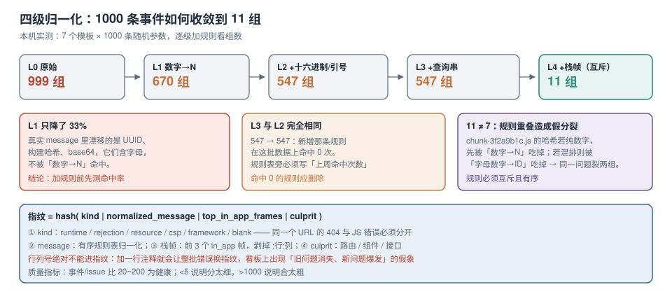

# 指纹、合并与噪音治理

一条错误事件最没用的形态是「一次出现」。有用的是「同一个问题出现了多少次、影响了多少人、从哪个版本开始」。把「事件」变成「问题（issue）」的那一步叫分组，分组靠的键叫**指纹（fingerprint）**。

指纹算错的两种后果都很贵：**分太细**——1000 条事件裂成 800 个 issue，没人看得过来；**合太粗**——三个不同的空指针被合成一个 issue，修了一个另两个还在。



本页判据族 `ETF-A` ~ `ETF-H`，共 8 条。

## 一、本机实测：归一化到第几级才够

造 1000 条合成事件，来自 **7 个报错模板**（购物车取值、接口 500、超时、SKU 价格、路由无匹配、fetch 失败、chunk 语法错误），每条填入随机的数字、UUID、十六进制串、时间戳、JSON 路径。然后逐级加归一化规则，看「组数」怎么收敛：

| 级别 | 规则 | 组数 | 最大组占比 |
| --- | --- | --- | --- |
| L0 | 原始 message 直接算哈希 | **999** | 2/1000 |
| L1 | 数字 → `N` | **670** | 150/1000 |
| L2 | L1 + 长十六进制串 → `HEX` + 引号内容 → `STR` | **547** | 150/1000 |
| L3 | L2 + 查询串 → `QS` + 空白折叠 | **547** | 150/1000 |
| L4 | L3 的**互斥版**（UUID → `UUID`、字母数字混排长串 → `ID`）+ **栈帧** | **11** | 160/1000 |

三个读数值得逐条解释：

1. **只做「数字 → N」几乎没用**（999 → 670）。因为真实 message 里漂移的往往是 UUID、构建哈希、base64 片段，它们**含字母**，不会被数字规则命中。
2. **L3 与 L2 完全一样（547）**，说明那两条规则在这批数据上一条都没命中——加规则不等于有效，必须**用数据验证每条规则的命中率**。
3. **L4 收敛到 11，而不是模板数 7**。原因是规则之间**有重叠**：`chunk-3f2a9b1c.js` 里的哈希若是纯数字（`01234567`），会先被 `\d+ → N` 吃掉，变成 `N`；若是字母数字混排，则被 `ID` 吃掉。同一个问题因此裂成两组。**11 − 7 = 4，这 4 组全是规则重叠造出来的假分裂。**

::: danger 分组规则必须互斥且有序
真实 SDK 的分组配置是一个**有序规则表**，每条规则带一个「作用范围」（message / 路径 / 函数名）。顺序错了就会出现上文的假分裂。自检方法：拿一批已确认「是同一个问题」的样本跑一遍，**要求组数 = 1**；再拿一批「确定不同」的样本跑，**要求组数 = 样本数**。两条都过，规则才算可用。
:::

## 二、指纹的四个组成部分

一个可用的指纹不是「message 的 md5」，而是四段的组合：

```text
fingerprint = hash( kind | normalized_message | top_in_app_frames | culprit )
```

| 段 | 取值 | 为什么需要 |
| --- | --- | --- |
| `kind` | `runtime` / `rejection` / `resource` / `csp` / `framework` / `blank` | 「同一个 URL 的 404」与「同一 URL 的 JS 错误」必须分开 |
| `normalized_message` | 归一化后的 message（见下一节） | 大部分错误的唯一区分信息在文字里 |
| `top_in_app_frames` | 栈里**前 3 个 `in_app` 帧**的 `函数名@文件:行` | message 相同但代码路径不同的错误（如 `undefined` 读取）必须分开 |
| `culprit` | 触发位置（路由 / 组件 / 接口） | 同一个工具函数被两个页面调用，修复责任不同 |

把栈帧纳入指纹是「11 组」那一步的关键。只用 message 时，`Cannot read properties of undefined (reading 'id')` 这种message 在任何一个页面、任何一个函数里都一样，会把几十个不同 bug 合成一个 issue。

```typescript [src/telemetry/fingerprint.ts]
const RULES: Array<[RegExp, string]> = [
  // 顺序即优先级：先具体（UUID），后笼统（数字），避免重叠
  [/[0-9a-f]{8}-?[0-9a-f]{4}-?[0-9a-f]{4}-?[0-9a-f]{4}-?[0-9a-f]{12}/gi, "UUID"],
  [/\b(?=[A-Za-z0-9]*\d)(?=[A-Za-z0-9]*[A-Za-z])[A-Za-z0-9]{8,}\b/g, "ID"],
  [/\b\d{10,13}\b/g, "TS"],
  [/\d+/g, "N"],
  [/"[^"]*"/g, "STR"],
  [/\?[^\s"']*/g, "?QS"],
  [/https?:\/\/[^\s)]+/g, "URL"],
  [/\s+/g, " "],
];

export function normalize(message: string): string {
  return RULES.reduce((acc, [re, to]) => acc.replace(re, to), message || "").trim();
}

export function framesKey(stack: string | null): string {
  if (!stack) return "nostack";
  return stack
    .split("\n")
    .slice(1, 4)                                     // 跳过 "Error: xxx" 这一行
    .map((l) => l.trim().replace(/^at\s+/, ""))
    .map((l) => l.replace(/\(?https?:\/\/[^/]+\//, ""))  // 去掉域名与协议
    .map((l) => l.replace(/:\d+:\d+\)?$/, ""))          // 去掉行列号
    .join(" <- ");
}

// FNV-1a 32 位，够用且无依赖；跨语言实现一致即可
export function hash(s: string): string {
  let h = 0x811c9dc5;
  for (let i = 0; i < s.length; i++) {
    h ^= s.charCodeAt(i);
    h = Math.imul(h, 0x01000193) >>> 0;
  }
  return h.toString(16).padStart(8, "0");
}
```

::: warning 行列号不能进指纹
栈帧里带了 `:行:列` 的，必须**在算指纹前剥掉**。否则同一段代码加一行注释，整批错误的指纹全变，看板上会出现「昨天的问题消失了、今天多了 8 个新问题」的假象。行列号只用于**符号化**，不用于**分组**。
:::

## 三、噪音：先算清楚它占多少，再决定怎么治

「噪音」指那些**不是你的代码产生的错误**。它们通常占前端错误总量的 20%~60%，且会把真实的业务错误淹没。四类主要来源：

| 噪音源 | 特征 | 处理方式 |
| --- | --- | --- |
| 浏览器扩展注入 | 栈里有 `chrome-extension://`、`moz-extension://`，或文件名是 `inject.js` | 采集端直接丢弃，并计入「已丢弃」指标 |
| 第三方统计 / 广告 / 客服脚本 | 栈顶文件不在自己的 CDN 域名白名单内 | 按域名白名单丢弃，**但要保留计数**，防止误杀 |
| 爬虫与自动化 | UA 含 `HeadlessChrome`、`bot`，或 `navigator.webdriver === true` | 单独分桶，不进业务告警 |
| 用户环境（老浏览器、被改写的 API） | `ResizeObserver loop limit exceeded`、`Script error.` 占高位 | 按 message 精确屏蔽，不按正则模糊屏蔽 |

```typescript [src/telemetry/filter.ts]
const NOISE_PATTERNS: RegExp[] = [
  /^(chrome|moz|safari-web)-extension:\/\//,
  /^ResizeObserver loop (limit exceeded|completed with undelivered notifications)/,
  /^Script error\.?$/,           // 跨域且无 crossorigin 的空壳事件
];
const THIRD_PARTY_HOSTS = [/\.googletagmanager\.com$/, /\.hotjar\.com$/, /\.sentry-cdn\.com$/];

export function isNoise(ev: { message: string; where?: any }): string | null {
  if (NOISE_PATTERNS.some((re) => re.test(ev.message))) return "pattern";
  const url = typeof ev.where === "string" ? ev.where : ev.where?.file;
  if (url && THIRD_PARTY_HOSTS.some((re) => re.test(new URL(url, location.href).host))) {
    return "third-party";
  }
  return null;
}
```

::: danger 「先屏蔽再说」是最贵的做法
每屏蔽一类，都要先回答：**它上周出现了多少次、影响了多少人、屏蔽后会不会把我们自己的 bug 一起屏蔽掉**。做法是把「将被屏蔽」的事件连同原因写进一张**影子表**（`dropped_events`），观察两周再真正丢弃。没有影子表的屏蔽，等于给自己装了一个只看好消息的滤镜。
:::

## 四、合并与拆分：issue 的生命周期

issue 不是「一次分组的结果」，而是有状态的：

| 状态 | 含义 | 进入条件 | 离开条件 |
| --- | --- | --- | --- |
| `open` | 有未处理的新事件 | 首次出现，或 `resolved` 后再次出现 | 人工 `resolve` |
| `resolved` | 已修复（当前版本） | 人工标记，且关联了修复版本 | 同指纹在**更高版本**再次出现 → 自动 `regressed` |
| `ignored` | 确认不管 | 人工忽略，必须填原因与到期日 | 到期自动回到 `open` |
| `merged` | 被合并到另一个 issue | 人工合并（两组其实是同一个 bug） | 可拆分回来 |

三个工程细节：

1. **`resolved` 的判据是「版本更高」，不是「时间更晚」**。按时间判会出现「用户回退到旧版本 → 同一问题又冒出来 → 看板报回归」的假回归。
2. **合并要留痕**：被合并的指纹要记录「合到谁、谁合的、为什么」，否则三个月后没人敢拆。
3. **忽略必须到期**：`ignored` 不带到期日，半年后你会在看板上看到 200 个「已忽略」，且没人记得当初为什么忽略。

## 五、用数据校准分组，而不是用感觉

分组质量可以量化。三个指标就够了：

| 指标 | 算法 | 健康值（经验） |
| --- | --- | --- |
| 事件/issue 比 | 总事件数 ÷ issue 数 | 20~200；**< 5 说明分太细**，**> 1000 说明合太粗** |
| 单 issue 覆盖用户上限 | 单个 issue 的 UV ÷ 总 UV | < 30%；超过说明它是个「通用容器」 |
| 新 issue 增速 | 每周新开 issue 数 | 与发版次数同阶；远高于发版数说明噪音多 |

第一条最实用。假设日均 5 万条错误、300 个 issue，比值 167 属于正常；如果某天变成 12，先别怀疑「错误变少了」，多半是某条归一化规则被改坏了。

::: tip 「事件/issue 比」突然下跌的三种原因
① 归一化规则失效（如新增了一种 UUID 格式）；② 栈帧被注入随机值（如带 hash 的 chunk 名进了栈）；③ 指纹里混进了时间戳或请求 id。三者都能用「拿 10 条同 issue 的事件逐字段 diff」在十分钟内定位。
:::

## 六、一个完整的合并流程

把上面几节串起来，采集端的处理顺序是固定的：

```text
1. 校验（字段完整性、release 非空、时间戳合理）
2. 丢弃（噪音规则 + UA 过滤），写入 dropped_events 影子表
3. 归一化（message 有序规则表）
4. 取栈帧（前 3 个 in_app 帧，剥掉行列号）
5. 算指纹（kind + message + frames + culprit）
6. upsert issue（指纹唯一键），事件写 events 表并外键到 issue
7. 更新计数（事件数、UV、首末次时间、版本集合）
8. 若 issue 为 resolved 且本次 release 更高 → 置为 regressed 并触发告警
```

第 8 步是「回归检测」，也是最容易被跳过的一步。没有它，`resolved` 就只是一个好看的状态。

## 七、本页判据

| 编号 | 判据 | 看什么现象 | 不满足时改哪里 |
| --- | --- | --- | --- |
| `ETF-A` | 指纹含「类别 + message + 栈帧 + culprit」四段 | 指纹函数的输入里有 `framesKey` | 只用 message 的指纹必须补栈帧 |
| `ETF-B` | 归一化规则有序且互斥 | 同模板样本跑出来组数 = 1 | 调整规则顺序，消除重叠（本页 11 vs 7） |
| `ETF-C` | 每条规则有命中率记录 | 规则表旁有「上周命中次数」 | 补统计；命中 0 的规则删掉 |
| `ETF-D` | 行列号不进指纹 | 改一行注释后 issue 数不变 | 算指纹前剥掉 `:行:列` |
| `ETF-E` | 噪音先入影子表再丢 | 有 `dropped_events` 与丢弃原因 | 建影子表，观察两周再真丢 |
| `ETF-F` | `resolved` 按版本判回归 | 回归判定比较 `release` 而非时间 | 改判定条件 |
| `ETF-G` | 合并与忽略留痕且到期 | `ignored` 有原因与到期日 | 加必填字段 |
| `ETF-H` | 分组质量有量化指标 | 看板有「事件/issue 比」 | 补指标，并设定异动告警 |

## 与「广告投放与实时竞价工程」的分工（第 210 天补充）

广告脚本是前端错误上报里最容易被「按域名一刀切」处理的一类来源：

| 事项 | 本页（错误分组） | 广告专题 |
| --- | --- | --- |
| 管什么 | 错误怎么聚类、怎么降噪 | 广告怎么投、怎么计费、怎么合规 |
| 对广告脚本的态度 | 只做**归因与计数**，不做业务判断 | 素材渲染失败要单独统计，不混进曝光 |
| 失败形态 | 噪声淹没真错误 | 素材 404 仍计曝光，为看不到的展示付费 |
| 归属 | 本页第四、五节 | [广告投放与实时竞价工程](../../../Backend/AdDelivery/index.md) |

本页特有的一个坑：**把广告域名的错误直接丢弃且不留计数**。本页第三节已经写过「按域名白名单丢弃但要保留计数」，在广告场景里这条尤其贵：素材 404、`postMessage` 跨域失败、SDK 初始化超时，都会让「曝光回执」丢失或错发——而外部报表只会显示「曝光正常」。丢弃而不计数，等于把「广告侧的失败」从你自己的可观测体系里删掉，出问题时只能等广告主来投诉。

## 参考资料

- Sentry Docs：*Issue Grouping*（fingerprint 规则、`customFingerprint`、栈帧参与方式）、*Inbound Filters*（`ignoreErrors`、`denyUrls`、`legacy browsers`）
- Sentry 源码语义：`grouping` 的 `STACKTRACE` 规则族（帧的 `in_app` 与 `context_line` 参与度）
- 本仓库：[上报通道与配额](../Transport/index.md)（噪音在客户端丢还是服务端丢）、[符号化与版本对齐](../SourceMap/index.md)（栈帧在前后的形态差异）、[告警、预算与闭环](../Alerting/index.md)（issue 状态如何驱动告警）
