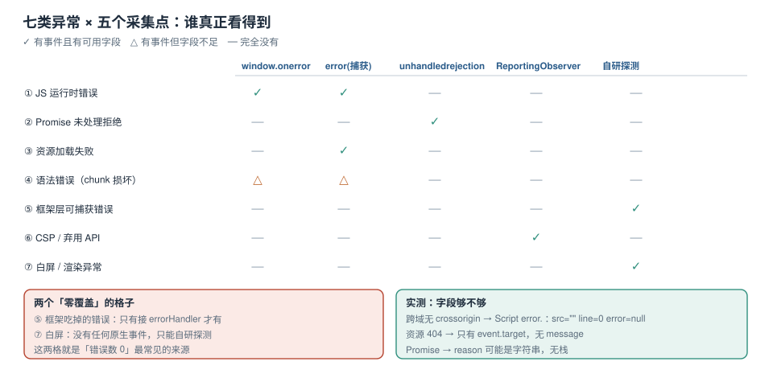

# 异常面全景与采集点地图

「前端错误监控」最常见的失败不是漏接 SDK，而是**以为接上就全了**。浏览器把「出错」这件事拆成了至少七种互不相通的事件，每一种的捕获方式、能拿到的字段、跨域时的行为都不一样。只挂一个 `window.onerror` 的监控，在真实站点上通常只能看到一半。

本页先给出全景：**七类异常、五个采集点、三种分母**，然后把「错误数 0」这个最常见的假象拆开。后面八页都在补这张图里的某一段。



本页判据族 `ETV-A` ~ `ETV-H`，共 8 条。

## 一、七类异常与「谁能看到它」

先给结论表。这张表是本专题的地基：**任何一类异常在这一行里全空，就意味着线上它永远不会出现在你的看板上**。

| # | 异常类别 | 典型触发 | `window.onerror` | `error`（捕获阶段） | `unhandledrejection` | `ReportingObserver` |
| --- | --- | --- | --- | --- | --- | --- |
| 1 | JS 运行时错误 | `null.x`、`undefined.fn()` | ✅ 有 message/src/line/col/error | ✅ 同一个事件 | ❌ | ❌ |
| 2 | 未处理的 Promise 拒绝 | `Promise.reject(e)`、`await` 抛错无人 catch | ❌ | ❌ | ✅ 有 `reason` 与 `promise` | ❌ |
| 3 | 资源加载失败 | `` 404、`<script>` 404、CSS 加载失败 | ❌ | ✅ 只有 `event.target`，无 message | ❌ | ❌ |
| 4 | 语法错误（已发布的 chunk） | 打包产物损坏、CDN 回了一张 HTML | ✅（但通常是 `Script error.`） | ✅ | ❌ | ❌ |
| 5 | 框架层可捕获错误 | Vue `errorHandler`、React Error Boundary | ❌（被框架吃掉） | ❌ | ❌ | ❌ |
| 6 | CSP 拦截与弃用 API | 内联脚本被拦、用了废弃 API | ❌ | ❌ | ❌ | ✅ `csp-violation` / `deprecation` |
| 7 | 白屏 / 渲染异常 | 首屏根节点为空、路由挂载失败 | ❌ | ❌ | ❌ | ❌ |

第 5、7 类没有任何浏览器原生事件能覆盖——它们必须由**框架层上报**与**主动探测**补上。这两块是「错误数 0」的头号来源。

::: danger 三个几乎人人都踩过的坑
1. **只挂 `window.onerror`**：第 2、3、6、7 类直接丢失。第 2 类（Promise）在现代前端里占比通常不低，因为 `fetch`/`async` 全都是 Promise。
2. **把 `window.onerror` 的 `return true` 当「已处理」**：返回 `true` 会**阻止控制台默认打印**，本地调试时你会看不到这条错误，误以为没发生。监控 SDK 里轻易不要返回 `true`。
3. **用 `try/catch` 包住业务代码就以为万事大吉**：`try/catch` 只能捕获同步栈内的异常，`setTimeout` 里的、事件回调里的、Promise 链上的都捕不到。
:::

## 二、五个采集点与各自的盲区

| 采集点 | 挂在哪里 | 能拿到什么 | 盲区 |
| --- | --- | --- | --- |
| `window.onerror` | 全局 | `message`、`source`、`lineno`、`colno`、`error`（第 5 个参数） | 资源错误、Promise、CSP、白屏；跨域时字段全空 |
| `window.addEventListener('error', h, true)` | 全局捕获阶段 | 同一个 `ErrorEvent`；**资源错误以 `event.target` 形式出现** | 需要自己区分「错误事件」与「资源事件」 |
| `window.addEventListener('unhandledrejection', h)` | 全局 | `event.reason`（可能是 Error，也可能是字符串）、`event.promise` | 已 `catch` 的拒绝、`await` 之外的手动 `reject` 不会来 |
| `ReportingObserver` | 全局 | `deprecation`、`csp-violation`、`intervention`、`integrity-violation` 等报告 | 只覆盖「浏览器想告诉你的政策类问题」，不覆盖业务异常 |
| 框架 / 应用层 | Vue `app.config.errorHandler`、React `onCaughtError` / Error Boundary、路由守卫 | 组件栈、props 快照、路由上下文 | 需要自己接；组件栈与 JS 栈是两套东西 |

一个必须记住的细节：**`onerror` 与 `addEventListener('error')` 不是两个独立事件**——同一次运行时错误会**两者都触发**（`onerror` 先注册就先执行）。这就是为什么很多 SDK 会在同一条错误上重复上报两次，需要去重。

## 三、本机实测：三类事件，谁收到了什么

用两个静态服务模拟「站点 + 跨域 CDN」，页面里依次制造同源错误、无 `crossorigin` 的跨域错误、带 `crossorigin` 的跨域错误、资源 404、Promise 拒绝，把每个回调拿到的字段写进 DOM，再用 headless Chrome 把 DOM 打出来。

```shell
# 1) 站点与 CDN（8802 额外回 Access-Control-Allow-Origin: *）
cd errlab && python3 serve.py 8801 site &
cd errlab && python3 serve.py 8802 cdn cors &

# 2) 用 headless Chrome 跑页面，把 <pre id="out"> 里的 JSON 打出来
"/Applications/Google Chrome.app/Contents/MacOS/Google Chrome" \
  --headless=new --disable-gpu --virtual-time-budget=6000 \
  --dump-dom http://127.0.0.1:8801/a.html | sed -n '/<pre id="out">/,/<\/pre>/p'
```

实测结果（Chrome 155 headless，逐字摘自输出）：

| 场景 | 收到的回调 | 实际字段 |
| --- | --- | --- |
| 同源 `null.x` | `onerror` | `msg="Uncaught TypeError: Cannot read properties of null (reading 'x')"`、`src=http://127.0.0.1:8801/same.js`、`line=2`、`col=8`、`errType=[object Error]` |
| 跨域脚本，**无** `crossorigin` | `onerror` | `msg="Script error."`、`src=""`、`line=0`、`col=0`、`error=null` |
| 跨域脚本，**有** `crossorigin="anonymous"` + CDN 回 CORS | `onerror` | `msg="Uncaught Error: cross origin boom"`、`src=http://127.0.0.1:8802/foreign.js`、`line=1`、`col=24`、栈可读到 `foreign.js:1:30` |
| `` 404 | **只有捕获阶段 `error`** | `tag=IMG`、`url=http://127.0.0.1:8802/missing.png`；`onerror` **完全没触发** |
| `Promise.reject(new Error("rejected-here"))` | **只有 `unhandledrejection`** | `reason="rejected-here"`、`hasPromise=true` |

五个读数里有三个直接改变实现：

1. **跨域错误只有「空壳」**：`Script error.` 这种事件里 `src`、`line`、`col`、`error` 全空，**符号化无从下手**。要么给所有外域脚本加 `crossorigin` 并要求对方回 CORS 头，要么接受这类错误只能按「页面 + 次数」统计。
2. **资源错误必须先判类型**：捕获阶段收到的 `error` 事件里，`event.target` 可能是 `IMG`/`SCRIPT`/`LINK`/`VIDEO`；而运行时错误的 `event.target === window`。用这一个判断就能分流，不需要看 `message` 是否为空。
3. **`unhandledrejection` 的 `reason` 不一定是 `Error`**：`Promise.reject("字符串")`、`Promise.reject({code:500})` 都很常见，`reason.stack` 会是 `undefined`。上报前必须做一次归一化，否则后端字段类型会被污染。

::: tip 跨域脚本的完整三条件
`<script crossorigin="anonymous">` + 响应头 `Access-Control-Allow-Origin`（匹配或 `*`）+ **同一个 CDN 域名**。三者缺一，浏览器都会退回到 `Script error.`。注意 `crossorigin` 会改变请求的凭据模式：`anonymous` 不带 Cookie，`use-credentials` 带 Cookie 但此时 `ACAO` 不能是 `*`。
:::

## 四、「错误数 0」的三种假象

监控上线第一周最常见的结论是「我们线上没有错误」。先排除这三种假象再庆祝：

| 假象 | 现象 | 怎么证伪 |
| --- | --- | --- |
| 采集面缺失 | 只有 `onerror`，没有 Promise / 资源 / 白屏 | 在预发页面手动制造七类异常各一次，看七条是否都到了采集端 |
| 上报被丢弃 | 采集端日志有，看板没有 | 抓包看 `sendBeacon` 返回值（`false` 就是被丢了）与 collector 的 4xx/5xx |
| 版本错位 | 看板只显示旧版本，新版本「干净」 | 查事件里的 `release` 字段分布；空 `release` 通常意味着构建时没注入 |

第三种最隐蔽：某次发版把 `release` 注入的构建变量改坏了，之后**所有新错误都被归到 `unknown` 版本**，而团队习惯了看「当前版本」那一栏。

::: warning 用「异常注入」当验收，而不是用「有没有报错」
每次发版前在预发环境跑一遍注入脚本：制造 1 个同步错误、1 个 Promise 拒绝、1 个资源 404、1 个跨域脚本错误、1 次 CSP 违规。**五个事件全部出现在采集端，且 `release` 等于本次构建号**，才算监控可用。这一条比任何配置检查都有效。
:::

## 五、分母：三种口径，混算就是自欺

「错误率」这个词至少对应三种分母，它们相差一个数量级：

| 口径 | 分母 | 适合回答 | 陷阱 |
| --- | --- | --- | --- |
| 按页面访问（PV） | `page_view` 事件数 | 「用户看到错误的比例」 | SPA 里一次会话多次路由切换，PV 会被放大 |
| 按会话（Session） | `session_start` 数 | 「有多少人被打断」 | 会话切分规则（30 min 超时）会改变分母 |
| 按业务动作（如订单提交） | 成功率的分母 | 「这个功能可用吗」 | 只有埋了业务事件才有，通用 SDK 拿不到 |

三种混算的典型产物是「错误率 0.3%，但客服说下单一直失败」：分子是 JS 错误数、分母是 PV，而下单失败的 90% 表现为**接口 5xx 后前端静默降级**，根本没产生 JS 错误。

::: danger 不要在告警里用「错误数 / PV」
PV 在 SPA 里被路由切换放大，在投放页被 `history.replaceState` 放大，在爬虫流量里被稀释。要么用**会话**做分母，要么用**业务动作**做分母，并且把分母的定义写进告警规则的注释里。
:::

## 六、把七类异常映射到「四个字段」

采集端不需要为七类异常设计七种表，只需要保证四个字段在所有类别里都存在：

| 字段 | 含义 | 缺失时的后果 |
| --- | --- | --- |
| `kind` | 类别（`runtime` / `rejection` / `resource` / `csp` / `framework` / `blank`） | 无法按类别分桶，也不能按类别设不同告警阈值 |
| `where` | 位置（脚本 URL + 行列，或资源 URL，或路由） | 无法符号化、无法定位 |
| `fingerprint` | 指纹（归一化 message + 栈帧，见[指纹页](../Grouping/index.md)） | 无法合并，1000 条事件 = 1000 个 issue |
| `context` | 上下文（`release`、路由、浏览器、用户分群） | 无法判断「哪个版本变差了」 |

这四列就是后面 [采集](../Capture/index.md)、[指纹](../Grouping/index.md)、[符号化](../SourceMap/index.md) 三页共同服务的对象。

## 七、采集覆盖率自查表

把七类异常 × 五个采集点做成一张 7×5 的勾选表，逐格确认「有回调」还是「有字段」。工程上最常见的状态是「勾了一半」：

| 类别 | 有回调 | 有可用字段 | 常见缺口 |
| --- | --- | --- | --- |
| 运行时错误 | ✅ | ✅ | 跨域时退化为 `Script error.` |
| Promise 拒绝 | ✅ | ⚠️ | `reason` 非 `Error` 时无栈 |
| 资源错误 | ✅（捕获阶段） | ⚠️ | 只有 URL，没有「谁引用的」 |
| 语法错误 | ✅ | ⚠️ | 同上，常伴随 `Script error.` |
| 框架错误 | ⚠️ | ⚠️ | 只在装了 `errorHandler` 时才有 |
| CSP / 弃用 | ⚠️ | ✅ | 只在支持 `ReportingObserver` 的浏览器上有 |
| 白屏 | ❌ | ❌ | 完全靠自研探测（见下一节） |

白屏检测最省事的做法不是截图比对，而是**在首屏预期挂载点的父节点上做一次「稳定后仍为空」的判断**：

```typescript [src/telemetry/blank.ts]
export function watchBlank(rootSelector: string, delay = 3000) {
  const start = Date.now();
  const timer = setTimeout(() => {
    const root = document.querySelector(rootSelector);
    // 只有「根节点为空或高度为 0」才算白屏；有骨架屏时不算
    const blank = !root || (root.childElementCount === 0 && root.clientHeight === 0);
    if (blank) {
      report({
        kind: "blank",
        where: location.pathname,
        context: { waitedMs: Date.now() - start, selector: rootSelector },
      });
    }
  }, delay);
  // 页面正常渲染后取消探测，避免误报
  const mo = new MutationObserver(() => {
    const root = document.querySelector(rootSelector);
    if (root && root.childElementCount > 0) { clearTimeout(timer); mo.disconnect(); }
  });
  mo.observe(document.documentElement, { childList: true, subtree: true });
}
```

::: danger 白屏探测的两个误报源
1. **骨架屏**：首屏先渲染骨架，`childElementCount > 0`，于是探测永远不报。正确做法是判断「业务内容容器」而不是根节点，或者判断「骨架屏标记是否还在」。
2. **延迟渲染**：3 秒阈值对弱网设备太短，会误报一大批。阈值要按 P95 的首次内容渲染时间给，并且**把 `waitedMs` 一起上报**，事后可以重新划线。
:::

## 八、本页判据

| 编号 | 判据 | 看什么现象 | 不满足时改哪里 |
| --- | --- | --- | --- |
| `ETV-A` | 七类异常逐类有归属 | 有一张「类别 × 采集点」的覆盖表，且每类写明由谁负责 | 先建表，再补缺失的采集点 |
| `ETV-B` | `onerror` 不是唯一入口 | 代码里有 `unhandledrejection` 与捕获阶段 `error` | 补两个监听；注意资源错误只在捕获阶段 |
| `ETV-C` | 资源错误与运行时错误可区分 | 用 `event.target === window` 分流，而不是看 message | 改判断条件，避免把资源 404 记成 JS 错误 |
| `ETV-D` | 跨域脚本有 `crossorigin` 与 CORS | 线上 `Script error.` 占比可查且持续下降 | 给 CDN 脚本加 `crossorigin`，要求回 `ACAO` |
| `ETV-E` | `reason` 非 `Error` 时被归一化 | 上报里 `rejection` 的 `message` 字段无 `[object Object]` | 加 `reason instanceof Error ? reason.message : String(reason)` |
| `ETV-F` | 分母口径唯一且写入文档 | 告警规则注释里写了分母是会话还是业务动作 | 统一分母；禁止「错误数 / PV」 |
| `ETV-G` | 每个事件都带 `release` | `release` 为空的占比 < 1% | 构建时注入版本；缺失时采集端拒收 |
| `ETV-H` | 发版前跑异常注入 | 五类注入事件全部落地且版本正确 | 把注入脚本纳入发布检查单 |

## 参考资料

- MDN：*Window: error event*（`ErrorEvent` 的 `message`/`filename`/`lineno`/`colno`/`error`）、*GlobalEventHandlers.onerror*（返回值语义）、*Window: unhandledrejection event*
- HTML 规范：*Scripting*（跨域脚本错误信息的隐藏规则）、*CORS settings attributes*（`crossorigin` 的 `anonymous` / `use-credentials`）
- web.dev：*CSP reporting*（`report-to` 与 `ReportingObserver` 的关系）
- 本仓库：[采集点与跨域盲区](../Capture/index.md)（本页第 3 节的展开）、[指纹、合并与噪音治理](../Grouping/index.md)（`fingerprint` 字段怎么算）、[首屏与运行时性能](../../MobileH5/PagePerformance/index.md)（白屏与首屏的关系）
