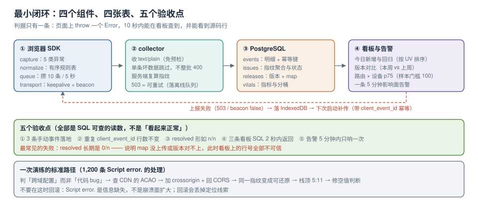

# 实战：从 0 到 1 搭一条链路

前面八页把每一段拆开讲了。这一页把它们装起来：**一个 150 行的浏览器 SDK、一个 80 行的采集端、四张表、三条看板 SQL、一条告警规则**，以及一次真实的故障定位演练。

目标不是「造一个 Sentry」，而是让读者能在自己的工程里跑通**最小闭环**，并且每一步都有可执行的验收。所有代码都以代码块给出（仓库不提交工程文件），照抄即可在自己的项目里建起来。



本页判据族 `ETX-A` ~ `ETX-H`，共 8 条。

## 一、边界：做什么、不做什么

| 做 | 不做 |
| --- | --- |
| 采集七类异常中的五类（运行时、拒绝、资源、CSP、白屏） | 会话重放（体积与隐私成本高，先用第三方） |
| 客户端归一化 + 指纹 | 全量指标平台（只用 web-vitals 采 3 个核心指标） |
| 采集端校验、指纹复算、入库 | 多租户与权限体系 |
| 源码还原（接 [符号化页](../SourceMap/index.md) 的流程） | 自动归因与 AI 分诊 |
| 三条看板 SQL + 一条告警 | 完整告警平台（先接现有 Alertmanager/飞书） |

::: tip 先跑通「一条错误从浏览器到看板」
最小闭环的判据只有一条：**在页面上 `throw new Error("probe")`，10 秒内能在看板 SQL 里查到它，并且点开能看到源码行**。这一条通了，后面所有优化才有意义。
:::

## 二、组件与数据流

```text
浏览器 SDK ──POST(text/plain)──▶ collector ──▶ PostgreSQL(events / issues / releases)
   │  capture/normalize/queue          │  validate → fingerprint → symbolicate
   └── 失败落 IndexedDB，下次补传 ◀────┘  失败返回 503（SDK 会重试）
```

四个组件的最小职责：

| 组件 | 职责 | 不负责 |
| --- | --- | --- |
| SDK | 采集、归一化、批量、限流、补传 | 指纹的最终裁定（以服务端为准） |
| collector | 校验、复算指纹、还原栈、入库 | UI |
| 数据库 | `events`（明细）、`issues`（聚合）、`releases`（版本 + map） | 原始大字段（重放另存） |
| 看板 | 三条 SQL + 一张图 | 实时计算（走预聚合或物化视图） |

**指纹为什么以服务端为准**：客户端版本会随用户缓存长期存在，规则一改就要等全部用户刷新。服务端复算可以做到「规则热更新，历史事件重算」。

## 三、第一步：SDK（约 150 行）

```typescript [src/telemetry/index.ts]
type Ev = {
  id: string; kind: string; message: string; where: any;
  stack?: string | null; context?: Record<string, unknown>; ts: number;
};

const RELEASE = (window as any).__APP_RELEASE__ ?? "dev";
const ENDPOINT = "https://collect.example.com/e";
const queue: Ev[] = [];
let timer: number | null = null;

function push(e: Omit<Ev, "id" | "ts">) {
  try {
    if (!allow()) return;                       // 限流，见 Transport 页
    queue.push({ ...e, id: crypto.randomUUID(), ts: Date.now() });
    if (queue.length >= 10) flush(); else schedule();
  } catch { /* SDK 自身异常绝不上抛 */ }
}

function schedule() {
  if (timer === null) timer = window.setTimeout(flush, 5000);
}

async function flush() {
  if (timer !== null) { clearTimeout(timer); timer = null; }
  if (!queue.length) return;
  const batch = queue.splice(0, 20);
  const body = JSON.stringify({ release: RELEASE, events: batch });
  try {
    const ok = body.length <= 48 * 1024
      ? await fetch(ENDPOINT, { method: "POST", body, keepalive: true,
          headers: { "Content-Type": "text/plain;charset=UTF-8" } }).then(r => r.ok)
      : navigator.sendBeacon(ENDPOINT, body);
    if (!ok) await saveOffline(batch);
  } catch { await saveOffline(batch); }
}

// —— 采集点（五类）——
addEventListener("error", (e) => {
  const t = e.target as any;
  if (t && t !== window) {
    push({ kind: "resource", message: `resource ${t.tagName} failed`,
           where: t.currentSrc || t.src || t.href, context: { tag: t.tagName } });
    return;
  }
  const err = (e as ErrorEvent).error;
  push({ kind: "runtime", message: e.message, stack: err?.stack ?? null,
         where: { file: e.filename, line: e.lineno, col: e.colno } });
}, true);

addEventListener("unhandledrejection", (e) => {
  const r: any = e.reason;
  const isErr = r instanceof Error;
  push({ kind: "rejection", message: isErr ? r.message : String(r),
         stack: isErr ? r.stack ?? null : null,
         context: { reasonType: Object.prototype.toString.call(r) } });
});

addEventListener("visibilitychange", () => { if (document.visibilityState === "hidden") flush(); });

// 供业务手动上报（如框架层、白屏探测）
(window as any).__track = push;
```

**验收（读者可在自己工程里做）**：页面加载后在控制台执行下面三行，10 秒内 collector 应收到 3 条事件。

```javascript
throw new Error("probe-runtime");
Promise.reject(new Error("probe-reject"));
window.__track({ kind: "blank", message: "probe-manual", where: location.pathname });
```

## 四、第二步：collector 契约（约 80 行）

```javascript [collector/server.js]
import express from "express";
import { pool } from "./db.js";
import { fingerprintOf } from "./fingerprint.js";
import { symbolicate } from "./symbolicate.js";

const app = express();
app.use(express.text({ type: "text/plain", limit: "256kb" }));   // 契约：text/plain，避免预检

app.post("/e", async (req, res) => {
  let payload;
  try { payload = JSON.parse(req.body); } catch { return res.status(400).json({ code: "BAD_JSON" }); }
  const { release, events } = payload ?? {};
  if (!release || !Array.isArray(events) || !events.length) {
    return res.status(400).json({ code: "BAD_SHAPE" });
  }
  try {
    for (const ev of events.slice(0, 50)) {
      if (!ev?.id || !ev.kind || typeof ev.message !== "string") continue;  // 单条坏不影响整批
      const fp = fingerprintOf(ev);
      const { frames, resolved } = await symbolicate({ ...ev, release });
      await pool.query(`insert into events
        (client_event_id, release, kind, message, fingerprint, where_json, stack, context, resolved)
        values ($1,$2,$3,$4,$5,$6,$7,$8,$9)
        on conflict (client_event_id) do nothing`, [
        ev.id, release, ev.kind, ev.message, fp,
        JSON.stringify(ev.where ?? {}), ev.stack ?? null, JSON.stringify(ev.context ?? {}),
        `${resolved}/${frames.length}`,
      ]);
      await pool.query(`insert into issues (fingerprint, title, first_seen, last_seen, n)
        values ($1,$2,now(),now(),1)
        on conflict (fingerprint) do update
          set n = issues.n + 1, last_seen = now(),
              releases = (select array_agg(distinct r) from unnest(issues.releases || $3) r)`,
        [fp, ev.message.slice(0, 200), [release]]);
    }
    return res.status(202).json({ accepted: true });
  } catch (e) {
    console.error(e);
    return res.status(503).json({ code: "RETRY" });   // 503 让 SDK 落离线队列
  }
});

app.listen(8787, () => console.log("collector on :8787"));
```

契约里三个刻意的决定：

| 决定 | 理由 |
| --- | --- |
| 收 `text/plain` | 避免 CORS 预检；卸载期间少一个往返 |
| 单条坏数据跳过而不是整批 400 | 一条脏数据不该让整批 20 条丢失 |
| 用 503 而不是 500 表示「可重试」 | SDK 只对 503 落离线队列，500 视为永久失败（避免毒丸重试） |

## 五、第三步：四张表与指纹入库

```sql [sql/001_schema.sql]
create table if not exists events (
  id              bigserial primary key,
  client_event_id uuid not null unique,          -- 幂等键：补传不重复
  release         text not null,
  kind            text not null check (kind in ('runtime','rejection','resource','csp','framework','blank','vital')),
  message         text not null,
  fingerprint     text not null,
  where_json      jsonb not null default '{}',
  stack           text,
  context         jsonb not null default '{}',
  resolved        text,                          -- "还原帧数/总帧数"
  ts              timestamptz not null default now()
);
create index if not exists idx_events_fp_ts on events (fingerprint, ts desc);
create index if not exists idx_events_release on events (release);

create table if not exists issues (
  fingerprint text primary key,
  title       text not null,
  status      text not null default 'open' check (status in ('open','resolved','ignored','regressed')),
  n           bigint not null default 0,
  uv          integer not null default 0,
  releases    text[] not null default '{}',
  first_seen  timestamptz not null default now(),
  last_seen   timestamptz not null default now(),
  owner       text,
  ignored_until timestamptz
);

create table if not exists releases (
  release     text primary key,
  app_release text not null unique,
  uploaded_at timestamptz not null default now(),
  maps        integer not null default 0
);

create table if not exists vitals (
  id       bigserial primary key,
  name     text not null,
  value    double precision not null,
  route    text not null,
  release  text not null,
  device   text,
  ts       timestamptz not null default now()
);
```

::: danger `client_event_id` 的唯一约束是防重复计数的唯一手段
没有它，一次「请求发出但响应丢失」就会让同一条错误被记两次；补传会把错误数越补越高。`on conflict do nothing` 必须写，且**不要**用 `on conflict do update` 去更新计数——那会把一次事件算两次。
:::

## 六、第四步：接上符号化

这一步不重复代码，直接沿用 [符号化与版本对齐](../SourceMap/index.md) 的三条纪律：

1. 构建用 `sourcemap: "hidden"`，map 上传后删除；
2. `release` 三处同源（构建注入、上传参数、事件字段）；
3. 只还原栈帧，`colno` 只做降级显示。

collector 侧的 `resolved` 字段就是验收抓手：**健康值应接近 `n/n`**。如果长期是 `0/n`，说明 map 没上传或版本对不上，此时看板上的行号一律不可信。

## 七、第五步：三条看板 SQL

```sql [sql/dashboard.sql]
-- ① 今日新增与回归（按影响面排序）
select i.fingerprint, i.title, i.status, i.n, i.uv,
       array_length(i.releases, 1) as release_cnt, i.last_seen
from issues i
where i.last_seen >= now() - interval '24 hours'
order by i.uv desc, i.n desc
limit 20;

-- ② 版本对比：本周 vs 上周，同一指纹的事件数变化
select coalesce(a.fingerprint, b.fingerprint) as fp,
       coalesce(a.n, 0) as this_week, coalesce(b.n, 0) as last_week
from (select fingerprint, count(*) n from events
      where ts >= now() - interval '7 days' group by 1) a
full join (select fingerprint, count(*) n from events
           where ts >= now() - interval '14 days' and ts < now() - interval '7 days'
           group by 1) b using (fingerprint)
order by this_week desc limit 20;

-- ③ 体验：按路由与设备档位的 p75（样本量 < 100 的桶标灰）
select route, device, count(*) as n,
       percentile_cont(0.75) within group (order by value) as p75
from vitals
where name = 'LCP' and ts >= now() - interval '7 days'
group by 1, 2
having count(*) >= 100
order by p75 desc limit 20;
```

## 八、第六步：一条告警规则

```yaml [alertmanager/rules.yaml]
groups:
  - name: frontend-telemetry
    rules:
      - alert: FrontendErrorAffectedUsers
        expr: |
          sum by (fingerprint) (increase(frontend_events_total{kind!="vital"}[5m])) > 20
          and
          sum by (fingerprint) (increase(frontend_events_total[5m]))
            > 3 * avg_over_time(sum by (fingerprint) (increase(frontend_events_total[5m]))[24h:5m])
        for: 5m
        labels: { severity: P1, team: web }
        annotations:
          summary: "指纹 {{ $labels.fingerprint }} 影响面突增"
          runbook: "https://wiki.example.com/runbook/frontend-error"
```

`for: 5m` 是关键：它让「一次性抖动」不会叫人，只有持续 5 分钟才升级。

## 九、一次真实的故障定位演练

把前面各页的读数串成一条时间线，这是一次完整演练的标准路径：

| 步骤 | 你看到的 | 你该做的判断 |
| --- | --- | --- |
| 1 | 看板出现 1,200 条 `Script error.`，`resolved = 0/n` | 不是代码 bug，是**跨域脚本没配 CORS** |
| 2 | 抓包/查 CDN：新上的 `vendor-*.js` 没有 `Access-Control-Allow-Origin` | 定位到具体文件 |
| 3 | 给标签加 `crossorigin="anonymous"`，CDN 回 CORS | 重新发布 |
| 4 | 同一指纹出现真实 message：`Cannot read properties of undefined (reading 'id')`，`resolved = 3/3` | 恢复可还原，进入代码定位 |
| 5 | 栈顶映射到 `src/cart.js:5:11` | 打开源码，确认是空值未判 |
| 6 | 修复并用 `release` 验证：新版本 24h 内该指纹 0 条（且会话量达标） | 关闭 issue |

::: warning 第 1 步的判断最容易错
「1,200 条 `Script error.`」看起来像「大面积崩溃」，实际是**信息缺失**。此时不要急着回滚：先确认这批事件是否集中在某个新文件、是否是跨域配置问题。回滚一个没问题的版本，会丢掉定位线索。
:::

## 十、验收清单（五条，全部可执行）

```shell
# 1) 事件落地：手动触发 3 条，查库应有 3 行且 fingerprint 非空
psql -c "select kind, left(message,30), fingerprint, resolved from events order by id desc limit 3;"
# 期望：3 行，kind 分别为 runtime/rejection/blank

# 2) 幂等：重复发送同一个 client_event_id，行数不变
psql -c "select count(*) from events where client_event_id = '<上一步某个 id>';"
# 期望：1

# 3) 还原：resolved 形如 n/n 且 n>0
psql -c "select resolved, count(*) from events group by 1 order by 2 desc limit 5;"
# 期望：多数为 3/3 或 4/4；若全是 0/n，回查 releases 表是否为空

# 4) 看板：三条 SQL 均能在 2 秒内返回（10 万行量级）
psql -c "\timing on" -f sql/dashboard.sql

# 5) 告警：把阈值临时调到 1，确认 5 分钟内触发一次且只触发一次
amtool alert query --alertmanager.url=http://localhost:9093
# 期望：只有一条 FrontendErrorAffectedUsers，且 fingerprint 与看板一致
```

## 十一、本页判据

| 编号 | 判据 | 看什么现象 | 不满足时改哪里 |
| --- | --- | --- | --- |
| `ETX-A` | 最小闭环可跑 | 一条 `throw` 10 秒内可查且能看到源码行 | 从第二节按顺序补齐四个组件 |
| `ETX-B` | 契约用 `text/plain` + 单条容错 | collector 不因一条脏数据 400 | 改解析与循环 |
| `ETX-C` | `client_event_id` 唯一 | 重复发送行数不变 | 加唯一约束与 `on conflict do nothing` |
| `ETX-D` | 指纹服务端复算 | 客户端规则改不动历史数据 | 服务端算 `fingerprint` |
| `ETX-E` | `resolved` 作为还原健康度 | 看板能看到 `n/n` 占比 | 补字段与面板 |
| `ETX-F` | 503 表示可重试 | SDK 只对 503 落离线队列 | 区分 4xx/5xx 语义 |
| `ETX-G` | 三条看板 SQL 有样本量门槛 | SQL 里有 `having count(*) >= 100` | 补门槛 |
| `ETX-H` | 告警有 `for` 与抑制 | 规则里有 `for: 5m` 与 `group_by` | 补持续时长与分组 |

## 参考资料

- Sentry Docs：*JavaScript SDK*（`beforeSend`、采样、`transport`）、*Relay / Envelope*（批量与压缩的上游实现）
- Express 文档：`express.text()`（`type` 与 `limit`，对应本页的 `text/plain` 契约）
- PostgreSQL 文档：*INSERT ... ON CONFLICT*（幂等写入）、*percentile_cont*（分位数聚合）
- Prometheus / Alertmanager 文档：`increase()`、`for`、`group_by`、`mute_time_intervals`
- 本仓库：[上报通道与配额](../Transport/index.md)（配额与队列）、[符号化与版本对齐](../SourceMap/index.md)（还原流程）、[指纹、合并与噪音治理](../Grouping/index.md)（服务端指纹）、[告警、预算与闭环](../Alerting/index.md)（规则的来源）
