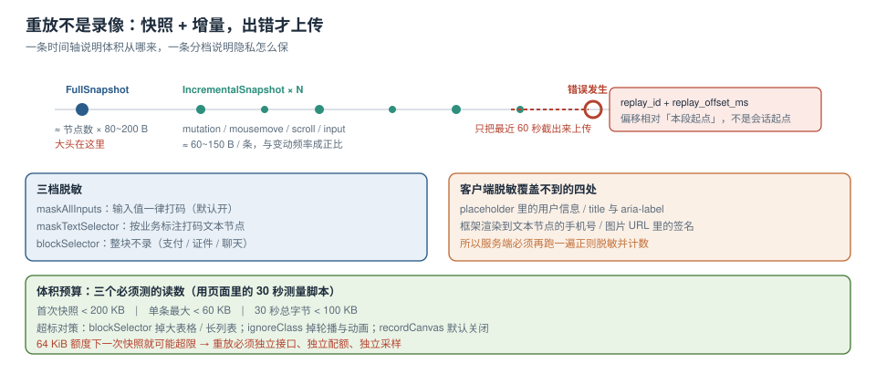

# 会话重放与隐私脱敏

「用户说他点了没反应」是前端最难复现的一类反馈：没有报错、没有接口失败、本地也复现不出来。会话重放（session replay）解决的就是这一类问题——它把用户看到的界面变化**记录下来**，让你在看错误的同时看到「他当时点了哪里、页面变成了什么样」。

但它也是最容易踩线的能力：录的东西越全，越可能把用户的手机号、地址、聊天内容一起录进去。所以本页的顺序是**先讲它到底录了什么、体积怎么算，再讲重放怎么合规地落地**。



本页判据族 `ETRP-A` ~ `ETRP-H`，共 8 条。

## 一、重放不是录像

重放记录的是**DOM 的变更序列**，播放时在浏览器里「重建」页面，而不是存一段视频。主流实现是 rrweb（Sentry 的 Replay 依赖它，`10.76.1` 里锁的是 **rrweb 2.44.1**）。它的事件分两大类：

| 类别 | 内容 | 频率 | 体积特征 |
| --- | --- | --- | --- |
| 全量快照（`FullSnapshot`） | 当前 DOM 树的序列化（节点类型、属性、文本） | 开始时 1 次，之后定期重拍（默认 30 min 或节点数超限） | **与节点数成正比**，是大头 |
| 增量事件（`IncrementalSnapshot`） | `mutation`（增删改）、`mousemove`、`scroll`、`input`、`viewport resize` | 每秒数次到数十次 | 与「页面变动频率」成正比 |

一个常见误解是「重放能还原用户的网络请求」。它不能——除非另外采集。**重放的坐标系只有 DOM 与输入，没有接口。**

::: danger 三个「重放看起来没用」的原因
1. **只录了 DOM，没录 canvas / iframe / 跨域资源**：图表、编辑器、第三方组件在回放里是空白。要么放弃这些区域，要么单独采集（canvas 需要 `recordCanvas: true`，体积会涨一个量级）。
2. **样式丢失**：回放容器里没有原页面的 CSS 时，画面会错位。rrweb 会内联部分样式，但 `@font-face`、外链 CSS 的优先级问题仍会出现。
3. **只录「出错之后」**：错误发生前用户做了什么才是关键。正确做法是**环形缓冲**，出错时把最近 30~60 秒一起发出去。
:::

## 二、体积：按节点数与变更频率算，不是按时间

重放体积没有「每分钟多少 KB」的固定答案，它由三个量决定：

```text
单次快照体积 ≈ 有效节点数 × 每节点平均字节（约 80~200 B，含属性与文本）
会话体积     ≈ 快照体积 × 重拍次数 + 增量事件数 × 每事件平均字节（约 60~150 B）
```

算例（**推算，不是实测**，请用自己的页面按第四节的方法测）：

| 页面 | 有效节点数 | 首次快照 | 5 分钟内增量 | 合计 |
| --- | --- | --- | --- | --- |
| 内容页（文章详情） | 800 | ≈ 100 KB | ≈ 300 条 × 100 B ≈ 30 KB | ≈ 130 KB |
| 后台列表页（带表格） | 3,000 | ≈ 400 KB | ≈ 1,200 条 ≈ 120 KB | ≈ 520 KB |
| 可视化大屏（含 canvas） | 1,500 + 画布 | ≈ 200 KB + 画布帧 | 画布每帧 10~50 KB，**不可按分钟估** | 数 MB 起 |

对照 [上报通道](../Transport/index.md) 的 64 KiB 额度：**一次快照就可能超限**。所以重放必须走独立接口、独立配额、独立采样。

::: warning 「录了再传」和「传了再录」是两种架构
- **实时上传**：每个增量事件都发一次 → 请求数爆炸，且页面关闭时最后一段会丢。
- **本地缓冲 + 触发上传**：默认只在内存里留最近 60 秒，**出错时**才整段上传。带宽省一个数量级，且上传的样本恰好是有用的样本。
推荐后者；采样率高的站点可以再叠加「1% 随机全量」用于观察正常路径。
:::

## 三、三档脱敏：mask / block / 忽略

| 档位 | 行为 | 适用 | 代价 |
| --- | --- | --- | --- |
| `maskAllInputs` | 所有输入框的值替换为 `*` | **默认开启**，没有例外 | 无（值本来就敏感） |
| `maskAllText` | 所有文本节点替换为 `*` | 医疗、金融、含个人信息的后台 | 回放可读性大幅下降 |
| `blockClass` / `blockSelector` | 整个子树不录（连结构都没有） | 支付表单、身份证上传、聊天窗口 | 该区域回放为空白 |
| `ignoreClass` | 只忽略该类元素的变更，保留结构 | 时间戳、动画、轮播 | 需要逐类标注 |

```typescript [src/telemetry/replay.ts]
import { record } from "rrweb";

record({
  emit: (event, isCheckout) => buffer.push({ event, isCheckout }),
  maskAllInputs: true,                  // 输入值一律打码
  maskTextSelector: "[data-pii]",       // 由业务标注：<span data-pii>138****</span>
  blockSelector: "[data-no-replay]",    // 支付、证件、聊天区域整块不录
  sampling: { mousemove: 50, scroll: 100, media: 800 }, // 降低高频事件密度
  recordCanvas: false,                  // 默认不录 canvas（体积原因）
  inlineStylesheet: true,
});
```

::: danger 客户端脱敏不充分，服务端还要再做一次
客户端的 `maskAllInputs` 只覆盖「值」，**不覆盖**：① 输入框的 `placeholder` 里被写进用户信息；② `title` / `aria-label` 属性；③ 由框架渲染到文本节点里的手机号（它不是 input）；④ 图片 URL 里的签名参数。
因此服务端入库前必须跑一遍**正则脱敏**（手机号、身份证、邮箱、银行卡、`token=` / `sign=` 查询参数），并把「命中脱敏规则的条数」做成指标——它是发现「业务把敏感信息渲染到页面上」的最快信号。
:::

## 四、怎么测自己站点的重放体积

不要相信任何「行业平均值」，用自己的页面测一次，十分钟能出结果：

```javascript [scripts/measure-replay.js]
import { record } from "rrweb";
let bytes = 0, events = 0, maxEvent = 0;
record({
  emit: (e) => {
    const s = JSON.stringify(e);
    bytes += s.length; events += 1; maxEvent = Math.max(maxEvent, s.length);
    if (e.type === 2) console.log("首次快照", s.length, "字节");     // FullSnapshot
  },
});
// 30 秒后打印：条数、总字节、单条最大
setTimeout(() => console.table({ events, bytes, avg: Math.round(bytes / events), maxEvent }), 30000);
```

判读方式：

| 读数 | 健康区间 | 异常含义 |
| --- | --- | --- |
| 首次快照 | < 200 KB | 超过 → 节点太多，考虑 `blockSelector` 掉大表格/长列表 |
| 单条最大 | < 60 KB | 超过 → 某个 mutation 一次改了一大片 DOM（如整表重渲染） |
| 30 秒总字节 | < 100 KB | 超过 → 高频动画或轮播在持续产生 mutation，用 `ignoreClass` 忽略 |

## 五、与错误事件的关联

重放的价值只有在「和错误对上」时才成立。三个字段必须写在错误事件里：

| 字段 | 含义 | 缺失后果 |
| --- | --- | --- |
| `replay_id` | 会话重放 id（同一会话内固定） | 看板上点不进回放 |
| `replay_offset_ms` | 错误发生时，相对重放开始的时间偏移 | 回放只能从头看，找不到那一秒 |
| `release` | 版本号 | 回放里的界面与当前代码不一致，无法对照 |

偏移量的取法要小心：重放缓冲区是**环形**的，`replay_offset_ms` 必须相对于**本次上传片段**的起点，而不是会话起点，否则上传片段被裁剪后时间轴会错位。

```typescript [src/telemetry/link-replay.ts]
// 出错时把「最近 60 秒」截出来，并记录错误在本段内的偏移
export function attachReplay(err: { ts: number }) {
  const seg = buffer.slice(-60_000);              // 时间窗裁剪
  const startTs = seg[0]?.event.timestamp ?? err.ts;
  return { replay_id: sessionId, replay_offset_ms: err.ts - startTs, segment: seg };
}
```

## 六、性能与合规的边界

| 关注点 | 事实 | 做法 |
| --- | --- | --- |
| 主线程占用 | `MutationObserver` 回调节流后仍可能每秒数十次序列化 | 用 `requestIdleCallback` 分片序列化；`sampling.mousemove` 降到 50 ms 一次 |
| 内存 | 环形缓冲持有最近 60 秒的 DOM 变更 | 缓冲上限（如 2,000 条 / 5 MB），超了丢最旧 |
| 用户告知 | 重放属于「记录用户操作」，多数司法辖区要求告知 | 隐私政策里写明；提供 `data-no-replay` 让业务标注敏感区 |
| 数据保留 | 回放数据长期留存风险最高 | 默认 30 天；与错误事件的保留期可以不同 |
| 内部人员访问 | 回放能看到真实用户界面 | 加访问审计；按项目授权而不是全员可见 |

::: warning 别把重放当「员工监控」
重放里能看到操作路径与输入节奏。上线前必须回答两个问题：**谁能看、看多久**。没有访问审计与保留期的重放，是合规事故的高发区，而不是可观测性能力。
:::

## 七、本页判据

| 编号 | 判据 | 看什么现象 | 不满足时改哪里 |
| --- | --- | --- | --- |
| `ETRP-A` | 默认 `maskAllInputs` | 配置里显式为 `true` | 打开；不要依赖默认值 |
| `ETRP-B` | 敏感区域用 `blockSelector` | 支付/证件/聊天区在回放里为空白 | 加 `data-no-replay` 标注 |
| `ETRP-C` | 服务端二次脱敏 | 入库前有正则脱敏与命中计数 | 加脱敏管道 |
| `ETRP-D` | 环形缓冲 + 错误触发上传 | 带宽与「有错的会话」成正比 | 改架构，别实时全传 |
| `ETRP-E` | 重放走独立通道 | 重放与错误不同接口/不同配额 | 拆分 |
| `ETRP-F` | 错误事件带 `replay_id` 与偏移 | 看板能从错误点进回放那一秒 | 补字段与时间轴换算 |
| `ETRP-G` | 有体积预算与实测 | 有「首次快照 / 单条最大 / 30 秒总量」三个读数 | 用第四节脚本测一次 |
| `ETRP-H` | 有保留期与访问审计 | 文档写明保留天数与授权范围 | 补策略 |

## 参考资料

- rrweb 官方文档：`record` 的配置项（`maskAllInputs`、`maskTextSelector`、`blockSelector`、`sampling`、`recordCanvas`）、事件类型与 `FullSnapshot` 的触发条件
- Sentry Docs：*Session Replay*（`maskAllText` / `blockAllMedia`、采样、与错误事件的关联）、*Replay privacy*
- web.dev：*Session replay* 的性能与隐私注意事项
- 本仓库：[上报通道与配额](../Transport/index.md)（64 KiB 额度与独立通道）、[符号化与版本对齐](../SourceMap/index.md)（版本号如何贯穿重放与错误）、[隐私与合规](../../../Others/PrivacyEngineering/index.md)（告知、最小化与保留期的一般原则）
