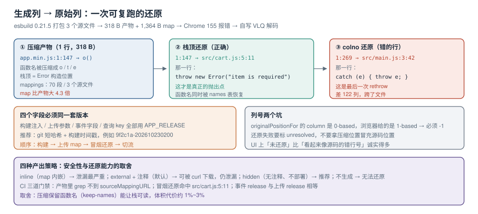

# 符号化与版本对齐

线上报错长这样：`at o (https://cdn.example.com/assets/index-9f2c1a.min.js:1:147)`。函数名 `o`、一个 1.4 MB 的单行文件、列号 147——**没有符号化，这条错误等于没报**。

符号化（symbolication）是把「压缩后的位置」还原成「源码位置」的过程。它依赖三样东西同时正确：**sourcemap 文件本身**、**错误事件里的版本号**、**还原时用的算法与列号口径**。三者任何一个错位，还原出来的行号就是错的——而错的行号比没有行号更糟，因为它会让修复的人去看一段无关的代码。



本页判据族 `ETSM-A` ~ `ETSM-H`，共 8 条。

## 一、sourcemap 里到底存了什么

一个 `.map` 文件是四段 JSON：

| 字段 | 内容 | 用途 |
| --- | --- | --- |
| `version` | `3` | 固定 |
| `sources` | 原始文件路径数组 | 还原后的「哪个文件」 |
| `sourcesContent` | 原始文件全文数组（可选） | 还原后能直接看到源码行，不必回拉 Git |
| `mappings` | VLQ 编码的映射串，按「生成行」用 `;` 分隔，行内用 `,` 分隔段 | 生成列 → 原始文件/行/列 |
| `names` | 标识符表（可选） | 还原变量名 |

`mappings` 的每个段是 4 或 5 个 VLQ 数字，含义是**相对增量**：`[生成列, 源文件索引, 原始行, 原始列, (名字索引)]`。因为是增量，解析器必须**顺序遍历**，不能随机跳。

本机实测的规模感：一个 318 B 的压缩产物，对应 `mappings` 里 **70 个段、3 个源文件**，map 文件 **1,364 B**——**map 比代码大 4.3 倍**。这解释了为什么「sourcemap 不是免费的」：一个 1.4 MB 的产物，map 通常在 3~6 MB。

## 二、四种产出策略

| 策略 | 产物 | DevTools 能否自动还原 | 线上是否泄漏源码 | 服务端能否还原 |
| --- | --- | --- | --- | --- |
| inline | `.js` 末尾 `data:application/json;base64,...` | ✅ | **✅ 严重泄漏**（map 就在 js 里） | ✅ |
| external（默认） | `.js` + `.js.map` + `//# sourceMappingURL=` 注释 | ✅ | **✅ 可被直接下载** | ✅ |
| hidden / external 无注释 | `.js` + `.js.map`，**不写注释** | ❌（需手工加载） | ⚠️ 只要不部署到同域就安全 | ✅ |
| 完全不上传 | 只有 `.js` | ❌ | ✅ | ❌ |

::: danger 「inline」与「external 且部署到同域」都是源码泄漏
`https://cdn.example.com/assets/index-9f2c1a.min.js.map` 是可以被任何人 `curl` 下来的。里面 `sourcesContent` 常常包含**完整源码、注释、内部接口路径、甚至遗留的测试账号**。正确做法是：**map 只上传到监控服务，不部署到 CDN**；或者部署到需要鉴权的内网路径。
:::

一个可用的 build 配置（Vite）：

```typescript [vite.config.ts]
import { defineConfig } from "vite";
import { sentryVitePlugin } from "@sentry/vite-plugin";

export default defineConfig({
  build: {
    sourcemap: "hidden",        // 生成 map，但不写 sourceMappingURL 注释
    rollupOptions: { output: { sourcemapExcludeSources: false } }, // 保留 sourcesContent 供服务端还原
  },
  plugins: [
    sentryVitePlugin({
      org: "example", project: "web",
      authToken: process.env.SENTRY_AUTH_TOKEN,
      sourcemaps: { assets: "./dist/**", filesToDeleteAfterUpload: "./dist/**/*.map" },
    }),
  ],
});
```

`filesToDeleteAfterUpload` 是关键：**上传成功后把本地 map 删掉**，从根上避免「误把 map 一起发布」。

## 三、本机实测：一次完整的还原

实验步骤（三步，全部可复跑）：

```shell
# 1) 三个源文件打成单文件并压缩，产出 external sourcemap
esbuild src/main.js --bundle --minify --sourcemap \
  --outfile=site/app.min.js --format=iife
# 产物：site/app.min.js 318 B，site/app.min.js.map 1,364 B

# 2) 用 headless Chrome 打开页面，捕获浏览器给的原始位置
"/Applications/Google Chrome.app/Contents/MacOS/Google Chrome" \
  --headless=new --disable-gpu --virtual-time-budget=3000 \
  --dump-dom http://127.0.0.1:8801/e.html
# 输出：{"msg":"Uncaught Error: item is required","line":1,"col":269,
#        "stack":"Error: item is required\n    at o (app.min.js:1:147)\n ..."}

# 3) 自写 VLQ 解码器读 mappings，把「生成列」映射回「原始位置」
node sm.mjs site/app.min.js.map 1 147
```

第三步的输出（逐字）：

```text
generated  1:147
mapped to  ../src/cart.js:5:11
原行内容    throw new Error("item is required");
映射条数   70  segments, sources=3
```

对照另一个位置：

| 来源 | 原始位置 | 映射结果 | 那一行是什么 |
| --- | --- | --- | --- |
| `err.stack` 栈顶 `1:147` | `onerror` 的 `error.stack` | `src/cart.js:5:11` | `throw new Error("item is required")` ← **真正的抛出点** |
| `onerror` 的 `colno=269` | `ErrorEvent.colno` | `src/main.js:3:42` | `try { addItem(cart, null); } catch (e) { throw e; }` ← **最后一次 rethrow** |

::: danger 用 `lineno/colno` 符号化会指错行
浏览器在 `ErrorEvent` 上给的 `lineno/colno` 是「错误被报告的位置」，而 `error.stack` 的栈顶是「`Error` 构造的位置」。本例里两者相差 122 列，还原到**两个不同的源文件**。正确做法：**只符号化栈帧，`lineno/colno` 仅用于「没有栈时的降级显示」**，且在 UI 上标注「未精确还原」。
:::

浏览器端拿到的栈在被压缩后，函数名会变成 `o`、`t`、`e`。符号化不只是换行号，还要**用 `names` 表恢复函数名**，否则看板上永远是「`o` 里出错了」。

## 四、版本对齐：三处必须同一个值

「还原到错的行」几乎总是版本对不齐。三个地方必须相等：

| 位置 | 来源 | 常见错误 |
| --- | --- | --- |
| 错误事件里的 `release` | 构建时注入（`__APP_VERSION__`、`VITE_APP_VERSION`） | 只在 CI 注入，本地构建是 `dev`，于是本地测的错误还原不了 |
| 上传 sourcemap 时用的 `release` | `sentry-cli` / 插件的 `--release` | 与上面用了不同的变量（一个是 git tag，一个是 `package.json` 版本） |
| 服务端查 map 时用的 `release` | 事件里的 `release` 字段 | 采集端把 `release` 截断或改写了 |

一个可靠的约定：**`release` = `git describe --always --dirty` 的短哈希 + 构建时间戳**，三处都从同一个环境变量读。

```shell
# CI 里只有一个来源
export APP_RELEASE="$(git rev-parse --short HEAD)-$(date -u +%Y%m%d%H%M)"
pnpm build                                  # 构建时把 APP_RELEASE 注入产物
npx @sentry/cli sourcemaps upload --release "$APP_RELEASE" ./dist
```

::: warning 先上传、后发版
如果顺序反了（先发版、后上传），在「发版完成」到「map 上传完成」之间产生的错误会**永久无法还原**——因为那时的 `release` 已经指向一批还没上传的 map。正确顺序：构建 → 上传 map → 校验还原成功 → 切换流量。
:::

Sentry 从 v7 起还引入了 **Debug ID**：在产物里注入一个 `debugId`，即使 `release` 写错也能按文件精确匹配。这解决了两类长期问题：同一份代码被多次构建（`release` 不同但内容相同）、以及 CDN 改写了文件名。

## 五、服务端还原：找不到 map 时要「诚实降级」

```javascript [collector/symbolicate.js]
import { SourceMapConsumer } from "source-map";

export async function symbolicate(event) {
  const frames = event.stack || [];
  // 1) 只处理有 file/line/col 的帧；顺序保持原样
  const need = frames.filter((f) => f.file && f.line && f.col);
  if (!need.length) return { frames, resolved: 0, reason: "no_frames" };

  // 2) 按 (release, file) 取 map；取不到就整帧标 unresolved，不要猜
  let resolved = 0;
  const out = [];
  for (const f of frames) {
    const raw = await loadMap(event.release, f.file);   // 可能为 null
    if (!raw) { out.push({ ...f, unresolved: true }); continue; }
    const consumer = await new SourceMapConsumer(raw);
    const pos = consumer.originalPositionFor({ line: f.line, column: f.col - 1 }); // ← 列号从 0 起
    if (!pos.source) { out.push({ ...f, unresolved: true }); continue; }
    out.push({ ...f, file: pos.source, line: pos.line, col: pos.column + 1, name: pos.name });
    resolved += 1;
  }
  return { frames: out, resolved, total: frames.length };
}
```

两个容易错的细节：

1. **列号从 0 开始**：`originalPositionFor` 的 `column` 是 0-based，而浏览器给的是 1-based。不做 `-1` 就会整体偏移一列，在单行压缩文件里这一列可能跨过一个逗号，落到隔壁表达式上。
2. **还原失败要显式标记**：UI 上显示「原样（未还原）」而不是把压缩位置美化一下当源码位置展示。

## 六、泄漏与可用性的取舍

| 方案 | 源码安全 | 还原能力 | 适用 |
| --- | --- | --- | --- |
| map 上传到监控服务，CDN 不部署 | ✅ | ✅ | 推荐 |
| map 部署在同域但加鉴权（`/__maps/`） | ⚠️ 依赖鉴权配置 | ✅ | 内网系统 |
| map 部署在同域公开路径 | ❌ | ✅ | 不要用 |
| inline map | ❌ | ✅ | 不要用 |
| 不生成 map | ✅ | ❌ | 只在「产物不到 50 KB 且错误极少」时可接受 |

顺带一条：即便不部署 map，**压缩后保留可读性**（terser 的 `keep_fnames`、esbuild 的 `--keep-names`）也能让栈里的函数名保持原样，代价是体积增加 1%~3%。对于错误率高的 B 端应用，这个交换通常值得。

## 七、CI 门禁：让「还原不了」在发布前暴露

```shell
# 发布前必须过的三道检查（任一失败即阻断发布）
set -e
# 1) 产物里没有 sourceMappingURL 注释（hidden 模式）
! grep -q "sourceMappingURL" dist/assets/*.js
# 2) map 已上传且可用：用一个已知错误位置做冒烟还原
node scripts/symbolicate-smoke.js --release "$APP_RELEASE" --expect "src/cart.js:5:11"
# 3) 事件里的 release 与上传的 release 一致
node scripts/check-release.js --release "$APP_RELEASE"
```

第 2 步的「冒烟还原」是整套流程里最有价值的一步：**它把「符号化」从「出事后才发现坏了」变成「发布前就验证」。**

## 八、本页判据

| 编号 | 判据 | 看什么现象 | 不满足时改哪里 |
| --- | --- | --- | --- |
| `ETSM-A` | 生产产物不含 `sourceMappingURL` | `grep` 产物为空 | 改 `sourcemap: "hidden"` |
| `ETSM-B` | map 不上 CDN | CDN 上 `curl *.map` 返回 404 | 上传后删除，或改部署路径 |
| `ETSM-C` | 只符号化栈帧 | 还原结果来自 `stack`，不是 `lineno/colno` | 改还原入口 |
| `ETSM-D` | 列号 0/1 基准正确 | 还原后的源码行与错误语义一致 | `column - 1` |
| `ETSM-E` | `release` 三处同源 | CI 里只有一个 `APP_RELEASE` | 统一变量 |
| `ETSM-F` | 先上传后发版 | 发布流程里上传在切流之前 | 调顺序 |
| `ETSM-G` | 还原失败显式标记 | UI 有「未还原」状态 | 加 `unresolved` 字段 |
| `ETSM-H` | 发布前有冒烟还原 | CI 里有 `symbolicate-smoke` | 补脚本并设为必过 |

## 参考资料

- Source Map 规范（`mappings` 的 VLQ 编码、`sourcesContent`、`names`）
- Sentry Docs：*Source Maps*（`hidden-source-map`、上传时机、Debug ID）、*Troubleshooting Source Maps*
- esbuild 文档：`--sourcemap` 与 `--sourcemap=external`（是否写注释的差别）
- Vite 文档：`build.sourcemap` 的四种取值（`true` / `false` / `inline` / `hidden`）
- 本仓库：[采集点与跨域盲区](../Capture/index.md)（`colno` 与栈列不一致的实测）、[指纹、合并与噪音治理](../Grouping/index.md)（为什么行列号不能进指纹）、[前端工程化](../../Others/FrontendEngineering/index.md)（构建流水线里的门禁位置）
