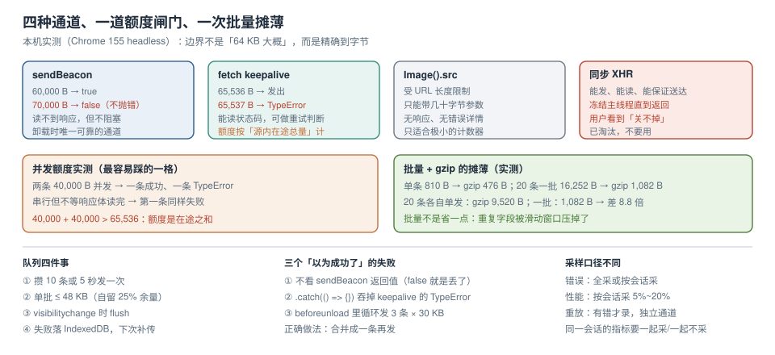

# 上报通道与配额

采集到错误之后，最常见的一句话是「发个请求传上去」。这一步有四个硬约束，任何一个没算清都会变成「线上有错、看板没有」：

1. **页面随时可能被关闭**，卸载后的异步请求会被浏览器取消；
2. **浏览器对「卸载期间还能发出去的请求」有严格体积上限**，超了**静默失败**；
3. **上报请求不能拖慢业务**，也不能在业务页面报错时再引发一次报错；
4. **上报量必须可控**，否则一次错误风暴会把采集端和用户的流量一起打爆。



本页判据族 `ETR-A` ~ `ETR-H`，共 8 条。

## 一、四种通道与它们真正的差别

| 通道 | 页面关闭时还能发 | 体积上限 | 能读响应 | 阻塞页面 | 适用 |
| --- | --- | --- | --- | --- | --- |
| `navigator.sendBeacon(url, data)` | ✅ 交给浏览器 | **65,536 B**（超限返回 `false`，不抛错） | ❌ | ❌ | 卸载时的最后一批 |
| `fetch(url, {keepalive: true})` | ✅ | 65,536 B，且按**源内在途总量**计 | ✅ | ❌ | 需要读状态码的重试判断 |
| `new Image().src = url` | ⚠️ 取决于浏览器 | URL 长度限制（约 2 KB 量级） | ❌ | ❌ | 极小的计数器，不推荐 |
| 同步 `XMLHttpRequest` | ✅ | 无明确限制 | ✅ | **✅ 阻塞主线程** | 已淘汰，不要用 |

同步 XHR 在 `unload` 里能用，但它会冻结页面直到请求完成——用户看到的是「点关闭后卡住两秒」。2026 年没有任何理由再用它。

## 二、本机实测：边界到底在哪

用 headless Chrome 直接探三条边界，结果比文档更细：

| 探测 | 调用 | 返回值 / 结果 |
| --- | --- | --- |
| beacon 60,000 B | `navigator.sendBeacon('/sink', 'x'.repeat(60000))` | `true` |
| beacon 70,000 B | 同上，`70000` | **`false`** |
| beacon 200,000 B | 同上，`200000` | **`false`** |
| keepalive 65,536 B | `fetch('/sink', {method:'POST', body:'x'.repeat(65536), keepalive:true})` | 请求发出（示例服务回 501，因为静态服务不收 POST） |
| keepalive 65,537 B | 同上，`65537` | **`TypeError: Failed to fetch`** |
| 两条 40,000 B **并发** | `Promise.all([...])` | **一条成功、一条 `TypeError`** |
| 两条 40,000 B **串行**（不等响应体读完） | 先 `await` 再发 | **第一条也失败**，间隔 400 ms 后第二条成功 |

最后一行是本页最值钱的读数：**配额按「源内所有在途 keepalive 请求之和」计算**，不是按单条。两条 40 KB 并发，合计 80 KB > 64 KB，必挂一条；串行但上一条的响应体还没读完，额度也还没释放，同样会挂。

::: danger 三个「以为成功了」的失败姿势
1. **`sendBeacon` 返回值不看**：超限时它返回 `false` 而不抛错。SDK 里必须 `if (!ok) fallbackToKeepalive()` 或计数上报失败。
2. **`fetch(...).catch()` 里吞掉错误**：`keepalive` 超限抛的是 `TypeError`，很多人写 `.catch(() => {})`，于是「配额超了」永久静默。
3. **在 `beforeunload` 里循环发多条**：每条 30 KB，发 3 条就超了总额度。正确做法是**合并成一条**再发。
:::

## 三、把额度换算成「一次能发几条」

算例（按本机实测的单条体积）：一条结构化错误事件 JSON **810 B**，gzip 后 **476 B**；20 条一批 **16,252 B**，gzip 后 **1,082 B**。

| 场景 | 单条体积 | 64 KiB 额度内的条数 | 结论 |
| --- | --- | --- | --- |
| 纯错误事件（批量、gzip） | 813 B/条（未压缩） | ≈ 80 条 | 一次 flush 上限设 20~50 条足够 |
| 纯错误事件（单条发送） | 810 B | ≈ 80 条 | 但 80 次往返不划算，见下节 |
| 带面包屑与设备信息的事件 | 3~5 KB | 13~21 条 | 面包屑要限量（如最近 20 条、每条 200 字符） |
| 带重放快照的错误 | 20~200 KB | **0~3 条** | 重放必须单独通道，绝不能和错误同批 |

最后一行是硬约束：**会话重放的快照体积与错误事件不是一个量级**（详见[会话重放](../SessionReplay/index.md)）。把两者塞进同一个 `sendBeacon`，结果就是「有重放的那几条错误永远传不上去」。

## 四、批量与 gzip：不是省一点，是省一个数量级

用同一条事件分别在「单条发送」与「20 条批量」下测体积：

| 形态 | 未压缩 | gzip | 备注 |
| --- | --- | --- | --- |
| 单条 | 810 B | 476 B | 一次 HTTP 往返 |
| 20 条一批 | 16,252 B | **1,082 B** | 一次往返，摊到每条 54 B |
| 20 条**各自单发** | 16,200 B | 9,520 B（20 × 476） | 20 次往返 |

gzip 后 1,082 B 对 9,520 B，**差 8.8 倍**。原因是批量里 20 条事件共享了大量重复字符串（字段名、文件 URL、版本号、UA），gzip 的滑动窗口把它们压掉了。这条性质决定了两个设计：

1. **尽量批量发**，哪怕延迟 5 秒；
2. **请求头要允许压缩**：`Content-Encoding: gzip` 需要服务端支持；如果不方便做 gzip，至少不要用「每条一个请求」。

```typescript [src/telemetry/transport.ts]
const LIMIT = 64 * 1024;        // 规范上限，留出余量
const SAFE = 48 * 1024;         // 自留 25% 余量，避免与服务端 header 共享额度

export async function send(events: unknown[]): Promise<boolean> {
  const body = JSON.stringify({ sentAt: Date.now(), events });
  const url = "https://collect.example.com/e";
  // 1) 小批量优先走 keepalive，能读状态码
  if (body.length <= SAFE) {
    try {
      const res = await fetch(url, {
        method: "POST", body, keepalive: true,
        headers: { "Content-Type": "text/plain;charset=UTF-8" }, // 避免 preflight
      });
      return res.ok;
    } catch { /* 落到 beacon */ }
  }
  // 2) 兜底走 beacon（页面即将关闭时唯一可靠的方式）
  if (body.length <= LIMIT) return navigator.sendBeacon(url, body);
  // 3) 两条都装不下：拆批，绝不截断（截断会丢字段，比丢整条更难查）
  const half = Math.ceil(events.length / 2);
  const a = await send(events.slice(0, half));
  const b = await send(events.slice(half));
  return a && b;
}
```

::: warning `Content-Type` 决定有没有预检
用 `application/json` 会触发 CORS 预检（`OPTIONS`），在卸载期间等于多一个往返，且预检失败时整条事件丢失。用 `text/plain`（服务端仍按 JSON 解析）可以避免预检。这是「上报接口为什么都收 text/plain」的真正原因。
:::

## 五、队列：内存 + 定时 + 卸载 + 离线

一个能用的上报队列要同时满足四件事：不丢、不重、不拖慢、不撑爆内存。

```typescript [src/telemetry/queue.ts]
type Item = { id: string; payload: unknown; ts: number };

const queue: Item[] = [];
const MAX = 200;                 // 内存上限，超了丢最旧的并计数
let timer: number | null = null;

export function enqueue(payload: unknown) {
  if (queue.length >= MAX) {
    queue.shift();
    reportSelf("queue_overflow");
  }
  queue.push({ id: crypto.randomUUID(), payload, ts: Date.now() });
  if (queue.length >= 10) flush();          // 攒够 10 条立刻发
  else if (timer === null) timer = window.setTimeout(flush, 5000); // 否则最多等 5 s
}

async function flush() {
  if (timer !== null) { clearTimeout(timer); timer = null; }
  const batch = queue.splice(0, 20);        // 单批上限，配合 48 KB 安全线
  if (!batch.length) return;
  const ok = await send(batch);
  if (!ok) await saveOffline(batch);        // 失败落 IndexedDB，下次启动补传
}

// 页面隐藏时是「最后的机会」：visibilitychange 比 beforeunload 更可靠（尤其移动端）
document.addEventListener("visibilitychange", () => {
  if (document.visibilityState === "hidden") void flush();
});
```

三个关键选择：

| 选择 | 理由 |
| --- | --- |
| 用 `visibilitychange` 而不是 `beforeunload` | 移动端 `beforeunload` 常不触发；`pagehide`/`visibilitychange` 是 Page Lifecycle 推荐的做法 |
| 单批上限 20 条 + 48 KB 安全线 | 与第三节的换算对齐；给 header 与压缩留余量 |
| 失败落 IndexedDB | `localStorage` 是同步 API，写入会阻塞主线程；且容量只有 5 MB 量级 |

::: danger 离线补传必须有幂等键
`saveOffline` 之后补传时，如果上一次其实已经到达服务端（只是响应丢了），会造成重复计数。所以每条事件都要带客户端生成的 `id`（`crypto.randomUUID()`），**服务端按 `id` 幂等写入**。没有这个键，补传只会把「错误数」越补越高。
:::

## 六、采样：错误与性能的规则完全不同

| 数据类型 | 采样策略 | 原因 |
| --- | --- | --- |
| 错误事件 | **全采**（或按会话采，同一会话内 100%） | 错误是低频高价值事件；按事件随机采会让「影响用户数」失真 |
| 性能指标（Web Vitals） | 按会话采 5%~20% | 高频、可统计；但**同一会话内的 LCP/INP/CLS 必须一起采或一起不采** |
| 会话重放 | 按错误采（有错才录）或 1%~5% | 体积大；「有错才录」能把预算集中在有用样本上 |
| 面包屑/日志 | 全量本地环形缓冲，只随错误上传 | 单独上传没有价值 |

「按会话采」的实现要点是**决策只做一次并固化**：用 `sessionId` 的哈希对 100 取模，落在区间内则整会话采。否则同一会话里有的指标采了、有的没采，`p75` 会算错。

```typescript [src/telemetry/sample.ts]
// 会话级一致采样：同一个 sessionId 永远得到同一个结论
export function sampled(sessionId: string, rate: number): boolean {
  const h = parseInt(sessionId.replace(/-/g, "").slice(0, 8), 16);
  return h % 10000 < rate * 10000;
}
```

::: warning 采样率变了，「变好」可能只是抽样变了
看板上必须**同时显示采样率与样本量**。10% 采样下的 `p75 = 2.1 s` 与 100% 采样下的 `p75 = 2.4 s` 不能直接比较——前者可能只是把慢用户抽掉了。采样率变更要在看板上打竖线标注。
:::

## 七、限流与自保：SDK 自己不能成为故障源

监控 SDK 的三条自保规则：

1. **SDK 的每次调用都包 `try/catch`**，且 `catch` 里**只做计数，不再上报**（避免「上报失败触发上报」的递归）。
2. **本地令牌桶限流**：每个页面每分钟最多 N 条（如 60），超出丢弃并累加 `dropped_by_limit`，在下一批里带一个汇总计数上报。
3. **上报域独立**：`collect.example.com` 与业务域分离，避免 Cookie 干扰、也避免业务域被打满连接数。

```typescript [src/telemetry/ratelimit.ts]
let tokens = 60, last = Date.now();
export function allow(): boolean {
  const now = Date.now();
  tokens = Math.min(60, tokens + ((now - last) / 1000) * 1); // 每秒补 1 个
  last = now;
  if (tokens < 1) return false;
  tokens -= 1;
  return true;
}
```

## 八、本页判据

| 编号 | 判据 | 看什么现象 | 不满足时改哪里 |
| --- | --- | --- | --- |
| `ETR-A` | 卸载时有 beacon 兜底 | 代码里有 `sendBeacon` 且检查返回值 | 补兜底与失败分支 |
| `ETR-B` | 单批不超过 48 KB | 上报日志里单请求体积有上限 | 加体积检查与拆批 |
| `ETR-C` | 不在同批混重放数据 | 重放走独立接口 | 拆分通道 |
| `ETR-D` | 每条事件有客户端幂等键 | 事件表有 `client_event_id` 唯一约束 | 加 `crypto.randomUUID()` 与服务端去重 |
| `ETR-E` | 用 `visibilitychange` 而非 `beforeunload` | 代码里没有 `beforeunload` 上报 | 改为 Page Lifecycle 事件 |
| `ETR-F` | 采样决策按会话一致 | 同一 `sessionId` 的指标采/不采一致 | 改成本地哈希取模 |
| `ETR-G` | SDK 自身异常不外溢 | 所有入口有 `try/catch` 且不递归上报 | 补包裹与自计数 |
| `ETR-H` | 有限流与丢弃计数 | 有 `dropped_by_limit` 指标 | 加令牌桶与汇总上报 |

## 参考资料

- WHATWG：*Beacon* 规范（65,536 B 上限、返回值语义）、*Fetch* 规范（`keepalive` 与 in-flight 配额）
- web.dev：*Page Lifecycle API*（`visibilitychange` / `pagehide` / bfcache）、*Don't lose user data on unload*
- MDN：*Navigator.sendBeacon*、*Request.keepalive*、*Content-Type 与 CORS 预检*
- Chrome for Developers：*Fetch keepalive quota* 相关 issue 与实现说明
- 本仓库：[指纹、合并与噪音治理](../Grouping/index.md)（哪些事件值得上报）、[会话重放与隐私脱敏](../SessionReplay/index.md)（为什么重放必须独立通道）、[告警、预算与闭环](../Alerting/index.md)（丢弃计数如何进入告警）
