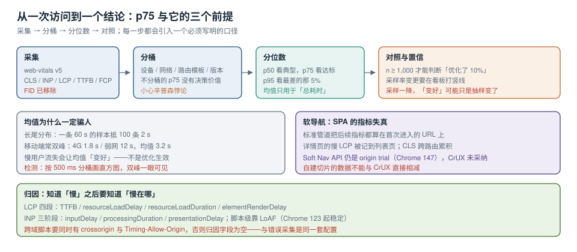

# 真实用户度量与软导航

错误监控回答「坏没坏」，体验度量回答「好不好」。后者更难，因为**它没有报错**——页面能打开、能点击、接口全 200，但用户等了 5 秒才看到内容，而你从任何日志里都看不出来。

本页不重复讲指标定义（那是[性能指标与评估](../../Others/PerformanceOptimization/Metrics/index.md) 的事），只讲三件在真实用户侧才会暴露的事：**为什么均值一定会骗你、SPA 的软导航为什么让指标失真、以及一个 `p75` 需要多少样本才可信**。



本页判据族 `ETWV-A` ~ `ETWV-H`，共 8 条。

## 一、web-vitals v5 的事实基线

| 项 | 现状（2026-10） | 影响 |
| --- | --- | --- |
| 导出函数 | `onCLS` / `onFCP` / `onINP` / `onLCP` / `onTTFB` | **`onFID` 已移除**，v4 代码升级会直接报「没有这个导出」 |
| 构建 | standard ≈ 2 KB（brotli）；attribution ≈ 3.5 KB | 归因信息值 1.5 KB，但只在你真的要定位时才需要 |
| INP 阈值 | 库默认 `durationThreshold = 40 ms`（平台默认 104 ms） | 低于 40 ms 的交互不进候选，但 `first-input` 始终观测 |
| 浏览器支持 | 全面转向 *Baseline Widely available* | 老浏览器不做降级，出问题就整块不执行——**要单独加载，别混进主 bundle** |
| 回调次数 | 可能**多次**：`visibilityState` 变 `hidden` 时 CLS/INP 会再报一次；从 bfcache 恢复后全部重报 | 服务端必须按「同一次访问」覆盖而不是累加 |
| LCP 冻结 | 首次用户交互后 LCP **停止更新** | 「用户一进来就点」的页面 LCP 会偏小，跨页面比较时要注意 |

```typescript [src/telemetry/vitals.ts]
import { onCLS, onINP, onLCP, onTTFB, onFCP } from "web-vitals/attribution";
import type { Metric } from "web-vitals";

const sent = new Set<string>();
function send(m: Metric) {
  // 同一个 id 只保留最后一次（可见性变化会重复回调）
  const key = `${m.name}:${m.id}`;
  if (sent.has(key) && m.name !== "CLS" && m.name !== "INP") return;
  sent.add(key);
  report({
    kind: "vital",
    message: m.name,
    where: location.pathname,
    context: {
      value: m.value, rating: m.rating, delta: m.delta, id: m.id,
      // attribution 构建才有：LCP 四段、INP 三阶段、CLS 最大偏移节点
      attribution: m.attribution,
      release: __APP_RELEASE__,
    },
  });
}
// 不要在 load 时一次性发：INP/CLS 要等到交互或隐藏才有值
onLCP(send); onINP(send); onCLS(send); onTTFB(send); onFCP(send);
```

::: danger 三个「指标采不到」的常见原因
1. **用 standard 构建却读 `m.attribution`**：字段是 `undefined`，不会报错，于是归因永远为空。
2. **在 `load` 事件里统一发一次**：INP 与 CLS 此时还没有最终值，上报的全是「半截数」。
3. **混进主 bundle**：主 bundle 的语法错误会让整块不执行；web-vitals v5 明确建议**独立加载**并用 `try/catch` 隔离。
:::

## 二、为什么均值一定骗人

性能数据是**长尾分布**：大多数访问很快，少数访问极慢。均值会被长尾拉高，且**拉高的幅度取决于有多少慢用户**——于是「均值下降」可能只是慢用户流失了。

| 统计量 | 对长尾的敏感度 | 适合回答 |
| --- | --- | --- |
| 均值 | 极高（一条 60 s 的样本能顶 100 条 2 s） | 总耗时（如「今天一共等了多少秒」） |
| 中位数（p50） | 低 | 典型用户体验 |
| **p75** | 中（Core Web Vitals 官方口径） | 「75% 的访问达标」 |
| p95 / p99 | 高 | 最差的那批人有多差 |

Google 的 Core Web Vitals 用 **p75** 作为「good / needs improvement / poor」的判定口径。工程上要同时看两个数：**p75 决定「整体是否达标」，p95 决定「最差的那 5% 有多糟」**。只看 p75 会出现「p75 = 2.4 s 达标，但 p95 = 18 s，客服仍在抱怨」的情况。

::: warning 均值还会掩盖「双峰」
移动端常见双峰：4G 用户 1.8 s、弱网用户 12 s，中间几乎没有样本。均值 = 3.2 s，看起来「略慢」；实际上**一半用户很快、另一半很慢**。检测方法：把分布按 500 ms 分桶画直方图，双峰一眼可见。
:::

## 三、分桶：不分桶的 p75 没有决策价值

同一个 `p75` 背后可能是完全不同的两组人。四个必分维度：

| 维度 | 分桶方式 | 不分会怎样 |
| --- | --- | --- |
| 设备档位 | 低端（< 4 GB 内存）/ 中端 / 高端 | 高端机的好成绩掩盖低端机的灾难 |
| 网络 | 4G / 5G / Wi-Fi / 弱网（`effectiveType`） | 办公室测出来的「达标」与地铁里的体验无关 |
| 路由 | 按 `pathname` 模板（`/order/:id`） | 首页很快、详情页很慢，混在一起看是「中等」 |
| 版本 | `release` | 优化上线后看不出变化，或把回归当成波动 |

有一个必须知道的统计陷阱：**辛普森悖论**。假设优化后每个设备档位的 p75 都下降了，但低端机的流量占比同时上升，**总体 p75 反而变差**。所以看板上「总体」那一栏只能用来对外汇报，**做决策必须看分桶**。

```sql [sql/vitals-p75.sql]
-- 按 路由模板 × 设备档位 × 版本 计算 p75（PostgreSQL）
select
  route_template,
  device_tier,
  release,
  count(*)                                            as n,
  percentile_cont(0.75) within group (order by value) as p75,
  percentile_cont(0.95) within group (order by value) as p95
from vitals
where name = 'LCP'
  and ts >= now() - interval '7 days'
group by 1, 2, 3
having count(*) >= 100            -- 样本量门槛，见下一节
order by p75 desc
limit 50;
```

## 四、p75 需要多少样本才可信

`p75` 是分位数，它的置信区间随样本量收窄。经验规则（自助法估算，**算例**）：

| 样本量 n | p75 的 95% 置信区间宽度（相对） | 能否判断「优化了 10%」 |
| --- | --- | --- |
| 50 | ±25% | ❌ |
| 200 | ±12% | ❌ |
| 1,000 | ±5% | ✅ |
| 10,000 | ±1.6% | ✅ 且能看周环比 |

结论：**单个路由的周度 p75 至少要有 1,000 个样本**才值得拿来决策。这也是为什么低流量页面要用「月」而不是「周」做窗口，或者干脆只看 p95 的绝对阈值（p95 对小样本更宽容，但噪声更大）。

::: danger 采样率变化会被误读成「体验变化」
采样率从 100% 降到 10% 的那一周，p75 往往会「变好」——因为采样通常在客户端做，而**低端机更容易在 SDK 初始化前就崩掉**，于是被抽掉的恰好是慢样本。规则：**采样率变更必须在看板上打竖线**，并且变更前后各保留一周的对照。
:::

## 五、软导航：SPA 的指标失真与它的边界

传统指标以「文档导航」为单位：一次 `load` 一组 LCP/CLS。SPA 里用户从 `/list` 点到 `/detail` 不产生新的文档，于是：

- **标准管道把后续所有指标都算在首次进入的那个 URL 上**；
- 详情页的慢 LCP 被记到列表页头上；
- `CLS` 会跨越多次路由切换累积。

三种处理方式，各有代价：

| 方式 | 做法 | 代价 |
| --- | --- | --- |
| 不做切片 | 只按「首次进入的 URL」统计 | 路由级优化无法度量 |
| 自建切片 | 路由变化时重置一个「软导航」观察器，单独上报 | 与 CrUX 数字不可比；实现要自己写 |
| Soft Navigations API | 浏览器原生支持软导航条目 | 2026-10 仍是 **origin trial（Chrome 147）**，**CrUX 未采纳** |

```typescript [src/telemetry/soft-nav.ts]
// 最小可用的软导航切片：路由变化后重新观察 LCP/CLS，并按新路由上报
let navId = 0;
export function onRouteChange(path: string) {
  const id = ++navId;
  const po = new PerformanceObserver((list) => {
    for (const e of list.getEntries()) {
      report({ kind: "vital", message: `soft_${e.entryType}`, where: path,
               context: { navId: id, startTime: e.startTime, release: __APP_RELEASE__ } });
    }
  });
  po.observe({ type: "largest-contentful-paint", buffered: false });
  // 旧观察器在 10 秒后断开，避免跨路由串数据
  setTimeout(() => po.disconnect(), 10_000);
}
```

::: warning 自建切片的数据不能和 CrUX 比
CrUX 用的是标准管道（按文档 URL 归属）。你自己切出来的「详情页 LCP 1.9 s」和 CrUX 上「/detail 的 LCP 2.8 s」**不是同一件事**，两者相减得到的「差异」没有意义。看板上要明确标注「自建切片 / 标准管道」两个口径。
:::

## 六、归因：知道「慢」之后要知道「慢在哪」

attribution 构建提供的关键字段：

| 指标 | 归因字段 | 能回答 |
| --- | --- | --- |
| LCP | `timeToFirstByte`、`resourceLoadDelay`、`resourceLoadDuration`、`elementRenderDelay` | 慢在服务端、慢在资源发现、慢在下载、还是慢在渲染 |
| INP | `inputDelay`、`processingDuration`、`presentationDelay`，以及 `longAnimationFrameEntries` | 慢在主线程被占、慢在事件处理、还是慢在绘制 |
| CLS | `largestShiftTarget`、`largestShiftTime`、`largestShiftValue` | 哪个元素在跳 |

INP 的脚本级归因依赖 **Long Animation Frames（LoAF，Chrome 123 起稳定）**：`sourceURL`、`sourceFunctionName`、`invoker`、`forcedStyleAndLayoutDuration`。这让「INP 差」能直接落到某个函数上。

**但跨域脚本拿不到归因**：需要脚本带 `crossorigin`，且响应头有 `Timing-Allow-Origin`。这与[采集页](../Capture/index.md)的跨域三条件是同一套机制——**跨域配置不做，错误和性能会同时失明**。

## 七、指标要连到业务，否则只是数字

三个「连起来」的做法，按成本从低到高：

1. **同页对照**：把「p75 达标的访问」与「未达标的访问」的转化率（加购、提交、支付）分开算。差异就是体验的业务价值，比任何评分都有说服力。
2. **版本对照**：发版前后各取 7 天，同路由同设备档位比较 p75 与转化率。注意同时看**流量结构**有没有变。
3. **预算化**：给每个核心路由设 p75 预算（如 `/checkout` ≤ 2.0 s），超预算的发布需要说明理由。这属于[告警与预算](../Alerting/index.md)的范畴。

## 八、本页判据

| 编号 | 判据 | 看什么现象 | 不满足时改哪里 |
| --- | --- | --- | --- |
| `ETWV-A` | 用 v5 的五个指标函数 | 代码里没有 `onFID` | 换成 `onINP` |
| `ETWV-B` | 指标独立加载且有隔离 | web-vitals 不在主 bundle 里 | 拆 chunk / 动态 import |
| `ETWV-C` | 不用均值做决策 | 看板只有 p50/p75/p95 | 加分位数，均值只留作参考 |
| `ETWV-D` | p75 有样本量门槛 | 低于 1,000 的桶被标灰 | 加 `having count(*) >= 1000` |
| `ETWV-E` | 四维分桶齐全 | 设备/网络/路由/版本都能切 | 补维度字段 |
| `ETWV-F` | 软导航口径显式标注 | 看板区分「自建切片 / 标准管道」 | 加标注，别混算 |
| `ETWV-G` | 用 attribution 构建做归因 | LCP/INP 有分段字段 | 换构建；跨域脚本配 TAO |
| `ETWV-H` | 指标连到业务动作 | 有「达标/未达标」的转化率对照 | 接业务埋点 |

## 与「音视频交付工程」的分工（第 203 天补充）

本页讲 Core Web Vitals 的采集与分位口径。视频播放的 QoE 可以借用它的**方法论**（分位 + 受影响会话占比），但**分母不能照搬**——Web Vitals 的分母是「页面浏览」，视频的分母是「播放会话」，两者在单页应用里数量完全不同。

| 概念 | Web Vitals（本页） | 视频 QoE（[体验与成本](../../../Backend/MediaDelivery/QoE/index.md)） |
| --- | --- | --- |
| 分母 | 页面浏览（page view） | 会话 / 播放 / 请求，三者分开 |
| 长尾指标 | INP 的 p75 | 卡顿的「有卡顿会话占比 + 时长占比 + 次数 p95」 |
| 归因字段 | 元素选择器、路由 | `play_id`、`bitrate`、`buffer_level` |

::: danger 一个会算错的细节
同一个播放页里，用户暂停 10 分钟再继续，是**一个会话、两次播放**。用页面浏览做分母算「起播时间」，会把续播也算成起播，p75 直接被拉低——看起来变好了，实际是分母错了。
:::

## 参考资料

- web-vitals 官方 README 与 v5 迁移说明（`onFID` 移除、`durationThreshold`、attribution 字段、重复回调与 bfcache）
- web.dev：*Core Web Vitals*（阈值与 p75 口径）、*Optimize INP*（三阶段）、*Optimize LCP*（四段拆解）、*Soft navigations*（origin trial 范围与 CrUX 现状）
- Chrome for Developers：*Long Animation Frames API*（`sourceURL` / `forcedStyleAndLayoutDuration`）、*CrUX API / History API*（数据口径与聚合周期）
- 本仓库：[性能指标与评估](../../Others/PerformanceOptimization/Metrics/index.md)（指标定义与 Lab 评估）、[监控与性能预算](../../Others/PerformanceOptimization/Monitoring/index.md)（预算与 Lighthouse CI）、[首屏与运行时性能](../../MobileH5/PagePerformance/index.md)（具体优化手段）、[告警、预算与闭环](../Alerting/index.md)（把 p75 变成告警）
