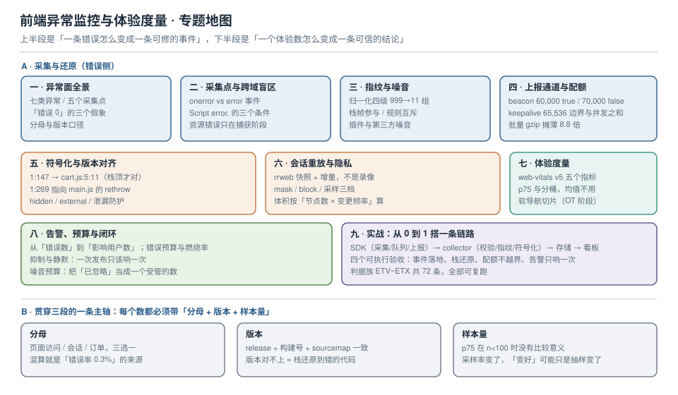

# 前端异常监控与体验度量

前端监控最容易被当成「接一个 SDK」的事：装包、填 DSN、看板一亮，就以为结束了。真正难的是**看板亮起来之后**——它亮的是不是真相？「错误数 0」可能只是采集漏了；「1000 条错误」可能只是同一个 bug 重复了 1000 次；「错误率 0.3%」这个分母可能是错的。

本专题只讲**数据从产生到被相信的那条链路**：采集点 → 归一化与分组 → 上报与配额 → 符号化还原 → 体验度量分桶 → 告警与闭环。三轮本机实测（Chrome 155 headless、esbuild 0.21.5 打包、Node 22）先给四个读数，它们是本专题的骨架：

- 同一个跨域脚本抛错，**不带 `crossorigin` 时拿到的是 `Script error.`（`src` 为空、`line=0`、`col=0`、`error=null`）**；带上 `crossorigin="anonymous"` 且 CDN 回 `Access-Control-Allow-Origin` 之后，才拿到 `cross origin boom` 与完整栈。
- 资源加载失败（`` 404）**根本不会进 `window.onerror`**；只会在**捕获阶段**的 `error` 事件里出现，且要靠 `event.target` 才知道是哪个元素。
- `navigator.sendBeacon` 传 **60,000 B 返回 `true`，70,000 B 返回 `false`**；`fetch(..., {keepalive:true})` 传 **65,536 B 成功、65,537 B 抛 `TypeError: Failed to fetch`**，且**两条 40 KB 并发时必挂一条**——额度是「源内所有在途请求之和」。
- 同一条压缩后的错误，`onerror` 给的 `colno=269` 用 sourcemap 还原到的是**最后一次 `throw e` 的位置**（`main.js:3:42`），而 `err.stack` 栈顶 `1:147` 还原到的才是**最初的抛出点**（`cart.js:5:11`）。

::: tip 一句话理解
前端监控的产出不是「一堆事件」，而是**三个能被追问的数**：这个错误影响了多少用户、它对应哪一行源码、它比上周变好了还是变坏了。三个问题里任何一个答不出来，这套监控就只是日志搬运。
:::

::: info 本专题与相邻专题的分工
- **性能指标的定义与优化手段** → [性能指标与评估](../Others/PerformanceOptimization/Metrics/index.md) 与 [监控与性能预算](../Others/PerformanceOptimization/Monitoring/index.md)：那两页讲「LCP 是什么、怎么优化、预算怎么设」，本专题只讲**这些数在真实用户侧怎么被采集、分桶、归因，以及为什么均值会骗人**。
- **首屏与运行时的具体优化** → [首屏与运行时性能](../MobileH5/PagePerformance/index.md)：那页是「怎么把 LCP 从 4 s 降到 2 s」，本页是「降完之后你怎么证明它真的降了」。
- **测试与覆盖率** → [前端测试](../Testing/Overview/index.md)：测试解决「已知路径不出错」，监控解决「未知路径出错时你知道」；两者共用 sourcemap，但门禁位置不同。
- **框架层的错误边界** → [错误边界](../Frame/React/ErrorBoundaries/index.md)：那页讲 React 的 `componentDidCatch` 与降级 UI，本页讲**边界捕获之后的第 2 步**——怎么把它变成一条可分组、可还原、可告警的事件。
- **服务端与基础设施可观测** → [可观测性工程](../../Ops/Observability/Overview/index.md)：那边是 metrics/logs/traces 三支柱，本页是浏览器这一端的「第四根柱子」，且**采样率、配额、隐私三件事与后端完全不同**。
- **大模型应用的观测** → [LLM 可观测性](../../AI/LLMObservability/Overview/index.md)：那边管 token 成本与链路，本页管 DOM 与运行时。
:::

## 目录

- [异常面全景与采集点地图](Overview/index.md)
- [采集点与跨域盲区](Capture/index.md)
- [指纹、合并与噪音治理](Grouping/index.md)
- [上报通道与配额](Transport/index.md)
- [符号化与版本对齐](SourceMap/index.md)
- [会话重放与隐私脱敏](SessionReplay/index.md)
- [真实用户度量与软导航](WebVitals/index.md)
- [告警、预算与闭环](Alerting/index.md)
- [实战：从 0 到 1 搭一条链路](Practice/index.md)

## 专题地图

## 判据纪律

沿用全库写法：**每页 8 条，编号形如 `ETV-A`**，逐页前缀唯一，可被 `utils/audit` 下的判据类巡检机械核对。每条判据都要能回答三件事：**看什么现象、判成什么、不满足时改哪里**。

| 页面 | 判据族 | 覆盖的约定 | 条数 |
| --- | --- | --- | --- |
| 异常面全景与采集点地图 | `ETV-A` ~ `ETV-H` | 异常分类、采集点覆盖、分母口径、盲区登记 | 8 |
| 采集点与跨域盲区 | `ETC-A` ~ `ETC-H` | `onerror` 与 `error` 事件、捕获阶段、跨域三条件、资源错误 | 8 |
| 指纹、合并与噪音治理 | `ETF-A` ~ `ETF-H` | 归一化规则、栈帧参与、规则互斥、噪音源识别 | 8 |
| 上报通道与配额 | `ETR-A` ~ `ETR-H` | beacon/keepalive 边界、批量摊薄、采样、离线补传、限流 | 8 |
| 符号化与版本对齐 | `ETSM-A` ~ `ETSM-H` | sourcemap 策略、版本匹配、还原口径、泄漏防护、CI 门禁 | 8 |
| 会话重放与隐私脱敏 | `ETRP-A` ~ `ETRP-H` | 快照与增量、采样、掩码、体积预算、回放与事件关联 | 8 |
| 真实用户度量与软导航 | `ETWV-A` ~ `ETWV-H` | 指标口径、p75、分桶、软导航、归因、采样置信 | 8 |
| 告警、预算与闭环 | `ETA-A` ~ `ETA-H` | 影响面、错误预算、阈值形态、抑制、噪音预算、闭环 | 8 |
| 实战 | `ETX-A` ~ `ETX-H` | SDK 分层、collector 契约、入库与指纹、看板、演练、验收 | 8 |

合计 **9 族 72 条**。

## 事实与版本速览（2026-10 核对）

| 项 | 现状 | 对本专题的影响 |
| --- | --- | --- |
| Sentry JavaScript SDK | **10.x 线**，最新 `10.76.1`（2026-10-06）；`@sentry/browser` 约 **27.56 KB**（gzip，含默认集成） | 「装个 SDK 就完事」的体积代价要算清楚：加 Replay 后同一构建约 **84.51 KB** |
| Sentry 的 Replay 依赖 | `rrweb 2.44.1`（随 `10.76.1` 升级） | 重放不是自研的首选项，先读第三方的体积与脱敏边界 |
| web-vitals | **5.1.x**；`FID` 已从导出中移除，只剩 `onCLS/onFCP/onINP/onLCP/onTTFB` | 老文档里的 `onFID` 写法在 v5 会直接报「没有这个导出」 |
| INP 观测阈值 | 库默认 `durationThreshold = 40 ms`（平台默认 104 ms），`first-input` 始终观测 | 「页面没有 INP」通常不是没交互，而是采样或阈值配置的问题 |
| Core Web Vitals 阈值 | LCP ≤2.5 s、INP ≤200 ms、CLS ≤0.1（good 档，p75 口径） | 分母是「页面访问」，不是「接口调用」，两者不能混算 |
| 软导航（SPA 路由切换） | Soft Navigations API 仍处 **origin trial（Chrome 147，2026-04）**，**CrUX 未采纳** | 自建 RUM 可以先行切片，但不能拿它跟 CrUX 的数直接对比 |
| 长动画帧归因 | **LoAF 自 Chrome 123 稳定**，提供 `sourceURL` / `sourceFunctionName` / `invoker` | INP 归因不必再靠猜；但跨域脚本需 `crossorigin` + `Timing-Allow-Origin` |
| Reporting API | **2026-03 起 Baseline newly available**（Chrome 69 / Edge 79 / Firefox 149 / Safari 16.4） | `deprecation` / `csp-violation` 报告终于可以统一收；但 Safari 的 CSP 报告要 18.4+ |
| `sendBeacon` 上限 | 规范 **65,536 B**；实测 70,000 B 直接返回 `false`（不抛错） | 「上报失败静默」的第一大来源：返回 `false` 时没人看 |
| `fetch` keepalive 上限 | 规范 65,536 B，且按**源内在途总量**计；实测并发两条 40 KB 必挂一条 | 批量上报必须自己排队，不能靠浏览器兜底 |
| Sourcemap | `sourceMappingURL` 注释 + `mappings`（VLQ）；esbuild 可产出 external（不写注释） | 「线上带 map」= 源码泄漏；「线上不带 map」= 必须有上传与版本对齐 |

::: warning 关于「实测」的诚实标注
本专题的数字分两类，正文逐处标注：

- **本机可复跑**：Chrome **155.0.7339.x headless**（`--headless=new --dump-dom --virtual-time-budget`）、两个 `python3 -m http.server` 风格的静态服务（8801 站点 / 8802 跨域 CDN，后者带 `Access-Control-Allow-Origin: *`）、esbuild **0.21.5**（`--bundle --minify --sourcemap`）、Node **22.22.2**（自写 VLQ 解码器读 `mappings`）。命令都写在页面里，**脚本本身不入库**。用途是证明**语义与量级**，不是你们生产的绝对值。
- **公开口径**：Sentry / web-vitals / rrweb 的版本与体积、规范里的 65,536 B、CrUX 与 LoAF 的能力边界，逐条标来源；凡属推算（配额换算、采样误差）一律写「算例」。

一处必须说清的局限：本机**没有做真实用户采样**（没有流量，也没有部署），因此所有 `p75`、`INP` 分桶、告警阈值的具体数字都是**算例**；页面会明确写「按语义推算」，并给出你自己采集后该怎么算的公式，**没有一条把「文档说会这样」写成「实测如此」**。
:::

## 三条底线

1. **每条错误都必须能回到一行源码**：做不到这一点，监控的产出就只是「有个错」，而不是「改哪里」。这条底线由 [符号化](SourceMap/index.md) 与 [指纹](Grouping/index.md) 共同保证。
2. **每个指标都必须带分母与版本**：`0.3%` 不带「哪个版本、哪个页面、多少访问」就没有意义；`p75` 不带「样本量与时间窗」就不能比较。这条底线由 [体验度量](WebVitals/index.md) 与 [告警](Alerting/index.md) 保证。
3. **上报通道必须能在页面关闭的那一刻仍然工作，也必须能在它失效时不拖垮业务**：前者靠 `sendBeacon`/`keepalive` 与配额预算，后者靠「监控 SDK 自己出错不能冒泡到业务」。这条底线由 [上报通道](Transport/index.md) 保证。

## 参考资料

- Sentry Docs：*JavaScript*（`@sentry/browser` 的默认集成与体积）、*Source Maps*（`sourceMappingURL`、Debug ID、上传时机）、*Session Replay*（rrweb、`maskAllText`、采样）
- web-vitals 官方 README 与 v5 迁移说明（`onFID` 移除、`durationThreshold` 默认 40 ms、attribution build）
- web.dev：*Core Web Vitals*（阈值与 p75 口径）、*INP*（三阶段拆解与离群值过滤）、*Soft navigations*（origin trial 范围）
- W3C / WHATWG：*Beacon*（65,536 B 上限与返回值语义）、*Fetch*（`keepalive` 与在途配额）、*Reporting API*（`ReportingObserver` 的 report 类型）
- MDN：*Window: error event*（`ErrorEvent` 五参数）、*GlobalEventHandlers.onerror*（返回 `true` 抑制默认行为）
- Chrome for Developers：*Long Animation Frames API*（`sourceURL` / `forcedStyleAndLayoutDuration`）
- 本仓库相邻专题：[性能指标与评估](../Others/PerformanceOptimization/Metrics/index.md)、[监控与性能预算](../Others/PerformanceOptimization/Monitoring/index.md)、[首屏与运行时性能](../MobileH5/PagePerformance/index.md)、[错误边界](../Frame/React/ErrorBoundaries/index.md)、[可观测性工程](../../Ops/Observability/Overview/index.md)
