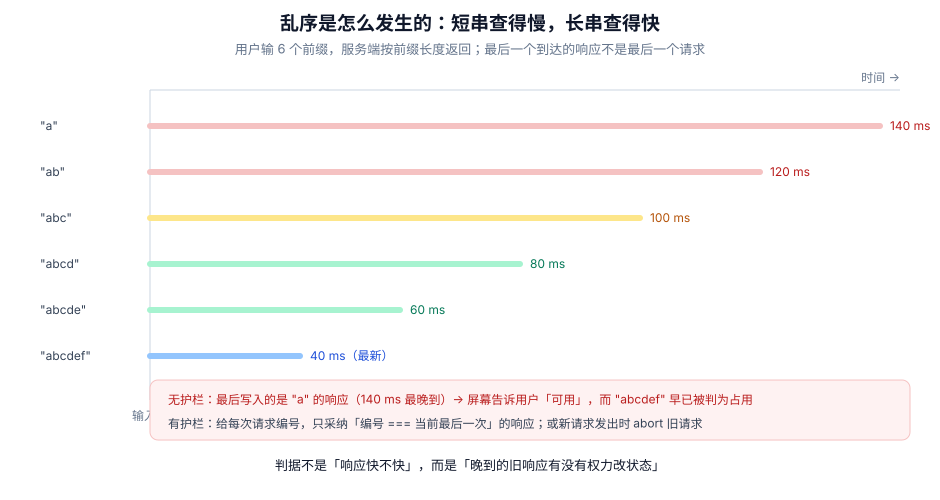

# 异步校验：乱序、取消与防抖

本页判据族 `FVA-A` ~ `FVA-H`，共 8 条。

有些规则本地判不了：邮箱是否已注册、信用代码是否被占用、优惠码是否有效。它们必须问服务端，而一旦问服务端，就引入了三个新问题：**响应会乱序、结论会过期、请求要能取消**。

::: tip 一句话理解
异步校验的唯一铁律：**晚到的旧响应没有权力改状态**。判断依据不是「响应快不快」，而是「这个响应对应的还是不是用户当前输入的值」。
:::



## 一、乱序不是「偶发」，是稳定复现

真实唯一性检查的延迟与查询串有关：短串（`a`）在服务端要扫更多候选，长串（`abcdef`）几乎精确命中。于是**先发的请求后到**，几乎每次都会发生。

本机实测（Node 22.22.2，`setTimeout` 模拟服务端延迟，延迟随串长递减）：

| 实现 | 单次输入 6 个前缀的实际提交次数 | 最终状态的 `query` | 200 轮里「最终状态是过期值」的轮次 |
| --- | --- | --- | --- |
| 无护栏 | 6 | `"a"`（最短、最慢的那个） | **200 / 200** |
| 序号护栏 | 1（只采纳最新一次） | `"abcdef"` | **0 / 200** |
| AbortController | 1（取消 5 次） | `"abcdef"` | **0 / 200** |

「无护栏」不是「偶尔错一次」，而是**每次都错**：因为延迟与串长严格反相关，最慢的永远是最早发的那一个。这个结论在真实系统里会被网络抖动打散成「偶发」，但**机制完全一样**，只是概率降低——所以「我这边测不出来」不能作为不修的理由。

## 二、两种护栏，选一个就够

### 护栏一：序号（sequence guard）

给每次请求编号，回来时比对「我还是不是最新的那次」：

```typescript [src/form/useAsyncCheck.ts]
import { useRef } from "react"

export function useAsyncCheck<T>(check: (v: string) => Promise<T>) {
  const seq = useRef(0)
  const last = useRef<{ value: string; result: T } | null>(null)

  return async function run(value: string): Promise<T | null> {
    const mine = ++seq.current
    const result = await check(value)
    if (mine !== seq.current) return null        // 已被更新的请求取代，丢弃
    last.current = { value, result }
    return result
  }
}
```

它的优点是**不需要取消能力**（`fetch` 之外的老接口也能用），缺点是**请求还是发出去了**——服务端白干一次活。

### 护栏二：AbortController（真的取消）

```typescript [src/form/useUniqueCheck.ts]
export function useUniqueCheck() {
  const ctrl = useRef<AbortController | null>(null)

  return async function check(email: string) {
    ctrl.current?.abort()                        // 取消上一次
    const mine = new AbortController()
    ctrl.current = mine
    try {
      const res = await fetch(`/api/email-available?email=${encodeURIComponent(email)}`, {
        signal: mine.signal,
      })
      if (!res.ok) throw new Error(`HTTP ${res.status}`)
      return (await res.json()) as { available: boolean }
    } catch (e) {
      if (mine.signal.aborted) return null       // 预期路径，不是错误
      throw e
    }
  }
}
```

::: danger 取消的三个坑
1. **把 `AbortError` 当错误上报**：取消是正常路径，混进错误监控会把「用户打字快」变成「接口错误率上升」。
2. **只取消不判序号**：`abort()` 之后旧请求可能已经进入 `then`（响应已到、微任务未执行），仍然会写状态。**取消与序号最好同时用**：序号管「写不写」，取消管「省不省」。
3. **`fetch` 的 `signal` 不支持重试**：同一个 `AbortController` 被 `abort` 后不能复用，重试必须新建。
:::

## 三、三种状态的合并：`idle` / `checking` / `ok` / `taken` / `error`

异步校验不是「有错 / 没错」两个状态，而是五个。少了任何一个，UI 都会说谎：

| 状态 | 含义 | UI 应该 |
| --- | --- | --- |
| `idle` | 还没查 | 什么都不显示（不是「可用」） |
| `checking` | 正在查 | 显示进度（小 spinner 或「检查中」），**提交按钮不可点** |
| `ok` | 查过，可用 | 可以显示绿色对勾 |
| `taken` | 查过，被占用 | 显示红字，并给替代建议 |
| `error` | 查询本身失败（网络/500） | 显示「暂时无法校验」，**不要**显示「可用」，也不要阻止提交（由服务端兜底） |

最后一行是关键判断：**查询失败 ≠ 校验不通过**。把网络错误显示成「该邮箱不可用」，用户会去改一个本来正确的邮箱。

## 四、防抖、去重与「提交时等它」

异步校验的请求量靠防抖控制（见 [校验时机](../ValidationTiming/index.md) 的实测：20 次按键 → 防抖后 1 次）。但防抖会带来一个副作用：**最后一次输入可能还没查**。

于是提交路径必须显式等它：

```typescript [src/form/submitWithAsyncCheck.ts]
async function submit() {
  // ① 先等「进行中的异步校验」，最多等 3 s
  const settled = await Promise.race([
    waitForChecks(),                                   // 返回所有 in-flight 的 Promise
    new Promise((r) => setTimeout(() => r("timeout"), 3000)),
  ])
  if (settled === "timeout") {
    setFormError("校验超时，请稍后重试")                 // 不静默放行
    return
  }
  // ② 再跑一次「提交前的最终判定」（服务端仍然会再判一次）
  if (hasBlockingError()) return
  await send()
}
```

这里刻意保留「服务端再判一次」：异步校验只是**减少无效提交**，不是一致性保证。两个用户同时注册同一邮箱时，只有唯一索引能拦住。

## 五、错误归属：别把错误挂到错的值上

乱序除了让结论过期，还会让**错误挂错字段**：

```text
用户输入 a@b.com  → 服务端返回「已注册」（慢）
用户改成 a@c.com  → 服务端返回「可用」（快）
慢的回来，把「已注册」写进 email 字段 → 用户看到 a@c.com 旁边写着「已注册」
```

护栏的做法不是「只在最新时写」，还要**把结论与被校验的值绑定**：

```typescript [src/form/fieldAsyncState.ts]
type Checked<T> = { value: string; state: "ok" | "taken" | "error"; at: number }

// 渲染时比对：结论必须属于「当前值」才显示
function errorFor(current: string, checked: Checked<unknown> | null) {
  if (!checked) return null
  if (checked.value !== current) return null      // 结论已过期，直接不显示
  return checked.state === "taken" ? "该邮箱已被占用" : null
}
```

`checked.value !== current` 这一行是「防过期」的最后一道闸：即使前两道护栏都失效，界面也不会显示一条属于旧值的错误。

## 六、判据 `FVA-A` ~ `FVA-H`

| 编号 | 判据 | 怎么验证 |
| --- | --- | --- |
| `FVA-A` | 每次异步请求带序号或信号，旧响应无权写状态 | 连输 6 个前缀，最终显示必须对应最后一个前缀 |
| `FVA-B` | 取消（`AbortError`）不计入错误率 | 打字过程中切走页面，错误监控无新增 |
| `FVA-C` | 异步状态是五态，`idle` 不显示为「可用」 | 输入后未返回前，界面不出现绿色对勾 |
| `FVA-D` | 查询失败显示「暂时无法校验」，不显示「不可用」 | 断网后输入，提示文案不含「已被占用」 |
| `FVA-E` | 提交前等待进行中的校验，超时则明确提示 | 用 3 s 延迟的 mock，提交应停在「校验超时」而不是直接成功 |
| `FVA-F` | 异步错误与被校验值绑定，值变了错误立即消失 | 看到「已注册」后改一个字符，红字应立即消失 |
| `FVA-G` | 服务端仍做最终唯一性判定（有唯一索引） | 并发两个请求注册同一邮箱，只有一个成功 |
| `FVA-H` | 防抖窗口内的输入不发起请求，但提交绕过防抖 | 连输 10 字符只有 1 次请求；点提交时必然有一次判定 |

## 七、验证方式

```javascript
// ① 乱序复现：让短串慢、长串快，看最终状态
const INPUT = ["a", "ab", "abc", "abcd", "abcde", "abcdef"]
const latency = (q) => Math.max(8, 140 - q.length * 20)
let last = null
await Promise.all(INPUT.map(async (q) => { await sleep(latency(q)); last = q }))
console.log("无护栏最终:", last)        // 期望 "a"（过期值）
```

```shell
# ② 检查是否处理了 abort
grep -rn "AbortError" src/ || echo "警告：没有区分取消与真实错误"
# ③ 检查异步状态是否有 idle（防「未查=可用」）
grep -rnE "emailStatus\s*===\s*\"ok\"" src/ | head -5
```

```typescript
// ④ 绑定校验：值变了，旧结论必须失效
const checked = { value: "a@b.com", state: "taken" as const }
console.log(errorFor("a@c.com", checked))   // 期望 null
console.log(errorFor("a@b.com", checked))   // 期望 "该邮箱已被占用"
```

## 八、相关页面与下一篇

- 下一篇：[错误呈现与可访问性](../ErrorPresentation/index.md)——异步结论最终要变成人能读的一句话。
- 上游：[校验时机](../ValidationTiming/index.md)（防抖窗口与触发点的关系）。
- 相邻必读：[schema 单一来源](../SchemaSource/index.md)（哪些规则不该进 schema）、[提交状态机](../SubmitFlow/index.md)（提交时如何等它）。

## 参考资料

- [MDN · `AbortController`](https://developer.mozilla.org/en-US/docs/Web/API/AbortController)
- [MDN · `AbortSignal`](https://developer.mozilla.org/en-US/docs/Web/API/AbortSignal)
- [web.dev · 避免过期的响应（stale response）](https://web.dev/articles/fetch-api-guide)
- [TanStack Form · Async validation 与 `onChangeAsyncDebounceMs`](https://tanstack.com/form/latest/docs/framework/react/guides/validation)
