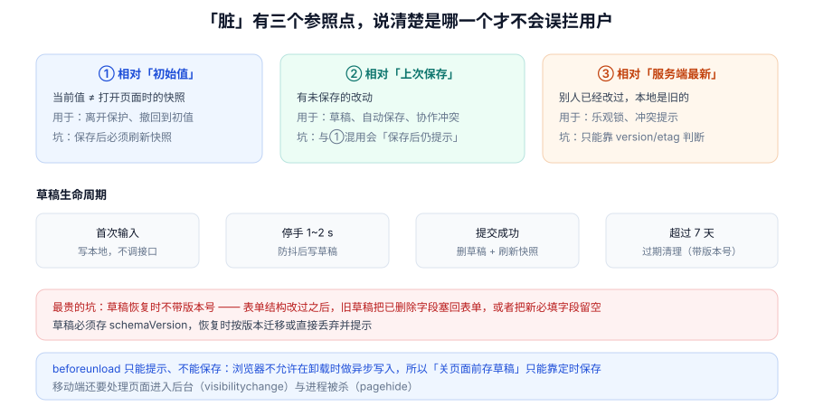

# 脏检查、草稿与离开保护

本页判据族 `FVD-A` ~ `FVD-H`，共 8 条。

「您有未保存的修改」这条提示，是最容易变成噪声的功能：挡得太多，用户学会无脑点「离开」；挡得太少，用户丢过一次数据就再也不信这个表单。要让它有用，先得说清**「脏」是相对谁**。

::: tip 一句话理解
脏有三个参照点：**初始值、上次保存、服务端最新**。三者混用，就必然出现「保存完了还提示未保存」和「别人改过了我却不知道」这两类问题。
:::



## 一、三个参照点

| 参照点 | 判据 | 用途 | 典型 bug |
| --- | --- | --- | --- |
| **① 初始值**（打开页面时的快照） | `values ≠ initial` | 离开保护、「撤销修改」 | 保存后不刷新快照 → 一直提示脏 |
| **② 上次保存** | `values ≠ lastSaved` | 草稿、自动保存、协作 | 与①混用 → 自动保存后仍拦截 |
| **③ 服务端最新** | `version` / `etag` 不一致 | 乐观锁、冲突提示 | 只有①②，永远发现不了「别人改过」 |

```typescript [src/form/useDirty.ts]
import { useMemo, useRef } from "react"

export function useDirty<T extends Record<string, unknown>>(values: T, initial: T) {
  const lastSaved = useRef<T>(initial)

  const dirtyVsInitial = useMemo(() => !shallowEqual(values, initial), [values, initial])
  const dirtyVsSaved = useMemo(() => !shallowEqual(values, lastSaved.current), [values])

  const markSaved = () => { lastSaved.current = values }   // 保存成功后调用
  return { dirtyVsInitial, dirtyVsSaved, markSaved }
}

function shallowEqual(a: Record<string, unknown>, b: Record<string, unknown>) {
  const ka = Object.keys(a)
  if (ka.length !== Object.keys(b).length) return false
  for (const k of ka) if (a[k] !== b[k]) return false
  return true
}
```

`markSaved` 必须同时**推进快照**并**重新渲染**（`useRef` 不触发渲染，所以要配一个 `useState` 的计数器或把快照放进 state）。只推进快照不重渲染，效果是「数据对了但界面还显示脏」——比不修更让人困惑。

## 二、脏检查的成本：不能放在输入事件里

本机实测（200 字段表单，2 万次）：

| 实现 | 单次耗时 | 占 60fps 帧预算（16.67 ms） |
| --- | --- | --- |
| `JSON.stringify(a) === JSON.stringify(b)` | **33.6 µs** | **201.6%** |
| 逐键浅比较 | **17.28 µs** | 103.6% |

单看微秒数很小，但两者都**超过一帧的预算**——也就是说，如果每次输入都算一次脏，光是这个判断就能让输入掉到 30fps 以下。而且用户完全不知道为什么卡（他没看到任何重活）。

正确做法是**把脏检查从输入路径上挪走**：

| 时机 | 做法 |
| --- | --- |
| 输入时 | 只置一个 `maybeDirty = true` 标记（O(1)） |
| 空闲时（`requestIdleCallback` / 300 ms 防抖） | 真正算一次比较，更新「是否脏」 |
| 离开前（`beforeunload`） | 用已算好的结果，不现场算 |

## 三、草稿：必须带版本号

草稿最贵的坑不是存储，而是**表单结构变了之后旧草稿还能被恢复**：

```text
v1 表单：姓名、公司、税号
v2 表单：姓名、公司、税号、开户行（新增必填）
用户上周存了 v1 草稿 → 今天打开 → 恢复出「开户行」为空的表单 → 提交被拒，且用户不知道为什么
```

```typescript [src/form/draft.ts]
const DRAFT_KEY = "cert:draft"
const SCHEMA_VERSION = 3                         // 与 schema 同步升级

export function saveDraft(values: unknown, step: number) {
  localStorage.setItem(DRAFT_KEY, JSON.stringify({ v: SCHEMA_VERSION, step, values, at: Date.now() }))
}

export function loadDraft<T>(): { values: T; step: number } | null {
  const raw = localStorage.getItem(DRAFT_KEY)
  if (!raw) return null
  try {
    const d = JSON.parse(raw) as { v: number; step: number; values: T; at: number }
    if (d.v !== SCHEMA_VERSION) { localStorage.removeItem(DRAFT_KEY); return null }  // 版本不符即丢弃
    if (Date.now() - d.at > 7 * 24 * 3600 * 1000) { localStorage.removeItem(DRAFT_KEY); return null }
    return { values: d.values, step: d.step }
  } catch {
    localStorage.removeItem(DRAFT_KEY)           // 坏数据不要让表单打不开
    return null
  }
}
```

三个细节：**版本不符就丢弃**（而不是尝试迁移——迁移代码比表单本身更容易腐化）；**坏 JSON 要能兜住**（`try/catch` 里删掉，否则用户每次打开都报错）；**过期清理**（7 天）。

## 四、`beforeunload` 的能力边界

| 能力 | 能做到 | 做不到 |
| --- | --- | --- |
| 提示「有未保存的修改」 | ✅ 设置 `returnValue` | ❌ 自定义文案（浏览器统一文案） |
| 离开前保存草稿 | ❌ | ❌ 卸载时不允许可靠的异步写入 |
| 区分「关闭标签」与「刷新」 | ❌ | ❌ |
| 移动端切后台时保存 | 部分 ✅（`visibilitychange`） | ❌ 进程被杀时（`pagehide` 也不保证） |

所以正确的分工是：**草稿靠定时保存（防抖 1~2 s），离开保护只负责提示**。

```typescript [src/form/useLeaveGuard.ts]
export function useLeaveGuard(shouldWarn: boolean, onSaveDraft: () => void) {
  useEffect(() => {
    function beforeUnload(e: BeforeUnloadEvent) {
      if (!shouldWarn) return
      e.preventDefault()
      e.returnValue = ""            // 现代浏览器忽略文案，但必须设置
    }
    function visibility() {
      if (document.visibilityState === "hidden") onSaveDraft()   // 切后台立即存
    }
    addEventListener("beforeunload", beforeUnload)
    document.addEventListener("visibilitychange", visibility)
    return () => {
      removeEventListener("beforeunload", beforeUnload)
      document.removeEventListener("visibilitychange", visibility)
    }
  }, [shouldWarn, onSaveDraft])
}
```

::: danger 三个必踩的坑
1. **`returnValue` 只在用户交互之后才生效**：没有点击/输入历史的页面，浏览器不会弹窗（防止广告劫持）。所以「一进来就提示」是不可能的。
2. **SPA 路由跳转不触发 `beforeunload`**：内部路由要用路由的守卫（`useBlocker` / `onBeforeRouteLeave`），两套都要接。
3. **`shouldWarn` 用了过期的闭包值**：`useEffect` 依赖里漏了它，切走时读到的是 `false`，提示永远不弹。
:::

## 五、`reset` 与 `clear` 是两个动作

| 动作 | 语义 | 之后 `isDirty` | 用在哪 |
| --- | --- | --- | --- |
| `reset()` | 回到**初始值**（编辑页是接口回填的那份） | `false` | 「撤销修改」 |
| `reset(newValues)` | 回到**新的基准值**（保存成功后的最新值） | `false` | 提交成功 / 重新加载 |
| `clear()` | 全部清空为默认空值 | `true`（若初始值非空） | 「新建」 |

「撤销修改」用 `clear()` 是常见 bug：用户点撤销，字段全空，又变成脏的，再点离开又提示。

## 六、多步表单的脏与草稿

多步表单要额外存一个 `step`，否则恢复草稿后停在第一步，用户得重新点两次「下一步」；更糟的是**跨步约束**会因为在第一步而被判为「还没轮到」：

| 存什么 | 为什么 |
| --- | --- |
| `values`（整份） | 分步不搬数据，见 [实战](../Practice/index.md) |
| `step` | 恢复后回到原位 |
| `schemaVersion` | 结构变了要丢弃 |
| `at`（时间戳） | 过期清理，也能提示「上次编辑于 3 天前」 |

## 七、判据 `FVD-A` ~ `FVD-H`

| 编号 | 判据 | 怎么验证 |
| --- | --- | --- |
| `FVD-A` | 脏的参照点在代码里写明是「初始值」还是「上次保存」 | 读变量名与注释；两者不得共用一个 `isDirty` |
| `FVD-B` | 保存成功/提交成功后刷新快照并重渲染 | 提交后立刻离开，不应弹提示 |
| `FVD-C` | 脏检查不在输入事件里同步执行 | 200 字段表单连续输入，帧率不低于 50fps |
| `FVD-D` | 草稿携带 `schemaVersion`，版本不符即丢弃 | 手动改 localStorage 的 `v` 为旧值，重新打开应不恢复 |
| `FVD-E` | 草稿解析失败不阻塞表单 | 写入非法 JSON，页面应正常打开且草稿被清除 |
| `FVD-F` | 离开保护同时覆盖 `beforeunload` 与路由守卫 | 内部跳转与关闭标签都能弹提示 |
| `FVD-G` | 「撤销修改」用 `reset()` 回到初始值，不用 `clear()` | 点撤销后 `isDirty === false` |
| `FVD-H` | 多步表单的草稿包含 `step` 与时间戳 | 恢复后停在原步骤，且显示「上次编辑于…」 |

## 八、验证方式

```javascript
// ① 脏检查成本（200 字段）
const big = Object.fromEntries(Array.from({ length: 200 }, (_, i) => ["f" + i, "v" + i]))
const snap = JSON.parse(JSON.stringify(big))
const t0 = performance.now()
for (let i = 0; i < 20000; i++) JSON.stringify(big) === JSON.stringify(snap)
console.log("JSON 比较 µs/次:", ((performance.now() - t0) * 1000) / 20000)  // 约 33 µs
```

```javascript
// ② 草稿版本号：改坏版本后应不恢复
localStorage.setItem("cert:draft", JSON.stringify({ v: 1, step: 0, values: { name: "旧" }, at: Date.now() }))
location.reload()
// 期望：表单为空，localStorage 中该键已被删除
```

```shell
# ③ 是否有两套离开保护
grep -rn "beforeunload" src/ | wc -l
grep -rnE "useBlocker|onBeforeRouteLeave" src/ | wc -l    # SPA 必须另有守卫
# ④ 撤销是否误用 clear
grep -rn "clear()" src/ | grep -i "reset\|undo" || echo "OK"
```

## 九、相关页面与下一篇

- 下一篇：[大表单：订阅粒度与校验预算](../LargeForm/index.md)——脏检查只是众多开销之一，这一页算总账。
- 上游：[提交状态机](../SubmitFlow/index.md)（提交成功后要清理什么）。
- 相邻必读：[状态管理与数据流 · 本地态与远端态](../../StateDataFlow/LocalRemote/index.md)（服务端最新这一层的来源）。

## 参考资料

- [MDN · `beforeunload` 事件](https://developer.mozilla.org/en-US/docs/Web/API/Window/beforeunload_event)
- [MDN · `visibilitychange`](https://developer.mozilla.org/en-US/docs/Web/API/Document/visibilitychange_event)
- [web.dev · Page Lifecycle API](https://web.dev/articles/page-lifecycle-api)
- [MDN · `HTMLFormElement.reset()`](https://developer.mozilla.org/en-US/docs/Web/API/HTMLFormElement/reset)
