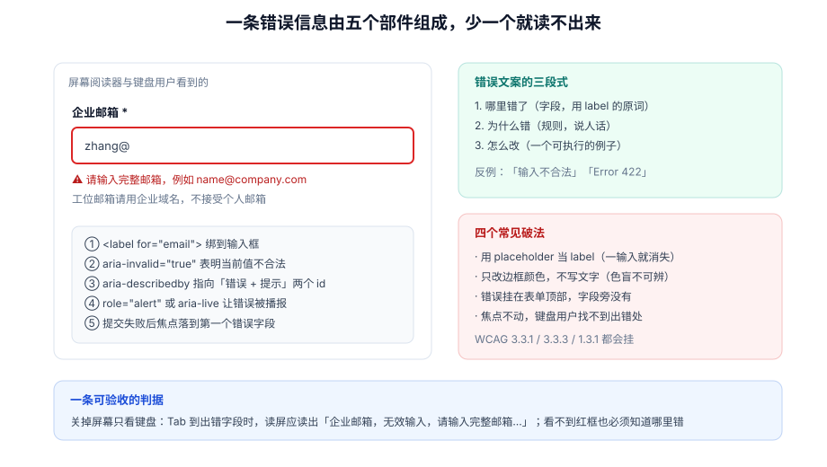

# 错误呈现与可访问性

本页判据族 `FVE-A` ~ `FVE-H`，共 8 条。

校验跑完之后，用户能不能知道「哪里错了、为什么错、怎么改」，取决于三个东西：**错误长在哪个 DOM 位置**、**这句话怎么写**、**焦点与播报怎么走**。三者缺一条，表单对「用键盘和读屏的人」就是不可用的。

::: tip 一句话理解
错误信息不是「一行红字」，而是**五个部件的组合**：标签、非法标记、描述关联、播报通道、焦点落点。只做红字，等于只做了 1/5。
:::



## 一、五个部件与它们的 DOM 形态

```html
<!-- ① label 用 for 绑到输入框（不要用 placeholder 当标签） -->
<label for="email">企业邮箱 <span aria-hidden="true">*</span></label>

<!-- ② aria-invalid 表明「当前值不合法」，不是「曾经不合法」 -->
<!-- ③ aria-describedby 同时指向提示与错误，读屏才会念完 -->
<!-- ④ aria-required 与必填星号并存：星号给人看，属性给机器读 -->
<input
  id="email"
  name="email"
  type="email"
  autocomplete="email"
  aria-required="true"
  aria-invalid="true"
  aria-describedby="email-hint email-error"
  value="zhang@"
/>

<p id="email-hint">工位邮箱请用企业域名，不接受个人邮箱</p>
<!-- ⑤ 错误容器需要 role="alert"（或 aria-live="polite"），内容出现时被播报 -->
<p id="email-error" role="alert">请输入完整邮箱，例如 name@company.com</p>
```

| 部件 | 作用 | 少了它会怎样 |
| --- | --- | --- |
| `label[for]` | 给控件一个可读名字 | 读屏只念「编辑框，空」，用户不知道要填什么 |
| `aria-invalid` | 让读屏知道当前值非法 | 错误只在视觉上存在，读屏用户以为填对了 |
| `aria-describedby` | 把提示与错误「挂」到控件上 | 焦点落到控件时念不出错误原因，要手动往后找 |
| `role="alert"` | 错误出现时主动播报 | 用户不移动焦点就永远不知道提交失败了 |
| 焦点落点 | 提交失败后聚焦第一个错误 | 键盘用户要 Tab 十几次才找到错在哪 |

## 二、文案三段式：哪里错、为什么、怎么改

| 段 | 内容 | 反例 | 正例 |
| --- | --- | --- | --- |
| 哪里错 | 用 label 的原词，不用字段名 | `taxNo invalid` | 统一社会信用代码格式不正确 |
| 为什么 | 说清规则，不引内部码 | `Error 422` | 应为 18 位，且不含字母 I、O、S、V、Z |
| 怎么改 | 给一个可照抄的例子 | 请检查输入 | 例如 `91310000MA1K35Q64R` |

这三段合起来通常 20~40 个字。超过 40 字的错误信息会被用户跳过——真正需要长解释的规则，应该放在 `hint` 里常驻，而不是塞进错误里。

::: danger 四个常见破法
1. **用 `placeholder` 当标签**：一输入就消失，用户填到一半忘了这一栏是什么；读屏对 `placeholder` 的支持也不一致。
2. **只改边框颜色**：色盲用户（约 8% 男性）分辨不出红框与灰框；必须有文字或图标。
3. **错误只挂在表单顶部**：字段多时用户要来回找；顶部摘要只能作为**补充**，不能替代字段旁的红字。
4. **提交失败后不动焦点**：键盘用户按了回车，页面滚到顶部，焦点还停在按钮上，看不到任何变化。
:::

## 三、播报次数：一次就够，别念三遍

同一条错误可能同时出现在三处：字段旁的红字、顶部摘要、Toast。对读屏用户来说这是**三次播报**，体验极差。

| 位置 | 是否播报 | 做法 |
| --- | --- | --- |
| 字段旁错误 | **播报**（`role="alert"`，或由 `aria-describedby` 在聚焦时读出） | 只播一次，内容最短 |
| 顶部摘要 | 不主动播报 | 用 `role="region" aria-label="错误摘要"`，供主动查看 |
| Toast | 不用于字段错误 | 只用于「提交成功」「网络异常」这类全局结果 |

```tsx [src/components/ErrorSummary.tsx]
export function ErrorSummary({ errors, onJump }: { errors: Record<string, string>; onJump: (f: string) => void }) {
  const list = Object.entries(errors)
  if (!list.length) return null
  return (
    <div role="region" aria-label="错误摘要" className="error-summary">
      <p>还有 {list.length} 处需要修改：</p>
      <ul>
        {list.map(([field, msg]) => (
          <li key={field}>
            <button type="button" onClick={() => onJump(field)}>{msg}</button>
          </li>
        ))}
      </ul>
    </div>
  )
}
```

摘要里的每一条都做成**可点击跳转**的按钮，是「既不重复播报、又不让用户找」的关键。

## 四、首错聚焦：顺序、滚动与「不要抢焦点」

```typescript [src/form/focusFirstError.ts]
export function focusFirstError(errors: Record<string, string>, root: HTMLElement) {
  // 按 DOM 顺序找第一个出错的字段，而不是按对象键顺序
  const first = Array.from(root.querySelectorAll<HTMLElement>("[aria-invalid='true']"))[0]
  if (!first) return
  first.focus({ preventScroll: true })          // 先聚焦，再自己滚，避免两段动画
  first.scrollIntoView({ block: "center", behavior: "smooth" })
}
```

三个细节值得单独说：

1. **按 DOM 顺序，不按 `errors` 的键顺序**：对象插入顺序与视觉顺序无关，按对象顺序聚焦会「跳到页面下半部分」。
2. **`preventScroll: true` 再手动滚**：直接 `focus()` 会让浏览器滚到元素位置（可能被固定头部遮住），再 `scrollIntoView({block:"center"})` 是两段位移，看起来像抽搐。
3. **只在提交失败时抢焦点**：字段级校验（失焦触发）**不应该**移动焦点，否则用户 Tab 到下一个字段时会被弹回上一个。

## 五、视觉：三个必须可分辨的信号

| 信号 | 只靠颜色 | 加一重信号 |
| --- | --- | --- |
| 字段非法 | 红边框 | 红边框 + 错误图标 + 文字 |
| 提交成功 | 绿字 | 绿字 + 对勾 + `role="status"` |
| 必填 | 红色星号 | 星号 + `aria-required` + 顶部说明「标 * 为必填」 |

WCAG 2.2 的 **1.4.1（颜色不作为唯一手段）** 与 **3.3.1（错误识别）** 都要求这一点；而 **2.4.11（焦点不被遮挡）** 要求聚焦后元素不被固定头部/底栏盖住——这一点在移动端表单里最容易犯。

## 六、判据 `FVE-A` ~ `FVE-H`

| 编号 | 判据 | 怎么验证 |
| --- | --- | --- |
| `FVE-A` | 每个控件都有 `label[for]`（或 `aria-labelledby`），不用 `placeholder` 代替 | `grep -rn "placeholder=" src/` 命中处必须有配对 label |
| `FVE-B` | 非法字段同时具备 `aria-invalid="true"` 与文字说明 | 用无障碍面板检查 name / description / invalid 三项 |
| `FVE-C` | 错误文案包含「为什么」与「怎么改」两段 | 抽查 6 条错误，缺任一段即不合格 |
| `FVE-D` | 同一条错误只被播报一次 | 打开读屏，提交空表单，统计播报次数应为「每条一次」 |
| `FVE-E` | 提交失败后焦点落到 DOM 顺序上第一个错误字段 | 键盘操作提交，`document.activeElement` 应是首个非法字段 |
| `FVE-F` | 字段级校验（失焦）不移动焦点 | 失焦触发错误后，`activeElement` 应仍是下一个字段 |
| `FVE-G` | 非法状态不只靠颜色表达 | 灰度截图下仍能看出哪一栏错 |
| `FVE-H` | 聚焦元素不被固定头部/底部遮挡 | 移动端 375×667 下聚焦最后一个字段，输入框完整可见 |

## 七、验证方式

```javascript
// ① 关联检查：控件的可访问名与描述
const el = document.querySelector("#email")
const ids = (el.getAttribute("aria-describedby") ?? "").split(/\s+/).filter(Boolean)
console.log({
  label: document.querySelector(`label[for="${el.id}"]`)?.textContent?.trim(),
  invalid: el.getAttribute("aria-invalid"),
  describedBy: ids.map((id) => document.getElementById(id)?.textContent?.trim()),
})
// 期望：label 有值、invalid="true"、describedBy 同时含提示与错误
```

```javascript
// ② 播报次数：统计 alert 区域在提交后新增的次数
const alerts = []
new MutationObserver((ms) => ms.forEach((m) => alerts.push(m.target.id))).observe(document.body, {
  subtree: true, childList: true, characterData: true,
})
document.querySelector("form")?.requestSubmit()
setTimeout(() => console.log("播报节点数:", new Set(alerts).size), 500)  // 期望 = 错误字段数
```

```shell
# ③ 焦点落点：用 Playwright 或手工键盘验证（无头环境可用 CDP 读 activeElement）
grep -rn "focusFirstError" src/ | wc -l        # 每个提交入口都应调用
# ④ 只靠颜色的地方
grep -rnE "color:\s*(red|#dc2626)" src/ | wc -l
```

## 八、相关页面与下一篇

- 下一篇：[提交状态机与防重复](../SubmitFlow/index.md)——错误呈现之后的那个动作。
- 上游：[异步校验](../AsyncValidation/index.md)（异步结论也要走同一套呈现）。
- 相邻必读：[无障碍基础](../../IntlA11y/A11yFoundation/index.md)（ARIA 的通用规则）、[键盘与焦点](../../IntlA11y/KeyboardFocus/index.md)（焦点管理的完整规范）。

## 参考资料

- [WCAG 2.2 · 3.3.1 错误识别](https://www.w3.org/WAI/WCAG22/Understanding/error-identification.html)
- [WCAG 2.2 · 3.3.3 错误建议](https://www.w3.org/WAI/WCAG22/Understanding/error-suggestion.html)
- [WCAG 2.2 · 2.4.11 焦点不被遮挡](https://www.w3.org/WAI/WCAG22/Understanding/focus-not-obscured-minimum.html)
- [MDN · `aria-describedby`](https://developer.mozilla.org/en-US/docs/Web/Accessibility/ARIA/Attributes/aria-describedby)
- [MDN · `aria-invalid`](https://developer.mozilla.org/en-US/docs/Web/Accessibility/ARIA/Attributes/aria-invalid)
- [WAI-ARIA Authoring Practices · Alert](https://www.w3.org/WAI/ARIA/apg/patterns/alert/)
