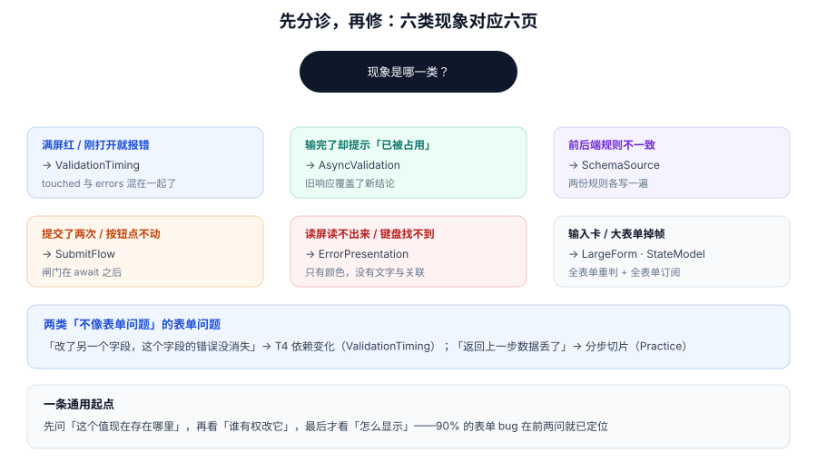

# 常见问题与分诊

本页判据族 `FVQ-A` ~ `FVQ-H`，共 8 条。

表单问题的麻烦之处在于**现象与原因隔得远**：屏幕上是「红字不消失」，根因可能在状态分层；「点了没反应」，根因可能在闸门位置。这一页先按现象分诊，再给十二个高频问题的直接答案。

::: tip 一句话理解
遇到表单问题，先问两句：**这个值现在存在哪里？谁有权改它？** 九成的 bug 在这两问之后就定位了，剩下的才是「怎么显示」。
:::



## 一、六类现象分诊

| 现象 | 最可能的原因 | 先去哪一页 | 一句话验证 |
| --- | --- | --- | --- |
| 一进页面满屏红 | 错误可见性只判 `errors`，没判 `touched` | [校验时机](../ValidationTiming/index.md) | 清空存储后首次进入，数红字个数 |
| 边输边冒新错 | `onChange` 全量复判，不是「只复判已错字段」 | [校验时机](../ValidationTiming/index.md) | 清空一个无错字段再输入，看是否新增红字 |
| 输完了却提示「已占用」 | 异步响应乱序，旧结论覆盖新结论 | [异步校验](../AsyncValidation/index.md) | 快速改 6 次，看最终红字对应哪个值 |
| 前后端规则不一致 | 规则写了两遍，没有单一来源 | [schema 单一来源](../SchemaSource/index.md) | 数手机号正则在几个文件里出现 |
| 提交了两次 | 闸门在第一个 `await` 之后 | [提交状态机](../SubmitFlow/index.md) | 双击，看网络面板几条 POST |
| 输入卡 / 掉帧 | 每键全量校验 + 整表单订阅 | [大表单](../LargeForm/index.md) | Profiler 看一次输入几个组件 render |

还有两类「不像表单问题」的表单问题，单独列出来：

| 现象 | 原因 | 去哪 |
| --- | --- | --- |
| 改了 A 字段，B 的错误没消失 | 依赖边表漏了一条 | [校验时机 · T4](../ValidationTiming/index.md) |
| 返回上一步数据丢了 | 每步各存一份 state，合并时漏字段 | [实战 · 分步切片](../Practice/index.md) |

## 二、十二个高频问题

### 1. 受控还是非受控？

字段 ≤ 15 且需要联动：受控。纯收集（导入、批量录入）：非受控。字段多且要字段级校验：外部 store（RHF / TanStack Form）。三种的代价表见 [状态模型](../StateModel/index.md)。

### 2. `mode: "onBlur"` 还是 `"onChange"`？

默认 `onBlur`；只有「密码强度」「用户名可用性」这类需要即时反馈的字段用 `onChange`，且只对**已出错**的字段复判。

### 3. 为什么 `isValid` 总是 `true`？

大概率是把 `isValid` 存成了独立 state，而它只在某些路径被更新。改为派生：`Object.keys(errors).length === 0`。

### 4. 提交按钮该不该 `disabled`？

「校验不过」时用 `aria-disabled` + 拦截点击（保留可聚焦）；「提交中」时同样不要用 `disabled`，否则键盘用户的焦点会丢失。

### 5. 异步校验要不要防抖？

要。20 次按键防抖后是 1 次请求（实测），但提交路径必须绕过防抖直接等结果。

### 6. 「保存成功」后还提示未保存？

脏的参照点没推进。保存成功后要 `reset(savedValues)` 或 `markSaved()`，并且**触发一次重渲染**。

### 7. 草稿恢复后提交被拒？

草稿没带 `schemaVersion`，表单结构变了。版本不符直接丢弃，别写迁移。

### 8. 移动端键盘弹起遮住输入框？

`scrollIntoView({ block: "center" })` + 底部留白；iOS 上 `position: fixed` 的底栏会跟着键盘走，要改用 `sticky` 或监听 `visualViewport`。

### 9. 中文输入法下校验误报？

`compositionstart` 到 `compositionend` 之间跳过校验；否则「zhong」会被判为非法姓名。

### 10. 服务端 400 怎么落到字段上？

后端返回 `issues[].path`，前端按 path 写进 `errors`。只返回 `message` 的接口，只能显示在顶部。

### 11. 表单里能不能放 `type="submit"` 的多个按钮？

能，但要用 `formaction` / `name+value` 区分意图，并且**每个提交入口都要走同一个闸门**。

### 12. 要不要上表单库？

判据是「字段数 × 规则复杂度 × 是否需要跨端复用规则」。三条都低时，手写 100 行更可控；有任一条高时，库省下的是**维护一致性**的成本，不是写代码的时间。

## 三、上线前自查清单

| # | 检查项 | 通过标准 |
| --- | --- | --- |
| 1 | 空表单打开 | 无红字 |
| 2 | 只填必填项提交 | 一次通过，无多余校验 |
| 3 | 全空提交 | 红字出现在字段旁 + 顶部摘要 + 焦点在首个错误 |
| 4 | 双击提交 | 只发一次请求 |
| 5 | 断网提交 | 有明确提示，不显示「成功」 |
| 6 | 刷新页面 | 有草稿则恢复，无草稿则空态 |
| 7 | 只用键盘完成 | 全程可操作，焦点始终可见 |
| 8 | 读屏走一遍 | 每个错误被读出一次，且含「为什么 + 怎么改」 |
| 9 | 375×667 窄屏 | 无横向滚动，聚焦字段不被遮挡 |
| 10 | 浏览器后退 | 有离开提示（脏时），无提示（不脏时） |

## 四、术语表

| 术语 | 含义 | 不要与什么混淆 |
| --- | --- | --- |
| 受控 / 非受控 | 值存在组件 state / 存在 DOM | 与「有没有校验」无关 |
| touched | 用户是否碰过该字段 | 不是「值是否合法」 |
| dirty | 值相对某个参照点发生了变化 | 三个参照点要说明是哪一个 |
| schema | 规则 + 类型 + 元数据的单一来源 | 不是「后端接口定义」 |
| resolver | 把 schema 接到表单库的适配层 | 不是校验器本身 |
| 悬挂校验 | 已发出、尚未返回的异步校验 | 不是「失败的校验」 |
| 闸门（gate） | 拦住重复提交的同步布尔 | 不是 loading 状态 |

## 五、判据 `FVQ-A` ~ `FVQ-H`

| 编号 | 判据 | 怎么验证 |
| --- | --- | --- |
| `FVQ-A` | 每个上报的表单问题都能归到六类现象之一 | 缺陷单必须带「现象类别」字段 |
| `FVQ-B` | 修复时改的是根因所在层，不是表象 | 修复 PR 描述里写明「改了哪一层」 |
| `FVQ-C` | 上线自查清单 10 项逐条有记录 | 发布记录里附清单截图或测试链接 |
| `FVQ-D` | 术语在团队内统一（同一概念一个词） | 搜索「脏/dirty/未保存」是否混用三种叫法 |
| `FVQ-E` | 已知限制写进页面或注释，不留口头约定 | `grep -rn "TODO\|临时"` 命中处需有说明 |
| `FVQ-F` | 每个修复都补了一条回归用例 | 缺陷单关联测试用例 |
| `FVQ-G` | 表单库选型有记录（为什么用它/不用它） | 见 [技术决策](../../../Others/TechDecision/Overview/index.md) 的记录格式 |
| `FVQ-H` | 分诊表随新问题更新（不是一次性文档） | 最近三次表单缺陷都能在表里找到对应行 |

## 六、验证方式

```shell
# ① 上线自查的机器化：空态无红字
npx playwright test e2e/form-empty.spec.ts
# ② 双击只发一次
npx playwright test e2e/form-double-click.spec.ts
# ③ 键盘可完成（Tab 序 + 聚焦可见）
npx playwright test e2e/form-keyboard.spec.ts
```

```javascript
// ④ 分诊表覆盖度：最近缺陷是否能归类
const categories = ["满屏红", "边输边冒错", "占用误报", "规则不一致", "重复提交", "输入卡"]
const recent = ["满屏红", "重复提交", "规则不一致"]
console.log("可归类:", recent.filter((r) => categories.includes(r)).length, "/", recent.length)
```

## 七、相关页面

- 起点：[状态模型](../StateModel/index.md)（六层与三种存放）。
- 落地：[实战：三步企业认证表单](../Practice/index.md)（八条验收）。
- 相邻：[项目实战 · 事件驱动订单与履约中心](../../../../project/Complete/EventOrderHub/index.md)（另一个完整项目的验收组织方式）、[技术写作与分享](../../../Others/TechWriting/index.md)（把这类问题写成可复用的清单）。

## 参考资料

- [WCAG 2.2 快速参考](https://www.w3.org/WAI/WCAG22/quickref/)
- [web.dev · Learn Forms](https://web.dev/learn/forms)
- [MDN · Web 表单指南](https://developer.mozilla.org/en-US/docs/Learn_web_development/Extensions/Forms)
- [Playwright · 测试表单](https://playwright.dev/docs/input)
