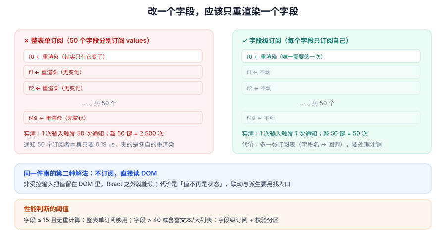

# 大表单：订阅粒度与校验预算

本页判据族 `FVL-A` ~ `FVL-H`，共 8 条。

字段数超过 40、或字段里有富文本/大列表/文件上传时，表单会开始「卡」。绝大多数情况不是框架慢，而是**一次输入惊动了整个表单**：全量校验 + 全量订阅 + 全量重渲染，三件事各乘一遍。

::: tip 一句话理解
大表单的优化不是「加 `memo`」，而是**缩小一次输入的传播范围**：只校验受影响的字段、只通知订阅该字段的组件、只重算依赖它的派生值。
:::



## 一、三笔账：一次按键到底花了多少

本机实测（Node 22.22.2，50 字段表单）：

| 项 | 整表单做法 | 字段级做法 | 倍数 |
| --- | --- | --- | --- |
| 单次校验耗时 | **5.95 µs**（50 字段全量） | **0.09 µs**（1 字段） | **66×** |
| 敲 50 个键的校验次数 | **2,500 次** | **50 次** | 50× |
| 一次输入触发的订阅通知 | **50 次** | **1 次** | 50× |
| 一次输入触发的重渲染 | 50 个字段组件 | 1 个字段组件 | 50× |
| 通知 50 个订阅者本身的开销 | 0.19 µs | 0.04 µs | — |

最后一行很重要：**通知本身几乎不花钱**（0.19 µs），贵的是被通知到的组件各自重渲染（每个可能 0.1~2 ms）。所以优化点不在「减少通知」，而在**「让不该被通知的组件不被通知」**。

## 二、订阅粒度：三级方案

| 方案 | 做法 | 一次输入的重渲染 | 适用 |
| --- | --- | --- | --- |
| **整表单订阅** | `useFormState()` 返回整个 `values` | 所有字段 | ≤ 15 字段 |
| **字段级订阅** | `useFieldState(name)`，按字段名订阅 | 只有该字段 + 显式依赖它的组件 | 15~60 字段 |
| **非受控 + 局部读取** | 值在 DOM，只有需要的地方 `watch` | 几乎为零 | 纯收集型（导入、批量录入） |

```typescript [src/form/useFieldState.ts]
import { useSyncExternalStore } from "react"

// 最小可用的字段级 store：只有订阅了该字段的组件会重渲染
export function createFieldStore<T extends Record<string, unknown>>(initial: T) {
  let values = { ...initial }
  const subs = new Map<keyof T, Set<() => void>>()

  return {
    get: <K extends keyof T>(k: K) => values[k],
    set: <K extends keyof T>(k: K, v: T[K]) => {
      if (Object.is(values[k], v)) return          // 值没变就不通知（避免无意义渲染）
      values = { ...values, [k]: v }
      subs.get(k)?.forEach((f) => f())
    },
    subscribe: (k: keyof T, f: () => void) => {
      if (!subs.has(k)) subs.set(k, new Set())
      subs.get(k)!.add(f)
      return () => subs.get(k)!.delete(f)
    },
    snapshot: () => values,
  }
}

export function useField<T extends Record<string, unknown>, K extends keyof T>(store: ReturnType<typeof createFieldStore<T>>, k: K) {
  return useSyncExternalStore(
    (cb) => store.subscribe(k, cb),
    () => store.get(k),
    () => store.get(k)
  )
}
```

`Object.is` 那一行是性价比最高的一行：**值没有变化就不要通知**。它顺便解决了「输入法组合中被重复写入同一个值」造成的抖动。

## 三、校验预算：分区 + 分级

| 策略 | 做法 | 成本 | 什么时候用 |
| --- | --- | --- | --- |
| 全量校验 | 每键判 50 个字段 | 5.95 µs/键 | 提交时、切步时 |
| **字段级** | 只判当前字段 | 0.09 µs/键 | 输入中 |
| **分区校验** | 按 `fieldset` 分组，只判当前组 | ≈ 组内字段数 × 0.12 µs | 中长表单 |
| 延迟校验 | 空闲时（`requestIdleCallback`）补判其余字段 | 不占输入帧 | 需要「实时汇总错误数」时 |

`FVL` 的核心判据不是「用了哪种」，而是**「提交时是否仍然全量」**：输入可以偷懒，提交不能。

```typescript [src/form/validateScoped.ts]
// 分区：把字段名映射到分区，输入时只判本区
const zoneOf: Record<string, string> = { name: "base", taxNo: "base", email: "admin", phone: "admin" }

export function validateZone(values: Record<string, unknown>, zone: string, rules: RuleSet) {
  const out: Record<string, string> = {}
  for (const [field, rule] of Object.entries(rules)) {
    if (zoneOf[field] !== zone) continue
    const msg = rule(values[field])
    if (msg) out[field] = msg
  }
  return out
}
```

## 四、渲染：三种「重」的来源

| 来源 | 现象 | 解法 |
| --- | --- | --- |
| 每个字段都是受控组件且订阅全量 | 输入延迟随字段数线性上升 | 字段级订阅 |
| 下拉选项在渲染里现算（`options.map` 每次新建） | 每键都重建上百个 `<option>` | `useMemo` 选项 / 拆成子组件 |
| 校验函数在渲染里创建（`onChange={(v) => schema.parse(v)}`） | 每键新建闭包，旧闭包不回收 | 提到模块级 / `useCallback` |

第三行是最隐蔽的：它不会报错，只会让「输入 200 字段的表单」在低端机上明显掉帧。

## 五、虚拟化与受控的冲突

字段超过 200 个时，通常要虚拟滚动。但虚拟化会**卸载看不见的字段**，于是：

| 冲突 | 后果 | 处理 |
| --- | --- | --- |
| 字段被卸载，值随之丢失（值存在组件 state 时） | 滚回去发现填的内容没了 | 值必须存在表单 store，不能存在字段组件里 |
| 校验器拿不到未挂载的字段 | 提交时「少校验了 80 个字段」 | 校验只用 store 里的 `values`，不读 DOM |
| 非受控 + 虚拟化 | `new FormData(form)` 拿不到未挂载字段 | 虚拟化场景禁用非受控，或提交前手动汇总 |

这也解释了为什么「大表单 + 非受控」这个组合很少见：非受控把值放在 DOM，而虚拟化会把 DOM 删掉。

## 六、判据 `FVL-A` ~ `FVL-H`

| 编号 | 判据 | 怎么验证 |
| --- | --- | --- |
| `FVL-A` | 输入时只校验当前字段（或当前分区），不全量 | 埋点统计一次输入的校验次数，应 ≈ 1 |
| `FVL-B` | 提交时仍做全量校验 | 提交路径调用 `validateAll()`，且断言覆盖全部字段 |
| `FVL-C` | 字段级订阅，一次输入只通知订阅该字段的组件 | React DevTools Profiler：一次输入只有 1 个字段组件 render |
| `FVL-D` | 值变更前做 `Object.is` 短路，同值不通知 | 输入法组合中同值重复写入，render 次数不增加 |
| `FVL-E` | 选项、校验函数不在渲染期新建 | 搜索 `options.map(` 是否在组件体内直接出现 |
| `FVL-F` | 虚拟化场景下值存在 store，不依赖组件 state | 滚动离开再回来，字段值仍在 |
| `FVL-G` | 输入帧率：50 字段表单连续输入 ≥ 50fps | Performance 面板录制 5 s 输入 |
| `FVL-H` | 脏检查与错误汇总不在输入事件里同步执行 | 见 [脏检查](../DirtyGuard/index.md) 的 33.6 µs 读数 |

## 七、验证方式

```javascript
// ① 校验次数：一次输入应该只判一个字段
let checks = 0
const validateField = (v) => { checks++; return v ? null : "必填" }
const validateAll = (vals) => Object.keys(vals).forEach((k) => validateField(vals[k]))
console.time("one-key")
validateField("x")                       // 模拟字段级
console.timeEnd("one-key")
checks = 0; validateAll(Object.fromEntries(Array.from({ length: 50 }, (_, i) => ["f" + i, "v"])))
console.log("全量校验次数:", checks)      // 50
```

```javascript
// ② 订阅通知次数：改一个字段只应通知一次
let renders = 0
const store = createFieldStore({ a: 1, b: 2 })
store.subscribe("a", () => renders++)
store.set("a", 2)                        // 值没变 → 不通知
store.set("a", 3)                        // 值变了 → 通知 1 次
console.log("通知次数:", renders)         // 期望 1
```

```shell
# ③ 渲染期新建闭包/选项的粗筛
grep -rnE "onChange=\{\(?[a-z]*\)? =>" src/ | head -10
grep -rn "\.map((" src/components/ | grep -v "useMemo" | head -10
```

## 八、相关页面与下一篇

- 下一篇：[实战：三步企业认证表单](../Practice/index.md)——把前面八页拼成一个能交付的东西。
- 上游：[状态模型](../StateModel/index.md)（受控/非受控/外部 store 的代价表）。
- 相邻必读：[状态管理与数据流 · 派生状态](../../StateDataFlow/DerivedState/index.md)、[前端性能优化](../../Others/PerformanceOptimization/index.md)。

## 参考资料

- [React 官方 · `useSyncExternalStore`](https://react.dev/reference/react/useSyncExternalStore)
- [React 官方 · 使用 Profiler 测量渲染开销](https://react.dev/reference/react/Profiler)
- [TanStack Form · 字段级订阅与性能](https://tanstack.com/form/latest/docs/framework/react/guides/basic-concepts)
- [web.dev · `requestIdleCallback`](https://developer.mozilla.org/en-US/docs/Web/API/Window/requestIdleCallback)
