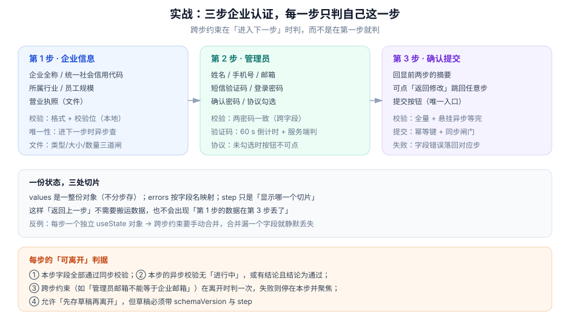

# 实战：三步企业认证表单

本页判据族 `FVP-A` ~ `FVP-H`，共 8 条。

把前面八页拼成一个能交付的东西：**三步企业认证**（企业信息 → 管理员 → 确认提交）。它同时命中五个难点：分步状态、跨步约束、唯一性异步校验、文件上传、验证码。这一页只讲**怎么把它们组织起来**，每一步的细节指向对应页面。

::: tip 一句话理解
分步表单只有一条硬规则：**数据是一整份，步骤只是「显示哪一个切片」**。做到这一点，「返回上一步」不需要搬运数据，「跨步约束」也不需要手动合并。
:::



## 一、整体结构：一份状态，三个切片

```typescript [src/features/cert/useCertForm.ts]
import { useMemo, useReducer } from "react"
import { certSchema, type CertForm } from "../../../shared/schema/cert"

type Step = 1 | 2 | 3
type State = { values: CertForm; errors: Partial<Record<keyof CertForm, string>>; touched: Partial<Record<keyof CertForm, boolean>>; step: Step; status: "idle" | "submitting" | "failed" | "done" }

const zones: Record<Step, (keyof CertForm)[]> = {
  1: ["name", "taxNo", "industry", "headcount", "licenseFile"],
  2: ["adminName", "phone", "email", "code", "password", "confirmPassword", "agreed"],
  3: [],
}
```

三个要点：

1. **`zones` 是唯一的分步定义**——「这一步有哪些字段」只写在这里，校验、错误过滤、摘要回显都读它；
2. **`values` 是一整份**，切换步骤不搬数据；
3. **`step` 只影响渲染与「离开本步时判谁」**，不影响存储结构。

## 二、每步的「可离开」判据

点「下一步」不是简单 `setStep(step + 1)`，而是四道检查：

```typescript [src/features/cert/next.ts]
export async function tryNext(state: State, dispatch: Dispatch): Promise<boolean> {
  const fields = zones[state.step]

  // ① 本步同步校验（只判本步字段，别的步的错误不拦人）
  const syncErrors = pick(validateSync(state.values), fields)
  if (Object.keys(syncErrors).length) {
    dispatch({ type: "errors", errors: syncErrors, touched: allTrue(fields) })
    focusFirstError(syncErrors)
    return false
  }

  // ② 本步的异步校验必须「有结论且通过」
  if (step1Pending(state.values)) { await waitStep1(); return false }

  // ③ 跨步约束（离开时才判：此时两边的值都在）
  const cross = crossStepErrors(state.values)
  if (Object.keys(cross).length) {
    dispatch({ type: "errors", errors: cross })
    focusFirstError(cross)
    return false
  }

  // ④ 存草稿（带 step 与 schemaVersion）
  saveDraft(state.values, state.step)
  dispatch({ type: "step", step: (state.step + 1) as Step })
  return true
}
```

第 ③ 步是分步表单最容易被漏的一环。典型跨步约束：**管理员邮箱不能等于企业邮箱**——它们分属第 1 步与第 2 步，只有到「离开第 2 步」时才两值俱全。

## 三、跨步约束表

| 约束 | 涉及字段 | 在哪一步判 | 失败时 |
| --- | --- | --- | --- |
| 管理员邮箱 ≠ 企业邮箱 | 第 1 步 `email` + 第 2 步 `email` | 离开第 2 步 | 停在 2，聚焦管理员邮箱 |
| 员工规模与所选套餐匹配 | 第 1 步 `headcount` + 第 3 步 `plan` | 离开第 3 步（提交前） | 回显到第 1 步并提示 |
| 信用代码唯一 | 第 1 步 `taxNo` | 离开第 1 步（异步） | 停在 1，红字「该企业已注册」 |
| 手机号未被占用 | 第 2 步 `phone` | 离开第 2 步（异步） | 停在 2，提供「换个号码」 |

这张表要写进代码（而不是记在脑子里），因为它同时是**测试用例的来源**：每条约束一个用例，改约束时用例跟着改。

## 四、文件上传：三道闸与一次预检

营业执照上传只做三件事：**类型、大小、数量**，且三道闸都在客户端先过一遍，服务端再验一次。

```typescript [src/features/cert/upload.ts]
const MAX_BYTES = 5 * 1024 * 1024
const ACCEPT = ["image/jpeg", "image/png", "application/pdf"]

export function preCheck(file: File): string | null {
  if (!ACCEPT.includes(file.type)) return "仅支持 JPG / PNG / PDF"
  if (file.size > MAX_BYTES) return `文件不超过 5 MB（当前 ${(file.size / 1024 / 1024).toFixed(1)} MB）`
  if (file.name.length > 120) return "文件名过长，请重命名后再上传"
  return null
}
```

::: danger 上传的四个坑
1. **只看扩展名不看 MIME**：`evil.pdf.exe` 改名成 `.pdf` 能过；反过来某些系统给 PDF 的 MIME 是 `application/octet-stream`，误杀。两者都要看，且以服务端为准。
2. **`file.size` 是字节数，不是「MB」**：直接与 `5` 比较会把 5 MB 判成 5 字节。
3. **上传中提交**：文件还没传完就点提交，拿到的是空 URL。提交闸门必须包含「无上传中的文件」。
4. **不上传也占位**：删除文件后没有清空 `licenseFile`，提交时带着旧 URL 过去。
:::

## 五、验证码：倒计时是 UI，判定在服务端

| 关注点 | 做法 |
| --- | --- |
| 倒计时 | 前端 60 s，存 `expiresAt` 时间戳而不是递减计数（切后台回来不会错） |
| 重复发送 | 同一手机号 60 s 内只允许一次（服务端限流，前端只做提示） |
| 校验 | 只信服务端；前端不做「6 位数字」之外的判断 |
| 错误提示 | 「验证码已过期，请重新获取」与「验证码不正确」要分开 |
| 自动填充 | `autocomplete="one-time-code"`，iOS/Android 能直接填 |

## 六、提交：三步合一

第 3 步的提交按钮要做五件事，顺序不能换：

```typescript [src/features/cert/submit.ts]
export async function submitAll(state: State, dispatch: Dispatch) {
  if (pending) return                    // ① 同步闸门（第一个 await 之前）
  pending = true
  try {
    dispatch({ type: "status", status: "submitting" })
    const all = await validateAll(state.values)        // ② 全量 + 等完异步
    if (Object.keys(all).length) { jumpToFirstErrorStep(all); dispatch({ type: "errors", errors: all }); return }
    const res = await send({ ...state.values, idempotencyKey: key })  // ③ 幂等键
    if (!res.ok) { applyServerErrors(res); return }
    clearDraft(); onDone()                             // ④ 清草稿 + 跳成功页
  } finally {
    pending = false                                    // ⑤ 异常也复位
  }
}
```

第 ② 步的 `jumpToFirstErrorStep` 是分步表单特有的：全量校验失败时，错误可能落在第 1 步，此时必须**跳回那一步**再聚焦，否则用户在第 3 步看到一条「企业名称过长」却找不到字段。

## 七、八条可执行验收

| # | 验收项 | 命令 / 操作 | 期望 |
| --- | --- | --- | --- |
| 1 | 打开即空态 | 清 localStorage 后进入 | 无任何红字，第 1 步可填 |
| 2 | 分步不丢数据 | 填第 1 步 → 下一步 → 返回 | 第 1 步所有值仍在 |
| 3 | 跨步约束生效 | 管理员邮箱填成企业邮箱 | 停在第 2 步并聚焦管理员邮箱 |
| 4 | 唯一性乱序安全 | 快速改 6 次信用代码 | 最终红字对应最后一次输入 |
| 5 | 双击只提交一次 | 双击提交按钮 | 网络面板只有 1 个 POST |
| 6 | 刷新可恢复 | 填到第 2 步 → 刷新 | 回到第 2 步，值完整 |
| 7 | 结构变更丢弃旧草稿 | 手动把草稿 `v` 改成旧值 → 刷新 | 表单为空，草稿被清除 |
| 8 | 键盘可完成 | 全程只用 Tab/Enter/空格 | 能提交成功，焦点始终可见 |

```shell
# 验收 5 的机器化版本（Playwright）
npx playwright test e2e/cert-submit.spec.ts --grep "double click"
# 断言：page.on("request") 中 POST /api/certifications 的次数 === 1
```

## 八、判据 `FVP-A` ~ `FVP-H`

| 编号 | 判据 | 怎么验证 |
| --- | --- | --- |
| `FVP-A` | 分步只定义一次（`zones` 表），校验/回显/摘要都读它 | 搜索字段名硬编码在多个组件里的情况 |
| `FVP-B` | 值是整份对象，切步不搬数据 | 第 1 步填完 → 第 3 步，`values` 键数不变 |
| `FVP-C` | 跨步约束在「离开该步」时判，且有测试用例覆盖每一条 | 约束表条数 == 测试用例数 |
| `FVP-D` | 文件上传三道闸（类型/大小/数量）+ 服务端复验 | 传 6 MB 的 PDF 应被前端拦下并提示具体大小 |
| `FVP-E` | 提交闸门同步置位，且包含「无上传中文件」 | 上传中点提交，应被拦下 |
| `FVP-F` | 全量校验失败时跳回错误所在步骤再聚焦 | 第 3 步提交失败，界面应回到第 2 步并聚焦 |
| `FVP-G` | 草稿带 `schemaVersion` 与 `step` | 刷新后回到原步骤 |
| `FVP-H` | 八条验收全部可执行（不依赖人眼判断） | 逐条跑一遍，每条都有明确读数或断言 |

## 九、验证方式

```javascript
// ① 分步不丢数据：模拟 zone 切片
const values = { name: "甲公司", taxNo: "91310000MA1K35Q64R", adminName: "张三", phone: "13800138000" }
const step1Keys = ["name", "taxNo"]
const slice1 = Object.fromEntries(step1Keys.map((k) => [k, values[k]]))
console.log("第 1 步视图键:", Object.keys(slice1), "整份键数:", Object.keys(values).length)  // 2 / 4
```

```javascript
// ② 跨步约束：两值都到位时才判
const crossStepErrors = (v) => (v.adminEmail && v.email && v.adminEmail === v.email ? { adminEmail: "不能与企业邮箱相同" } : {})
console.log(crossStepErrors({ email: "a@corp.com", adminEmail: "a@corp.com" }))  // 期望 { adminEmail: ... }
console.log(crossStepErrors({ email: "a@corp.com", adminEmail: "b@corp.com" }))  // 期望 {}
```

```shell
# ③ 验收 1：空态无红字
npx playwright test e2e/cert-empty.spec.ts
# 断言：page.locator('[aria-invalid="true"]').count() === 0
```

## 十、相关页面与下一篇

- 下一篇：[常见问题与分诊](../FAQ/index.md)——上线后最常遇到的十二个问题。
- 上游：[大表单](../LargeForm/index.md)（分区的性能依据）、[提交状态机](../SubmitFlow/index.md)（闸门）。
- 相邻必读：[项目实战 · 事件驱动订单与履约中心](../../../../project/Complete/EventOrderHub/index.md)（另一个 0→1 项目的组织方式）。

## 参考资料

- [react-hook-form · 多步表单（Wizard）实践](https://react-hook-form.com/docs/useform/formstate)
- [MDN · `autocomplete="one-time-code"`](https://developer.mozilla.org/en-US/docs/Web/HTML/Attributes/autocomplete#one-time-code)
- [OWASP · File Upload Cheat Sheet](https://cheatsheetseries.owasp.org/cheatsheets/File_Upload_Cheat_Sheet.html)
- [Playwright · 断言与网络监听](https://playwright.dev/docs/api/class-page#page-on-request)
