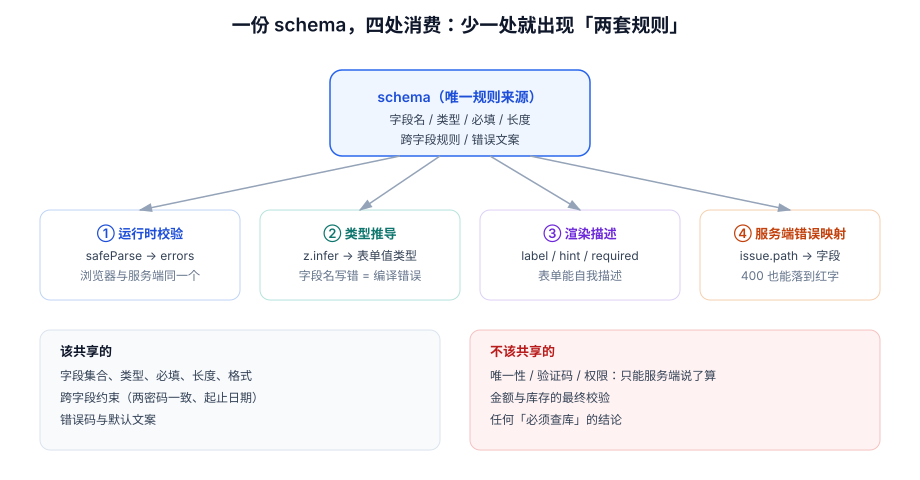

# schema 单一来源：一份定义，四处消费

本页判据族 `FVS-A` ~ `FVS-H`，共 8 条。

表单规则最常见的腐烂方式是**同一个规则被写三遍**：前端写一遍 `if (name.length > 32)`，后端写一遍注解，接口文档上再写一遍「最长 32 字符」。三处只要有一处改漏，就会出现「前端放过去了、后端 400」「文档说 32、实际 20」这类只在生产环境显形的问题。

::: tip 一句话理解
schema 的价值不是「帮你校验」，而是**「让规则只有一个定义，且这个定义还能推导出类型、渲染信息和错误结构」**。少了后半句，schema 只是把 `if` 换了个写法。
:::



## 一、四处消费：少一处就退化成两套规则

| 消费者 | 消费方式 | 少了它会怎样 |
| --- | --- | --- |
| **运行时校验** | `schema.safeParse(values)` → 错误集合 | 校验靠手写 `if`，与 schema 迟早不一致 |
| **类型推导** | `z.infer<typeof schema>` → `FormValues` | 字段名写错是运行时才发现；`errors` 与 `values` 的键对不上 |
| **渲染描述** | `schema` 的 meta（label / hint / 必填） | label 与规则分居两处，改字段时漏改 |
| **服务端错误映射** | 后端也跑同一份 schema，返回 `issue.path` | 后端只能返回 `"参数错误"`，前端无法落到字段上 |

第 4 条最容易被忽略，但它是「一套规则」和「两套规则」的分水岭：后端如果也用同一份 schema（哪怕是同一份 JSON Schema），它返回的错误就能带**字段路径**，前端可以直接把红字挂到对应输入框上，不需要写映射表。

```typescript [shared/schema/company.ts]
import { z } from "zod"

export const companySchema = z.object({
  name: z.string().min(2, "企业全称至少 2 个字").max(64, "企业全称不超过 64 个字"),
  taxNo: z.string().regex(/^[0-9A-HJ-NPQRTUWXY]{18}$/, "统一社会信用代码为 18 位，不含字母 I、O、S、V、Z"),
  industry: z.enum(["tech", "finance", "retail", "manufacture", "other"], { message: "请选择所属行业" }),
  headcount: z.coerce.number().int().min(1).max(100000),
  contactEmail: z.email("请输入完整邮箱"),
  invoiceType: z.enum(["none", "normal", "special"]).default("none"),
})

export type CompanyForm = z.infer<typeof companySchema>
```

同一份文件被三处 import：前端表单（`companySchema.safeParse`）、前端类型（`CompanyForm`）、后端接口（Node 服务里同样 `safeParse` 后把 `issues` 返回）。这就是「一处定义」。

## 二、Standard Schema：库与库之间的公约数

过去「用 Zod 还是 Valibot」是不可逆的选择，因为表单库的 `resolver` 只认一种。2026 年的现状是：**Zod 4、Valibot、ArkType 都实现了 Standard Schema 的 `~standard` 属性**，表单库按这个属性调用，不再绑定具体实现。

```typescript [src/form/resolver.ts]
// 不 import 任何具体 schema 库：只依赖 ~standard
type StandardSchemaV1 = {
  "~standard": {
    version: 1
    validate: (v: unknown) => { value?: unknown; issues?: { message: string; path?: (string | number)[] }[] }
      | Promise<{ value?: unknown; issues?: { message: string; path?: (string | number)[] }[] }>
  }
}

export async function validateWith(schema: StandardSchemaV1, values: unknown) {
  const r = await schema["~standard"].validate(values)
  const errors: Record<string, string> = {}
  for (const issue of r.issues ?? []) {
    const key = (issue.path ?? []).join(".")
    if (key && !(key in errors)) errors[key] = issue.message   // 每个字段只留第一条
  }
  return errors
}
```

::: warning 为什么「每个字段只留第一条」是刻意的
一个字段同时违反「必填 + 格式」时，schema 可能返回两条 issue。全部显示会让用户面对「请输入邮箱」和「邮箱格式不正确」两句话——而后者在前者为真时是废话。保留第一条（通常也是最根本的那条）比「显示全部」更可读；确实需要全部时，用 `criteriaMode: "all"` 显式打开。
:::

## 三、该共享的与不该共享的

「前后端共用一份 schema」这句话只对一半。**格式类规则该共享，事实类结论不该共享**。

| 规则类型 | 例子 | 能不能放进共享 schema |
| --- | --- | --- |
| 类型与格式 | 邮箱格式、18 位信用代码、手机号段 | **能**，纯函数，无副作用 |
| 长度与范围 | 2~64 字、1~100000 人 | **能** |
| 跨字段约束 | 两密码一致、结束日期晚于开始 | **能**（但需要 `superRefine` 拿到全量值） |
| 唯一性 | 邮箱是否已注册、信用代码是否已被占用 | **不能**——必须查库，只能异步、只能服务端 |
| 权限与额度 | 该账号能否开专票 | **不能** |
| 金额与库存 | 下单金额是否超过授信 | **不能** |

把唯一性塞进共享 schema 是最常见的错误：它让「同步校验」变成「同步 + 异步混合」，`safeParse` 不再是纯函数，测试要连数据库。

## 四、抽象是有成本的，但成本不在你以为的地方

本机实测：8 字段表单，手写 `if` 校验 vs 表驱动 schema，各跑 20 万次。

| 实现 | 单次耗时 | 相对成本 | 错误结果是否一致 |
| --- | --- | --- | --- |
| 手写 `if` | **0.16 µs** | 1× | — |
| 表驱动（规则对象 + 循环） | **0.62 µs** | **3.9×** | 一致（同输入同输出） |

3.9 倍看着吓人，但换算成绝对值是 **0.46 µs**——一次按键的校验预算里，它连 1% 都不到。**真正贵的是「每键全表单复判」**（50 字段 × 5.95 µs = 297 µs/键），而不是 schema 本身（见 [大表单](../LargeForm/index.md)）。

所以选型判断不该是「schema 太慢」，而应该是：**这套规则要被几处消费？** 只有一两处、且永不变化时，手写 `if` 完全合理；一旦要被后端、类型、渲染三处消费，3.9 倍换一份定义是划算的。

## 五、服务端错误怎么落回字段

后端返回的错误有两种形态，处理方式完全不同：

```json
// 形态 A：字段级（可映射）
{ "code": "VALIDATION_FAILED", "issues": [{ "path": ["contactEmail"], "message": "该邮箱已被占用" }] }

// 形态 B：业务级（不可映射到字段）
{ "code": "COMPANY_ALREADY_CERTIFIED", "message": "该企业已完成认证，请直接登录" }
```

| 形态 | 处理 | 不要做什么 |
| --- | --- | --- |
| 字段级 | 按 `path` 写进对应字段 `errors`，样式与本地错误一致 | 不要弹 Toast 了事——用户看不出是哪一栏错 |
| 业务级 | 显示在表单顶部摘要区（`role="alert"`），并提供「去登录」等出口 | 不要硬塞进某个字段，用户会以为是那一栏填错 |
| 未知结构 | 兜底文案 + 记录原始响应（打点） | 不要把 `error.message` 直接给用户看（可能含内部字段名） |

```typescript [src/form/applyServerErrors.ts]
export function applyServerErrors(res: unknown, setErrors: (e: Record<string, string>) => void) {
  const body = res as { issues?: { path?: (string | number)[]; message: string }[]; message?: string }
  if (Array.isArray(body.issues) && body.issues.length) {
    const next: Record<string, string> = {}
    for (const i of body.issues) {
      const key = (i.path ?? []).join(".")
      if (key && !(key in next)) next[key] = i.message
    }
    setErrors(next)
    return { kind: "field" as const }
  }
  return { kind: "form" as const, message: body.message ?? "提交失败，请稍后重试" }
}
```

## 六、判据 `FVS-A` ~ `FVS-H`

| 编号 | 判据 | 怎么验证 |
| --- | --- | --- |
| `FVS-A` | 规则只在 schema 里定义一次，前端与后端 import 同一份（或同一份 JSON Schema） | 搜索重复的 `length > 32`、手机号正则，命中处不得两处并存 |
| `FVS-B` | 表单值类型由 schema 推导，不手写 interface | `grep -rn "interface .*Form\b"` 命中即不合格 |
| `FVS-C` | 唯一性、权限、额度类规则**不在**共享 schema 里 | 检查 schema 文件中是否 import 了请求库或 db |
| `FVS-D` | 服务端字段级错误按 `path` 落到对应字段，样式与本地错误一致 | 构造一个 409/422 响应，红字应出现在对应输入框下 |
| `FVS-E` | 业务级错误显示在表单顶部且带 `role="alert"` | 构造业务错误，检查 DOM 的 `role` 与位置 |
| `FVS-F` | 每字段只显示一条错误（或显式开启全量并说明原因） | 提交一个同时违反两条规则的字段，只应出现一句 |
| `FVS-G` | schema 变更后，类型推导处编译通过、测试用例同步更新 | 改一个字段名，`tsc` 应报错；不改测试则测试失败 |
| `FVS-H` | 校验函数是纯函数（同输入同输出，无网络、无时间依赖） | 连续调用两次结果一致；断网时仍能给出格式类错误 |

## 七、验证方式

```typescript
// ① 纯函数性：同样的输入调两次，结果必须全等
const a = validateWith(companySchema, sample); const b = validateWith(companySchema, sample)
console.log("纯函数:", JSON.stringify(a) === JSON.stringify(b))

// ② 字段路径可用：故意造一个坏值，看 key 是否是字段名
const errs = await validateWith(companySchema, { ...sample, taxNo: "123" })
console.log("错误键:", Object.keys(errs))       // 期望 ["taxNo"]
```

```shell
# ③ 规则是否重复定义（同一正则出现在两个以上文件）
grep -rn "1\[3-9\]\[0-9\]{9}" src/ server/ shared/ | wc -l    # 期望 1
# ④ 共享 schema 是否偷偷依赖了 IO
grep -rnE "^import .*(axios|fetch|prisma|knex)" shared/schema/ && echo "不合格" || echo "OK"
```

```typescript
// ⑤ 类型同源：改字段名后编译必须失败（把下面一行取消注释应报 TS2339）
// const bad: CompanyForm = { ...sample, notAField: 1 }
console.log("类型来源:", Object.keys(companySchema.shape).length, "个字段")
```

## 八、相关页面与下一篇

- 下一篇：[异步校验](../AsyncValidation/index.md)——共享 schema 装不下的那部分规则。
- 上游：[校验时机](../ValidationTiming/index.md)（schema 只是「判什么」，本页之前那页讲「何时判」）。
- 相邻必读：[TypeScript · 工具类型](../../Basic/TypeScript/UtilityTypes/index.md)（`Path<T>` 与类型推导）、[技术决策与评审](../../../Others/TechDecision/Overview/index.md)（选型的记录方式）。

## 参考资料

- [Zod 官方文档](https://zod.dev/)
- [Zod 4.6 发布说明（`z.validate` / `z.compile`）](https://zod.dev/blog/zod-4-6)
- [Standard Schema 规范](https://standardschema.dev/)
- [JSON Schema 官方文档](https://json-schema.org/)
- [Valibot 官方文档](https://valibot.dev/)
