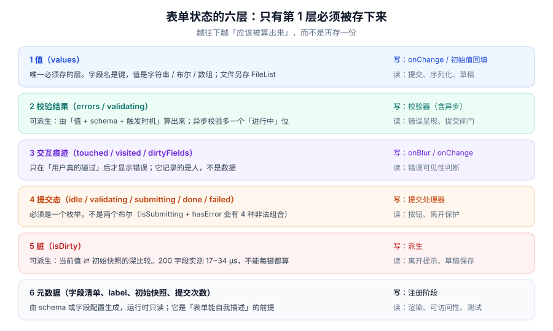

# 状态模型：六层与三种存放

本页判据族 `FVM-A` ~ `FVM-H`，共 8 条。

一个表单看着就是「一堆输入框」，但真正在跑的至少有六层状态：**值、校验结果、交互痕迹、提交态、脏、元数据**。把这六层混成一个大对象，最后一定会出现「改了值错误没消失」「保存了还提示未保存」「提交中按钮又变了」这三类无解问题。

::: tip 一句话理解
表单状态的分层原则只有一条：**能被算出来的就不要存**。唯一必须存的是「值」；`errors` 由值 + 规则算出来，`isDirty` 由值 + 快照算出来，`isValid` 由 `errors` 算出来。剩下的都是**交互痕迹**，它们记的是「人做过什么」，算不出来，必须存。
:::



## 一、六层状态各自的写者与读者

| 层 | 存不存 | 谁写 | 谁读 | 存错了会怎样 |
| --- | --- | --- | --- | --- |
| 值 `values` | **必须存** | `onChange`、初始回填 | 提交、序列化、草稿、联动 | 用 `useState` 按字段各存一份，跨字段规则拿不到全量 |
| 校验 `errors` / `validating` | 可派生 | 校验器（同步 + 异步） | 错误呈现、提交闸门 | 手动 `setErrors` 与校验器各写一份，两处不同步 |
| 交互 `touched` / `visited` | **必须存** | `onBlur`、首次 `onChange` | 决定错误「显不显示」 | 用 `errors` 兼任，一进页面满屏红 |
| 提交 `status` | **必须存** | 提交处理器 | 按钮、离开保护、重试 | `isSubmitting + hasError` 两个布尔，出现 4 种非法组合 |
| 脏 `isDirty` | 可派生 | 派生（值 ⇄ 快照） | 离开提示、草稿 | 保存后不刷新快照，关页面还在问「要保存吗」 |
| 元数据 `fields` | **必须存**（注册期写） | schema / 字段配置 | 渲染、a11y、测试 | 字段清单散在 JSX 里，做不了「全量校验」与「错误摘要」 |

这张表最值得记的是第 3 行：**`touched` 不是 `errors` 的附属品**。它回答的是「用户有没有机会看到这条错误」，与「这条错误存不存在」是两个维度。把它们合成一个，就必然在「刚打开页面」和「用户清空后离开」两个时刻出错。

## 二、三种存放方式：受控、非受控、外部 store

值的存放位置决定了**一次输入会惊动谁**。

| 方式 | 值在哪 | 一次输入的开销 | 适用 | 代价 |
| --- | --- | --- | --- | --- |
| **受控**（controlled） | 组件 state / 表单 store | 一次 `setState` + 订阅者重渲染 | 需要联动、格式化、即时校验 | 大表单里重渲染成本线性上升 |
| **非受控**（uncontrolled） | DOM 节点 | 零渲染（值不进 React） | 纯收集、提交时才读 | 联动与派生要另找入口；重置语义靠 `form.reset()` |
| **外部 store**（RHF / TanStack Form） | store + 订阅 | 只有订阅了该字段的组件重渲染 | 字段多、要字段级校验 | 多一层抽象；调试要看 store 而不只是 props |

同一份代码在三种方式下差别很大。下面这个「姓名 + 公司」的联动，是三种写法的分水岭：

```tsx [src/CompanyField.tsx]
// 受控：值在 state，联动就是读 state
function CompanyField({ values, setValue }: Props) {
  const needInvoice = values.company !== "" && values.country === "CN"
  return (
    <>
      <input
        name="company"
        value={values.company}
        onChange={(e) => setValue("company", e.target.value)}
      />
      {needInvoice && <input name="taxNo" value={values.taxNo} onChange={(e) => setValue("taxNo", e.target.value)} />}
    </>
  )
}
```

```tsx [src/CompanyFieldUncontrolled.tsx]
// 非受控：值在 DOM，联动只能靠「监听 + 读 DOM」
function CompanyFieldUncontrolled({ formRef }: { formRef: RefObject<HTMLFormElement> }) {
  const [needInvoice, setNeedInvoice] = useState(false)
  function onCompanyChange() {
    const fd = new FormData(formRef.current!)
    setNeedInvoice(String(fd.get("company") ?? "") !== "" && fd.get("country") === "CN")
  }
  return (
    <>
      <input name="company" defaultValue="" onChange={onCompanyChange} />
      {needInvoice && <input name="taxNo" defaultValue="" />}
    </>
  )
}
```

::: danger 非受控的联动有三个必踩的坑
1. **读不到「还没挂载」的字段**：`new FormData(form)` 只包含**当前已挂载且有 `name`** 的控件，条件渲染出来的 `taxNo` 在挂载前读不到，于是「切国家 → 立刻读」永远拿到空值。
2. **`defaultValue` 变了不重渲染**：非受控输入的初始值只在挂载时生效，接口回填必须 `form.reset()` 或给 `key` 换实例，否则界面上是旧值、提交出去是新值。
3. **`onChange` 里读 DOM 会拿到「上一次」的值**：受控输入的 `onChange` 触发时 DOM 已更新，但如果你在同一个事件里读的是另一个字段，它是旧值。
:::

## 三、派生的边界：哪些必须算、哪些必须存

判断标准不是「能不能算」，而是**「算它的输入是不是都还在」**。

| 派生项 | 输入 | 能不能派生 | 结论 |
| --- | --- | --- | --- |
| `isValid` | `errors` | 能 | **派生**，不要单独存一份 `isValid` |
| `errorCount` | `errors` | 能 | 派生 |
| `isDirty` | `values` + `initialSnapshot` | 能，但**贵** | 派生 + 缓存（见 [脏检查](../DirtyGuard/index.md)） |
| `canSubmit` | `status` + `isValid` + `validating` | 能 | 派生；但它同时依赖「进行中的异步校验」，要一并纳入 |
| `touched` | 无（人的行为） | **不能** | 必须存 |
| `submitCount` | 无 | **不能** | 必须存（决定「提交过一次后是否改为即时校验」） |

```typescript [src/form/derive.ts]
// 派生层的唯一入口：UI 不直接拼条件
export function deriveCanSubmit(s: FormState): boolean {
  if (s.status === "submitting") return false
  if (s.validating > 0) return false          // 还有异步校验在飞
  return Object.keys(s.errors).length === 0
}
```

页面里出现 `disabled={!isValid || isSubmitting || validating}` 这种拼接，几乎必然漏项——漏的那一项通常是 `validating`：用户刚输完唯一性校验还没回来，按钮就可点了。

## 四、四种常见的「错存」

| 错存 | 现象 | 正确做法 |
| --- | --- | --- |
| 每个字段一个 `useState` | 跨字段规则要读 8 个 state，`useEffect` 里互相依赖，更新顺序不确定 | 一份 `values` 对象 + `setField(name, value)` |
| `errors` 既存又算 | 手动 `setErrors({})` 清空后，校验器下一次跑又填回来 | 只留校验器写，UI 只读 |
| 用 `errors` 判断「要不要显示」 | 一进页面就全红；用户改了又立刻变红 | 加 `touched` 层，显示条件 = `touched && error` |
| 把 `initialValues` 当常量引用 | 编辑页回填后 `initialValues` 还是空对象，`isDirty` 一直为真 | 回填完成时更新快照（`reset(values)`） |

## 五、一个最小可用的状态容器

不引库也能写对，关键是**把六层分开、把派生收口**：

```typescript [src/form/useFormState.ts]
import { useCallback, useMemo, useRef, useState } from "react"

export type Status = "idle" | "validating" | "submitting" | "succeeded" | "failed"

export interface FormState<T extends Record<string, unknown>> {
  values: T
  initial: T
  errors: Partial<Record<keyof T, string>>
  touched: Partial<Record<keyof T, boolean>>
  status: Status
  validating: number
}

export function useFormState<T extends Record<string, unknown>>(initial: T) {
  const [state, setState] = useState<FormState<T>>({
    values: initial, initial, errors: {}, touched: {}, status: "idle", validating: 0,
  })
  const snapshot = useRef(initial)          // 保存成功后才推进的「上次保存点」

  const setField = useCallback((name: keyof T, value: T[keyof T]) => {
    setState((s) => ({ ...s, values: { ...s.values, [name]: value } }))
  }, [])

  const markTouched = useCallback((name: keyof T) => {
    setState((s) => (s.touched[name] ? s : { ...s, touched: { ...s.touched, [name]: true } }))
  }, [])

  const isDirty = useMemo(
    () => Object.keys(state.values).some((k) => state.values[k] !== snapshot.current[k]),
    [state.values]
  )

  const commitSaved = useCallback(() => { snapshot.current = state.values }, [state.values])

  return { state, setField, markTouched, isDirty, commitSaved }
}
```

这段代码有三处刻意设计：`validating` 用**计数**而不是布尔（多个异步校验可以同时在飞）；`isDirty` 与 `initial` 分开（`initial` 用于「重置」，`snapshot` 用于「已保存」）；`markTouched` 做了幂等短路（避免每个键都触发一次重渲染）。

## 六、判据 `FVM-A` ~ `FVM-H`

| 编号 | 判据 | 怎么验证 |
| --- | --- | --- |
| `FVM-A` | 值只有一份，跨字段规则读的是同一份 `values` | 搜索字段级 `useState`，出现两个以上且被同一规则读取即不合格 |
| `FVM-B` | `errors` 只由校验器写，UI 层没有 `setErrors` 之外的直接赋值 | `grep -rn "setErrors" src/` 的每次调用都能说明「为什么不是校验器写的」 |
| `FVM-C` | 错误可见性 = `touched && error`，不是仅 `error` | 打开空表单截图：不应有任何红字；点进字段再离开：应出现该字段错误 |
| `FVM-D` | 提交态是枚举，不是两个布尔组合 | 搜索 `isSubmitting` 与 `hasError` 是否同时存在并被并列判断 |
| `FVM-E` | `isValid` / `errorCount` 为派生值，没有独立 state | `grep -rn "setIsValid"` 应为 0 命中 |
| `FVM-F` | 编辑页回填后刷新「初始快照」，`isDirty` 立即为假 | 回填 10 个字段后不改任何输入，`isDirty` 读数为 `false` |
| `FVM-G` | 非受控写法不使用 `defaultValue` 做二次回填 | `grep -rn "defaultValue" src/` 命中处不得同时出现「依赖接口数据的变量」 |
| `FVM-H` | 派生层只有一个入口（`deriveCanSubmit` 一类），页面不拼条件 | 搜索 `disabled` 属性的表达式长度，出现 3 个及以上逻辑与/或运算即不合格 |

## 七、验证方式

```typescript [src/form/__tests__/state.test.ts]
// ① 值只有一份：改一个字段不影响其它字段的引用
const before = state.values
setField("city", "上海")
expect(state.values).not.toBe(before)        // 新对象
expect(state.values.name).toBe(before.name)  // 其余字段值不变

// ② touched 幂等：同一个字段连续 markTouched 三次，只应产生一次状态变化
const s1 = markTouched("email"); const s2 = markTouched("email")
expect(s2).toBe(s1)   // 引用相等 = 没有触发重渲染
```

```shell
# ③ 全库检查：UI 层是否自己拼了提交条件
grep -rnE "disabled=\{[^}]{20,}\}" src/ || echo "OK：没有超长条件表达式"
# ④ 检查是否有手动维护的 isValid
grep -rn "setIsValid\|setValid\b" src/ || echo "OK：isValid 是派生的"
```

```typescript
// ⑤ 派生一致性：canSubmit 的三种输入组合
const base = { values: {}, initial: {}, errors: {}, touched: {}, status: "idle", validating: 0 } as FormState<any>
console.log(deriveCanSubmit(base))                                  // true
console.log(deriveCanSubmit({ ...base, errors: { email: "x" } }))    // false
console.log(deriveCanSubmit({ ...base, validating: 1 }))             // false ← 最常漏的这一项
```

## 八、相关页面与下一篇

- 下一篇：[校验时机：五个触发点与三档模式](../ValidationTiming/index.md)——六层里第 2 层什么时候被写。
- 上游：[React 表单与受控组件](../../Frame/React/Forms/index.md)（框架层的受控写法）。
- 相邻必读：[状态管理与数据流 · 派生状态](../../StateDataFlow/DerivedState/index.md)（派生的通用规则）、[大表单：订阅粒度](../LargeForm/index.md)（第 1 层的性能后果）。

## 参考资料

- [react.dev · Managing State](https://react.dev/learn/managing-state)
- [react.dev · `<input>` 的受控与非受控](https://react.dev/reference/react-dom/components/input)
- [react-hook-form · 为何用非受控（Uncontrolled）](https://react-hook-form.com/faqs)
- [TanStack Form · Form and Field state](https://tanstack.com/form/latest/docs/framework/react/guides/form-state)
- [MDN · `HTMLFormElement.reset()`](https://developer.mozilla.org/en-US/docs/Web/API/HTMLFormElement/reset)
