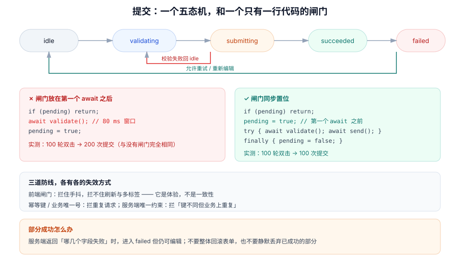

# 提交状态机与防重复

本页判据族 `FVF-A` ~ `FVF-H`，共 8 条。

提交是表单唯一一个**会产生外部副作用**的动作：扣款、发短信、建工单。它也是最容易被一行代码毁掉的地方——`if (pending) return` 写在 `await` 之后，等于没写。

::: tip 一句话理解
防重复提交不是「加个 loading」，而是**「把闸门放在第一个 `await` 之前」**。位置错了，闸门就是装饰品；位置对了，一行布尔就够。
:::



## 一、五态机：为什么不能用两个布尔

很多实现用 `isSubmitting` + `hasError` 两个布尔表达提交态。四个组合里有两个是不存在的：

| `isSubmitting` | `hasError` | 语义 | 是否合法 |
| --- | --- | --- | --- |
| false | false | 空闲 | ✅ |
| true | false | 提交中 | ✅ |
| false | true | 失败待改 | ✅ |
| true | true | 边提交边失败 | ❌ 不存在，但代码里会出现 |

用枚举就没有这个洞：

```typescript [src/form/submitMachine.ts]
export type SubmitStatus = "idle" | "validating" | "submitting" | "succeeded" | "failed"

export const transitions: Record<SubmitStatus, SubmitStatus[]> = {
  idle: ["validating"],
  validating: ["submitting", "failed", "idle"],   // 校验不过 → failed；用户取消 → idle
  submitting: ["succeeded", "failed"],
  succeeded: ["idle"],                            // 允许「再提交一次」
  failed: ["validating", "idle"],
}

export function assertTransition(from: SubmitStatus, to: SubmitStatus) {
  if (!transitions[from].includes(to)) throw new Error(`非法迁移 ${from} → ${to}`)
}
```

这张迁移表在测试里可以穷举：5 个状态 × 5 个目标 = 25 个组合，断言只有 9 个合法。**状态机的价值不在于它好看，而在于「非法组合会抛错」**——抛错比静默进入一个不存在的状态便宜得多。

## 二、闸门位置：本机实测的三种写法

这是本页最值得记住的一组数字。场景：提交前有一次 80 ms 的异步校验，两次点击间隔 5 ms（典型双击），跑 100 轮。

| 写法 | 代码形态 | 100 轮总提交次数 | 结论 |
| --- | --- | --- | --- |
| 无闸门 | `await validate(); await send()` | **200** | 每次双击都提交两次 |
| 闸门在 `await` 之后 | `if (p) return; await validate(); p = true` | **200** | **与无闸门完全相同** |
| 闸门在第一个 `await` 之前 | `if (p) return; p = true; try {…} finally { p = false }` | **100** | 正确 |

第二行是这一页的核心：**「有闸门」的代码和「没闸门」的代码，在双击下表现一模一样**。因为 80 ms 的校验窗口里，两次点击都通过了 `if (p)`——此时 `p` 还是 `false`。

```typescript [src/form/submitOnce.ts]
let pending = false                                   // 或 useRef(false)

export async function submitOnce(task: () => Promise<void>) {
  if (pending) return                                  // ① 读闸门
  pending = true                                       // ② 立刻写闸门（同步，无 await）
  try {
    await task()                                       // ③ 之后才是异步
  } finally {
    pending = false                                    // ④ finally 保证异常也复位
  }
}
```

::: danger 用 `useState` 做闸门，需要额外一层
`if (submitting) return; setSubmitting(true)` 在 React 里**不一定拦得住**：`setSubmitting` 是异步生效的，如果两次点击落在同一次渲染周期内，两次读到的 `submitting` 都是 `false`。

可靠做法二选一：
1. 用 `useRef`（同步可写）做闸门，`useState` 只用于渲染；
2. 用 `<form>` 的原生 `submit` 事件 + `requestSubmit()` 的去重，或把按钮设成 `type="submit"` 并让 `disabled` 由 ref 驱动。
:::

## 三、三道防线，各有各的失效方式

| 防线 | 拦住什么 | 拦不住什么 |
| --- | --- | --- |
| 前端闸门（同步布尔） | 双击、手抖、连点 | 刷新页面、多标签、脚本重放 |
| 幂等键（`Idempotency-Key`） | 同一请求被重发（网络重试、代理重放） | 键不同但业务上重复（用户改了一个字符又提交） |
| 服务端唯一约束 | 「业务上只能有一条」的最终保证 | 它不负责给用户友好提示，需要把冲突翻译成字段错误 |

判断标准很简单：**前端闸门是体验，幂等键是传输层，唯一约束是一致性**。三者不能互相替代。

## 四、部分成功：最容易被做错的分支

批量提交（一次导入 20 条、一次邀请 10 个人）会出现「3 条成功、2 条失败」。三种做法里只有一种是对的：

| 做法 | 用户感受 | 评价 |
| --- | --- | --- |
| 整体回滚，全部重填 | 20 条白填 | ❌ 代价最大 |
| 只显示「部分失败」，不说是哪几条 | 不知道改哪 | ❌ 等于没提示 |
| 保留成功项，失败项留在表单里并标注原因 | 只改 2 条 | ✅ 正确 |

```typescript [src/form/applyBatchResult.ts]
type BatchResult = { ok: string[]; failed: { id: string; message: string }[] }

export function applyBatchResult(r: BatchResult, removeRows: (ids: string[]) => void) {
  removeRows(r.ok)                                     // 成功的从待提交列表移除
  return Object.fromEntries(r.failed.map((f) => [f.id, f.message]))  // 失败的保留并标错
}
```

关键是**成功的那些必须立刻从表单里消失**，否则用户会重复提交它们，制造真正的重复数据。

## 五、超时、重试与「不知道成功没有」

网络超时是最难的分支：请求发出去了，响应没回来，服务端可能已经成功。

| 情况 | 处理 | 理由 |
| --- | --- | --- |
| 明确失败（4xx） | 显示错误，允许修改后重试 | 服务端确定没执行 |
| 明确失败（5xx） | 提示稍后重试，**自动重试最多 2 次**（指数退避） | 可能是瞬时故障，但重试必须带幂等键 |
| 超时 / 网络中断 | **不要自动重试**，改为「查询结果」 | 自动重试可能造成重复扣款 |
| 超时后用户手动重试 | 用同一个幂等键，服务端应返回首次结果 | 幂等键的意义就在这里 |

```typescript [src/form/submitWithIdempotency.ts]
const key = crypto.randomUUID()                        // 同一表单生命周期内保持不变
async function send(values: unknown) {
  return fetch("/api/certifications", {
    method: "POST",
    headers: { "Content-Type": "application/json", "Idempotency-Key": key },
    body: JSON.stringify(values),
  })
}
// 关键：重试时复用同一个 key，而不是每次生成新的
```

## 六、按钮状态：三种「不可点」要区分开

| 不可点原因 | 视觉 | 提示 |
| --- | --- | --- |
| 表单未填完（校验不过） | 灰按钮（保留可聚焦，`aria-disabled`） | hover/聚焦时说明缺什么 |
| 正在提交 | 灰按钮 + spinner + 文案「提交中…」 | 不要变成「请稍候」这种含糊词 |
| 无权限 | 灰按钮 + 说明 | 说明谁能操作，给申请入口 |

用 `disabled` 会让按钮**从 Tab 序列里消失**，键盘用户会以为表单坏了。更稳的做法是 `aria-disabled="true"` + 拦截点击 + 保留焦点。

## 七、判据 `FVF-A` ~ `FVF-H`

| 编号 | 判据 | 怎么验证 |
| --- | --- | --- |
| `FVF-A` | 提交态是枚举，迁移表可穷举测试 | 25 个组合里只有 9 个合法；非法迁移抛错 |
| `FVF-B` | 闸门在第一个 `await` 之前同步置位，`finally` 复位 | 双击测试：100 轮应只有 100 次提交 |
| `FVF-C` | 闸门用 `useRef` 或模块级变量，不用纯 `useState` | 读代码：`setState` 不得作为唯一闸门 |
| `FVF-D` | 每次提交带幂等键，重试复用同一个键 | 抓包：两次重试的 `Idempotency-Key` 相同 |
| `FVF-E` | 超时不自动重试，改为查询结果 | 用 30 s 超时的 mock，观察是否自动二次发送 |
| `FVF-F` | 部分成功保留失败项、移除成功项 | 批量提交 5 条成功 2 条失败，表单只剩 2 条 |
| `FVF-G` | 提交中按钮不退出 Tab 序列（`aria-disabled` 而非 `disabled`） | Tab 键仍能聚焦到提交按钮 |
| `FVF-H` | 提交成功后清理草稿并刷新脏快照 | 提交成功后立刻离开页面，不应弹出「未保存」提示 |

## 八、验证方式

```javascript
// ① 双击：两种闸门写法的对比（真实异步）
async function trial(kind) {
  let submits = 0, pending = false
  const validate = () => sleep(80), send = async () => { submits++; await sleep(40) }
  async function click() {
    if (kind === "late") { if (pending) return; await validate(); pending = true; await send(); pending = false; return }
    if (kind === "early") { if (pending) return; pending = true; try { await validate(); await send() } finally { pending = false } }
  }
  const a = click(); await sleep(5); const b = click(); await Promise.all([a, b])
  return submits
}
console.log("late:", await trial("late"), "early:", await trial("early"))  // 期望 2 / 1
```

```shell
# ② 闸门是否在第一个 await 之前（人工评审的机械辅助）
grep -rn -A3 "if (pending) return" src/ | grep -n "await" | head
# 若 await 出现在 pending = true 之前 → 不合格

# ③ 幂等键是否被复用
grep -rn "Idempotency-Key" src/ | wc -l
```

```typescript
// ④ 状态机穷举
const all: SubmitStatus[] = ["idle", "validating", "submitting", "succeeded", "failed"]
let legal = 0
for (const from of all) for (const to of all) if (transitions[from].includes(to)) legal++
console.log("合法迁移:", legal, "/ 25")   // 期望 9
```

## 九、相关页面与下一篇

- 下一篇：[脏检查、草稿与离开保护](../DirtyGuard/index.md)——提交成功后要做的清理。
- 上游：[错误呈现](../ErrorPresentation/index.md)（失败之后怎么告诉用户）。
- 相邻必读：[幂等与状态机工程](../../../Backend/IdempotencyStateMachine/Overview/index.md)（服务端侧的幂等设计）、[React 表单](../../Frame/React/Forms/index.md)（`useActionState` 的 pending）。

## 参考资料

- [react.dev · `useActionState`](https://react.dev/reference/react/useActionState)
- [react.dev · `useFormStatus`](https://react.dev/reference/react-dom/hooks/useFormStatus)
- [IETF · The Idempotency-Key HTTP Header Field（draft）](https://datatracker.ietf.org/doc/draft-ietf-httpapi-idempotency-key-header/)
- [MDN · `aria-disabled`](https://developer.mozilla.org/en-US/docs/Web/Accessibility/ARIA/Attributes/aria-disabled)
