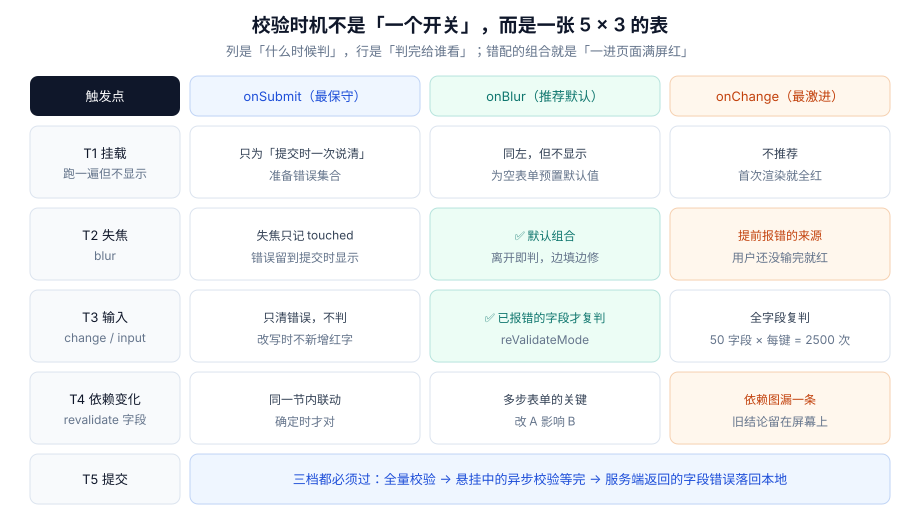

# 校验时机：五个触发点与三档模式

本页判据族 `FVT-A` ~ `FVT-H`，共 8 条。

「什么时候校验」看起来是个开关，实际上是**五个触发点 × 三档显示策略**的组合。绝大多数「表单体验差」的投诉，都不是规则写错了，而是这个组合配错了：该判的时候没判（提交后才发现全错）、不该判的时候判了（刚输入第一个字符就红）。

::: tip 一句话理解
校验有两个独立的问题：**什么时候算**（计算）与 **什么时候显示**（呈现）。把它们混成一个「校验模式」，就必然在「用户正在改」的时刻显示「上一秒的错误」。
:::



## 一、五个触发点

| 触发点 | 什么时候发生 | 该做什么 | 不该做什么 |
| --- | --- | --- | --- |
| **T1 挂载** | 组件首次渲染、字段注册 | 跑一遍同步校验，**只填 `errors` 不显示**；为空表单预置默认值 | 不显示错误；不跑异步校验（用户还没输入，查了也白查） |
| **T2 失焦** | `blur` / `focusout` | 标记 `touched`，对该字段做一次完整校验（含格式与长度） | 不校验「依赖其它字段」的规则（对方可能还没填） |
| **T3 输入** | `change` / `input` | 若该字段当前**已有错误**，复判一次；否则只清空旧错误 | 全表单复判；对未触碰过的字段新增错误 |
| **T4 依赖变化** | 被依赖字段的值变了 | 复判依赖它的字段（确认密码、起止日期、省市区） | 漏掉依赖图里的一条边 |
| **T5 提交** | 点提交 / 表单 `submit` | 全量校验 → 等完悬挂的异步校验 → 再决定放不放行 | 用「上次校验的结果」直接放行 |

这五行里最容易漏的是 **T3 的「只复判已有错误」**。它的作用是让「边填边修」成立：用户看到红字后开始改，改到符合规则时红字应当消失；但如果每键都全量复判，就会在改到一半时冒出新的红字（比如「密码强度不足」在输到第 3 位时弹出）。

## 二、三档显示策略与它们的错配

| 模式 | 何时显示错误 | 适合 | 错配的样子 |
| --- | --- | --- | --- |
| `onSubmit` | 只有提交过之后才显示 | 短表单、低频表单（设置页） | 用户填完点提交，一次冒出 8 条红字，不知道先改哪个 |
| `onBlur` | 字段失焦后显示该字段错误 | **默认推荐**：中长表单 | 用户在字段间用 Tab 快速跳转，每跳一个都留一条红字 |
| `onChange` | 每次输入都判、都显示 | 即时反馈类（密码强度、用户名可用性） | 输第一个字符就红；中文输入法拼写过程中被判为非法 |

### 「先报错、后修正」是错配的典型

把 `onChange` 当默认，会产生一条非常难受的路径：用户输入「a」→ 立刻红「至少 2 个字符」→ 用户继续输「ab」→ 红字消失。**这条红字在 300 ms 内出现又消失，用户只会记住「这破表单一直报错」**。

正确的默认组合是：**判在 `onBlur`，复判在 `onChange`（仅针对已出错的字段），提交时全量**。这就是 `mode: "onBlur"` + `reValidateMode: "onChange"` 的由来：

```typescript [src/form/validationConfig.ts]
// 三档模式的默认值，写在一处而不是散在每个字段
export const validationConfig = {
  mode: "onBlur" as const,          // 首次判：离开字段
  reValidateMode: "onChange" as const, // 复判：只在已出错的字段上、随输入
  shouldFocusError: true,           // 提交失败后聚焦首个错误
  criteriaMode: "firstError" as const, // 只取第一条，避免一个字段堆三句
} satisfies Record<string, unknown>
```

## 三、去抖不是「防抖一下就好」

输入触发的校验（尤其是唯一性检查）通常要防抖。但防抖的**窗口长度**决定了两个体验指标：请求数（成本）与反馈延迟（手感）。

本机实测：模拟 20 次按键、间隔 50 ms，比较三种策略的实际请求数。

```javascript
// 20 次按键，间隔 50 ms，窗口 300 ms
// 原始：每次按键都发 → 20 次
// 防抖（debounce 300ms）→ 1 次
// 节流（throttle 300ms，leading + trailing）→ 5 次
```

| 策略 | 请求数 | 首次反馈延迟 | 适用 |
| --- | --- | --- | --- |
| 不处理 | **20** | 0 ms | 纯本地同步校验 |
| 防抖 300 ms | **1** | ≈ 300 ms + 网络 | 唯一性检查（用户输完才查） |
| 节流 300 ms | **5** | 0 ms（leading 先发一次） | 需要「边输边有反馈」的搜索建议 |

同时测了定时器的实际漂移：目标 300 ms 的 `setTimeout`，30 次采样的 **p50 = 301.6 ms、p95 = 302.4 ms**。也就是说**防抖窗口的真实误差在 1~2 ms 量级**，不需要为「定时器不准」额外补偿；真正让延迟变大的是网络，不是定时器。

::: danger 防抖的三个坑
1. **防抖函数每次渲染都新建**：`onChange={debounce(check, 300)}` 每次渲染创建一个新函数，旧定时器永远清不掉，等于没防抖。必须 `useMemo`/`useRef` 持有。
2. **防抖把「最后一次」也丢了**：只做 trailing 时，用户输完立刻点提交，那次校验还没发出，提交时读到的是 `undefined`。提交路径必须**绕过防抖、直接等结果**。
3. **组件卸载后仍在跑**：定时器没清理会在卸载后触发 `setState`，React 18 起不报错但会泄漏；必须在 `useEffect` 的清理里 `clearTimeout`。
:::

## 四、依赖变化：一张必须写下来的边表

跨字段规则（两密码一致、结束日期晚于开始日期、省市区联动）的触发点是 **T4**，而它最容易漏。做法不是「在 onChange 里顺手多判一个」，而是**把依赖关系写成数据**：

```typescript [src/form/dependencies.ts]
// 字段 → 它变了之后要复判谁
export const dependents: Record<string, string[]> = {
  password: ["confirmPassword"],
  startDate: ["endDate"],
  country: ["province", "city", "postalCode"],
  invoiceType: ["taxNo"],
}

export function revalidateDependents(changed: string, revalidate: (f: string) => void) {
  for (const f of dependents[changed] ?? []) revalidate(f)
}
```

这张表有三个好处：**新加字段时只改一处**；**测试可以直接遍历它**（每个键都改一次，断言被依赖字段的错误被重算）；**代码评审能看见边**——漏一条边在代码里是「少了一行数组元素」，在调用现场是「少了一个看不出缺口的 if」。

## 五、提交时的时序：三档必须都过

提交不是「跑一次 `validate()` 就发请求」，而是三步串行：

```typescript [src/form/submit.ts]
async function onSubmit() {
  setStatus("validating")
  const errors = await validateAll(values)      // ① 全量（含异步）
  if (Object.keys(errors).length) {
    setErrors(errors); setStatus("failed"); focusFirstError(errors); return
  }
  setStatus("submitting")                       // ② 闸门在此之后（见提交状态机）
  await send(values)
  setStatus("succeeded")
}
```

第 ① 步里藏着一个常被忽略的事实：**异步校验可能还在飞**。如果提交时不等它，就会出现「唯一性检查还没回来，订单已经创建了」。判断条件不是「有没有错误」，而是「有没有错误 **且** 没有进行中的校验」：

```typescript
if (state.validating > 0 || Object.keys(state.errors).length > 0) return  // 不放行
```

## 六、判据 `FVT-A` ~ `FVT-H`

| 编号 | 判据 | 怎么验证 |
| --- | --- | --- |
| `FVT-A` | 打开空表单不出现任何错误提示 | 清空本地存储后首次进入，截图应只有占位提示 |
| `FVT-B` | 错误显示条件包含 `touched`（或等价的「提交过」标志） | 读渲染条件：不应只有 `errors.email` |
| `FVT-C` | 默认模式为 `onBlur`，复判模式为 `onChange` | 读表单配置对象；两处都写 `onChange` 即不合格 |
| `FVT-D` | `onChange` 只复判「已有错误」的字段 | 清空一个无错误字段后输入，不应新增红字 |
| `FVT-E` | 输入法拼写过程中不触发校验（`compositionstart` 到 `compositionend` 之间跳过） | 中文输入法输入「中国」的全拼过程截图，不应出现错误 |
| `FVT-F` | 跨字段依赖写成表，且被依赖字段变更时确实复判 | 改 `password`，`confirmPassword` 的错误状态应被重算（不论原来对错） |
| `FVT-G` | 提交前等待所有进行中的异步校验结束 | 断点/日志确认：`validating === 0` 时才发请求 |
| `FVT-H` | 防抖函数在重渲染间保持同一引用，且卸载时清理 | 连输 10 个字符只发 1 次请求；切走页面后控制台无 setState 警告 |

## 七、验证方式

```javascript
// ① 输入法安全：composition 期间不应触发校验
const input = document.querySelector('input[name="name"]')
let checks = 0
const spy = () => checks++
input.addEventListener("compositionstart", () => input.dispatchEvent(new CompositionEvent("compositionstart")))
// 期望：在 compositionstart 与 compositionend 之间键入拼音，checks 不增加
```

```shell
# ② 检查是否有人把「显示条件」写成只有 errors
grep -rnE "errors\.[a-zA-Z]+ &&" src/ | grep -v "touched" || echo "OK：都带了 touched"
# ③ 检查防抖是否被内联创建
grep -rnE "onChange=\{[^}]*debounce\(" src/ && echo "有问题：每次渲染新建" || echo "OK"
```

```typescript
// ④ 依赖边表自测：每个键改一次，断言复判被调用
for (const [field, deps] of Object.entries(dependents)) {
  const calls: string[] = []
  revalidateDependents(field, (f) => calls.push(f))
  if (JSON.stringify(calls) !== JSON.stringify(deps)) throw new Error(`依赖边缺失: ${field}`)
}
console.log("依赖边:", Object.keys(dependents).length, "条全部生效")
```

## 八、相关页面与下一篇

- 下一篇：[schema 单一来源](../SchemaSource/index.md)——「判得准不准」取决于规则写在哪。
- 上游：[状态模型](../StateModel/index.md)（`touched` 与 `errors` 为什么必须分开）。
- 相邻必读：[异步校验](../AsyncValidation/index.md)（T3 里的异步窗口）、[错误呈现](../ErrorPresentation/index.md)（判完怎么显示）。

## 参考资料

- [react-hook-form · `mode` 与 `reValidateMode`](https://react-hook-form.com/docs/useform)
- [Angular · `updateOn` 选项](https://angular.dev/guide/forms/form-validation)
- [MDN · CompositionEvent](https://developer.mozilla.org/en-US/docs/Web/API/CompositionEvent)
- [web.dev · Debounce 与 throttle 的可视化解释](https://web.dev/articles/debounce-throttle)
