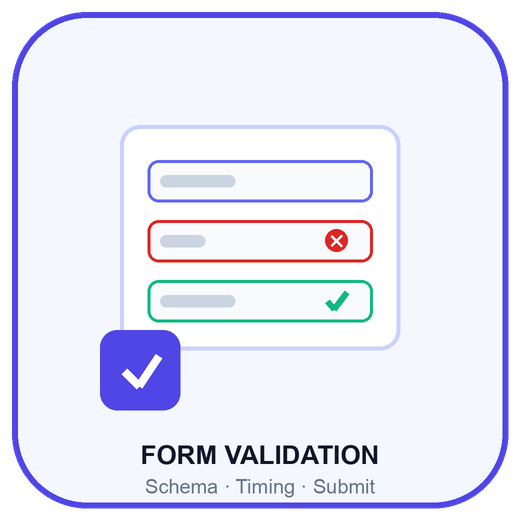
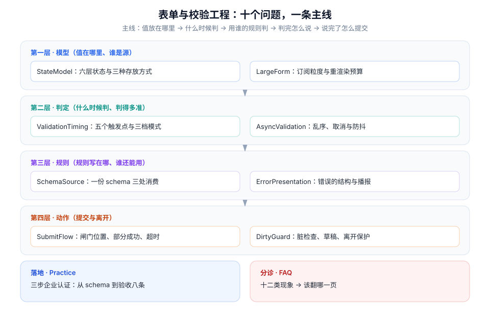

# 表单与校验工程

表单是前端唯一一个**用户会主动、反复、带着目的去填**的界面。它也是最容易「看着能用、实际处处漏」的界面：值存在三个地方、错误在四个时机被判、规则在前端和后端各写一遍、提交闸门写在该在的位置的前一行。

本专题只做一件事：把表单拆成**六个状态层、五个触发点、一次提交**，每一层都给出「约定 / 定错了会怎样 / 怎么验证」。

::: tip 一句话理解
表单的 bug 几乎都不是「校验写错了」，而是**「这个值现在存在哪里、谁有权改它」没说清**。先把状态分层，再谈校验；先定触发时机，再谈错误文案。
:::

## 与相邻专题的分工

本专题最容易和十个已有专题重叠。下表把边界写死——**判据可以互相借用，结论不能互相搬运**。

| 相邻专题 | 它回答什么 | 本专题回答什么 | 为什么不能互相替代 |
| --- | --- | --- | --- |
| [HTML 表单标签](../Basic/HTML/Form/index.md) | `<form>`、`<input>`、`<select>` 的**标签语法与属性清单** | 这些属性该用哪个、原生约束校验能兜到哪一步、兜不住时怎么接 | 那一页是「标签怎么用」，本专题是「原生能力到哪里为止」 |
| [React 表单与受控组件](../Frame/React/Forms/index.md) | React 19 的受控/非受控、`useActionState`、`useFormStatus` | 受控到底贵在哪里、Actions 替掉了哪三行状态、什么时候该退回非受控 | 那一页是「React 怎么写表单」，本专题是「换框架也成立的那部分」 |
| [Angular 表单](../Frame/Angular/Forms/index.md) | 模板驱动与响应式表单、`ValidatorFn`、`updateOn` | `updateOn` 之外还有哪些触发点、异步校验器怎么取消 | 那一页讲框架给的机制，本专题讲机制的取舍 |
| [状态管理与数据流](../StateDataFlow/DerivedState/index.md) | 派生状态、归一化、避免冗余存储 | 表单里哪几层**必须**冗余存（如 touched），哪几层必须派生 | 那一页讲通用状态，本专题讲「表单这种带交互痕迹的状态」 |
| [状态管理与数据流 · 乐观更新](../StateDataFlow/OptimisticUpdate/index.md) | 先改 UI 再发请求、失败回滚 | 提交期内的表单该不该禁用、部分成功怎么呈现 | 那一页讲列表项，本专题讲「一个正在提交的表单」 |
| [国际化与无障碍 · 无障碍基础](../IntlA11y/A11yFoundation/index.md) | 语义化、对比度、ARIA 基础 | 错误信息怎么与字段关联、首错怎么聚焦、播报几次 | 那一页讲「能不能用」，本专题讲「错了以后还知道错在哪」 |
| [国际化与无障碍 · 键盘与焦点](../IntlA11y/KeyboardFocus/index.md) | 焦点顺序、焦点陷阱、跳转链接 | 提交失败后焦点落到哪、多步表单怎么不丢焦点 | 焦点规则是静态的，表单会在运行时改变它 |
| [前端测试 · 组件测试](../Testing/ComponentTesting/index.md) | 测试工具、查询方式、断言风格 | 表单该测哪四类不变量、怎么测竞态 | 那一页讲怎么测，本专题讲「表单里最值得测的是什么」 |
| [TypeScript · 工具类型](../Basic/TypeScript/UtilityTypes/index.md) | 泛型、条件类型、映射类型 | schema 怎么推导出表单类型、`Path<T>` 怎么约束字段名 | 那一页讲类型技巧，本专题讲「类型与运行时规则同源」 |
| [技术决策与评审](../../Others/TechDecision/Overview/index.md) | 决策怎么被记录、复核、替换 | 表单库与校验库的选型判据（含「什么时候不该上库」） | 那一页讲决策流程，本专题给决策的**输入** |

::: info 版本组织说明
本专题**不建版本目录**，三条理由：

1. **它不是某个产品的文档，而是一类工程问题**——React 19 换到 20，表单的六个状态层不会变；
2. 真正并存的差异是**库的选型**（受控 / 非受控 / schema 驱动），这是「同一问题的三种解法」，在页内用对照表处理；
3. 版本差异已经收敛进每页表格的「最低版本 / 适用版本」列，拆目录会制造两份要同步维护的清单。

仓库内已有版本目录范式可对照，三者都遵守「旧版本保留 + 页顶标注状态 + 新版不覆盖」：

| 版本目录范式 | 入口 | 组织方式 |
| --- | --- | --- |
| Spring 框架 | [Spring 版本入口](../../Backend/Java/Frame/Spring/index.md) | `Spring5/` 与 `Spring6/` 并存，各自独立目录 |
| MySQL 变更 | [数据库变更与在线 Schema 演进](../../DB/SchemaEvolution/index.md) | `MySQL57/`（已停止维护）与 `MySQL84/`（当前 LTS）并存 |
| Vue 框架 | [Vue3](../Frame/Vue/Vue3/index.md) | `Vue2/` 与 `Vue3/` 并存，`Vue2` 标注为存量项目使用 |
:::

## 十篇正文

按「先定模型，再定时机，再定规则，再定呈现，最后提交与落地」的顺序排列。

| # | 页面 | 一句话说明 |
| --- | --- | --- |
| 1 | [状态模型：六层与三种存放](StateModel/index.md) | 值 / 校验 / 交互 / 提交 / 脏 / 元数据；受控、非受控、外部 store 的代价表 |
| 2 | [校验时机：五个触发点与三档模式](ValidationTiming/index.md) | 挂载、失焦、输入、依赖变化、提交；`onSubmit` / `onBlur` / `onChange` 的错配 |
| 3 | [schema 单一来源](SchemaSource/index.md) | 一份定义四处消费；该共享与不该共享；服务端 400 怎么落回字段 |
| 4 | [异步校验：乱序、取消与防抖](AsyncValidation/index.md) | 旧响应覆盖新结论、序号护栏与 AbortController、提交时的悬挂校验 |
| 5 | [错误呈现与可访问性](ErrorPresentation/index.md) | 一条错误的五个部件、文案三段式、首错聚焦与播报次数 |
| 6 | [提交状态机与防重复](SubmitFlow/index.md) | 五态机、闸门位置、部分成功、超时与重试 |
| 7 | [脏检查、草稿与离开保护](DirtyGuard/index.md) | 三个参照点、草稿版本号、`beforeunload` 的能力边界 |
| 8 | [大表单：订阅粒度与校验预算](LargeForm/index.md) | 字段级订阅、分区校验、虚拟化与受控组件的取舍 |
| 9 | [实战：三步企业认证表单](Practice/index.md) | 分步切片、跨步约束、文件与验证码、八条验收 |
| 10 | [常见问题与分诊](FAQ/index.md) | 六类现象分诊、十二问、上线自查清单 |

## 判据族总览

全专题 **10 族 80 条**判据，每条只回答三件事：**约定是什么 / 定错了会怎样 / 怎么验证它没被破坏**。

| 页面 | 判据族 | 覆盖的约定 | 条数 |
| --- | --- | --- | --- |
| [状态模型](StateModel/index.md) | `FVM` | 值只有一个写者，派生层不重复存 | 8 |
| [校验时机](ValidationTiming/index.md) | `FVT` | 什么时候判、判完给谁看 | 8 |
| [schema 单一来源](SchemaSource/index.md) | `FVS` | 规则只写一遍，四处消费 | 8 |
| [异步校验](AsyncValidation/index.md) | `FVA` | 晚到的旧响应无权改状态 | 8 |
| [错误呈现](ErrorPresentation/index.md) | `FVE` | 错误可看见、可读出、可定位 | 8 |
| [提交状态机](SubmitFlow/index.md) | `FVF` | 闸门在第一个 `await` 之前 | 8 |
| [脏检查与草稿](DirtyGuard/index.md) | `FVD` | 脏的参照点写清楚，草稿带版本 | 8 |
| [大表单](LargeForm/index.md) | `FVL` | 一次输入只惊动一个字段 | 8 |
| [实战](Practice/index.md) | `FVP` | 分步不搬数据，跨步约束在离开时判 | 8 |
| [分诊](FAQ/index.md) | `FVQ` | 先定位层，再改代码 | 8 |

## 阅读顺序建议

1. **只想建立判断力**：读 [状态模型](StateModel/index.md) + [校验时机](ValidationTiming/index.md)。两页够你在评审里问出「这个值现在存在哪里、这个错误是在哪个时机判的」。
2. **正在救一个线上问题**：先看 [常见问题与分诊](FAQ/index.md) 的分诊表，它会把你送回正确的页面。
3. **要动手做一个表单规范**：从 [schema 单一来源](SchemaSource/index.md) 的边界表开始，落到 [实战](Practice/index.md) 的三步结构。
4. **只关心「为什么输入卡」**：直接读 [大表单](LargeForm/index.md) 的两组读数，再回头看 [状态模型](StateModel/index.md) 的受控代价表。

## 本机实测：三个反直觉的读数

以下数字全部来自本机可复跑脚本（Node 22.22.2，标准库，无第三方依赖，脚本不入库），每一页会重新给出对应脚本与读数。

| 结论 | 读数 | 说明 |
| --- | --- | --- |
| **闸门位置比闸门本身更重要** | 100 轮双击：无闸门 **200** 次提交、闸门放在 `await` 之后 **200** 次、闸门前置 **100** 次 | 「有闸门」的代码和「没闸门」的代码在双击下表现完全相同 |
| **全表单校验比字段级贵 66 倍** | 50 字段表单：全量 **5.95 µs** / 字段级 **0.09 µs**；敲 50 个键累计 **2,500 次 vs 50 次** | 贵不贵不是问题，**「每键都做」才是问题** |
| **脏检查不能放在输入事件里** | 200 字段深比较：`JSON.stringify` **33.6 µs**、逐键比较 **17.28 µs**，前者占 60fps 帧预算 **201.6%** | 一次输入就能吃掉两帧，且用户完全不知道为什么卡 |

::: warning 关于这三条的口径
三个读数都是**单机、冷启动后、固定输入**的中位数，用于比较**数量级**，不作为性能承诺。第 8 页会给出「什么规模下才需要优化」的阈值，而不是「一律优化」。
:::

## 事实与规格速览（2026-10 口径）

| 事项 | 结论 | 依据 |
| --- | --- | --- |
| React 19.2 | **2025-10-01** 发布；当前补丁 **19.2.8**（2026-07-21）；`useActionState` / `useFormStatus` 自 19.0 起稳定 | react.dev 版本页与 19.2 发布说明 |
| React Compiler | **1.0**（2025-10），自动记忆化；表单里大量 `useMemo` 可删，但**不能替掉字段级订阅** | React 官方发布说明 |
| react-hook-form | **7.89.0**（2026-09-26），零运行时依赖，注册式（DOM 持有值） | npm 与官方文档 |
| TanStack Form | **1.33.5**（2026-08-21），v1 稳定，字段级 store + 显式校验事件 | npm 与官方文档 |
| Formik | **2.4.9**（2025-11-10），维护近乎停滞，新项目不建议 | npm 发布记录 |
| Zod | **4.6.x**（4.6.5 = 2026-09-13）；4.6 引入 `z.validate()`（不构造 `ZodError`）与 `z.compile()`；4.x 主体积约 **5.36 kB** gzip | zod.dev 4.6 发布说明 |
| Valibot | **1.5.0**（2026-09-09），函数式、可摇树，体积优先场景 | npm |
| Standard Schema | `~standard` 属性（version 1），Zod 4 / Valibot / ArkType 均实现，库之间可互换校验器 | standard-schema 规范 |
| 原生约束校验 | `checkValidity()` / `reportValidity()` / `setCustomValidity()`；`:user-invalid` 在 Chrome 119 / Safari 16.5 / Firefox 88 起可用 | HTML Living Standard；MDN |
| WCAG 2.2（2023-10-05 REC） | 表单相关：**3.3.1** 错误识别、**3.3.3** 错误建议、**3.3.7** 冗余输入（A）、**3.3.8** 无障碍认证（AA）、**2.4.11** 焦点不被遮挡（AA） | W3C WCAG 2.2 |

## 参考资料

- [react.dev · `<form>` 与 Actions](https://react.dev/reference/react-dom/components/form)
- [react.dev · React 19.2 发布说明](https://react.dev/blog/2025/10/01/react-19-2)
- [react-hook-form 官方文档](https://react-hook-form.com/docs)
- [TanStack Form 官方文档](https://tanstack.com/form/latest)
- [Zod 4.6 发布说明](https://zod.dev/blog/zod-4-6)
- [Standard Schema 规范](https://standardschema.dev/)
- [MDN · 约束校验（Constraint validation）](https://developer.mozilla.org/en-US/docs/Web/HTML/Constraint_validation)
- [WCAG 2.2](https://www.w3.org/TR/WCAG22/)
