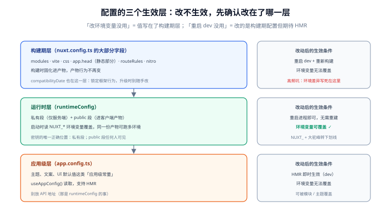

# 常用配置项

一句话定位：`nuxt.config.ts` 是 Nuxt 的**唯一配置入口**——渲染模式、模块、路由规则、运行时密钥、构建行为全在这里。它的难点不是字段多，而是**「这个配置在构建期生效还是运行时生效」分不清**：改错了地方，表现就是「改了没生效」或「改环境变量没用」。



## 一、一个真实项目的配置骨架

```typescript [nuxt.config.ts]
export default defineNuxtConfig({
  // ---- 渲染与路由 ----
  ssr: true,                        // 全局 SSR 开关（false 则整站 SPA）
  routeRules: {                     // 按路由覆盖渲染模式（见渲染模式篇）
    '/': { swr: 60 },
    '/account/**': { ssr: false },
  },

  // ---- 模块与扩展 ----
  modules: ['@nuxt/image', '@nuxt/eslint'],

  // ---- 运行时配置（密钥与环境差异） ----
  runtimeConfig: {
    apiKey: '',                     // 私有：仅服务端
    public: {
      siteName: '示例商城',          // 公开：进客户端产物
    },
  },

  // ---- 应用级 ----
  app: {
    head: {                         // 全站默认 <head>
      titleTemplate: '%s - 示例商城',
      htmlAttrs: { lang: 'zh-CN' },
      link: [{ rel: 'icon', href: '/favicon.ico' }],
    },
  },
  css: ['~/assets/main.css'],       // 全局样式

  // ---- 工程行为 ----
  devtools: { enabled: true },      // 开发工具（生产自动关闭）
  typescript: { typeCheck: true },  // 构建时跑类型检查
  compatibilityDate: '2026-01-01',  // 行为兼容性锁定（见第三节）
})
```

## 二、高频配置项对照表

### 渲染与路由

| 字段 | 类型 | 作用 | 生效时机 |
| --- | --- | --- | --- |
| `ssr` | `boolean` | 全局 SSR 开关 | 构建 + 运行时 |
| `routeRules` | `object` | 按路由的渲染/缓存/代理规则 | 构建 + 运行时 |
| `router.options` | `object` | 透传给 Vue Router（`scrollBehavior` 等） | 构建 |

### 模块与自动导入

| 字段 | 类型 | 作用 |
| --- | --- | --- |
| `modules` | `string[]` | 登记的 Nuxt 模块（按顺序加载） |
| `components` | `object[] / false` | 组件自动导入的目录与前缀规则 |
| `imports.dirs` | `string[]` | 额外加入自动导入的目录 |
| `devtools` | `object` | Nuxt DevTools（页面/组件/请求检查器） |

### 样式与资源

| 字段 | 类型 | 作用 |
| --- | --- | --- |
| `css` | `string[]` | 全局 CSS（每个页面都注入） |
| `app.head` | `object` | 全站默认 `<head>`（被 `useHead` 覆盖） |
| `app.baseURL` | `string` | 部署在子路径时的前缀（如 `/docs/`） |
| `app.buildAssetsDir` | `string` | 构建资源的 URL 前缀（默认 `/_nuxt/`） |

### 构建与运行时

| 字段 | 类型 | 作用 | 生效时机 |
| --- | --- | --- | --- |
| `runtimeConfig` | `object` | 运行时配置（环境变量可覆盖） | **运行时** |
| `vite` | `object` | 透传给 Vite 的配置 | 构建 |
| `nitro` | `object` | 服务端引擎配置（preset、storage） | 构建 + 运行时 |
| `typescript` | `object` | `typeCheck`、`strict` 等 | 构建 |
| `sourcemap` | `object` | 客户端/服务端 sourcemap | 构建 |
| `compatibilityDate` | `string` | 锁定框架行为兼容性（见下） | 构建 + 运行时 |

## 三、三个「什么时候生效」的分层

::: danger 注意：改配置不生效，90% 是搞错了生效层
| 层 | 改了要不要重启 dev | 改了要不要重新构建 | 改环境变量能不能覆盖 |
| --- | --- | --- | --- |
| **构建期配置**（`modules`、`vite`、`css`、`app.head` 的静态部分） | 要（dev 不监听配置文件） | 要 | 不能 |
| **运行时配置**（`runtimeConfig`） | 要 | 不要（`NUXT_*` 变量在启动时读） | **能**（这正是它的用途） |
| **应用配置**（`app.config.ts`） | 不要（HMR 生效） | 不要 | 不能（但可被模块/主题覆盖） |

最常见的踩坑：把「不同环境不同的值」写进 `app.head` 或 `css`，然后期待环境变量能改它——构建期配置在构建时就被固化进产物了。
:::

### `app.config.ts` 与 `nuxt.config.ts` 的分工

```typescript [app.config.ts]
export default defineAppConfig({
  // 运行时可用（useAppConfig()），HMR 即时生效
  // 适合：主题、文案、UI 默认值这类「应用级常量」
  ui: { primaryColor: '#2563EB' },
  footer: { copyright: '© 2026 示例商城' },
})
```

| | `nuxt.config.ts` | `app.config.ts` |
| --- | --- | --- |
| 控制什么 | **构建与框架行为**（渲染模式、模块、密钥） | **应用级常量**（主题、文案） |
| 环境变量覆盖 | `runtimeConfig` 段可以 | 不能 |
| HMR | 不生效（要重启） | 生效 |
| 典型误用 | 把文案塞进去 | 把 API 地址塞进去（应走 runtimeConfig） |

### `compatibilityDate` 的作用

```typescript [nuxt.config.ts]
export default defineNuxtConfig({
  compatibilityDate: '2026-01-01',
})
```

它告诉 Nuxt「我的代码是按哪个日期的框架行为写的」。框架升级引入**行为变更**（非破坏性的语义调整）时，只影响 `compatibilityDate` 之后的项目。**升级 Nuxt 版本时先不要动这个日期**，跑通了再单独改，否则「框架升级 + 行为变更」两个问题混在一起排查。

## 四、环境差异化配置

```typescript [nuxt.config.ts]
export default defineNuxtConfig({
  // 条件配置：只在对应环境生效
  $development: {
    devtools: { enabled: true },
    sourcemap: { client: true },
  },
  $production: {
    sourcemap: false,                    // 生产关闭（避免暴露源码结构）
    nitro: { compressPublicAssets: true },
  },
})
```

| 机制 | 适用 | 例 |
| --- | --- | --- |
| `$development` / `$production` | 按命令（dev vs build）区分的配置 | devtools、sourcemap |
| `runtimeConfig` + `NUXT_*` 变量 | 按部署环境区分的值 | API 地址、密钥 |
| `.env` / `.env.production` | 本地管理环境变量 | 见[安装与环境配置](../Environment/index.md) |

::: warning 说明：`if (process.env.NODE_ENV === '...')` 在配置里也能写，但别写
`nuxt.config.ts` 本身在 Node 里执行，写条件逻辑**技术上可行**，但会让配置变成「需要调试的程序」。条件配置优先用 `$development` / `$production` 声明式写法——可读、可被工具分析、不会在构建日志里藏一个拼写错误。
:::

## 五、TypeScript 配置

```typescript [nuxt.config.ts]
export default defineNuxtConfig({
  typescript: {
    typeCheck: true,        // build 时跑 vue-tsc（需要 pnpm add -D vue-tsc typescript）
    strict: true,           // 生成 strict 模式的 tsconfig
    shim: false,            // 关闭 .vue 的 any 兜底（更严格）
  },
})
```

```shell
# 独立的类型检查命令（CI 里用）
pnpm dlx nuxi typecheck
```

::: tip `typeCheck: true` 会把类型错误变成构建失败
开启后，类型错误不再只是编辑器里的红线，而是 `pnpm build` 直接失败。**建议开启**——它把「能跑但类型不对」的代码拦在部署之前；代价是构建变慢，老项目开启前先用 `nuxi typecheck` 摸清存量错误的量。
:::

## 六、常见问题与排错

| 现象 | 高概率原因 | 处理 |
| --- | --- | --- |
| 改配置后页面没变化 | 构建期配置但 dev 没重启 | 重启 `pnpm dev` |
| 环境变量改了没生效 | 该值写死在构建期配置里 | 移到 `runtimeConfig` |
| `useRuntimeConfig()` 在客户端拿不到私有字段 | 这是**设计行为**（私有段只在服务端可见） | 需要的值移到 `public` 段（先确认可公开） |
| 模块登记了但没生效 | 模块没装 / 版本不兼容 Nuxt 4 | 看启动日志的模块加载警告 |
| `app.baseURL` 改了资源 404 | 只改了 baseURL 没改部署路径 | 静态资源与 baseURL 必须一致 |
| 升级 Nuxt 后行为变了 | `compatibilityDate` 没锁 | 锁定日期，对照 changelog |

## 七、验证方式

```shell
# 1. 配置语法正确（dev 能起来就是第一关）
pnpm dev
# 期望：无 config 报错

# 2. routeRules 生效
curl -sI http://127.0.0.1:3000/ | grep -i 'cache'
# 期望：swr 路由出现缓存相关头

# 3. runtimeConfig 可被环境变量覆盖
NUXT_PUBLIC_SITE_NAME=测试名 pnpm preview &
sleep 3
curl -s http://127.0.0.1:3000/ | grep -c '测试名'
# 期望：>= 1（public 段值被覆盖）

# 4. 私有配置没进客户端产物
pnpm build && grep -rl 'apiKey' .output/public/ | wc -l
# 期望：0
```

## 参考资料

- [Nuxt 官方：`nuxt.config.ts` 参考](https://nuxt.com/docs/api/nuxt-config)
- [Nuxt 官方：运行时配置（runtimeConfig）](https://nuxt.com/docs/guide/going-further/runtime-config)
- [Nuxt 官方：应用配置（app.config.ts）](https://nuxt.com/docs/guide/directory-structure/app-config)
- [Nuxt 官方：环境变量与多环境](https://nuxt.com/docs/getting-started/configuration#environment-variables-and-private-tokens)

## 相关页面

- [渲染模式与架构](../Overview/index.md) —— `ssr` 与 `routeRules` 的语义
- [安装与环境配置](../Environment/index.md) —— 环境变量与 `.env` 的组织
- [服务端能力：Server Routes 与中间件](../ServerRoute/index.md) —— `runtimeConfig` 私有段的完整用法
- [部署与实战](../Deployment/index.md) —— 构建期与运行时变量在部署中的差异
- [目录结构解析](../DirectoryStructure/index.md) —— 配置文件在项目结构中的位置
