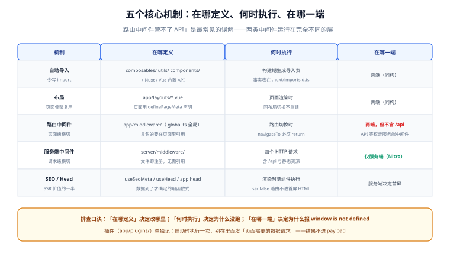

# 核心功能与使用

一句话定位：Nuxt 的日常开发由五件「框架替你做的事」构成——**自动导入、文件路由、布局、中间件、SEO/Head**。理解了它们各自「什么时候执行、在哪一端执行」，剩下的就是 Vue 组件语法本身（那部分见 [Vue 框架](../../Vue/index.md)，本篇不重复）。



## 一、自动导入：少写 import 的代价与边界

Nuxt 自动导入三类东西：**Vue 的 API（`ref`、`computed`…）、Nuxt 的组合式函数（`useFetch`、`useRoute`…）、你自己放在 `composables/`、`utils/`、`components/` 下的内容**。

```vue
<script setup lang="ts">
// 没有任何 import 语句，但以下全部可用：
const route = useRoute()                    // Nuxt 内置
const count = ref(0)                        // Vue API
const { data } = await useFetch('/api/me')  // Nuxt 内置
const cart = useCart()                      // app/composables/useCart.ts
const label = formatPrice(9900)             // app/utils/formatPrice.ts
</script>

<template>
  <BaseButton @click="count++">{{ label }}</BaseButton>  <!-- app/components/base/Button.vue -->
</template>
```

| 便利 | 代价 | 对策 |
| --- | --- | --- |
| 少写 import，重构时不用改一堆文件 | IDE 里看不到符号来源，新人容易迷路 | 记住「查 `.nuxt/imports.d.ts` 看事实表」 |
| 服务端/客户端差异被封装掉（如 `useFetch`） | 同名冲突时行为出人意料 | 自定义函数加项目前缀（`useAppCart`） |
| Tree-shaking 仍然生效（未用的不进产物） | 深层目录的具名导出不会被导入 | 只把「想被自动导入的」放顶层或一级子目录 |

::: danger 注意：自动导入的两个边界
1. **`app/composables/` 只自动导入顶层与一级子目录**——`composables/cart/index.ts` 可以，`composables/cart/internal/helper.ts` 不会被自动导入（深层的请显式 `import`）。
2. **同名的内置组合式函数会被你的覆盖**——在 `composables/useFetch.ts` 里定义自己的 `useFetch` 会遮蔽内置的，调试时极其痛苦。**自定义函数永远不要与内置同名**。
:::

## 二、布局（layouts）：多套页面骨架

```text [app/layouts/]
layouts/
├─ default.vue       # 默认布局（不指定时用它）
├─ admin.vue         # 后台布局（侧边栏 + 顶栏）
└─ plain.vue         # 无装饰布局（登录页、打印页）
```

```vue [app/layouts/admin.vue]
<template>
  <div class="admin-shell">
    <aside>…导航…</aside>
    <main><slot /></main>   <!-- 页面内容渲染在这里 -->
  </div>
</template>
```

```vue [app/pages/admin/users.vue]
<script setup lang="ts">
definePageMeta({ layout: 'admin' })   // 声明本页用 admin 布局
</script>
```

| 方式 | 写法 | 适用 |
| --- | --- | --- |
| 页面声明 | `definePageMeta({ layout: 'admin' })` | 大多数情况 |
| 模板级包裹 | `<NuxtLayout name="plain">…</NuxtLayout>` | 一个页面里局部切换布局 |
| 全局默认 | `app.vue` 里 `<NuxtLayout><NuxtPage /></NuxtLayout>` | 整个应用统一骨架 |

::: tip 布局不重新渲染的技巧
切换两个**同布局**的页面时，布局组件不会销毁重建（`keepalive` 语义）。利用这一点把「耗时初始化」（大列表、地图）放进布局，页面切换时状态保留。反过来，**不要把「每个页面都要重置」的状态放进布局的 `ref`**——它会跨页面残留。
:::

## 三、路由中间件：页面级的横切逻辑

路由中间件在**每次路由切换时**执行（服务端首屏 + 客户端导航都会跑），用来处理「未登录跳登录页」「记录埋点」这类页面级横切。

```typescript [app/middleware/auth.ts]
// 具名中间件：需要在页面里显式引用
export default defineNuxtRouteMiddleware((to) => {
  const { loggedIn } = useAuth()
  if (!loggedIn.value) {
    return navigateTo(`/login?redirect=${encodeURIComponent(to.fullPath)}`)
  }
})
```

```typescript [app/middleware/track.global.ts]
// .global.ts 后缀：全局中间件，每个路由切换都执行（无需引用）
export default defineNuxtRouteMiddleware((to, from) => {
  if (import.meta.client) {
    trackPageView(to.fullPath)   // 只在客户端上报（服务端渲染不算「浏览」）
  }
})
```

```vue [app/pages/account/index.vue]
<script setup lang="ts">
definePageMeta({ middleware: ['auth'] })   // 引用具名中间件
</script>
```

| 类型 | 文件名 | 注册方式 | 适用 |
| --- | --- | --- | --- |
| 具名 | `middleware/auth.ts` | 页面里 `definePageMeta` 引用 | 权限、特定页面逻辑 |
| 全局 | `middleware/xxx.global.ts` | 自动生效 | 埋点、全局重定向 |
| 内联 | 页面里直接写函数 | 不需要文件 | 只用一次的简单判断 |

::: danger 注意：路由中间件管不了 API 请求
`app/middleware/` 只在**页面路由切换**时执行。对 `/api/xxx` 的 HTTP 请求**不会**经过它——API 鉴权必须写在 `server/middleware/` 或 handler 里（完整对照见[服务端能力](../ServerRoute/index.md)第四节）。这是「明明配了中间件，接口还是被匿名调到」的唯一原因。
:::

## 四、SEO 与 Head：SSR 价值的一半在这里

Nuxt 的 SEO 能力来自「服务端就能把 `<head>` 渲染完整」。两套 API 分工明确：

```vue [app/pages/products/[id].vue]
<script setup lang="ts">
const { data: product } = await useFetch(`/api/products/${useRoute().params.id}`)

// 响应式 Head：数据到了才确定 title，服务端直接渲染进 HTML
useSeoMeta({
  title: () => `${product.value?.name} - 示例商城`,
  description: () => product.value?.summary,
  ogTitle: () => product.value?.name,
  ogImage: () => product.value?.coverUrl,
})

// 需要完整控制（script、link、htmlAttrs）时用 useHead
useHead({
  htmlAttrs: { lang: 'zh-CN' },
  link: [{ rel: 'canonical', href: `https://shop.example.com/products/${product.value?.id}` }],
})
</script>
```

| API | 适用 | 特点 |
| --- | --- | --- |
| `useSeoMeta` | 90% 的 SEO 场景 | 类型安全、自带常用 meta 模板、防 XSS |
| `useHead` | 需要 `script`/`link`/`htmlAttrs` 时 | 更底层，可插任意标签 |
| `nuxt.config.ts` 的 `app.head` | 全站默认值（favicon、全局 meta） | 静态值，不随数据变化 |

::: warning 说明：SEO 只对「服务端渲染的页面」有意义
`<ClientOnly>` 里或 `ssr: false` 路由里的 `useSeoMeta` 在服务端不执行，meta 不会出现在首屏 HTML 里。**需要被搜索引擎抓的页面，必须走 SSR/SSG**（判据见[渲染模式与架构](../Overview/index.md)第一节）。
:::

## 五、插件（plugins）：启动时执行的初始化

```typescript [app/plugins/api.client.ts]
// 文件名后缀控制执行端：.client（仅浏览器）/ .server（仅服务端）/ 无（两端都跑）
export default defineNuxtPlugin(() => {
  return {
    provide: {
      // 注入后全局可用：const { $api } = useNuxtApp()
      api: $fetch.create({ baseURL: useRuntimeConfig().public.apiBase }),
    },
  }
})
```

| 后缀 | 执行位置 | 典型用途 |
| --- | --- | --- |
| 无 | 服务端 + 客户端 | 注入同构工具 |
| `.client.ts` | 仅浏览器 | 依赖 `window` 的库（图表、富文本编辑器） |
| `.server.ts` | 仅服务端 | 注册服务端钩子、预热缓存 |

::: danger 注意：插件的执行顺序与「别在插件里发请求」
插件按文件名**字母序**执行，有依赖关系时用数字前缀（`01.auth.ts`、`02.api.ts`）。另外，**插件里不要做「页面需要的数据请求」**——插件在应用启动时执行一次，结果不会进 payload，也不会随路由刷新。页面数据一律走 `useFetch` / `useAsyncData`（见[数据获取与状态](../DataFetching/index.md)）。
:::

## 六、模块系统：官方模块速查

Nuxt 的生态靠模块扩展。安装一个模块 = `pnpm add` + 在 `nuxt.config.ts` 的 `modules` 数组里登记：

```typescript [nuxt.config.ts]
export default defineNuxtConfig({
  modules: [
    '@nuxt/image',      // 图片优化（<NuxtImg>）
    '@nuxt/eslint',     // 项目级 ESLint
    '@pinia/nuxt',      // 状态管理（见数据获取与状态第五节）
  ],
})
```

| 模块 | 解决什么 | 何时考虑 |
| --- | --- | --- |
| `@nuxt/image` | 响应式图片、格式转换、懒加载 | 图片多的内容站 |
| `@nuxt/content` | 把 Markdown/YAML 变成可查询的内容库 | 文档、博客 |
| `@pinia/nuxt` | Pinia 状态管理 | 中大型应用 |
| `@nuxtjs/i18n` | 国际化（路由、SEO、语言切换） | 多语言站点 |
| `@nuxt/eslint` | 项目级 lint | 所有项目 |
| `nuxt-security` | 安全响应头、CSP | 面向公网的生产站 |

::: tip 模块的三个判断标准
1. **优先官方模块**（`@nuxt/*`、`@nuxtjs/*`）：版本与框架同步升级；
2. **看模块的维护状态**（最近 commit、issue 响应）：Nuxt 4 生态里仍有只兼容 Nuxt 3 的模块；
3. **能不用就不用**：一个「三行代码就能实现」的功能不值得引入一个模块——模块是运行时代码，会进产物。
:::

## 七、验证方式

```shell
# 1. 自动导入生效（无需 import 就能用 useFetch）
grep -c 'useFetch' .nuxt/imports.d.ts   # 期望：>= 1

# 2. 布局确实切换了（检查 HTML 里的布局特征 class）
curl -s http://127.0.0.1:3000/admin/users | grep -c 'admin-shell'
# 期望：>= 1

# 3. SEO meta 在服务端就渲染了
curl -s http://127.0.0.1:3000/products/1 | grep -o '<title>[^<]*</title>'
# 期望：<title>商品名 - 示例商城</title>（不是默认标题）

# 4. 全局中间件执行了（服务端日志里有 trace 记录）
# 启动 dev 后访问任意页面，看终端输出
```

## 参考资料

- [Nuxt 官方：自动导入](https://nuxt.com/docs/guide/concepts/auto-imports)
- [Nuxt 官方：布局](https://nuxt.com/docs/guide/directory-structure/layouts)
- [Nuxt 官方：路由中间件](https://nuxt.com/docs/guide/directory-structure/middleware)
- [Nuxt 官方：SEO 与 Meta](https://nuxt.com/docs/getting-started/seo-meta)
- [Nuxt 官方：插件](https://nuxt.com/docs/guide/directory-structure/plugins)
- [Nuxt 官方：模块生态](https://nuxt.com/modules)

## 相关页面

- [目录结构解析](../DirectoryStructure/index.md) —— 各机制对应的目录位置
- [路由与页面管理](../Routing/index.md) —— 文件路由与导航的完整规则
- [数据获取与状态](../DataFetching/index.md) —— `useFetch` / `useAsyncData` / `useState` 的分工
- [常用配置项](../Configuration/index.md) —— `nuxt.config.ts` 各字段的行为
- [Vue 框架](../../Vue/index.md) —— 组件语法与组合式 API 的基础
