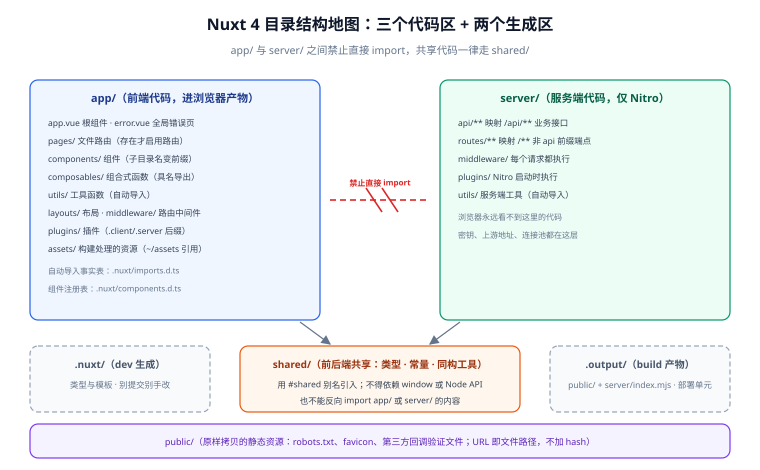

# 目录结构解析

一句话定位：Nuxt 的目录不是「建议」而是**约定**——文件名与位置直接决定路由、自动导入、构建产物。看懂目录结构，就看懂了 Nuxt 一半的行为。**[渲染模式与架构](../Overview/index.md) 给过一张总览图，本篇把每个目录的规则、边界与常见误用逐一展开。**



## 一、顶层布局：先分清「谁是谁」

```text [顶层结构]
my-app/
├─ app/            # ① 前端代码（会被打包进浏览器产物）
├─ server/         # ② 服务端代码（只跑在 Nitro 里）
├─ shared/         # ③ 前后端共享代码（类型、工具、常量）
├─ public/         # ④ 原样拷贝的静态资源
├─ .nuxt/          # ⑤ 生成的开发目录（类型、模板，别提交）
├─ .output/        # ⑥ 生成的生产产物（部署单元，别提交）
├─ nuxt.config.ts  # 唯一配置入口
├─ app.config.ts   # 运行时应用配置（见常用配置项）
└─ package.json
```

| 目录 | 归属 | 打包进浏览器？ | 关键规则 |
| --- | --- | --- | --- |
| `app/` | 前端 | 是 | 组件、页面、组合式函数都在这里 |
| `server/` | 服务端 | 否 | 只由 Nitro 加载，浏览器永远看不到 |
| `shared/` | 共享 | 视引用方 | **不能 import `app/` 或 `server/` 的内容**（否则前后端边界被打破） |
| `public/` | 静态资源 | 原样拷贝 | 不经过构建管线，URL 即文件路径 |
| `.nuxt/` | 生成 | — | dev 时生成，存类型与模板 |
| `.output/` | 生成 | — | build 时生成，就是部署产物 |

::: danger 注意：两个「生成目录」不要提交、不要手改
`.nuxt/` 与 `.output/` 都由构建命令生成，**必须写进 `.gitignore`**（官方模板已带）。手改 `.nuxt/` 里的文件会在下一次 `pnpm dev` 时被覆盖；提交 `.output/` 会让仓库迅速膨胀（几百 MB）且与源码脱节。
:::

## 二、`app/`：前端代码的九个位置

| 路径 | 作用 | 是必需的吗 |
| --- | --- | --- |
| `app/app.vue` | 根组件（挂载点） | 是（缺了会 404） |
| `app/pages/` | 文件路由 | 否（没有它 Nuxt 退化成单页应用） |
| `app/components/` | 自动导入的组件 | 否 |
| `app/composables/` | 自动导入的组合式函数 | 否 |
| `app/layouts/` | 布局 | 否（默认是 `default.vue`） |
| `app/middleware/` | 路由中间件 | 否 |
| `app/plugins/` | Nuxt 插件（启动时执行） | 否 |
| `app/assets/` | 需构建处理的资源（CSS、图片、字体） | 否 |
| `app/utils/` | 自动导入的工具函数 | 否 |
| `app/error.vue` | 全局错误页 | 否 |
| `app/app.config.ts` | 运行时应用配置 | 否 |

### 三个容易混淆的位置

1. **`app/components/` 的命名规则决定组件名**：
   ```text
   components/
   ├─ base/
   │  └─ Button.vue        → <BaseButton>
   └─ ProductCard.vue      → <ProductCard>
   ```
   子目录名会成为组件名前缀。想关闭这个行为要在 `nuxt.config.ts` 里配 `components: [{ path: '~/components', pathPrefix: false }]`。

2. **`app/composables/` 只自动导入「顶层与一级子目录的具名导出」**：
   ```typescript [app/composables/useCart.ts]
   // ✅ 具名导出会被自动导入
   export const useCart = () => { /* ... */ }

   // ❌ default 导出不会被自动导入（需要自己 import）
   export default function () { /* ... */ }
   ```

3. **`app/assets/` 与 `public/` 的分工**（这条在 [Overview](../Overview/index.md) 已强调，这里给判据）：
   - 会被组件引用、希望构建期优化 + hash → `app/assets/`（用 `~/assets/x.png` 引用）；
   - 需要固定 URL、第三方要求放在根路径 → `public/`（用 `/x.png` 引用）。

## 三、`server/`：服务端的五个位置

| 路径 | 映射 | 用途 |
| --- | --- | --- |
| `server/api/**` | `/api/**` | 业务接口（文件名 + HTTP 方法后缀） |
| `server/routes/**` | `/**` | 非 `/api` 前缀的端点（webhook、`robots.txt`） |
| `server/middleware/**` | — | 每个请求都执行（鉴权、trace、日志） |
| `server/plugins/**` | — | Nitro 启动时执行（连接池、钩子注册） |
| `server/utils/**` | — | 自动导入的服务端工具 |

完整的写法与示例见 [服务端能力：Server Routes 与中间件](../ServerRoute/index.md)，这里只给两条**结构层面**的纪律：

::: danger 注意：前后端的 import 边界
1. **`app/` 不能 import `server/`**：构建时可能不报错，但会把服务端依赖打进浏览器包（体积暴涨 + 密钥泄漏风险）。共享的类型与工具放 `shared/`。
2. **`shared/` 不能 import `app/` 或 `server/`**：它的定位是「双方都安全可用的最小公约数」。放进 `shared/` 的东西必须**同构**（不依赖 `window`、不依赖 Node API）。
:::

## 四、自动导入与别名：Nuxt 的「看不见的机制」

Nuxt 的便利来自自动导入，代价是**IDE 里看不到 import 语句**。掌握两条规则就不会迷失：

### 自动导入的覆盖范围

| 来源 | 自动导入的内容 | 例 |
| --- | --- | --- |
| Nuxt 内置 | 全部组合式 API（`useFetch`、`useRoute`、`navigateTo`…）与 Vue 的 `ref`/`computed` 等 | 直接用 |
| `app/components/` | 组件（含子目录前缀） | `<BaseButton>` |
| `app/composables/` | 具名导出 | `useCart()` |
| `app/utils/` | 具名导出 | `formatPrice()` |
| `server/utils/` | 服务端工具（仅在 `server/` 内可用） | `verifyJwt()` |

### 别名对照表

| 别名 | 指向 | 使用场景 |
| --- | --- | --- |
| `~` / `@` | 项目根目录 | `~/assets/logo.png` |
| `~~` / `@@` | 项目根目录（`app/` 布局下同上） | 兼容写法 |
| `#shared` | `shared/` 目录 | `import type { User } from '#shared/types'` |
| `#build` | `.nuxt/` 生成目录 | 模块内部用，业务代码几乎不直接用 |
| `#app` | Nuxt 运行时 | `import type { NuxtError } from '#app'` |

::: tip 排查「为什么这个函数没导入」的三步法
1. 确认文件在自动导入的目录里（`composables/` / `utils/` / `components/`）；
2. 确认是**具名导出**（`export const useXxx = ...`），不是 `export default`；
3. 重启 dev server（新增文件会触发自动导入表重建，但偶尔需要手动重启兜底）。

还查不出来就打开 `.nuxt/imports.d.ts` 与 `.nuxt/components.d.ts` 直接看生成结果——这两份文件就是自动导入的「事实表」。
:::

## 五、两个生成目录里有什么

```text [.nuxt/（dev 时生成）]
.nuxt/
├─ imports.d.ts        # 自动导入的类型声明（排错时直接看它）
├─ components.d.ts     # 组件自动导入的类型
├─ tsconfig.json       # 项目 tsconfig 继承它
├─ types/              # 路由、模块生成的类型
└─ dev/                # 开发期的临时模板
```

```text [.output/（build 时生成）]
.output/
├─ public/             # 客户端产物（HTML、JS、CSS，可直接丢 CDN）
└─ server/
   ├─ index.mjs        # Nitro 服务端入口（依赖已内联）
   └─ chunks/          # 服务端分块
```

::: warning 说明：`tsconfig.json` 为什么不要手改
项目根的 `tsconfig.json` 只有一行 `extends: './.nuxt/tsconfig.json'`。Nuxt 的类型（自动导入、路由参数、模块类型）都生成在 `.nuxt/` 里。**手改根 tsconfig 的 `compilerOptions` 会与生成类型打架**——要加配置，改 `nuxt.config.ts` 的 `typescript` 字段，或在根 tsconfig 里加 `include`/`exclude`。
:::

## 六、常见问题与排错

| 现象 | 高概率原因 | 处理 |
| --- | --- | --- |
| 组件用了但没渲染、控制台干净 | 没放 `app/components/`，或自动导入目录配置被改 | 对照 `.nuxt/components.d.ts` 看有没有注册 |
| `useXxx is not defined` | 文件放错目录，或是 default 导出 | 见第四节三步法 |
| 页面 404 | 文件没放 `app/pages/`，或文件名拼写 | 对照 [路由与页面管理](../Routing/index.md) 的映射表 |
| 改了 `app.config.ts` 页面不更新 | 它只影响运行时配置，不影响构建 | 看[常用配置项](../Configuration/index.md)的两者分工 |
| 客户端代码里 import 了 `server/utils` | 边界破了 | 移到 `shared/` 或 `app/utils/` |
| `.nuxt/` 出现在 Git 提交里 | `.gitignore` 漏了 | 补 `.nuxt` 与 `.output`，`git rm -r --cached .nuxt .output` |

## 七、验证方式

```shell
# 1. 自动导入表确实生成了
ls .nuxt/imports.d.ts .nuxt/components.d.ts
# 期望：两个文件都存在（dev 跑过一次之后）

# 2. 你写的组合式函数被注册了
grep -c 'useCart' .nuxt/imports.d.ts
# 期望：>= 1

# 3. 别名解析正常
pnpm dlx nuxi typecheck
# 期望：无「找不到模块」错误

# 4. 生成目录没被提交
git ls-files | grep -E '^\.(nuxt|output)/' | wc -l
# 期望：0
```

## 参考资料

- [Nuxt 官方：目录结构总览](https://nuxt.com/docs/guide/directory-structure)
- [Nuxt 官方：`app/` 目录](https://nuxt.com/docs/guide/directory-structure/app)
- [Nuxt 官方：自动导入（Auto-imports）](https://nuxt.com/docs/guide/concepts/auto-imports)
- [Nuxt 官方：`shared/` 目录](https://nuxt.com/docs/guide/directory-structure/shared)

## 相关页面

- [渲染模式与架构](../Overview/index.md) —— 目录结构在整体架构中的位置
- [安装与环境配置](../Environment/index.md) —— 创建项目后得到的就是这套目录
- [路由与页面管理](../Routing/index.md) —— `app/pages/` 的映射规则展开
- [核心功能与使用](../CoreConcepts/index.md) —— 自动导入、布局、插件的机制展开
- [服务端能力：Server Routes 与中间件](../ServerRoute/index.md) —— `server/` 目录的完整写法
