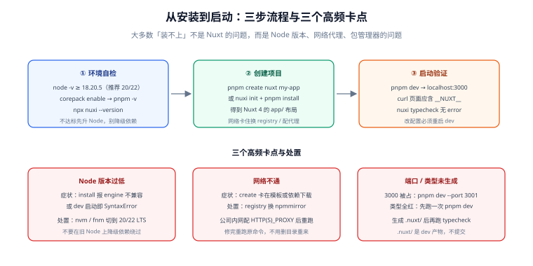

# 安装与环境配置

一句话定位：这一篇解决「从零到 `localhost:3000` 能跑起来」的全部前置问题——Node 版本、包管理器、创建命令、IDE 插件、环境变量。**大多数「装不上」与「跑不起来」都不是 Nuxt 的问题，而是 Node 版本、网络代理或包管理器版本的问题**，先把这三样对齐再怀疑框架。



::: info 版本约定（2026-11 核对）
- 本专题以 **Nuxt 4**（当前稳定主线，最新 4.6）为准；**Nuxt 3 已于 2026-07-31 停止维护（EOL）**，存量项目建议按官方升级指南迁移。
- Node 要求：**Node.js ≥ 18.20.5**（推荐 **20 LTS 或 22 LTS**；Nuxt 4.5 起构建层升级到 Vite 8，旧 Node 会在构建期直接报语法错误）。
- 以下命令以 **pnpm** 为主（官方默认推荐），npm / yarn / bun 均给出等价写法。
:::

## 一、环境要求与自检

| 依赖 | 要求 | 检查命令 | 不达标的后果 |
| --- | --- | --- | --- |
| Node.js | ≥ 18.20.5（推荐 20/22 LTS） | `node -v` | 构建期报 `SyntaxError` 或依赖安装失败 |
| 包管理器 | pnpm ≥ 9 / npm ≥ 10 / yarn ≥ 4 / bun ≥ 1.1 | `pnpm -v` | 锁文件格式不兼容、`nuxi` 报依赖解析错误 |
| Git | 任意现代版本 | `git --version` | 无直接影响（仅初始化模板时需要） |

```shell
# 一分钟自检：三条命令都返回版本号即可继续
node -v        # 期望：v20.x 或 v22.x
corepack enable && pnpm -v   # 期望：9.x 或 10.x（Node 自带 corepack，免全局安装 pnpm）
npx nuxi --version   # 期望：CLI 4.x
```

::: danger 注意：Node 版本不对是最高频的「装不上」根因
两类典型症状，根因都是 Node 版本：

1. `pnpm install` 时报 `Unsupported engine` 或某个依赖编译失败 → 用 `node -v` 确认版本，用 nvm / fnm 切到 LTS。
2. 能安装但 `pnpm dev` 一启动就报 `SyntaxError: Unexpected token` → 构建层（Vite 8）需要的语法旧 Node 不支持，同样先升 Node。

**不要在旧 Node 上通过降级依赖绕过**——后续每次升级都会再踩一次。
:::

## 二、创建项目

```shell
# 官方创建命令（下载模板 + 安装依赖，两步合一）
pnpm create nuxt my-app
cd my-app

# 等价写法（先 init 再装依赖，适合需要自定义 registry 的场景）
pnpm dlx nuxi@latest init my-app
cd my-app && pnpm install
```

创建完成后得到的目录是 **Nuxt 4 的 `app/` 布局**（详见[目录结构解析](../DirectoryStructure/index.md)）：

```text [初始目录]
my-app/
├─ app/
│  └─ app.vue          # 根组件
├─ public/             # 原样拷贝的静态资源
├─ server/             # 服务端代码（初始为空）
├─ nuxt.config.ts      # 全部配置入口
├─ package.json
└─ tsconfig.json       # 继承 .nuxt/tsconfig.json，不要直接改
```

```shell
# 启动开发服务器
pnpm dev
# 期望输出：
#   ➜ Local:    http://localhost:3000/
# 打开浏览器确认出现 Nuxt 欢迎页、控制台无报错
```

::: tip 创建时卡住或失败，先查网络而不是重装
`nuxi init` 要下载模板（GitHub）与依赖（npm registry），两个都可能被网络卡住：

- 模板下载失败 → 用 `pnpm dlx nuxi init my-app -t v4` 指定模板，或配 GitHub 代理；
- 依赖安装慢 → 换 registry：`pnpm config set registry https://registry.npmmirror.com`；
- 公司内网 → 配置 `HTTP_PROXY` / `HTTPS_PROXY` 环境变量后再跑。

这些都是环境问题，**改完之后重跑原命令即可，不需要删目录重来**。
:::

## 三、IDE 配置

| 编辑器 | 必装插件 | 作用 |
| --- | --- | --- |
| VS Code | **Vue - Official**（原 Volar，替代 Vetur） | `.vue` 文件的高亮、类型检查、跳转 |
| VS Code | ESLint + Prettier（可选） | 与项目 lint 规则对齐 |
| WebStorm | 内置 Vue/Nuxt 支持（2023.3+） | 无需额外插件 |

::: danger 注意：Vetur 与 Vue - Official 不能同时启用
VS Code 里同时装了 Vetur 和 Vue - Official 会出现「类型检查报错但代码能跑」的灵异现象。确认方法：扩展面板里搜 `vetur`，装了就直接禁用或卸载。Nuxt 4 + Vue 3.5 只支持 Vue - Official。
:::

启用类型检查（强烈建议，能在 `pnpm dev` 之外多一道编译期保障）：

```shell
pnpm add -D vue-tsc typescript
pnpm dlx nuxi typecheck
# 期望：无 error（首次运行会先生成 .nuxt/ 类型，需要等 dev 跑过一次）
```

## 四、四个核心命令

| 命令 | 作用 | 产物位置 |
| --- | --- | --- |
| `pnpm dev` | 开发服务器（HMR、按需编译） | 无产物（内存中） |
| `pnpm build` | 生产构建（SSR 服务端 + 客户端） | `.output/` |
| `pnpm generate` | 全静态生成（SSG） | `.output/public/` |
| `pnpm preview` | 本地预览 `.output/` 产物 | 无（只读产物） |

```shell
# 两条辅助命令
pnpm dlx nuxi analyze     # 分析 bundle 构成（找出「不小心全量引入的库」）
pnpm dlx nuxi info        # 打印环境信息（提 issue / 排查环境问题前必跑）
```

::: warning 说明：`dev` 与 `preview` 是两条代码路径
`pnpm dev` 用 Vite 开发服务器按需编译；`pnpm preview` 跑的是构建产物。**很多问题只在产物里出现**（自动导入边界、环境变量内联、routeRules 生效）。上线前的验收必须对 `preview` 跑一遍，而不是只看 `dev`。详见[部署与实战](../Deployment/index.md)。
:::

## 五、环境变量与多环境

Nuxt 的环境变量分两类，**读取时机完全不同**（完整讨论见[部署与实战](../Deployment/index.md)第四节，这里只讲开发期配置）：

```text [.env]
# 私有：只在服务端可见（NUXT_ 前缀映射到 runtimeConfig 私有段）
NUXT_API_KEY=sk-dev-xxxxx
NUXT_API_BASE=http://localhost:8080

# 公开：会被打进客户端产物（任何人可见）
NUXT_PUBLIC_SITE_NAME=示例商城（开发）
```

```typescript [nuxt.config.ts]
export default defineNuxtConfig({
  runtimeConfig: {
    apiKey: '',          // ← 被 NUXT_API_KEY 覆盖
    apiBase: '',         // ← 被 NUXT_API_BASE 覆盖
    public: {
      siteName: '',      // ← 被 NUXT_PUBLIC_SITE_NAME 覆盖
    },
  },
})
```

多环境的常见组织方式：

| 文件 | 何时加载 | 用途 |
| --- | --- | --- |
| `.env` | 所有命令 | 本地开发的默认值 |
| `.env.production` | `build` / `generate` | 生产构建的覆盖值 |
| 部署平台的变量面板 | 运行时 | 密钥与内部地址（**不进仓库**） |

::: danger 注意：`.env` 不要提交密钥
`.env` 里的**私有值**（`NUXT_API_KEY` 这类）如果是真实密钥，就应该只存在于部署平台与本机，不进 Git。仓库里只放 `.env.example`（占位、不含真值）。`public` 段的值本身会进产物、可以被看到，但**真密钥永远不该出现在 public 段**。
:::

## 六、从 Nuxt 3 升级到 Nuxt 4

Nuxt 3 已 EOL，存量项目迁移的成本集中在目录结构与少数 API 变更：

```shell
# 官方一键升级（修改 package.json 并跑 codemod）
pnpm dlx nuxi@latest upgrade --dedupe
```

升级后需要人工确认的三件事：

1. **目录结构**：Nuxt 4 默认把前端代码收进 `app/`。旧结构（`pages/`、`components/` 在仓库根）通过 `future.compatibilityVersion` 或兼容性配置可以继续工作，但**新项目请直接用 `app/` 布局**。
2. **`process.client` / `process.server` 已移除** → 全局替换成 `import.meta.client` / `import.meta.server`。
3. **数据获取的 key 语义更严格** → 依赖自动 key 且含非纯值参数的代码要显式声明 `key`（见[数据获取与状态](../DataFetching/index.md)第二节）。

## 七、常见问题与排错

| 现象 | 高概率原因 | 处理 |
| --- | --- | --- |
| `pnpm create nuxt` 卡在下载 | 模板或 registry 网络不通 | 换 registry / 配代理，见第二节 tip |
| `pnpm dev` 端口被占用 | 3000 已被其他进程占用 | `pnpm dev --port 3001`，或杀掉占用进程 |
| 类型检查全红但页面正常 | `.nuxt/` 类型还没生成 | 先跑一次 `pnpm dev` 再跑 `nuxi typecheck` |
| `pnpm install` 报引擎不兼容 | Node 版本过低 | 升 Node 到 20/22 LTS |
| 改 `nuxt.config.ts` 不生效 | dev server 没重启 | 配置文件变更**必须重启** dev（HMR 不覆盖配置） |
| 页面 404 但文件存在 | 页面没放在 `app/pages/` 下 | Nuxt 4 的页面目录是 `app/pages`，不是仓库根的 `pages` |

## 八、验证方式

```shell
# 1. 版本对齐
node -v && pnpm -v && pnpm dlx nuxi --version
# 期望：Node 20/22、pnpm 9/10、nuxi 4.x

# 2. 开发服务器可访问且是 SSR
pnpm dev &
sleep 5
curl -s http://127.0.0.1:3000/ | grep -c '__NUXT__'
# 期望：>= 1（说明是服务端渲染的完整 HTML）

# 3. 类型检查通过
pnpm dlx nuxi typecheck
# 期望：无 error

# 4. 生产构建与产物预览
pnpm build && pnpm preview &
sleep 3
curl -s -o /dev/null -w '%{http_code}\n' http://127.0.0.1:3000/
# 期望：200
```

## 参考资料

- [Nuxt 官方：安装指南](https://nuxt.com/docs/getting-started/installation)
- [Nuxt 官方：升级指南（v3 → v4）](https://nuxt.com/docs/getting-started/upgrade)
- [Nuxt 官方：nuxi CLI 命令参考](https://nuxt.com/docs/api/commands)
- [Nuxt 4.0 发布公告](https://nuxt.com/blog/v4)
- [Vue - Official 插件（原 Volar）](https://marketplace.visualstudio.com/items?itemName=Vue.volar)

## 相关页面

- [渲染模式与架构](../Overview/index.md) —— 装好环境后第一个要决策的问题：页面在哪里渲染
- [目录结构解析](../DirectoryStructure/index.md) —— 创建出来的每个目录是干什么的
- [常用配置项](../Configuration/index.md) —— `nuxt.config.ts` 的完整字段说明
- [常见问题与故障排查](../FAQ/index.md) —— 装好了但跑不对时的对照表
- [部署与实战](../Deployment/index.md) —— 从「能跑」到「能上线」
- [Nuxt 通用模板](../../../../../project/Base/NuxtTemplate/index.md) —— 一个把「环境初始化」做成自动化引导的工程样本
