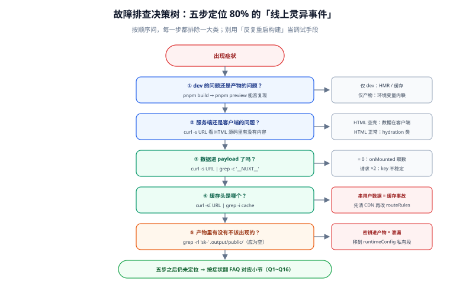

# 常见问题与故障排查

一句话定位：Nuxt 的问题有**很强的模式**——绝大多数故障能在五步内定位，前提是**按正确的顺序排查**：先分清「开发环境还是产物」、再看「服务端还是客户端」、最后才看代码本身。本篇把高频问题按症状分类，每条都给出定位手段与正确修法。



## 〇、排查顺序（先看这张表再翻具体问题）

| 步骤 | 问题 | 命令 / 手段 | 排除掉的大类 |
| --- | --- | --- | --- |
| 1 | 是 dev 的问题还是产物的问题？ | `pnpm build && pnpm preview` 复现 | dev-only（HMR、缓存） |
| 2 | 是服务端还是客户端的问题？ | `curl -s <url>` 看 HTML 源码 | 客户端-only（hydration、JS） |
| 3 | 数据有没有进 payload？ | `curl -s <url> \| grep -c '__NUXT__'` | 数据获取方式错误 |
| 4 | 缓存头是哪个？ | `curl -sI <url> \| grep -i cache` | 缓存 / routeRules 配置 |
| 5 | 产物里有没有不该出现的东西？ | `grep -rl 'sk-' .output/public/` | 密钥泄漏 |

::: tip 五步能覆盖 80% 的「线上灵异事件」
「A 用户看到 B 用户的数据」→ 第 4 步（缓存头）；
「改了环境变量没生效」→ 第 1 步（产物是构建期内联的）；
「首屏空白但刷新后正常」→ 第 2 + 3 步（数据在客户端才取）。
**先跑五步，再决定翻哪一节。**
:::

## 一、安装与启动类

### Q1：`pnpm create nuxt` 卡住或失败

**判据**：卡在下载模板 → GitHub 网络；卡在安装依赖 → registry。

```shell
# registry 换成国内镜像
pnpm config set registry https://registry.npmmirror.com
# 模板单独指定（绕过默认下载）
pnpm dlx nuxi@latest init my-app -t v4
```

### Q2：`pnpm dev` 启动报 `SyntaxError` 或依赖安装失败

**高概率根因**：Node 版本。Nuxt 4 要求 Node ≥ 18.20.5（推荐 20/22 LTS）。

```shell
node -v    # 不在 18.20.5+ 就升，用 nvm/fnm 切换
```

### Q3：端口被占用

```shell
pnpm dev --port 3001    # 换端口（不要杀错进程）
```

## 二、渲染与 Hydration 类

### Q4：控制台报 `Hydration completed but contains mismatches`

**含义**：服务端渲染的 HTML 与客户端 hydration 时的虚拟 DOM 不一致。三个高频来源（按概率排序）：

1. **用了浏览器专属 API**：`window.innerWidth`、`localStorage` 在 setup 顶层执行 → 服务端没有，两端结果不同；
2. **不确定的值**：`Date.now()`、`Math.random()`、`new Date().toLocaleString()`（服务端与客户端时区/时刻不同）；
3. **无效的 HTML 嵌套**：`<p>` 里放 `<div>`、`<table>` 结构不完整 → 浏览器解析时自动修正，两端解析结果不同。

**修法**：

```vue
<script setup lang="ts">
// ① 浏览器 API 移到 onMounted
const width = ref(0)
onMounted(() => { width.value = window.innerWidth })

// ② 时间/随机数在服务端与客户端要一致：用 useState 固定
const buildId = useState('build-id', () => Math.random().toString(36).slice(2))
</script>

<template>
  <!-- ③ 整个组件只在客户端渲染 -->
  <ClientOnly>
    <BrowserWidget />
    <template #fallback><div class="skeleton" /></template>
  </ClientOnly>
</template>
```

### Q5：页面打开一片空白，控制台报 `window is not defined` 或 `document is not defined`

**根因**：代码在服务端执行时访问了浏览器 API。按 Q4 的①③修法处理。第三方库只支持浏览器时，用 `.client.ts` 插件或 `<ClientOnly>` 包裹。

### Q6：页面能开，但点击没反应

**排查顺序**：

1. 控制台有没有 hydration 错误（Q4）——hydration 失败后事件绑定不上；
2. 首屏 JS 是不是太大（`pnpm dlx nuxi analyze`）——JS 没加载完时页面「看着好了但点不动」；
3. 按钮是不是在 `<ClientOnly>` 的 fallback 里——fallback 只是占位，不是真组件。

## 三、数据获取类

### Q7：同一个接口请求了两次

**根因排序**：

1. 在 `onMounted` 里用 `$fetch`（服务端不跑、客户端补一次）；
2. `key` 不稳定（含时间戳、随机数、非纯值对象）——hydration 时 key 变了，重新请求；
3. 父子组件同时取同一份数据但 key 不同。

**修法**：数据请求一律用 `useFetch` / `useAsyncData`；显式声明 `key` 且只用字符串与基本类型。完整机制见[数据获取与状态](../DataFetching/index.md)。

### Q8：切换路由参数（`/products/1` → `/products/2`）数据不更新

**根因**：`key` 不含参数，Nuxt 认为是同一份数据。

```typescript
// ✅ key 含参数；或用 getter URL + 自动 watch
const route = useRoute()
const { data } = await useFetch(() => `/api/products/${route.params.id}`, {
  key: `product-${route.params.id}`,
})
```

### Q9：`useFetch` 返回的 `data` 在模板里报 `undefined`

**根因**：服务端渲染时请求失败，`data` 是 `null`，模板直接 `data.xxx` 就炸。

```typescript
// ✅ 给 default，模板里就不用判空
const { data, error } = await useFetch('/api/products', { default: () => [] })
// ✅ 同时处理 error（见数据获取篇第六节）
```

## 四、路由与中间件类

### Q10：页面文件在，但访问 404

按[路由与页面管理](../Routing/index.md)第一节排查：层级、方括号、大小写（Linux 敏感）。快速确认手段：

```shell
grep '<你的路径>' .nuxt/types/typed-router.d.ts
# 期望：能搜到（搜不到 = Nuxt 根本没注册这个路由）
```

### Q11：路由中间件「没执行」

**两类情况**：

1. **具名中间件没在页面里引用**——`definePageMeta({ middleware: ['auth'] })` 必须有；
2. **期待它拦截 API 请求**——路由中间件只在**页面导航**时执行，`/api/**` 的鉴权要写在 `server/middleware/`（见[服务端能力](../ServerRoute/index.md)第四节）。

### Q12：`navigateTo` 在中间件里「跳了又跳回来」

没写 `return`。中间件里必须 `return navigateTo('/login')` 才能中断当前导航。

## 五、构建与部署类

### Q13：`pnpm build` 内存溢出（`JavaScript heap out of memory`）

```shell
# Node 堆调大（Windows PowerShell / 类 Unix 通用写法二选一）
export NODE_OPTIONS=--max-old-space-size=8192 && pnpm build
```

长期方案：减少首屏并行渲染的页面数（`nitro.prerender.concurrency`）、拆分超大页面、CI 机器内存 ≥ 8 GB。

### Q14：`dev` 正常，产物（`preview` / 线上）异常

**按概率排序的三个根因**：

1. **环境变量是构建期内联的**——`NUXT_PUBLIC_*` 改了必须重新构建（见[部署与实战](../Deployment/index.md)第四节）；
2. **自动导入的边界情况**——某些宏 / 深层目录的导入在产物里失效，对照 `.nuxt/imports.d.ts`；
3. **`routeRules` 只在产物里生效**——dev 下 `swr` / `prerender` 的行为与产物不同，验收必须对 `preview` 做。

### Q15：上线后「A 用户看到 B 用户的数据」

**这是缓存事故，按秒级响应处理**：

1. 立即把受影响路径的 CDN 缓存清掉；
2. 检查 `routeRules`：用户相关路由是否被 `swr` / 公共缓存头覆盖；
3. 正确配置：`/account/**` 用 `ssr: false` 或 `Cache-Control: private, no-store`；
4. 回归验证：A、B 两个账号访问同一路径，确认互不可见。

完整讨论见[部署与实战](../Deployment/index.md)第五节。

### Q16：容器启动即退出

最常见：只监听了 `127.0.0.1`。加环境变量 `HOST=0.0.0.0`（官方 Dockerfile 模板已带，见[部署与实战](../Deployment/index.md)第三节）。

## 六、排查工具箱

| 工具 | 命令 / 入口 | 能回答什么 |
| --- | --- | --- |
| Nuxt DevTools | dev 页面右下角图标 | 页面/组件/请求/模块的运行时状态 |
| `nuxi analyze` | `pnpm dlx nuxi analyze` | bundle 构成（谁在撑大体积） |
| `nuxi info` | `pnpm dlx nuxi info` | 环境信息（提 issue 前必附） |
| `.nuxt/imports.d.ts` | 直接读文件 | 自动导入的「事实表」 |
| `curl -s <url>` | 终端 | 服务端到底渲染了什么 |
| `curl -sI <url>` | 终端 | 缓存头 / 路由规则是否生效 |
| 浏览器 Network「Doc」 | F12 | 客户端导航有没有触发整页刷新（有 = 路由配置问题） |

::: danger 注意：别用「反复重启构建」来排查
构建一次要几分钟到几十分钟，用它当调试手段一天只能试几次。**先用 `curl` + DevTools 把问题定位到「哪一层」，再决定要不要重新构建**。90% 的问题在浏览器与 curl 层面就能看到答案。
:::

## 参考资料

- [Nuxt 官方：错误处理](https://nuxt.com/docs/getting-started/error-handling)
- [Nuxt 官方：调试（DevTools 与日志）](https://nuxt.com/docs/guide/going-further/debugging)
- [Vue 官方：SSR Hydration 不匹配](https://vuejs.org/guide/scaling-up/ssr.html#hydration-mismatch)
- [Nuxt GitHub Discussions（社区问答）](https://github.com/nuxt/nuxt/discussions)

## 相关页面

- [安装与环境配置](../Environment/index.md) —— 装不上、起不来的完整清单
- [数据获取与状态](../DataFetching/index.md) —— Q7~Q9 的机制展开
- [路由与页面管理](../Routing/index.md) —— Q10~Q12 的规则展开
- [部署与实战](../Deployment/index.md) —— Q13~Q16 的完整处置
- [渲染模式与架构](../Overview/index.md) —— hydration 与渲染模式的底层机制
