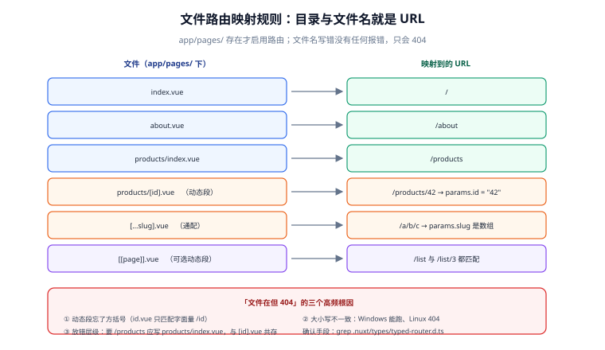

# 路由与页面管理

一句话定位：Nuxt 的路由是**文件系统**——`app/pages/` 下的目录与文件名就是 URL，不需要手写路由表。好处是「看一眼目录就知道有哪些页面」；代价是**文件名写错、目录放错，页面就是 404**，而且没有任何报错告诉你为什么。



## 一、文件路由的映射规则

```text [映射规则]
app/pages/index.vue              →  /
app/pages/about.vue              →  /about
app/pages/products/index.vue     →  /products
app/pages/products/[id].vue      →  /products/:id       （动态段）
app/pages/products/[id]/edit.vue →  /products/:id/edit
app/pages/[...slug].vue          →  通配路由（匹配任意多级路径）
app/pages/[[page]].vue           →  可选动态段（/ 与 /2 都匹配）
```

启用条件：`app/pages/` 目录**存在**才启用文件路由；没有它 Nuxt 只渲染 `app.vue`（适合纯工具页）。启用后 `app.vue` 里必须有 `<NuxtPage />` 作为页面出口：

```vue [app/app.vue]
<template>
  <NuxtLayout>
    <NuxtPage />
  </NuxtLayout>
</template>
```

::: danger 注意：三种「文件在但页面 404」的写法
1. **放错了层级**：`pages/products.vue`（应为 `pages/products/index.vue`）——两者 URL 不同，前者是 `/products`，后者也是 `/products`，但**与 `[id].vue` 组合时**只有目录形式能共存；
2. **动态段忘了方括号**：`pages/products/id.vue` 会匹配字面量 `/products/id`，而不是任意 id；
3. **大小写不一致**：`pages/About.vue` 在 Windows 开发机能跑，部署到 Linux 后 `/about` 404（文件系统大小写敏感）。**目录与文件名统一小写**。
:::

## 二、动态路由与参数读取

```vue [app/pages/products/[id].vue]
<script setup lang="ts">
const route = useRoute()

// 1. 参数是字符串（可能是数组，见通配路由），用之前先校验
const id = computed(() => {
  const raw = route.params.id
  const n = Number(Array.isArray(raw) ? raw[0] : raw)
  if (!Number.isInteger(n) || n <= 0) {
    throw createError({ statusCode: 404, statusMessage: '商品不存在' })
  }
  return n
})

// 2. 用参数取数（key 里必须含参数，见数据获取篇）
const { data: product } = await useFetch(() => `/api/products/${id.value}`, {
  key: `product-${id.value}`,
})
</script>
```

| 参数形式 | 匹配 | `route.params` 的值 |
| --- | --- | --- |
| `[id]` | `/products/42` | `{ id: '42' }` |
| `[...slug]` | `/docs/a/b/c` | `{ slug: ['a', 'b', 'c'] }`（**数组**） |
| `[[page]]` | `/list` 或 `/list/3` | `{ page: undefined }` 或 `{ page: '3' }` |

::: tip 参数校验要在「取数之前」
`route.params` 是**用户可控输入**。直接拼进 URL 或 SQL 就是注入入口。Nuxt 层面的纪律：**先用 schema 校验（zod / 手写判断），不合法就 `createError(404)`**，不要带着脏参数去请求后端。
:::

## 三、导航：`NuxtLink` 与 `navigateTo`

```vue [任意页面]
<template>
  <!-- 声明式：内部导航（走客户端路由，不刷新页面） -->
  <NuxtLink to="/products/42">查看商品</NuxtLink>

  <!-- 外部链接用原生 <a>（或 NuxtLink 会自动识别外链） -->
  <a href="https://example.com" target="_blank" rel="noopener">外部</a>

  <!-- 预取控制：hover 时预取（默认），数据重的页面可关 -->
  <NuxtLink to="/heavy" :prefetch="false">重页面</NuxtLink>
</template>

<script setup lang="ts">
// 编程式导航
async function goSearch(keyword: string) {
  await navigateTo({ path: '/search', query: { q: keyword } })
}

// 替换历史（不留下一条历史记录，适合登录成功后的跳转）
async function goHome() {
  await navigateTo('/', { replace: true })
}

// 外部跳转必须显式声明
async function goExternal() {
  await navigateTo('https://example.com', { external: true })
}
</script>
```

| API | 用途 | 返回值 |
| --- | --- | --- |
| `useRoute()` | 读当前路由（params / query / path） | 响应式路由对象 |
| `useRouter()` | 操作路由栈（back / push / replace） | Vue Router 实例 |
| `navigateTo()` | 推荐的编程式导航 | 可在中间件/插件里 `return` |

::: warning 说明：`navigateTo` 在中间件里要 `return`，不是 `await`
中间件里 `return navigateTo('/login')` 才会中断当前导航并跳转；只写 `await navigateTo('/login')` 不 `return`，**原导航会继续执行**——表现为「跳了但又跳回来」。
:::

## 四、`definePageMeta`：页面的元信息

```vue [app/pages/admin/users.vue]
<script setup lang="ts">
definePageMeta({
  layout: 'admin',                    // 用哪个布局
  middleware: ['auth'],               // 引用哪些路由中间件
  title: '用户管理',                   // 配合 useHead 之外的路由级标题
  key: (route) => route.fullPath,     // 页面组件的 key（控制复用粒度）
  pageTransition: { name: 'page', mode: 'out-in' },   // 页面过渡
  validate: async (route) => {        // 路由校验（返回 false 即 404）
    return /^\d+$/.test(String(route.params.id))
  },
})
</script>
```

| 字段 | 作用 | 高频误用 |
| --- | --- | --- |
| `layout` | 指定布局 | 写成布局文件名带 `.vue`（应只写名字） |
| `middleware` | 引用中间件 | 写成路径（应写中间件名） |
| `key` | 控制组件复用 | 默认按路径复用，`/products/1` → `/products/2` 不重建组件 |
| `validate` | 路由参数校验 | 在里面 `throw`（应返回 `false`） |
| `pageTransition` | 过渡动画 | 忘记在 `app.vue` 或全局 CSS 里配对应样式 |

::: tip 「切参数不刷新」就是 `key` 的问题
同一个页面组件 `/products/1` → `/products/2` 默认**不会重建**（Nuxt 认为只是参数变了）。于是 `onMounted` 不再执行、组件内 `ref` 残留旧数据。两种修法：

1. `definePageMeta({ key: (route) => route.fullPath })`：参数变化就重建组件；
2. 或者接受复用，把数据获取交给 `useFetch` 的 `watch`（推荐，见[数据获取与状态](../DataFetching/index.md)），组件内的本地状态手动重置。

**不要两个都做**——重建组件 + watch 会发两次请求。
:::

## 五、404 与错误页

```text [两级错误处理]
app/pages/[...slug].vue   →  路由内的「未匹配兜底」（还能用布局）
app/error.vue             →  全局错误页（布局之外，应用级崩溃也走这里）
```

```vue [app/pages/[...slug].vue]
<script setup lang="ts">
// 未匹配的路径落到这里，主动抛 404 让 error.vue 接管
throw createError({ statusCode: 404, statusMessage: '页面不存在', fatal: true })
</script>
```

`createError` 的 `fatal: true` 表示「不可恢复，直接显示错误页」；不加 `fatal` 时错误可被 `clearError()` 清除（适合「局部失败但整体可用」的场景）。`app/error.vue` 的完整写法见[部署与实战](../Deployment/index.md)第七节。

## 六、常见问题与排错

| 现象 | 高概率原因 | 定位手段 |
| --- | --- | --- |
| 页面 404 但文件存在 | 放错层级 / 忘方括号 / 大小写 | 对照第一节映射表；`.nuxt/types/typed-router.d.ts` 看生成的路由 |
| 跳转到动态页参数不更新 | 组件被复用（默认 `key`） | 改 `key` 或用 `watch`（第四节） |
| `navigateTo` 没生效 | 中间件里没 `return` | 加 `return` |
| 查询参数是字符串 `'1'` 不是数字 | URL query 永远是字符串 | `Number(route.query.page)` 转换后校验 |
| 通配路由拿到的参数是字符串不是数组 | 把 `[...slug]` 写成 `[slug]` | 通配必须是 `...` 前缀，拿到的是数组 |
| 生产环境 404、开发环境正常 | 文件名大小写（Linux 敏感） | 目录与文件名统一小写 |

## 七、验证方式

```shell
# 1. 生成的路由表里包含你的页面
ls .nuxt/types/typed-router.d.ts && grep -c 'products' .nuxt/types/typed-router.d.ts
# 期望：>= 1

# 2. 动态路由匹配正确
curl -s -o /dev/null -w '%{http_code}\n' http://127.0.0.1:3000/products/42
# 期望：200
curl -s -o /dev/null -w '%{http_code}\n' http://127.0.0.1:3000/products/abc
# 期望：404（validate 或 createError 生效）

# 3. 客户端导航不刷新页面
# 浏览器打开 Network，点击 NuxtLink，观察：无文档请求（只有可能的预取请求）

# 4. 未匹配路径走错误页
curl -s http://127.0.0.1:3000/no-such-page | grep -c '页面不存在'
# 期望：>= 1
```

## 参考资料

- [Nuxt 官方：路由（pages 目录）](https://nuxt.com/docs/guide/directory-structure/pages)
- [Nuxt 官方：`definePageMeta`](https://nuxt.com/docs/api/utils/define-page-meta)
- [Nuxt 官方：`navigateTo`](https://nuxt.com/docs/api/utils/navigate-to)
- [Nuxt 官方：`NuxtLink` 组件](https://nuxt.com/docs/api/components/nuxt-link)
- [Vue Router 官方文档（底层实现）](https://router.vuejs.org/)

## 相关页面

- [目录结构解析](../DirectoryStructure/index.md) —— `pages/` 在整体结构中的位置
- [核心功能与使用](../CoreConcepts/index.md) —— 布局与中间件的机制
- [数据获取与状态](../DataFetching/index.md) —— 路由参数怎么变成数据请求的 key
- [渲染模式与架构](../Overview/index.md) —— `routeRules` 按路由控制渲染模式
- [常见问题与故障排查](../FAQ/index.md) —— 路由类问题的速查表
