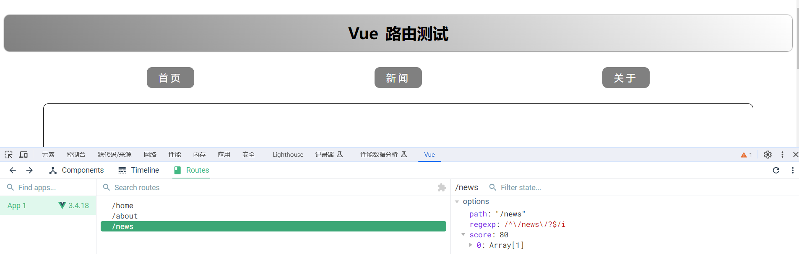
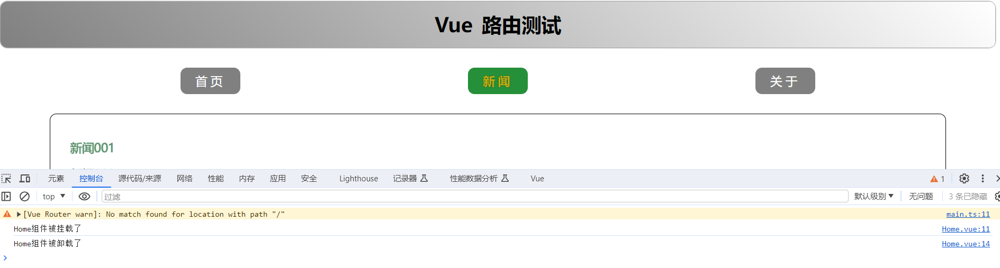

# Vue3 路由

::: info 版本现状
Vue Router 当前稳定版为 4.6.x。懒加载、动态路由、权限控制等进阶用法见「路由进阶」。
:::

路由(Route)是一组key-value的对应关系。多个路由，需要经过路由器(Router)的管理。

在单页面(SPA，`single page web application`)应用中，点击导航区不同的导航项就会在展示区展示不同的内容

整个过程中，页面是不抖动的，没有进行页面的跳转。

当点击一个导航项时，地址的路径发生变化，路由器监测到路径变化就会进行规则的匹配，若匹配上 则会出现在展示区。只要路径发生变化会在第一时间捕获到去寻找规则 把之前装载的组件进行卸载 把匹配上的组件进行挂载。

`Vue3`中要使用`vue-router`的最新版本，目前是`4`版本（**核对时间 2026-09**：Vue 3 对应的仍是 4.x 线；具体补丁号以 `npm view vue-router version` 为准，不要照抄本文写作时的数字）。

官方网站：https://router.vuejs.org/zh/

## 基本切换效果

安装vue 路由：

```bash
npm i vue-router@4
```

编写组件：

**说明**：路由组件(靠路由的规则渲染出来的)通常存放在`pages` 或 `views`文件夹，一般组件通常存放在`components`文件夹。

- 一般组件：

  ```vue [/src/components/Header.vue]
  <script setup lang="ts"></script>
  
  <template>
    <h2 class="title">Vue 路由测试</h2>
  </template>
  
  <style scoped>
  .title {
    text-align: center;
    word-spacing: 5px;
    margin: 30px 0;
    height: 70px;
    line-height: 70px;
    background-image: linear-gradient(45deg, rgb(128, 128, 128), white);
    border-radius: 10px;
    box-shadow: 0 0 2px;
    font-size: 30px;
  }
  </style>
  ```
  
- 路由组件：

  ```vue [/src/views/About.vue]
  <template>
    <div class="about">
      <h2>Vue 路由Router</h2>
    </div>
  </template>
  <script setup lang="ts" name="About"></script>
  
  <style scoped>
  .about {
    display: flex;
    justify-content: center;
    align-items: center;
    height: 100%;
    color: rgb(85, 84, 84);
    font-size: 18px;
  }
  </style>
  ```
  
  ```vue [/src/views/Home.vue]
  <template>
    <div class="home">
      
    </div>
  </template>
  <script setup lang="ts" name="Home">
  import { onMounted, onUnmounted } from 'vue'
  
  onMounted(() => {
    console.log('Home组件被挂载了')
  })
  onUnmounted(() => {
    console.log('Home组件被卸载了')
  })
  </script>
  
  <style scoped>
  .home {
    display: flex;
    justify-content: center;
    align-items: center;
    height: 100%;
  }
  </style>
  ```
  
  ```vue [/src/views/News.vue]
  <template>
    <div class="news">
      <ul>
        <li><a href="#">新闻001</a></li>
        <li><a href="#">新闻002</a></li>
        <li><a href="#">新闻003</a></li>
        <li><a href="#">新闻004</a></li>
      </ul>
    </div>
  </template>
  <script setup lang="ts" name="News"></script>
  
  <style scoped>
  /* 新闻 */
  .news {
    padding: 0 20px;
    display: flex;
    justify-content: space-between;
    height: 100%;
  }
  .news ul {
    margin-top: 30px;
    list-style: none;
    padding-left: 10px;
  }
  .news li > a {
    font-size: 18px;
    line-height: 40px;
    text-decoration: none;
    color: #64967e;
    text-shadow: 0 0 1px rgb(0, 84, 0);
  }
  .news-content {
    width: 70%;
    height: 90%;
    border: 1px solid;
    margin-top: 20px;
    border-radius: 10px;
  }
  </style>
  ```

路由配置文件：

```typescript [/src/router/index.ts]
// 创建一个路由器，并暴露出去

//第一步：引入createRouter
import { createRouter, createWebHistory } from 'vue-router'
//引入可能要呈现的组件
import Home from '@/views/Home.vue'
import About from '@/views/About.vue'
import News from '@/views/News.vue'

//第二步：创建路由器
const router = createRouter({
  // 路由器工作模式
  //在制定路由的之后 一定要想好路由器的工作模式
  history: createWebHistory(),
  //配置路由规则
  routes: [
    // 配置路由
    {
      // 路由路径
      path: '/home',
      //组件
      component: Home,
    },
    {
      path: '/about',
      component: About,
    },
    {
      path: '/news',
      component: News,
    },
  ],
})

//暴露router
export default router
```

使用router路由器：

```typescript [main.ts]
// 引入createApp用于创建应用
import { createApp } from 'vue'
// 引入App根组件
import App from './App.vue'
// 引入Router路由器
import router from './router'

//创建一个应用
const app = createApp(App)
//使用router路由器
app.use(router)
//挂载整个应用到app容器中
app.mount('#app')
```

```vue [App.vue]
<template>
  <div class="app">
    <!-- 标题 -->
    <Header />
    <!-- 导航栏 -->
    <div class="navigate">
      <!--      <a href="#" class="active">首页</a>-->
      <!--      <a href="#">新闻</a>-->
      <!--      <a href="#">关于</a>-->
      <!-- 跳转路径 to：跳转的路径 active-class 点击呈现的class样式-->
      <RouterLink to="/home" active-class="active">首页</RouterLink>
      <RouterLink to="/news" active-class="active">新闻</RouterLink>
      <RouterLink to="/about" active-class="active">关于</RouterLink>
    </div>
    <!-- 展示区 -->
    <div class="main-content">
      <!-- 此处根据路径展示各种组件 -->
      <!-- 路由器视图 把路由的内容展示到这-->
      <RouterView></RouterView>
    </div>
  </div>
</template>
<script setup lang="ts">
import { RouterLink, RouterView } from 'vue-router'
import Header from '@/components/Header.vue'
</script>

<style scoped>
/* App */

.navigate {
  display: flex;
  justify-content: space-around;
  margin: 0 100px;
}

.navigate a {
  display: block;
  text-align: center;
  width: 90px;
  height: 40px;
  line-height: 40px;
  border-radius: 10px;
  background-color: rgb(128, 128, 128);
  text-decoration: none;
  color: white;
  font-size: 18px;
  letter-spacing: 5px;
}

.navigate a.active {
  background-color: #259039;
  color: #bcaf14;
  font-weight: 900;
  text-shadow: 0 0 1px black;
  font-family: 微软雅黑, serif;
}

.main-content {
  margin: 0 auto;
  margin-top: 30px;
  border-radius: 10px;
  width: 90%;
  height: 400px;
  border: 1px solid;
}
</style>
```



通过点击导航，视觉效果上“消失” 了的路由组件，默认是被**卸载**掉的，需要的时候再去**挂载**：



## 路由器工作模式

`history`模式

- 优点：`URL`更加美观，不带有`#`，更接近传统的网站`URL`。

- 缺点：后期项目上线，需要服务端配合处理路径问题，否则刷新会有`404`错误。

  ```js
  const router = createRouter({
    history: createWebHistory(), //history模式
    /******/
  })
  ```

`hash`模式

- 优点：兼容性更好，因为不需要服务器端处理路径。

- 缺点：`URL`带有`#`不太美观，且在`SEO`优化方面相对较差。

  ```js
  const router = createRouter({
    history: createWebHashHistory(), //hash模式
    /******/
  })
  ```


## to的两种写法

```vue
<!-- 第一种：to的字符串写法 -->
<RouterLink to="/home" active-class="active">首页</RouterLink>
<RouterLink to="/news" active-class="active">新闻</RouterLink>
<RouterLink to="/about" active-class="active">关于</RouterLink>

<!-- 第二种：to的对象写法 -->
<RouterLink :to="{ path: '/home' }" active-class="active">首页</RouterLink>
<RouterLink :to="{ path: '/news' }" active-class="active">新闻</RouterLink>
<RouterLink :to="{ path: '/about' }" active-class="active">关于</RouterLink>
```

## 命名路由

作用：可以简化路由跳转及传参。

给路由规则命名：

```js
const router = createRouter({
  // 路由器工作模式
  history: createWebHistory(),
  //配置路由规则
  routes: [
    // 配置路由
    {
      // 路由名称
      name: 'zy',
      // 路由路径
      path: '/home',
      //组件
      component: Home,
    },
    {
      // 路由名称
      name: 'gy',
      path: '/about',
      component: About,
    },
    {
      // 路由名称
      name: 'xw',
      path: '/news',
      component: News,
    },
  ],
})
```

跳转路由：

```vue
<!--简化前：需要写完整的路径（to的字符串写法） -->
<RouterLink to="/home" active-class="active">首页</RouterLink>
<RouterLink to="/news" active-class="active">新闻</RouterLink>
<RouterLink to="/about" active-class="active">关于</RouterLink>

<!--简化后：直接通过名字跳转（to的对象写法配合name属性） -->
<RouterLink :to="{ name: 'zy' }" active-class="active">首页</RouterLink>
<RouterLink :to="{ name: 'xw' }" active-class="active">新闻</RouterLink>
<RouterLink :to="{ name: 'gy' }" active-class="active">关于</RouterLink>
```

## 嵌套路由

1. 编写`News`的子路由：

   ```vue [Detail.vue]
   <template>
     <ul class="news-list">
       <li>编号：xxx</li>
       <li>标题：xxx</li>
       <li>内容：xxx</li>
     </ul>
   </template>
   
   <script setup lang="ts" name="About"></script>
   
   <style scoped>
   .news-list {
     list-style: none;
     padding-left: 20px;
   }
   
   .news-list > li {
     line-height: 30px;
   }
   </style>
   ```
   
2. 配置路由规则，使用`children`配置项：

   ```ts [/src/router/index.ts]
   // 创建一个路由器，并暴露出去
   
   //第一步：引入createRouter
   import { createRouter, createWebHashHistory, createWebHistory } from 'vue-router'
   //引入可能要呈现的组件
   import Home from '@/views/Home.vue'
   import About from '@/views/About.vue'
   import News from '@/views/News.vue'
   import Detail from '@/views/Detail.vue'
   
   //第二步：创建路由器
   const router = createRouter({
     // 路由器工作模式
     //在制定路由的之后 一定要想好路由器的工作模式
     history: createWebHistory(),
     //配置路由规则
     routes: [
       // 配置路由
       {
         // 路由名称
         name: 'sy',
         // 路由路径
         path: '/home',
         //组件
         component: Home,
       },
       {
         // 路由名称
         name: 'gy',
         path: '/about',
         component: About,
       },
       {
         // 路由名称
         name: 'xw',
         path: '/news',
         component: News,
         children: [
           {
             name: 'detail',
             //注意 不用写 '/'
             path: 'detail',
             // component: () => import('@/views/Detail.vue')
             component: Detail,
           },
         ],
       },
     ],
   })
   
   //暴露router
   export default router
   ```
   
3. 跳转路由（记得要加完整路径）：

   ```vue [/src/views/News.vue]
   <template>
     <div class="news">
       <!-- 导航区 -->
       <ul>
         <li v-for="news in newList" :key="news.id">
           <RouterLink to="/news/detail">{{ news.title }}</RouterLink>
           <!-- 或 -->
           <RouterLink :to="{ path: '/news/detail' }">{{ news.title }}</RouterLink>
         </li>
       </ul>
       <!-- 展示区 -->
       <div class="news-content">
         <RouterView></RouterView>
       </div>
     </div>
   </template>
   <script setup lang="ts" name="News">
   import { reactive } from 'vue'
   
   const newList = reactive([
     { id: 'new001', title: '新闻01', content: '新闻001内容' },
     { id: 'new002', title: '新闻02', content: '新闻002内容' },
     { id: 'new003', title: '新闻03', content: '新闻003内容' },
     { id: 'new004', title: '新闻04', content: '新闻004内容' },
   ])
   </script>
   
   <style scoped>
   /* 新闻 */
   .news {
     padding: 0 20px;
     display: flex;
     justify-content: space-between;
     height: 100%;
   }
   
   .news ul {
     margin-top: 30px;
     list-style: none;
     padding-left: 10px;
   }
   
   .news li > a {
     font-size: 18px;
     line-height: 40px;
     text-decoration: none;
     color: #64967e;
     text-shadow: 0 0 1px rgb(0, 84, 0);
   }
   
   .news-content {
     width: 70%;
     height: 90%;
     border: 1px solid;
     margin-top: 20px;
     border-radius: 10px;
   }
   </style>
   ```

## 路由传参

### query参数

1.  传递参数

    ```vue
    <template>
      <div class="news">
        <!-- 导航区 -->
        <ul>
          <li v-for="news in newList" :key="news.id">
            <!-- 跳转并携带query参数（to的字符串写法） -->
            <RouterLink
              :to="`/news/detail?id=${news.id}&title=${news.title}&content=${news.content}`"
            >
              {{ news.title }}
            </RouterLink>

            <!-- 跳转并携带query参数（to的对象写法） -->
            <RouterLink
              :to="{
                path: '/news/detail',
                query: {
                  id: news.id,
                  title: news.title,
                  content: news.content,
                },
              }"
            >
              {{ news.title }}
            </RouterLink>
          </li>
        </ul>
        <!-- 展示区 -->
        <div class="news-content">
          <RouterView></RouterView>
        </div>
      </div>
    </template>
    <script setup lang="ts" name="News">
    import { reactive } from 'vue'

    const newList = reactive([
      { id: 'new001', title: '新闻01', content: '新闻001内容' },
      { id: 'new002', title: '新闻02', content: '新闻002内容' },
      { id: 'new003', title: '新闻03', content: '新闻003内容' },
      { id: 'new004', title: '新闻04', content: '新闻004内容' },
    ])
    </script>
    ```

2.  接收参数：

    ```vue
    <template>
      <ul class="news-list">
        <!--    <li>编号：{{ route.query.id }}</li>-->
        <!--    <li>标题：{{ route.query.title }}</li>-->
        <!--    <li>内容：{{ route.query.content }}</li>-->
        <li>编号：{{ query.id }}</li>
        <li>标题：{{ query.title }}</li>
        <li>内容：{{ query.content }}</li>
      </ul>
    </template>
    
    <script setup lang="ts" name="Detail">
    import { useRoute } from 'vue-router'
    import { toRefs } from 'vue'
    
    let route = useRoute()
    console.log(route)
    // 打印query参数
    console.log(route.query)
    let { query } = toRefs(route)
    </script>
    ```

### params参数

**说明**：

- 传递`params`参数时，若使用`to`的对象写法，必须使用`name`配置项，不能用`path`。

- 传递`params`参数时，需要提前在规则中占位。

---

1.  设置匹配规则：

    ```typescript
    const router = createRouter({
      // 路由器工作模式
      //在制定路由的之后 一定要想好路由器的工作模式
      history: createWebHistory(),
      //配置路由规则
      routes: [
        // 配置路由
        {
          // 路由名称
          name: 'xw',
          path: '/news',
          component: News,
          children: [
            {
              name: 'detail',
              //注意 不用写/
              //加? 可传可不传 配置传入的必要性
              path: 'detail/:id/:title/:content?',
              // component: () => import('@/views/Detail.vue')
              component: Detail,
            },
          ],
        },
      ],
    })
    ```

2.  传递参数：

    ```vue
    <template>
      <div class="news">
        <!-- 导航区 -->
        <ul>
          <li v-for="news in newList" :key="news.id">
            <!-- 跳转并携带params参数（to的字符串写法） -->
            <RouterLink :to="`/news/detail/${news.id}/${news.title}/${news.content}`">
              {{ news.title }}
            </RouterLink>
            <!-- 或 -->
            <!-- 跳转并携带params参数（to的对象写法） -->
            <RouterLink
              :to="{
                //必须使用名字进行匹配
                name: 'detail',
                //传入的不能是对象和数组
                params: {
                  id: news.id,
                  title: news.title,
                  content: news.content,
                },
              }"
            >
              {{ news.title }}
            </RouterLink>
          </li>
        </ul>
        <!-- 展示区 -->
        <div class="news-content">
          <RouterView></RouterView>
        </div>
      </div>
    </template>
    ```

3.  接收参数：

    ```vue
    <template>
      <ul class="news-list">
        <!--    <li>编号：{{route.params.id }}</li>-->
        <!--    <li>标题：{{route.params.title }}</li>-->
        <!--    <li>内容：{{route.params.content }}</li>-->
        <li>编号：{{ params.id }}</li>
        <li>标题：{{ params.title }}</li>
        <li>内容：{{ params.content }}</li>
      </ul>
    </template>
    
    <script setup lang="ts" name="About">
    import { useRoute } from 'vue-router'
    import { toRefs } from 'vue'
    
    const route = useRoute()
    let { params } = toRefs(route)
    // 打印params参数
    console.log(route.params)
    </script>
    ```

## 路由的props配置

作用：让路由组件更方便的收到参数（可以将路由参数作为`props`传给组件）

```js
const router = createRouter({
  // 路由器工作模式
  //在制定路由的之后 一定要想好路由器的工作模式
  history: createWebHistory(),
  //配置路由规则
  routes: [
    // 配置路由
    {
      // 路由名称
      name: 'xw',
      path: '/news',
      component: News,
      children: [
        {
          name: 'detail',
          //params path
          // path: 'detail/:id/:title/:content?',
          //query path
          path: 'detail',
          component: Detail,
          // props的对象写法，作用：把对象中的每一组key-value作为props传给Detail组件(只限于params)
          // props:{id:1,title:2,content:3}
          // props的布尔值写法，作用：把收到了每一组params参数，作为props传给Detail组件(只限于params)
          // props:true
          // props的函数写法，作用：把返回的对象中每一组key-value作为props传给Detail组件(可以用作params和query)
          props(route) {
            // return route.params
            return route.query
          },
        },
      ],
    },
  ],
})
```

接收参数：

```vue
<template>
  <ul class="news-list">
    <li>编号：{{ id }}</li>
    <li>标题：{{ title }}</li>
    <li>内容：{{ content }}</li>
  </ul>
</template>

<script setup lang="ts" name="About">
defineProps(['id', 'title', 'content'])
</script>
```

## replace属性

作用：控制路由跳转时操作浏览器历史记录的模式。

浏览器的历史记录有两种写入方式：分别为`push`和`replace`：

- `push`是追加历史记录（默认值）。
- `replace`是替换当前记录。

开启`replace`模式：

```vue
<RouterLink replace .......>News</RouterLink>
<RouterLink :replace="true" .......>News</RouterLink>
```

## 编程式路由导航

编程式路由导航：脱离`<RouterLink>`实现路由跳转

路由组件的两个重要的属性：`$route`和`$router`变成了两个`hooks`

```js
import { useRoute, useRouter } from 'vue-router'

const route = useRoute()
const router = useRouter()

console.log(route.query)
console.log(route.parmas)
console.log(router.push)
console.log(router.replace)
// 前进
router.forward()
// 后退
router.back()
// 前进或后退几步
router.go(2)
router.go(-2)
```

点击按钮跳转路由：

```vue
<template>
  <div class="news">
    <!-- 导航区 -->
    <ul>
      <li v-for="news in newList" :key="news.id">
        <button @click="showNewsDetail(news)">点击跳转</button>
        <!-- 跳转并携带query参数（to的对象写法） -->
        <RouterLink
          :to="{
            path: '/news/detail',
            query: {
              id: news.id,
              title: news.title,
              content: news.content,
            },
          }"
        >
          {{ news.title }}
        </RouterLink>
      </li>
    </ul>
    <!-- 展示区 -->
    <div class="news-content">
      <RouterView></RouterView>
    </div>
  </div>
</template>
<script setup lang="ts" name="News">
import { onMounted, reactive } from 'vue'
import { useRoute, useRouter } from 'vue-router'

const newList = reactive([
  { id: 'new001', title: '新闻01', content: '新闻001内容' },
  { id: 'new002', title: '新闻02', content: '新闻002内容' },
  { id: 'new003', title: '新闻03', content: '新闻003内容' },
  { id: 'new004', title: '新闻04', content: '新闻004内容' },
])

const router = useRouter()
interface NewsInter {
  id: string
  title: string
  content: string
}
function showNewsDetail(news: NewsInter) {
  router.push({
    path: '/news/detail',
    query: {
      id: news.id,
      title: news.title,
      content: news.content,
    },
  })
}
</script>
```

## 重定向

作用：将特定的路径，重新定向到已有路由。

```js
{
    path:'/',
    redirect:'/about'
}
```

## 缓存路由组件

默认情况下路由切换时，路由组件会被销毁。有时需要在切换路由时保留组件。

```vue
<template>
  <!-- 用 keep-alive 包裹 router-view 即可保留被缓存组件的状态 -->
  <keep-alive :include="['News', 'Message']">
    <router-view></router-view>
  </keep-alive>
</template>
```

三个常用属性：

| 属性 | 说明 |
| --- | --- |
| `include` | 值为组件 `name` 的数组（或逗号分隔的字符串），只有被包含的组件才缓存 |
| `exclude` | 与 `include` 相反，**优先级更高**，同时出现在两者中时以 `exclude` 为准 |
| `max` | 最多缓存多少个组件实例，超出时按 LRU 淘汰最久未使用的 |

**要点**：`include` / `exclude` 匹配的是组件的 `name` 选项，**不是路由的 `name`**。在 `<script setup>` 中组件名会退化为文件名，需要额外用 `defineOptions({ name: 'News' })` 显式声明，否则匹配不上、缓存静默失效。

被缓存的组件不会再次触发 `created` / `mounted`，需要在进入时刷新数据的话，改用 `onActivated` 钩子。


## 路由守卫

### 全局前置守卫

通过 `router.beforeEach` 注册，在**每次路由跳转前**调用，是登录鉴权最常用的位置。

```javascript
router.beforeEach((to, from, next) => {
  // to：即将进入的目标路由对象
  // from：当前正要离开的路由对象
  // next：放行函数，必须调用，否则路由会一直挂起
})
```

`next` 有四种用法，用错是这一块最常见的 bug 来源：

| 写法 | 含义 |
| --- | --- |
| `next()` | 放行，进入下一个守卫 |
| `next(false)` | 中断本次导航，URL 回退到 `from` |
| `next('/login')` 或 `next({ path: '/login' })` | 跳转到另一个地址 |
| `next(new Error('...'))` | 中断导航，并把错误传给 `router.onError` |

```javascript
router.beforeEach((to, from, next) => {
  const token = localStorage.getItem('token')
  if (to.meta.requiresAuth && !token) {
    // 带上 redirect，登录后可以跳回原页面
    next({ path: '/login', query: { redirect: to.fullPath } })
  } else {
    next()
  }
})
```

> **必须调用 `next`**：`beforeEach` 里漏写 `next()`，页面会白屏且控制台不报错——这是排查时最容易忽略的一环。同时注意 `next()` 不要在同一个分支里被调用两次，Vue Router 4 会抛出 `NavigationDuplicated`。

### 全局后置守卫

通过 `router.afterEach` 注册，在导航**确认完成后**调用。

它**没有 `next` 参数**，因为此时导航结果已经确定，无法再改变。常用来做收尾工作：

```javascript
router.afterEach((to, from, failure) => {
  if (failure) return                 // 导航被取消或失败时跳过
  document.title = to.meta.title || '默认标题'
  // 关闭全局 loading、上报埋点……
})
```

> Vue Router 4 为 `afterEach` 增加了第三个参数 `failure`：导航被取消或失败时它不是 `undefined`，可以据此判断这次导航是否真的落地。


### 局部路由守卫

作用范围比全局守卫小，只在特定的路由或组件上生效。

#### path守卫

写在**路由配置**里，只对当前这条路由生效，也叫「路由独享守卫」，最常用的是 `beforeEnter`。

```javascript
{
  path: '/admin',
  component: Admin,
  beforeEnter: (to, from, next) => {
    if (!store.state.user.isAdmin) {
      next('/403')
    } else {
      next()
    }
  }
}
```

`beforeEnter` 只在**从其他路由进入**时触发。带有动态参数的路由在同一组件内切换参数（如 `/user/1` → `/user/2`）**不会**触发它，这种情况要改用组件内的 `onBeforeRouteUpdate`。

#### component守卫

写在**组件内部**，作用范围最小，也叫「组件内守卫」。Vue 3 组合式 API 里通过 `onBeforeRouteLeave` / `onBeforeRouteUpdate` 注册。

```javascript
import { onBeforeRouteLeave, onBeforeRouteUpdate } from 'vue-router'

// 离开当前组件时触发，常用于「有未保存内容，确认离开？」
onBeforeRouteLeave((to, from) => {
  if (hasUnsavedChanges.value) {
    return window.confirm('内容尚未保存，确定离开吗？')
    // 返回 false 等价于 next(false)，中断导航
  }
  // 不返回值等价于 next()，放行
})

// 同一组件内路由参数变化时触发（/user/1 → /user/2）
onBeforeRouteUpdate((to, from) => {
  loadUser(to.params.id)
})
```

**完整执行顺序**（从外到内，再由内到外）：

```text
全局 beforeEach
  → 路由独享 beforeEnter
    → 组件内 beforeRouteEnter
      → 全局 afterEach
```

`beforeRouteEnter` 因为组件实例尚未创建，**不能访问 `this`**；需要拿到实例时通过 `next(vm => { ... })` 回调。

