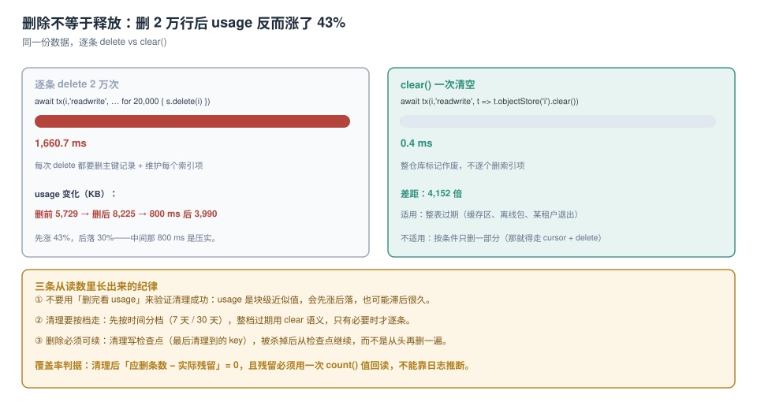

# 清理：删除不等于释放

本地库最终都会变大，所以清理是必答题。而这道题最常见的错，是**用「删完看 `usage`」来判断删干净了没有**——本机实测：删掉 2 万行之后，`usage` 从 **5,729 KB 涨到 8,225 KB**，800 ms 后才落到 3,990 KB。如果验收脚本只跑一次采样，它会得出「越删越大」的结论。

本页讲三件事：删除的三种粒度差多少、`usage` 为什么不可信、以及一个能被复跑的清理流程长什么样。



本页判据族 `EVC-A` ~ `EVC-H`，共 8 条。定义表在第六节。

## 一、三种粒度：删一条、清一仓、删一库

```js
// ① 删一条
store.delete(key);

// ② 清空一个仓库（保留结构）
store.clear();

// ③ 删掉整个数据库（含所有仓库与索引）
indexedDB.deleteDatabase('board');
```

| 粒度 | 本机耗时（2 万行） | 语义 | 适用 |
| --- | --- | --- | --- |
| `delete(key)` × 20,000 | **1,660.7 ms** | 逐条删主键 + 维护每个索引项 | 按条件删（只删过期的那部分） |
| `clear()` | **0.4 ms** | 整仓标记作废 | 整仓过期（缓存区、离线包） |
| `deleteDatabase()` | 视库大小 | 连结构一起删 | 租户退出、版本重来 |

**4,152 倍**。差距的来源不是「删」本身，而是**索引维护**：每条 `delete` 都要在每一棵索引树上删一个项，2 万行 × 3 个索引 = 6 万次索引操作。

::: tip 一条能省下几个数量级的选择
**问：这批数据是「整档一起过期」，还是「按条件删一部分」？**
整档 → 用 `clear()`（哪怕先 `put` 到一个临时仓库再清）；按条件 → 才用 `delete(key)`。
:::

## 二、`usage` 为什么不可信：它是块级近似

同一个库的三次采样：

| 时刻 | `usage` | 说明 |
| --- | --- | --- |
| 2 万行写完 | 5,729 KB | 业务数据 + 索引 + 日志 |
| 逐条删完 20,000 行（1,660.7 ms） | **8,225 KB** | 删除本身也写日志（墓碑） |
| 800 ms 后（压实完成） | **3,990 KB** | 空间回收 |
| `clear()` 后 | 3,992 KB | 空库基数 |

所以验收清理**不能**用 `usage`，只能用**业务事实**：

```js
// 唯一可信的「删干净了」判据
const remain = await count(tx(db, 'archive', 'readonly', s =>
  s.count(IDBKeyRange.upperBound(cutoff))));
console.log('残留过期行', remain);   // 必须为 0
```

`count()` 走索引/主键，不反序列化记录，成本远低于 `getAll()`——它是清理验收的标准工具。

::: danger 三个「删了但没删」的写法
1. **`delete(IDBKeyRange)`**：`delete` 只接受**单个键**，传 `IDBKeyRange` 会抛 `DataError`。要范围删，必须 `openCursor(range)` 逐条删。
2. **`cursor.delete()` 之后又 `cursor.continue()`**：这在只读事务里抛 `ReadOnlyError`；在读写事务里可以，但删完当前项后游标的 `continue()` 语义在部分实现里会跳过下一条——安全写法是删完重新 `openCursor`，或者收集键后批量删。
3. **删了父项忘了子项**：见下文「孤儿」。
:::

## 三、按档过期：把「删多少」变成「删哪档」

清理策略不要写成「删到某个大小以下」，而要写成**按时间分档**：

| 档 | 保留期 | 清理动作 | 依据 |
| --- | --- | --- | --- |
| 热（在线草稿） | 不删 | 只 `put` | 用户正在编辑 |
| 温（本地副本） | 30 天 | `delete` 过期键 | 服务端有副本，删了能再取 |
| 冷（归档/导出包） | 7 天 | **`clear()` 整仓** | 一次性产物 |
| 缓存（缩略图、静态资源） | 有 LRU 上限 | 超上限即清最旧 | 可重建 |

分档的好处是**每条数据都只有一个「到期动作」**，而不是一堆 if-else 判断谁该删。

### 可续的清理：检查点

清理最怕「删到一半页面被关掉」。所以要写检查点：

```js
async function sweep(db, { store, cutoff, batch = 500 }) {
  const ck = await getCheckpoint(db, store);           // { lastKey }
  let lastKey = ck?.lastKey ?? null;
  let removed = 0;
  for (;;) {
    const keys = await new Promise((res, rej) => {
      const out = [];
      const range = lastKey === null
        ? IDBKeyRange.upperBound(cutoff)
        : IDBKeyRange.bound(lastKey, cutoff, true, false);
      const cur = db.transaction(store).objectStore(store).openKeyCursor(range);
      cur.onsuccess = e => {
        const c = e.target.result;
        if (!c || out.length >= batch) return res(out);
        out.push(c.primaryKey); c.continue();
      };
      cur.onerror = () => rej(cur.error);
    });
    if (keys.length === 0) break;

    await tx(db, store, 'readwrite', s => { keys.forEach(k => s.delete(k)); });
    lastKey = keys[keys.length - 1];
    removed += keys.length;
    await setCheckpoint(db, store, { lastKey });        // 每批之后落检查点
  }
  await setCheckpoint(db, store, null);                 // 收尾清空
  return removed;
}
```

三个设计点：

1. **按批删**（500 条一批），每批一个事务——单事务删 2 万条会持锁 1.6 秒，期间其他标签页的写全部排队。
2. **检查点每批落一次**，被杀掉后从 `lastKey` 继续，不会从头再删。
3. **收尾清空检查点**，否则下次会从一个过期的位置开始。

## 四、孤儿：拆了仓库就必须对账

拆成父子两个仓库后，删父项不会级联。孤儿数据不会自己消失，也不会报错——它只是让「统计数字」慢慢变得不可信。

对账脚本（见[建模](../SchemaModeling/index.md)第五节的级联写法）：

```js
// 孤儿卡片：boardId 不在 boards 里的卡片数
let orphans = 0;
const boardIds = new Set();
await new Promise(r => {
  const c = db.transaction('boards').objectStore('boards').openKeyCursor();
  c.onsuccess = e => { const x = e.target.result; if (!x) return r(); boardIds.add(x.key); x.continue(); };
});
await new Promise(r => {
  const c = db.transaction('cards').objectStore('cards').openCursor();
  c.onsuccess = e => { const x = e.target.result; if (!x) return r(); if (!boardIds.has(x.value.boardId)) orphans++; x.continue(); };
});
```

`orphans` 必须恒为 `0`。它进 CI（或每次启动自检），比任何日志都有效——因为它是一个**可证伪的数字**。

## 五、`deleteDatabase` 的两个坑

```js
indexedDB.deleteDatabase('board');
```

1. **有连接未关闭时会 `blocked`**，一直挂着不返回。删之前先 `db.close()`，并处理其他标签页（它们会收到 `versionchange`）。
2. **删完再 `open` 会从 0 开始**，`onupgradeneeded` 触发且 `oldVersion === 0`。所以「删库重来」的逻辑必须能处理「首次建库」这条路径，不能只在升级路径里写建表代码。

## 六、本页判据

| 编号 | 判据 | 看什么现象 | 不满足时改哪里 |
| --- | --- | --- | --- |
| `EVC-A` | 整档过期用 `clear()` 而非逐条 `delete` | 清理代码里整仓场景没走 `delete` 循环 | 改 `clear()` |
| `EVC-B` | 范围删用 `openCursor(range)` | 没有 `delete(IDBKeyRange)` | 改游标 |
| `EVC-C` | 清理有检查点且按批提交 | 存在 `checkpoint` 表与 `batch` 常量 | 补检查点 |
| `EVC-D` | 验收用 `count()` 而不是 `usage` | 验收脚本里没有 `estimate` | 改 `count` |
| `EVC-E` | 孤儿数据有对账且恒为 0 | 能跑出 `orphans` 数字 | 补对账 |
| `EVC-F` | `deleteDatabase` 前先 `close()` | 调用点前有 close 且处理 blocked | 补 close |
| `EVC-G` | 每类数据只有一个到期动作 | 分档表里每档一行 | 收敛策略 |
| `EVC-H` | 清理失败有人知道 | 清理结果计数进日志/上报 | 补上报 |

## 验证方式

```js
(async () => {
  const db = await new Promise((res, rej) => {
    const r = indexedDB.open('cleanlab', 1);
    r.onupgradeneeded = e => {
      const s = e.target.result.createObjectStore('i', { keyPath: 'id' });
      s.createIndex('byTime', 't');
    };
    r.onsuccess = e => res(e.target.result); r.onerror = () => rej(r.error);
  });

  // 造 20,000 行
  await new Promise(r => {
    const t = db.transaction('i', 'readwrite'), s = t.objectStore('i');
    for (let i = 0; i < 20000; i++) s.put({ id: i, t: i });
    t.oncomplete = r;
  });

  const u1 = (await navigator.storage.estimate()).usage;
  let t0 = performance.now();
  await new Promise(r => {
    const t = db.transaction('i', 'readwrite'), s = t.objectStore('i');
    for (let i = 0; i < 20000; i++) s.delete(i);
    t.oncomplete = r;
  });
  console.log('delete each', (performance.now() - t0).toFixed(1), 'ms',
              'usage KB', Math.round(u1 / 1024), '→', Math.round((await navigator.storage.estimate()).usage / 1024));

  t0 = performance.now();
  await new Promise(r => { const t = db.transaction('i', 'readwrite'); t.objectStore('i').clear(); t.oncomplete = r; });
  console.log('clear', (performance.now() - t0).toFixed(1), 'ms');

  // 唯一可信的验收：count
  console.log('left', await new Promise(r => { const q = db.transaction('i').objectStore('i').count(); q.onsuccess = () => r(q.result); }));
})();
```

预期：`delete each` 在秒级、`clear` 在毫秒级（本机 1,660.7 / 0.4 ms）；`usage` 在两次删除之间**先涨后落**；`left` 为 `0`。

## 参考资料

- W3C：*Indexed Database API 3.0*（`IDBObjectStore.delete` 只接受单键、`clear` 的语义、`count` 与 `IDBKeyRange`）
- MDN：*IDBFactory.deleteDatabase*（`blocked` 事件与连接未关闭时的行为）
- WHATWG：*Storage Standard*（回收与压实对 `usage` 读数的影响）
- 本仓库：[配额](../Quota/index.md)、[建模](../SchemaModeling/index.md)、[分区与冷热分离](../../../DB/PartitionArchival/index.md)
