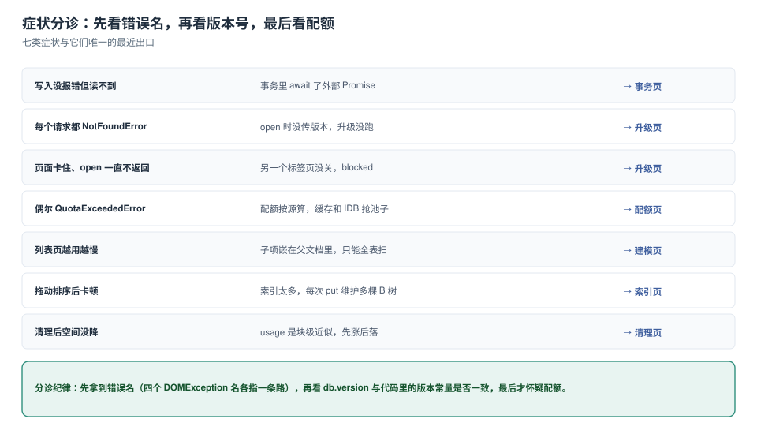

# 常见问题与分诊

本地库的故障有一个特点：**错误信息和原因隔着很远**。`NotFoundError` 可能来自三个月前删掉的一行 `open` 参数，`QuotaExceededError` 可能来自上周上线的预缓存策略。所以这一页按「症状 → 最近出口」组织，不按知识点组织。



本页判据族 `LSQ-A` ~ `LSQ-H`，共 8 条。定义表在第七节。

## 一、分诊表

| 症状 | 最可能的原因 | 一步确认 | 去哪看 |
| --- | --- | --- | --- |
| 写入没报错但读不到 | 事务里 `await` 了外部 Promise，事务已自动提交 | 看那个 `put` 是否抛 `TransactionInactiveError` | [事务](../Transaction/index.md) |
| 每个请求都 `NotFoundError` | `open` 时没传版本，`onupgradeneeded` 从未执行 | 搜代码里 `indexedDB.open(` 的第二个参数 | [升级](../Upgrade/index.md) |
| 页面卡住、`open` 不返回 | 另一个标签页没关，`blocked` | 看是否触发了 `onblocked` | [升级](../Upgrade/index.md) |
| 偶发 `QuotaExceededError` | 配额按源，`Cache Storage` 与 IDB 抢桶 | `estimate()` 看 `usageDetails` | [配额](../Quota/index.md) |
| 列表越用越慢 | 子项嵌在父文档里，只能全表扫 | 统计一次查询读了多少行 | [建模](../SchemaModeling/index.md) |
| 拖动排序后卡顿 | 索引太多，每次 `put` 维护多棵 B 树 | 数一下该仓库的 `indexNames.length` | [索引](../IndexDesign/index.md) |
| 清理后空间没降 | `usage` 是块级近似，先涨后落 | 用 `count()` 而不是 `usage` 验收 | [清理](../Eviction/index.md) |
| 升级后老用户白屏 | 升级窗口里旧代码 + 新结构 | 看旧字段是否被假设存在 | [升级](../Upgrade/index.md) 第五节 |
| 两个标签页数据不一致 | 各自持有旧连接，缓存了 `db` 实例 | 检查是否有 `versionchange` 处理 | [升级](../Upgrade/index.md) |
| 无痕窗口里数据丢失 | best-effort + 会话级存储 | `persisted()` 返回值 | [配额](../Quota/index.md) |

## 二、十二个高频问题

**Q1：`indexedDB.open` 到底要不要传版本号？**

**必须传。** 省略时它开在**当前版本**且**不触发** `onupgradeneeded`——首次访问一个不存在的库会建出空库，随后所有 `transaction('xxx')` 都 `NotFoundError`。把版本号放进常量，是唯一可靠的写法。

**Q2：为什么 `put` 成功了，`count()` 却没变？**

三种可能：① 你 `put` 的是同一个主键（覆盖，不是新增）；② 事务失败了但你只 `catch` 了外层 `await`，没看 `tx.onerror`；③ 你在事务里 `await` 了别的东西，`put` 抛了 `TransactionInactiveError` 被上层吞掉。

**Q3：`getAll()` 和游标该用哪个？**

要「全部命中行」用 `getAll(range)`（一次返回数组，快）；要「边读边处理、随时中止」用游标（内存峰值低）；要「只拿主键」用 `openKeyCursor`（不反序列化记录，最省）。三者读的行数一样，差的是**内存与提前退出的能力**。

**Q4：索引加了，为什么查询没变快？**

四个常见原因：① 查询没用 `index(...)`，走的是主键游标；② `getAll()` 没带 range，取回全表再 `filter`；③ 命中率太高（> 50%），索引没有收益；④ 索引建在深层路径（`meta.author.id`）上，而部分记录该字段是 `undefined`，根本不进索引。

**Q5：能不能用本地库做「跨标签页锁」？**

同仓库的 `readwrite` 事务天然互斥，可以当**短锁**用；但它不能跨标签页（不同标签页有各自的连接，仍是同一个库，事务其实会串行——但你不能依赖它做业务锁，因为无法续期）。跨标签页协调用 **Web Locks** 或 `BroadcastChannel`。

**Q6：删了记录空间为什么不降？**

`usage` 是块级近似，删除先写墓碑，压实后才回收。本机实测：删 2 万行后 `usage` **从 5,729 KB 涨到 8,225 KB**，800 ms 后落到 3,990 KB。验收请用 `count()`。

**Q7：`clear()` 和重建仓库哪个快？**

`clear()` 快得多（本机 0.4 ms vs 逐条 1,660.7 ms）。重建仓库（删 + 建）也可以，但它要改版本号，属于结构变更，代价是升级窗口 + `blocked`。

**Q8：本地库能存多大？**

看 `quota`，不看经验值。本机 **10,251 MB**，随磁盘变。产品话术请写「占可用空间的比例」，别写绝对值。

**Q9：无痕模式下要不要禁用本地库？**

不必禁用，但要**降级**：无痕会话关闭即销毁，所以「离线可用」的承诺不成立。检测方式：`persisted()` 为 `false` 且写入后立刻 `estimate()` 的 `usage` 行为异常——更稳的做法是**功能探测 + 友好提示**，不猜模式。

**Q10：升级时能不能做网络请求？**

不能。`onupgradeneeded` 里持有排他锁，所有标签页都在等；而且事务会自动提交，`await` 之后任何 IDB 操作都抛 `TransactionInactiveError`。要拉数据，升级完再拉。

**Q11：`unique` 索引冲突会不会只失败一条？**

不会。请求失败默认**冒泡到事务并 abort**，整批回滚。要「单条失败、其余继续」，必须在 `req.onerror` 里 `preventDefault()`，并自己记录失败清单。

**Q12：为什么 `estimate()` 的 `usage` 比我的数据小？**

因为块压缩。测试数据常用重复字符填充（`'x'.repeat(200)`），压缩率极高；本机 2 万行原始约 4.6 MB，`usage` 增量只有 1,737 KB。用 `crypto.getRandomValues` 造不可压缩数据再看。

## 三、五条「听起来对」的错误建议

| 错误建议 | 为什么错 | 正确做法 |
| --- | --- | --- |
| 「数据小就放 `localStorage`，简单」 | 2.25 MB 上限 + 同步阻塞 + Worker 不可达 | 业务数据一律 IDB |
| 「先写内存，空闲时批量刷盘」 | 页面被关就全丢，且「空闲」不可靠 | 先落盘再发送（见[离线数据](../../PWA/OfflineData/index.md)） |
| 「加个 `try/catch` 包住所有 IDB 调用就行」 | 吞掉错误 = 静默丢数据 | 按 `error.name` 分类处置 |
| 「索引越多查询越快」 | 写放大 +60.4%（3 个索引 vs 0 个） | 每条索引对一条查询 |
| 「删完看 `usage` 就能确认清理成功」 | `usage` 先涨后落，块级近似 | 用 `count()` 回读 |

## 四、上线前自查（14 项）

- [ ] 版本号是唯一常量，所有 `open` 都带它
- [ ] 升级用 `e.oldVersion` 分段，且用 `e.target.transaction`
- [ ] 升级块里没有 `await`、没有网络请求
- [ ] 每个 `open` 后都挂了 `onversionchange = () => db.close()`
- [ ] 有 `onblocked` 的用户可见提示（3 秒兜底）
- [ ] 写路径上没有「事务内 `await` 外部 Promise」
- [ ] 批量写有确定的批大小（500~2,000）
- [ ] 每条索引都能说出一条查询
- [ ] `getAll` 都带 range 或索引键
- [ ] `QuotaExceededError` 有 catch，且只重试一次
- [ ] 清理有分档 + 检查点，验收用 `count()`
- [ ] 孤儿数据对账恒为 0
- [ ] 失败按 `error.name` 分组上报
- [ ] 验收脚本（十条断言）在开发期跑过，四条负向都真的失败

## 五、本页判据

| 编号 | 判据 | 看什么现象 | 不满足时改哪里 |
| --- | --- | --- | --- |
| `LSQ-A` | 每个线上症状能对上分诊表的一行 | 值班文档里有这张表 | 补表 |
| `LSQ-B` | 错误处理按 `error.name` 分支 | `catch` 里没有「一律重试」 | 改分支 |
| `LSQ-C` | 没有「一律 try/catch 吞掉」的封装 | 封装层不返回 `undefined` 当失败 | 抛出并分类 |
| `LSQ-D` | 无痕/无持久化有降级提示 | 能检测并提示 | 补探测 |
| `LSQ-E` | 五条错误建议在团队内被明确否定 | 代码评审清单里有这五条 | 写进规范 |
| `LSQ-F` | 上线自查 14 项可勾选 | 有 checklist 文件 | 补清单 |
| `LSQ-G` | 分诊表里的「一步确认」都是命令或一行代码 | 每条都能复制执行 | 改写成可执行 |
| `LSQ-H` | 每条症状都指向具体页面而非「看文档」 | 有相对链接 | 补链接 |

## 验证方式

把分诊表当脚本用：随便挑一行，按「一步确认」跑一次，看现象是否一致。

```js
// 例：确认「每个请求都 NotFoundError」是不是版本问题
(async () => {
  const dbs = await indexedDB.databases();
  console.log(dbs);        // 看 name 与 version —— 与代码里的 DB_VERSION 是否一致
  const db = await new Promise((res, rej) => {
    const r = indexedDB.open('board'); r.onsuccess = e => res(e.target.result); r.onerror = () => rej(r.error);
  });
  console.log('opened at', db.version, 'stores', [...db.objectStoreNames]);
})();
```

预期：`db.version` 与常量一致；`stores` 里能看到全部业务仓库。若 `version` 存在但 `stores` 为空，说明升级代码从未执行——回到 [升级](../Upgrade/index.md) 第二节。

## 参考资料

- MDN：*IndexedDB API*（`IDBFactory.databases()` 的浏览器支持、`IDBRequest.error`）
- W3C：*Indexed Database API 3.0*（`NotFoundError` / `TransactionInactiveError` / `ConstraintError` 的规范定义）
- WHATWG：*Storage Standard*（best-effort 与回收）
- 本仓库：[事务](../Transaction/index.md)、[升级](../Upgrade/index.md)、[配额](../Quota/index.md)、[清理](../Eviction/index.md)
