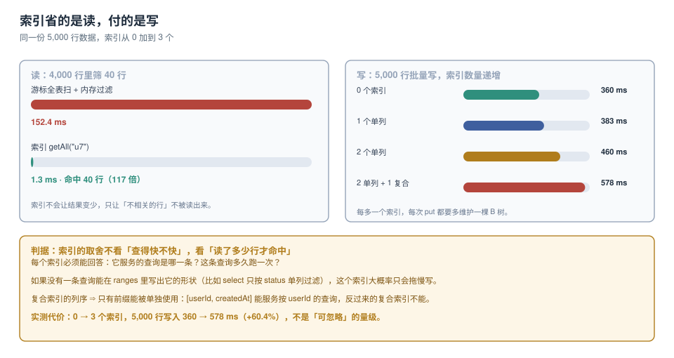

# 索引：读省下来的，写要还

本地库的性能问题九成被归因错。列表页慢，第一反应是「数据太多了」，于是加虚拟滚动、加缓存、加分页——但真正的原因往往是**每一次筛选都在读整张表**。浏览器不会告诉你这件事：没有 `EXPLAIN`、没有慢查询日志，只有一个变慢的页面。

索引是唯一能改变「读多少行」的手段，而它的代价全部落在写上。本页把这两笔账都量出来。



本页判据族 `IDX-A` ~ `IDX-H`，共 8 条。定义表在第六节。

## 一、索引只做一件事：让你不读不相关的行

同一份 4,000 行数据，筛出 40 行（`userId === 'u7'`）：

```js
// A. 无索引：游标全表扫，内存里过滤
let hits = 0;
const c = db.transaction('items').objectStore('items').openCursor();
c.onsuccess = e => {
  const cur = e.target.result;
  if (!cur) return;
  if (cur.value.userId === 'u7') hits++;
  cur.continue();
};
// hits = 40，152.4 ms

// B. 有索引：直接在索引上取区间
const q = db.transaction('items').objectStore('items').index('byUser').getAll('u7');
// hits = 40，1.3 ms
```

**结果完全相同，读的行数差 100 倍。** 这个倍数与「命中率」成反比：

| 命中占比 | 索引收益 | 说明 |
| --- | --- | --- |
| 1%（40 / 4,000） | **117 倍** | 实测场景 |
| 10% | 约 10 倍 | 仍值得 |
| 50% | 约 2 倍 | 边缘 |
| 90%+ | 可能为负 | 索引扫 + 回表，不如顺序读 |

所以「要不要加索引」的判据不是「这条查询快不快」，而是**「这条查询命中多少比例」**。

## 二、复合索引：只有前缀能被单独使用

```js
store.createIndex('byBoardStatus', ['boardId', 'status']);
store.createIndex('byBoardPos',    ['boardId', 'pos']);
```

一个 `['boardId','status']` 的索引能服务这些查询：

| 查询 | 能用吗 | 怎么用 |
| --- | --- | --- |
| `bound([7, 'open'], [7, 'open'])` | ✅ | 精确命中 |
| `bound([7], [7, []])` | ✅ | 用 `boardId` 前缀 |
| 只按 `status` 筛 | ❌ | 索引第一个键是 `boardId`，跳不过去 |
| 按 `status` + `pos` 排序 | ❌ | 排序键必须是索引的连续前缀 |

**列序的唯一判据是「等值在前，范围/排序在后」**。把 `status` 放前面、`boardId` 放后面，那么「按看板取全部卡片」这条最高频的查询就用不上索引了。

::: danger 三种「加了索引还是慢」
1. **`getAll()` 之后再 `filter()`**：索引帮你取回 34 行，然后你用 `Array.filter` 又筛一遍——这不算错，但如果 `getAll()` 取的是**全表**（比如 `getAll()` 不带 range），索引就白加了。判据：`getAll` 必须带 `IDBKeyRange` 或索引键。
2. **索引键是对象字段的深层路径**：`keyPath: 'meta.author.id'` 合法，但写入时要逐层取值，任何一层是 `undefined` 这条记录就**不进索引**（不是报错）。于是「按作者查」会漏数据。
3. **用来排序的字段没进索引**：`openCursor()` 的默认顺序是**主键顺序**，不是你的 `createdAt`。要按时间排，必须 `index('byCreated').openCursor()`，否则就是「先全读出来再 sort」。
:::

## 三、写成本：每多一个索引，每次 `put` 多维护一棵 B 树

同一份 5,000 行、单事务批量写入，索引从 0 加到 3：

| 索引数量 | 写入耗时 | 相对增幅 |
| --- | --- | --- |
| 0 | 360.0 ms | — |
| 1 个单列 | 383.0 ms | +6.4% |
| 2 个单列 | 459.7 ms | +27.7% |
| 2 单列 + 1 复合 | 577.6 ms | **+60.4%** |

```js
// 三档索引的建法（同一个版本里）
const s = db.createObjectStore('items', { keyPath: 'id' });
s.createIndex('byUser', 'userId');                    // 1
s.createIndex('byCreated', 'createdAt');              // 2
s.createIndex('byUserTime', ['userId', 'createdAt']); // 3（复合）
```

复合索引比单列索引更贵，因为它要维护更宽的键；但这不意味着「用复合代替两个单列」——**一个复合索引不能替代两个单列索引**，除非所有查询都带前缀。

换算成产品语言：如果这个仓库是「高频写、低频查」（离线队列、日志缓冲），索引就该压到 1 个以内；如果是「低频写、高频查」（联系人、商品缓存），3 个索引换 100 倍查询提速非常划算。

## 四、`multiEntry`：数组字段的索引与它的两个陷阱

```js
// tags: ['urgent', 'backend'] 这种数组字段
store.createIndex('byTag', 'tags', { multiEntry: true });
// 一条记录会在 'urgent' 与 'backend' 两个键下各出现一次
```

两个陷阱：

1. **`multiEntry` 的索引项数 = 数组长度**，所以它比普通索引更贵，且数组里重复值会被去重（同一记录在同一键下只出现一次）。
2. **`unique: true` 不能与 `multiEntry` 共用**（`InvalidAccessError`）。想做「标签唯一」，得把标签建成独立仓库，主键就是标签名。

```js
// 想「一个标签只能属于一个条目」→ 用独立仓库，主键即约束
db.createObjectStore('tagOwner', { keyPath: 'tag' });
```

## 五、`unique` 索引：它不是校验，是写入闸门

```js
store.createIndex('byOrderNo', 'orderNo', { unique: true });
```

很多代码靠它做「订单号不重复」，然后期望冲突时**抛一个可读的错误**。实际行为是：

- `put` 一个重复值 → 该请求 `onerror` 收到 `ConstraintError`；
- **整个事务会被中止**（`abort`），同一事务里在这之前的写入也一起回滚——这正是原子性该有的样子，但如果你在一个事务里批量导入 1,000 条，其中 1 条重复，**999 条好数据也全没了**。

所以 unique 索引的正确用法是「**单条写入的快速失败**」，批量导入要先自己去重，或者把每条放进独立事务（代价是 6.6 倍的写成本，见[事务](../Transaction/index.md)）。

## 六、本页判据

| 编号 | 判据 | 看什么现象 | 不满足时改哪里 |
| --- | --- | --- | --- |
| `IDX-A` | 每条索引对应一条具名查询 | 索引清单与查询清单能一一对上 | 删掉对不上的索引 |
| `IDX-B` | 索引列序是「等值在前、范围在后」 | 复合索引第一个键是最高频的等值条件 | 重排 `keyPath` |
| `IDX-C` | 高命中率的查询没有被索引拖慢 | 命中 > 50% 的查询走顺序读 | 删索引或改分页策略 |
| `IDX-D` | `getAll` 都带 range 或索引键 | 代码里没有无参 `getAll()` 于大仓库 | 补 range |
| `IDX-E` | 写密集仓库的索引数 ≤ 1 | 统计写入路径上的索引数量 | 合并或删 |
| `IDX-F` | 排序用的是索引游标而非内存 `sort` | `openCursor` 前先 `index(...)` | 补索引或改排序字段 |
| `IDX-G` | `multiEntry` 使用处没有 `unique` | 建索引参数里不同时出现两者 | 改独立仓库 |
| `IDX-H` | 批量导入前已去重，不靠 unique 兜底 | 导入前有一次 `Set` 去重 | 补去重 |

## 验证方式

给每条查询跑一次「命中 + 耗时」，把结果填进表里；重点是**同一份数据上对比有无索引**：

```js
(async () => {
  const db = await new Promise((res, rej) => {
    const r = indexedDB.open('idxlab'); r.onsuccess = e => res(e.target.result); r.onerror = () => rej(r.error);
  });
  const s = db.transaction('items').objectStore('items');
  const t0 = performance.now();
  let hits = 0;
  await new Promise(r => {
    const c = s.openCursor();
    c.onsuccess = e => { const x = e.target.result; if (!x) return r(); if (x.value.userId === 'u7') hits++; x.continue(); };
  });
  console.log('scan', hits, (performance.now() - t0).toFixed(1), 'ms');

  const t1 = performance.now();
  const rows = await new Promise(r => { const q = s.index('byUser').getAll('u7'); q.onsuccess = () => r(q.result.length); });
  console.log('index', rows, (performance.now() - t1).toFixed(2), 'ms');
})();
```

预期：两个数字的 `rows`/`hits` 相等；耗时比值 ≈ 数据量 / 命中数。若比值接近 1，说明索引没生效（检查查询是否用了 `index()`）。

## 参考资料

- MDN：*IDBIndex*（`multiEntry`、`unique`、`getAll(query)` 的语义）、*IDBKeyRange*（`bound` 的 `lowerOpen` / `upperOpen`）
- W3C：*Indexed Database API 3.0*（索引记录的产生规则：键值 `undefined` 不入索引）
- Chrome 文档：*IndexedDB 的性能建议*（批量写入与索引数量的取舍）
- 本仓库：[建模](../SchemaModeling/index.md)、[事务](../Transaction/index.md)、[服务端索引与查询优化](../../../DB/Relational/SQLOptimization/index.md)
