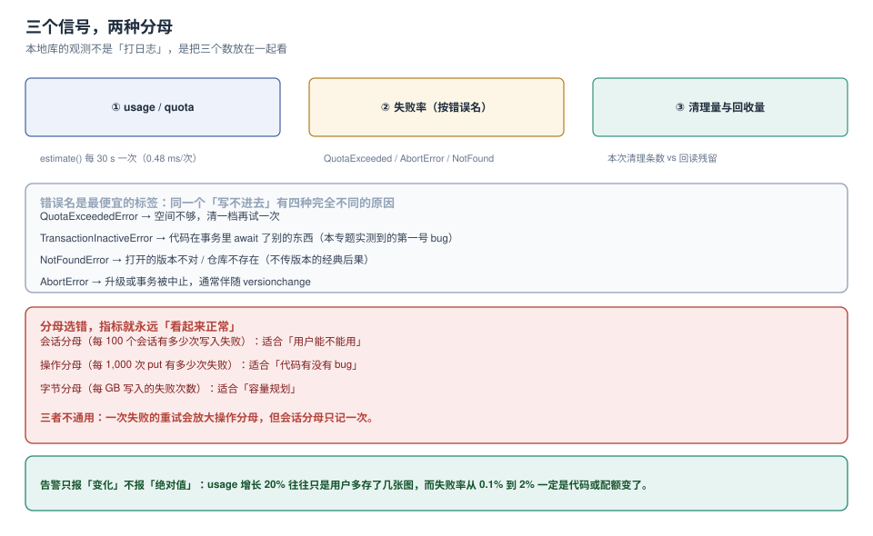

# 观测：三个信号与三种分母

前端的可观测体系里，本地库是最容易被漏掉的一层：它不出现在接口耗时里，不出现在渲染性能里，出问题时表现成「数据不对」或「页面卡」——两种都归不到它头上。

本页给一套最小可用的观测方案：**三个信号、一个标签、三种分母**。全部基于浏览器原生 API，不引入 SDK。



本页判据族 `LSO-A` ~ `LSO-H`，共 8 条。定义表在第六节。

## 一、三个信号

| 信号 | 怎么采 | 频率 | 回答什么问题 |
| --- | --- | --- | --- |
| **占用** `usage / quota` | `navigator.storage.estimate()` | 30 s 一次，或每次写入会话结束时 | 我们离写满还有多远 |
| **失败率**（按错误名分组） | 写入路径的 `catch` 里计数 | 每次失败 | 是谁在失败、为什么 |
| **清理量 / 残留** | 清理任务的返回值 + `count()` 回读 | 每次清理 | 清理真的生效了吗 |

三个信号要一起看，单看任何一个都会误判：

- 只有占用：`usage` 涨可能只是用户多存了几张图；
- 只有失败率：失败率 0% 也可能是「从来不写」；
- 只有清理量：清理了 2 万条但残留还是 2 万条，说明删错了范围。

## 二、错误名是最便宜的标签

同一个「写不进去」背后有四种完全不同的原因，而它们的 `DOMException.name` 各不相同：

| `e.name` | 含义 | 第一处置 |
| --- | --- | --- |
| `QuotaExceededError` | 空间不够（或单值超限） | 清一档再重试一次，见[配额](../Quota/index.md) |
| `TransactionInactiveError` | 事务已失活（多半是事务里 `await` 了外部东西） | 改代码，见[事务](../Transaction/index.md) |
| `NotFoundError` | 仓库不存在（版本没升 / 没传版本） | 查版本常量，见[升级](../Upgrade/index.md) |
| `AbortError` | 事务或升级被中止（常伴 `versionchange`） | 查是否有老标签页占着连接 |

所以埋点的第一件事不是记「写了多少条」，而是记 `error.name` 的分布。它几乎不需要额外成本，却能把 90% 的排查从「猜」变成「查表」。

```js
const counters = { put: 0, fail: {} };
function countFail(name) { counters.fail[name] = (counters.fail[name] || 0) + 1; }

try {
  await tx(db, 'drafts', 'readwrite', s => s.put(draft));
  counters.put++;
} catch (e) {
  countFail(e.name || 'Unknown');
  throw e;
}
```

::: danger 四种「看起来在观测，其实没有」的写法
1. **只记失败总数**：`fail++` 之后你无法区分「配额」和「代码 bug」，两者的处置完全相反。
2. **把 `console.error` 当上报**：线上没人开控制台，等于没采。
3. **上报成功也上报失败，但用同一个分母**：失败率会被「成功的重试」稀释（见下一节）。
4. **在失败路径里再写本地库**：配额满的时候写本地库必然再失败，日志把自己的路堵死——失败日志要么进内存队列，要么走 `sendBeacon` 直发。
:::

## 三、三种分母，别混用

同一个「失败 8 次」，三种分母给出三个完全不同的结论：

| 分母 | 算式 | 适合回答 | 陷阱 |
| --- | --- | --- | --- |
| **会话** | 失败会话数 / 总会话数 | 用户还能不能用 | 一次失败的重试不重复计 |
| **操作** | 失败次数 / `put` 次数 | 代码有没有 bug | 重试会放大分母 |
| **字节** | 失败次数 / 写入 GB | 容量规划 | 需要额外的字节统计 |

举例：1,000 个会话、每个会话 10 次 `put`、其中 8 次失败且全部重试成功：

```text
会话分母：8 / 1000 = 0.8%       → 看起来「几乎没事」
操作分母：8 / 10000 = 0.08%     → 看起来「更没事」
若这 8 次都集中在 1 个会话：1 / 1000 = 0.1%，但那个用户 80% 的操作失败了
```

**结论：报「哪个用户受影响」用会话分母，报「代码质量」用操作分母，两者必须分开报。** 把两个数并成一个「综合健康度」，就一定有人拿它糊弄自己。

## 四、采样：0.48 ms 的代价可以接受

`estimate()` 本机 **200 次 96 ms**（≈0.48 ms/次）。三种采样策略：

```js
// A. 定时采（推荐）
setInterval(async () => {
  const { usage, quota } = await navigator.storage.estimate();
  report('storage', { usage, quota, ratio: usage / quota });
}, 30_000);

// B. 事件驱动（省电）
window.addEventListener('visibilitychange', () => {
  if (document.visibilityState === 'hidden') sampleAndFlush();   // 离开页面时采一次
});

// C. 写入后采（最准，但最贵）
async function putAndSample(...) { /* 每次写后 estimate 一次 */ }
```

推荐 **A + B 组合**：可见时 30 秒一次，隐藏时补一次并 flush。理由是本地库的占用变化是**慢变量**，秒级精度毫无意义；而「关掉页面前最后一次读数」才是最有价值的样本。

## 五、告警：只报变化，不报绝对值

| 指标 | 不要这样告警 | 应该这样告警 |
| --- | --- | --- |
| `usage` | `usage > 100 MB` | **24 小时内增长 > 50%** 且 `usage/quota > 0.6` |
| 失败率 | `fail > 0` | 失败率 **从基线翻 3 倍** |
| 清理残留 | `remain > 0` | 残留率 **> 1%** 连续 3 次清理 |

原因是绝对值没有基线：一个正常用户存了 300 MB 草稿不是事故，而失败率从 0.1% 涨到 2% 一定是代码或配额变了。

`usage/quota` 的告警门槛建议 **0.6 预警、0.8 停止新增**：留 20% 给 `Cache Storage`、其他标签页和浏览器元数据。

::: tip 与前端错误监控的分工
「错误怎么上报、通道额度怎么控、sourcemap 怎么对齐」属于[错误监控与体验度量](../../ErrorTelemetry/index.md)；本页只定义**本地库这一层的指标口径**——采什么、分母是谁、门槛在哪。两边共用同一条上报通道是可以的，但指标定义不能混。
:::

## 六、多标签页：一个数比 N 个数好

同一个源开 3 个标签页，每个都在每 30 秒采一次 `estimate()`，上报上去就是 3 条重复样本（数值还基本相同）。

```js
// 选主：用 Web Locks 保证只有一个标签页在采
navigator.locks.request('storage-metrics', { ifAvailable: true }, async lock => {
  if (!lock) return;                      // 没抢到锁的标签页不采
  setInterval(sample, 30_000);
  await new Promise(() => {});            // 一直持锁
});
```

或者用 `BroadcastChannel` 让第一个标签页负责采、其余只读它的广播。两种做法的共同前提是：**总量类指标必须去重**，否则你会看到「用户数 1、样本数 3」。

## 七、本页判据

| 编号 | 判据 | 看什么现象 | 不满足时改哪里 |
| --- | --- | --- | --- |
| `LSO-A` | 失败按 `error.name` 分组 | 上报里有四类错误名的分布 | 补标签 |
| `LSO-B` | 会话分母与操作分母分开报 | 报表里是两个数不是「综合分」 | 拆指标 |
| `LSO-C` | `usage` 采样有频率上限 | 采样间隔 ≥ 10 s | 加节流 |
| `LSO-D` | 隐藏页面时补采一次 | `visibilitychange` 有 flush | 补监听 |
| `LSO-E` | 告警基于变化率而非绝对值 | 阈值写成倍数/比例 | 改阈值 |
| `LSO-F` | 有 `usage/quota` 的两道门槛（0.6 / 0.8） | 代码里有常量与对应动作 | 补门槛 |
| `LSO-G` | 多标签页采样去重 | 有 Web Locks 或 BroadcastChannel | 补选主 |
| `LSO-H` | 失败日志不写本地库 | 失败路径里没有 `put` | 改内存队列 / `sendBeacon` |

## 验证方式

在控制台跑一段，确认四个信号都能拿到：

```js
(async () => {
  const { quota, usage } = await navigator.storage.estimate();
  console.log('占用比', (usage / quota).toFixed(4), 'usage MB', (usage / 1048576).toFixed(2));

  const t0 = performance.now();
  for (let i = 0; i < 200; i++) await navigator.storage.estimate();
  console.log('estimate 单次成本 ms', ((performance.now() - t0) / 200).toFixed(2));

  // 错误名分组的骨架
  const counters = {};
  const db = await new Promise((res, rej) => {
    const r = indexedDB.open('obs'); r.onsuccess = e => res(e.target.result); r.onerror = () => rej(r.error);
  });
  try { db.transaction('nope').objectStore('nope'); }
  catch (e) { counters[e.name] = (counters[e.name] || 0) + 1; }
  console.log('errors', counters);    // { NotFoundError: 1 }
})();
```

预期：占用比是一个小数（本机 11.2 / 10,251 ≈ 0.001）；`estimate` 单次 < 1 ms；最后一行能看到 `NotFoundError` 被正确归类。

## 参考资料

- MDN：*StorageManager.estimate*（`usage` 的近似性质与 `usageDetails`）
- MDN：*Web Locks API*（`ifAvailable` 与多标签页选主）
- MDN：*DOMException*（`QuotaExceededError` / `TransactionInactiveError` / `NotFoundError` / `AbortError` 的触发场景）
- 本仓库：[错误监控与体验度量](../../ErrorTelemetry/index.md)、[配额](../Quota/index.md)、[清理](../Eviction/index.md)
