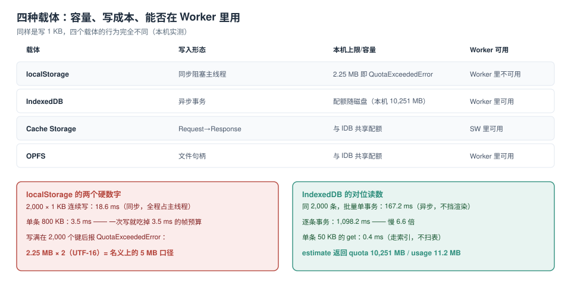

# 四种载体与三条边界

「数据放浏览器里」这句话在代码里会落成四个不同的 API，而它们不是四选一的关系——它们是**四层**，各有自己的容量口径、写入形态与生命周期。选错一层的代价不是「慢一点」，而是「写不进去」「Worker 里拿不到」「某天整库被清掉」。

本页先把四种载体的边界量出来，再给三条判断规则。



本页判据族 `LDS-A` ~ `LDS-H`，共 8 条。定义表在第七节。

## 一、四种载体，四种形态

| 载体 | 内容形态 | 是否异步 | 本机实测上限 | 主要用途 | 别用它做 |
| --- | --- | --- | --- | --- | --- |
| **`localStorage`** | 字符串键值 | **否（同步）** | 写满在 **2.25 MB** 报 `QuotaExceededError` | 主题、开关、极小的用户偏好 | 业务数据、离线队列、任何 KB 级以上的东西 |
| **IndexedDB** | 对象 + 索引 + 游标 | 是 | 与本机 `quota` 共享（**10,251 MB**） | 结构化业务数据、离线队列、草稿 | 大文件（二进制走 OPFS 更合适） |
| **`Cache Storage`** | `Request → Response` | 是 | 与 IDB 共享同一配额池 | 静态资源、HTTP 响应缓存 | 业务对象（它只认 HTTP 语义） |
| **OPFS** | 文件句柄 | 是 | 与 IDB 共享同一配额池 | 大文件、导出包、低层二进制流 | 结构化查询 |

两个容易记错的点：

- `Cache Storage` **不是**「缓存的存储」，它是一张 `Request → Response` 的表；你要存一个 `{id, title}`，得先把它包成 `new Response(JSON.stringify(x))`，读的时候再 `json()`——绕了一圈，还不如 IDB。
- OPFS 与 IDB 共享同一个配额池，所以「把大文件挪到 OPFS 就省空间」是错的，它只改变**读写形态**（流式、随机访问），不改变**容量账**。

## 二、三条边界：容量、字节、生命周期

### 边界一：容量按「源」算，不按 API 算

`http://127.0.0.1:8765` 这个源上，IDB、`Cache Storage`、OPFS、`localStorage`（它有自己的小上限）共用一个桶。本机 `estimate()` 给的是：

```js
const { quota, usage } = await navigator.storage.estimate();
// quota = 10,747,? MB 级 → 本机读到 10,251 MB
// usage = 11.2 MB
```

`quota` 跟磁盘剩余空间走，同一台机器上不同源拿到的值不同，同一源在不同时间也可能变。**不要把它当常量写进代码**，只能当读数。

### 边界二：字节的算法不一样

`localStorage` 按 **UTF-16 码元**计费：一个 ASCII 字符占 1 个码元 = 2 字节。所以「5 MB 的 localStorage」在 ASCII 内容下实际只能放 **2.25 MB 的字符串**（本机实测正好卡在 2,000 个 1 KB 键之后）。

```js
// 本机实测：第 2,000 个键之后抛错
for (let i = 0; i < 20000; i++) localStorage.setItem('f' + i, 'y'.repeat(1024));
// → DOMException: QuotaExceededError，此时已写入 2.25 MB 字符 → 4.5 MB 码元
```

IDB 没有这个换算问题，但它有**记录级开销**：一条 230 字节的对象，`estimate().usage` 的增量往往大于 230 字节（块对齐 + 索引项 + 日志）。所以按「记录数 × 平均字节」估算容量会偏乐观，这一点在[配额](../Quota/index.md)页有专门一节。

### 边界三：生命周期不归你管

`persisted()` 在本机返回 **`false`**。这意味着这个源的存储是 **best-effort** 档：磁盘告急时，浏览器有权**整库清掉**，而且不会通知页面。想升到 persistent 档要 `navigator.storage.persist()`，授予条件由浏览器决定（安装为 PWA、站点参与度、书签等），**不能保证成功**。

::: danger 三个「想当然」的写法
1. **「先写 localStorage，失败了再写 IDB」**：`localStorage` 是同步的，写 800 KB 要 **3.5 ms**，这 3.5 ms 里主线程什么都干不了；而且它在 Service Worker 里**根本访问不到**（没有 `window`），后台同步代码读不到队列。
2. **「配额是 5 MB」**：5 MB 是 `localStorage` 的历史口径，且以码元计；IDB 的配额是 GB 级。用 5 MB 做容量规划，会把一个能存 10 GB 的方案否掉。
3. **「persisted() 是 true 就安全了」**：它只表示「当前不会被自动回收」，用户清站点数据、无痕窗口关闭、磁盘满到系统级，仍然会没。
:::

## 三、同步 vs 异步：真正的差别是「谁在等」

同一份 2,000 条、每条约 230 字节的数据，两种写法：

```js
// A. localStorage：同步，主线程全程阻塞
let t = performance.now();
for (let i = 0; i < 2000; i++) localStorage.setItem('k' + i, 'y'.repeat(1024));
console.log(performance.now() - t);   // 18.6 ms

// B. IndexedDB：异步，单事务批量
const db = await openDB();
t = performance.now();
await tx(db, 'items', 'readwrite', s => {
  for (let i = 0; i < 2000; i++) s.put(rec(i));
});
console.log(performance.now() - t);   // 167.2 ms
```

读数很反直觉：**`localStorage` 更快（18.6 ms vs 167.2 ms）**。但这个比较没有意义——`localStorage` 的 18.6 ms 是**主线程被独占**的 18.6 ms，60 fps 的帧预算只有 16.7 ms，也就是说这 18.6 ms 里一定会掉帧；而 IDB 的 167.2 ms 里主线程只占很小一部分，渲染照常。

判断标准因此不是「谁快」，而是：

| 场景 | 选谁 | 理由 |
| --- | --- | --- |
| 首屏前要读的一个开关 | `localStorage` | 异步读会让首屏多一次 await，得不偿失 |
| 超过 4 KB 的任何东西 | IDB | 同步写会掉帧，且容易触上限 |
| Service Worker 里要读 | IDB / Cache | `localStorage` 在那里不存在 |
| 大文件 | OPFS | 流式读写，不占内存 |
| HTTP 响应 | `Cache Storage` | 它就是这个语义 |

## 四、Worker 与 Service Worker 的可达性

这张表决定了「离线队列能不能在后台继续跑」：

| 载体 | 主线程 | Web Worker | Service Worker |
| --- | --- | --- | --- |
| `localStorage` / `sessionStorage` | 可用 | **不可用** | **不可用** |
| IndexedDB | 可用 | 可用 | 可用 |
| `Cache Storage` | 可用 | 可用 | 可用 |
| OPFS | 可用 | 可用 | 可用 |

`localStorage` 挂在 `window` 上，而 Worker 与 Service Worker 都没有 `window`。于是「把离线队列写进 localStorage，让 SW 后台补发」这个设计从第一行就不成立——SW 读不到队列，补发永远是空的。

::: tip 一条可迁移的规则
**凡是需要「关掉页面之后还能继续处理」的数据，一律不能放在和 `window` 绑定的载体里。** 这条规则同时解释了为什么 IDB 是离线写路径的唯一选择。
:::

## 五、同一个源，一个池子

`Cache Storage` 与 IDB 抢的是同一个配额。这在真实项目里会以「莫名其妙的 `QuotaExceededError`」出现：

1. 预缓存了 200 MB 的静态资源（`Cache Storage`）；
2. IDB 里存了 2 GB 的离线草稿；
3. 某天用户磁盘只剩 8 GB，`quota` 掉到 6 GB；
4. IDB 写入开始随机失败——而报错的地方离「预缓存」隔着几千行代码。

处置顺序（详细步骤在[配额](../Quota/index.md)）：

1. 先 `estimate()` 拿到 `usage` / `quota` 的真实读数，别猜；
2. 区分「可重建」与「不可重建」：静态资源可重建，用户草稿不可重建；
3. 空间不够时**先清可重建的那一档**，再考虑降级写入。

## 六、五个必失点

| # | 必失点 | 现象 | 根因 |
| --- | --- | --- | --- |
| 1 | 用 `localStorage` 存业务数据 | 偶尔 `QuotaExceededError`，偶尔掉帧 | 2.25 MB 上限 + 同步 API |
| 2 | 在 SW 里读 `localStorage` | 队列永远是空的 | SW 没有 `window` |
| 3 | 把 `quota` 当常量 | 换台机器就报错 | 配额随磁盘与源变化 |
| 4 | 用「记录数 × 字节数」估容量 | 实际用量比估算高 30%~50% | 块对齐 + 索引 + 日志开销 |
| 5 | 认为 `persisted()` 是保险 | 用户清站点数据后数据全没 | 持久档也不对抗用户操作 |

## 七、本页判据

| 编号 | 判据 | 看什么现象 | 不满足时改哪里 |
| --- | --- | --- | --- |
| `LDS-A` | 业务数据不在 `localStorage` 里 | `grep` 代码，业务字段名不出现在 `setItem` 的参数里 | 迁到 IDB，见[建模](../SchemaModeling/index.md) |
| `LDS-B` | 任何超过 4 KB 的写都不是同步 API | 写入路径上没有 `localStorage.setItem` 的大字符串 | 改 IDB / OPFS |
| `LDS-C` | 需要在 SW 里访问的数据不在 `window` 绑定的载体里 | SW 文件里没有 `localStorage` 引用 | 改 IDB |
| `LDS-D` | 容量读数来自 `estimate()` 而非常量 | 代码里没有硬编码的 `5 * 1024 * 1024` | 改成运行时读数 |
| `LDS-E` | 有「可重建 / 不可重建」两类数据的明确划分 | 清理逻辑能说出先清哪一档 | 见[清理](../Eviction/index.md) |
| `LDS-F` | 写满时有确定的降级路径 | 能指出 `QuotaExceededError` 的 catch 在哪 | 见[配额](../Quota/index.md) |
| `LDS-G` | 存储方案能说出「丢了会怎样」 | 每个仓库有一句「丢了会不会不可恢复」 | 补一句并据此决定是否 `persist()` |
| `LDS-H` | 首屏关键读路径上最多一次同步读 | 统计首屏代码里的同步存储调用次数 | 合并成一个键或改异步 |

## 验证方式

在任意真实源（不是 `about:blank`）打开 DevTools 控制台，跑下面这段，把四个数抄下来：

```js
(async () => {
  const { quota, usage } = await navigator.storage.estimate();
  console.log('quota MB', (quota / 1048576).toFixed(0), 'usage MB', (usage / 1048576).toFixed(2));
  console.log('persisted', await navigator.storage.persisted());
  let t = performance.now(), i = 0;
  try { for (; i < 20000; i++) localStorage.setItem('probe' + i, 'y'.repeat(1024)); }
  catch (e) { console.log('localStorage full at MB', (i / 1024).toFixed(2), e.name); }
  console.log('write ms', (performance.now() - t).toFixed(1));
  localStorage.clear();
})();
```

预期：`quota` 在 GB 级、`usage` 与你实际存的东西同量级、`persisted` 多数情况是 `false`、`localStorage` 在 2~3 MB 之间抛 `QuotaExceededError`（具体值随浏览器与已用空间浮动）。

> 若控制台报 `SecurityError: Access to the IndexedDB API is denied in this context`，说明当前页是不透明源——换成 `http://localhost:xxxx` 起的页面再试。

## 参考资料

- MDN：*Window.localStorage*（同步 API 与 5 MB 历史口径）、*Storage quotas and eviction criteria*
- WHATWG：*Storage Standard*（存储桶按源划分、best-effort / persistent 两档）
- MDN：*File System API*（OPFS 的 `createSyncAccessHandle` 与 Worker 限制）
- 本仓库：[PWA 离线数据](../../PWA/OfflineData/index.md)、[浏览器原理 · 存储](../../Basic/Browser/Storage/index.md)
