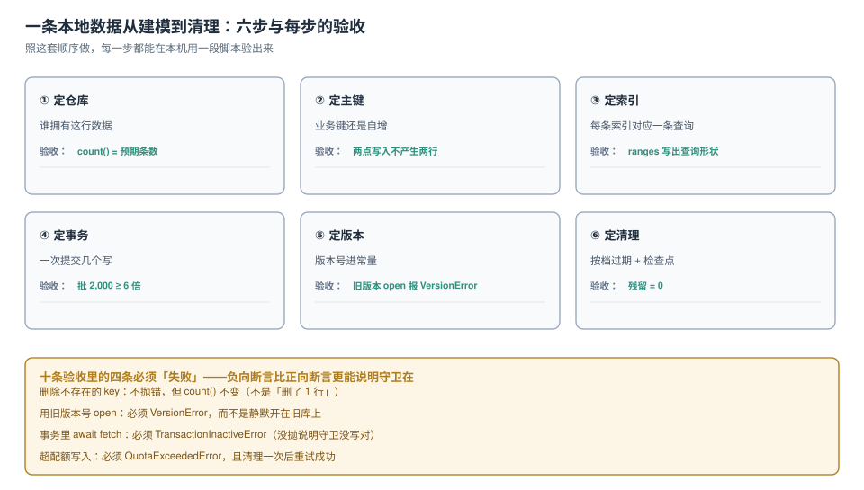

# 实战：一套可验收的本地库

前面九页各自回答一个问题。这一页把它们拼成一条**能照着做、能照着验**的流水线：六步建立，十条验收（其中四条必须失败），以及一套任何人都能在本机复跑的读数。

场景选一个真实的最小闭环：**离线任务看板**——看板、卡片、离线写队列三张表，用户断网能改，恢复后补发。



本页判据族 `LSP-A` ~ `LSP-H`，共 8 条。定义表在第六节。

## 一、六步建立

| 步 | 动作 | 产出的判断 | 验收 |
| --- | --- | --- | --- |
| ① 定仓库 | 谁拥有这行数据 | 每个仓库一个业务概念 | `count()` = 预期条数 |
| ② 定主键 | 业务键 / 自增 / 复合 | 同一仓库键类型单一 | 同一业务对象写两次只有一行 |
| ③ 定索引 | 每条索引对应一条查询 | 查询清单能对上索引清单 | 查询的 `ranges` 写得出来 |
| ④ 定事务 | 一次提交几条 | 写路径有确定的批大小 | 批量写比逐条快 ≥ 3 倍 |
| ⑤ 定版本 | 版本号进常量 | 全库一个常量，`oldVersion` 分段 | 旧版本 `open` 报 `VersionError` |
| ⑥ 定清理 | 按档过期 + 检查点 | 每类数据只有一个到期动作 | 清理后残留 = 0 |

第 ①②③ 步见[建模](../SchemaModeling/index.md)与[索引](../IndexDesign/index.md)，④ 见[事务](../Transaction/index.md)，⑤ 见[升级](../Upgrade/index.md)，⑥ 见[清理](../Eviction/index.md)。

## 二、完整模型（可直接抄）

```js
// db.js —— 版本常量与建库的唯一来源
export const DB_NAME = 'board';
export const DB_VERSION = 1;

export function openDB() {
  return new Promise((resolve, reject) => {
    const req = indexedDB.open(DB_NAME, DB_VERSION);

    req.onupgradeneeded = e => {
      const db = e.target.result;
      const tx = e.target.transaction;            // 注意：不是 e.transaction

      if (e.oldVersion < 1) {
        // 看板：数量少、整体读写
        db.createObjectStore('boards', { keyPath: 'id' });

        // 卡片：数量无上界、要单独筛 → 独立仓库 + 三条索引
        const cards = db.createObjectStore('cards', { keyPath: 'id' });
        cards.createIndex('byBoard', 'boardId');
        cards.createIndex('byBoardStatus', ['boardId', 'status']);
        cards.createIndex('byBoardPos', ['boardId', 'pos']);

        // 离线队列：自增，天然按到达顺序；带检查点字段便于重投
        const outbox = db.createObjectStore('outbox', { autoIncrement: true });
        outbox.createIndex('byState', 'state');

        // 元数据：检查点、迁移状态、最后一次采样
        db.createObjectStore('meta', { keyPath: 'k' });
      }
    };

    req.onsuccess = () => {
      const db = req.result;
      // 让出连接，否则别的标签页升级会被 blocked
      db.onversionchange = () => db.close();
      resolve(db);
    };
    req.onerror = () => reject(req.error);
    req.onblocked = () => reject(new Error('blocked: 请关闭本站其他标签页'));
  });
}
```

四条值得单独说明的设计：

1. **卡片里存 `pos`（可比较字符串），不存数组下标**。拖动排序只改两张卡片的 `pos`，而不是重写整个看板的顺序数组——这样「拖动」是 2 次单行写，而不是 1 次大文档写。
2. **`outbox` 用自增主键**：队列天然有序，且不需要业务键。
3. **`meta` 独立成仓**：检查点、迁移游标、最后一次采样都存在这里，不和业务数据混。
4. **`db.onversionchange = () => db.close()`** 写在 `openDB` 里，而不是散落在每个页面——一处写对，全站受益。

## 三、十条验收（四条必须失败）

前六条是正向，后四条**必须失败**——负向断言比正向断言更能说明守卫在。

| # | 断言 | 期望 | 类型 |
| --- | --- | --- | --- |
| S1 | 建库后 `objectStoreNames` | 含 `boards / cards / outbox / meta` | 正向 |
| S2 | 写 1,000 条卡片后 `count()` | `1000` | 正向 |
| S3 | 复合索引查询 `[7,'open']` | 结果全部 `boardId===7 && status==='open'` | 正向 |
| S4 | 批量写 2,000 条 vs 逐条 2,000 条 | 批量至少快 3 倍 | 正向（性能） |
| S5 | abort 之后 `count()` | 与 abort 前相等 | 正向 |
| S6 | `usage/quota` 采样 | 能取到且 < 0.8 | 正向 |
| **S7** | 用旧版本号 `open` | **抛 `VersionError`** | 负向 |
| **S8** | 事务里 `await` 外部 Promise 后再 `put` | **抛 `TransactionInactiveError`，且该条未落盘** | 负向 |
| **S9** | 删一个不存在的键 | **不抛错，且 `count()` 不变** | 负向 |
| **S10** | unique 索引写重复值 | **整批回滚，一条不落** | 负向 |

S9 看起来平淡，实际最容易被写错：很多人以为 `delete` 不存在的键会抛错，于是写了 `if (deleted) {...}` 的分支，结果那个分支永远不执行。

## 四、把十条写成一次能跑的脚本

```js
// verify.js —— 在真实源（http://localhost:xxxx）的页面里跑
const log = (k, v) => console.log(`[${v ? 'PASS' : 'FAIL'}] ${k}`);

async function verify() {
  const db = await openDB();

  // S1
  log('S1 stores', ['boards','cards','outbox','meta'].every(n => db.objectStoreNames.contains(n)));

  // S2
  await new Promise(r => {
    const t = db.transaction('cards', 'readwrite'), s = t.objectStore('cards');
    for (let i = 0; i < 1000; i++) s.put({ id: `c${i}`, boardId: i % 20, status: i % 3 ? 'done' : 'open', pos: 'a' + i });
    t.oncomplete = r;
  });
  const n = await new Promise(r => { const q = db.transaction('cards').objectStore('cards').count(); q.onsuccess = () => r(q.result); });
  log('S2 count=1000', n === 1000);

  // S3
  const rows = await new Promise(r => { const q = db.transaction('cards').objectStore('cards').index('byBoardStatus').getAll([7, 'open']); q.onsuccess = () => r(q.result); });
  log('S3 index filter', rows.length > 0 && rows.every(x => x.boardId === 7 && x.status === 'open'));

  // S5 abort 回滚
  const before = await new Promise(r => { const q = db.transaction('cards').objectStore('cards').count(); q.onsuccess = () => r(q.result); });
  await new Promise(r => {
    const t = db.transaction('cards', 'readwrite'), s = t.objectStore('cards');
    for (let i = 0; i < 100; i++) s.put({ id: `tmp${i}`, boardId: 0, status: 'open', pos: 'z' });
    t.onabort = r; s.put({ id: 'c0' }); t.abort();
  });
  const after = await new Promise(r => { const q = db.transaction('cards').objectStore('cards').count(); q.onsuccess = () => r(q.result); });
  log('S5 abort rollback', before === after);

  // S7 旧版本 → 必须抛
  let threw = null;
  try { await new Promise((res, rej) => { const r = indexedDB.open(DB_NAME, 0); r.onsuccess = () => res(); r.onerror = () => rej(r.error.name); }); }
  catch (e) { threw = e; }
  log('S7 downgrade throws', threw === 'VersionError');

  // S8 事务里 await → 必须抛
  let threw2 = null;
  try {
    await new Promise((res, rej) => {
      const t = db.transaction('cards', 'readwrite'), s = t.objectStore('cards');
      s.put({ id: 'x1', boardId: 0, status: 'open', pos: 'q' });
      setTimeout(() => { try { s.put({ id: 'x2', boardId: 0, status: 'open', pos: 'q' }); res(); } catch (e) { rej(e.name); } }, 0);
    });
  } catch (e) { threw2 = e; }
  log('S8 await in tx throws', threw2 === 'TransactionInactiveError');

  // S9 删不存在的键：不抛，count 不变
  const c1 = await new Promise(r => { const q = db.transaction('cards').objectStore('cards').count(); q.onsuccess = () => r(q.result); });
  await new Promise(r => { const t = db.transaction('cards', 'readwrite'); t.objectStore('cards').delete('definitely-missing'); t.oncomplete = r; });
  const c2 = await new Promise(r => { const q = db.transaction('cards').objectStore('cards').count(); q.onsuccess = () => r(q.result); });
  log('S9 delete missing no-op', c1 === c2);

  // S6
  const { usage, quota } = await navigator.storage.estimate();
  log('S6 usage ratio < 0.8', usage / quota < 0.8);
}
verify();
```

跑完应该在控制台看到十行 `PASS`。任何一行 `FAIL` 都指向一个具体页面：

| 失败项 | 去哪看 |
| --- | --- |
| S1 / S2 | [建模](../SchemaModeling/index.md) |
| S3 | [索引](../IndexDesign/index.md) |
| S4 | [事务](../Transaction/index.md) |
| S5 | [事务](../Transaction/index.md) 第三节 |
| S6 | [配额](../Quota/index.md) |
| S7 | [升级](../Upgrade/index.md) |
| S8 | [事务](../Transaction/index.md) 第二节 |
| S9 / S10 | [索引](../IndexDesign/index.md) 第五节 |

## 五、本机读数汇总（复跑基线）

同一台机器、同一份脚本，两次结果的**倍数关系**应当稳定：

| 读数 | 本机值 | 这项读数说明什么 |
| --- | --- | --- |
| 2,000 条单事务 | 167.2 ms | 批量基线 |
| 2,000 条逐条事务 | 1,098.2 ms | 6.6 倍 |
| 4,000 行筛 40 行（无索引） | 152.4 ms | 全表扫 |
| 同上（走索引） | 1.3 ms | 117 倍 |
| 5,000 行写入（0 / 3 索引） | 360.0 / 577.6 ms | 写放大 +60.4% |
| 2 万行建索引 | 1,095.4 ms | 升级窗口 |
| 回填 5,000 行 | 1,239.2 ms | 升级窗口 |
| 删 2 万行（逐条 / clear） | 1,660.7 / 0.4 ms | 4,152 倍 |
| quota / usage | 10,251 / 11.2 MB | 桶的大小 |
| `estimate` 单次 | 0.48 ms | 采样成本 |

## 六、本页判据

| 编号 | 判据 | 看什么现象 | 不满足时改哪里 |
| --- | --- | --- | --- |
| `LSP-A` | 六步都有对应产物 | 仓库/主键/索引/事务/版本/清理六项各有一句话 | 补缺失的那步 |
| `LSP-B` | 版本常量单一来源 | 只有 `db.js` 定义 `DB_VERSION` | 收敛 |
| `LSP-C` | `onversionchange` 在 `openDB` 内统一挂载 | 每个 `open` 都经过同一个函数 | 统一封装 |
| `LSP-D` | 十条验收能在本机跑完 | 控制台十行 PASS | 补脚本 |
| `LSP-E` | 四条负向断言都在 | S7~S10 存在且断言的是「抛错」 | 补负向 |
| `LSP-F` | 读数有基线可对比 | 汇总表里有本机值 | 补基线 |
| `LSP-G` | 每条验收都能指向一个页面 | 失败项有「去哪看」 | 补索引表 |
| `LSP-H` | 验收脚本不进生产包 | 构建产物里没有 `verify` | 移到开发期 |

## 验证方式

按第四节把 `verify.js` 贴进页面（或作为开发期入口），打开控制台，回车，数一下 `PASS` 的个数。

- **十条全 PASS**：模型可用，可以进入业务开发；
- **S4 差距不到 3 倍**：检查是否每条都在开新事务（提示：`await tx(...)` 写在 `for` 里面）；
- **S7 没抛错**：说明 `open` 根本没传版本号，或者用了 `indexedDB.open(name)` 的省略形态；
- **S8 没抛错**：说明「事务里 `await`」这条路径在你的封装里被 `Promise.all` 掩掉了——这是最需要注意的一种「假通过」。

## 参考资料

- W3C：*Indexed Database API 3.0*（`createIndex` 的 `unique`、`openCursor` 的 `IDBKeyRange`、`count`）
- MDN：*Using IndexedDB*（事务生命周期与 promise 封装的推荐模式）
- WHATWG：*Storage Standard*（`estimate` 的近似性质）
- 本仓库：[建模](../SchemaModeling/index.md)、[索引](../IndexDesign/index.md)、[事务](../Transaction/index.md)、[升级](../Upgrade/index.md)、[配额](../Quota/index.md)、[清理](../Eviction/index.md)
