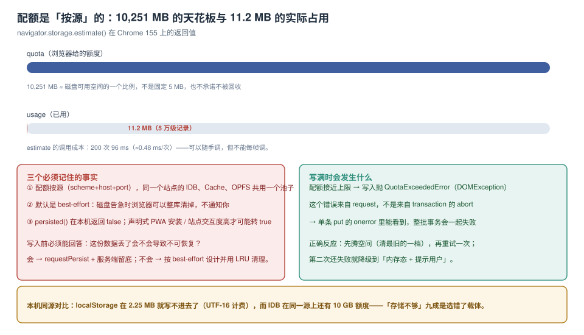

# 配额：按源分配的那只桶

`QuotaExceededError` 之所以难查，是因为它出现的位置和原因往往相隔很远：报错发生在写入草稿的 `put`，原因可能是三个月前上线的预缓存策略；而你以为是「5 MB 上限」的那条经验，早就不适用于 IndexedDB 了。

本页把配额的四个事实摆清楚：**按源算、按块记、随磁盘变、默认可以被清掉**，再给一套「写满时怎么办」的处置流程。



本页判据族 `STQ-A` ~ `STQ-H`，共 8 条。定义表在第六节。

## 一、`estimate()` 给你的两个数

```js
const { quota, usage, usageDetails } = await navigator.storage.estimate();
// 本机：quota = 10,251 MB，usage = 11.2 MB，usageDetails 在部分浏览器给出分项
```

| 字段 | 含义 | 常见误读 |
| --- | --- | --- |
| `quota` | 这个**源**最多能用多少 | 当成常量写进代码 |
| `usage` | 这个源已用多少（**块级近似**） | 当成精确字节数做对账 |
| `usageDetails` | 按 `indexedDB` / `caches` / `serviceWorker` 分项 | 以为所有浏览器都有（Safari 常缺） |

调用成本实测：**200 次 96 ms**（≈0.48 ms/次）。所以「每 30 秒采一次」完全可行，「每次写入前采一次」也不贵，但**每帧采**会拖慢滚动。

## 二、四个事实

### 事实一：配额按源，不按 API

`scheme + host + port` 相同即同一个桶。于是：

- `https://app.example.com` 与 `https://app.example.com:8443` 是**两个**桶；
- 同一个源上的 IDB、`Cache Storage`、OPFS 共享 `quota`；
- `localStorage` 有自己更小的上限（本机 2.25 MB 字符），但**也计入** `usage`。

这条事实解释了一类事故：预缓存把桶吃满，IDB 写入开始随机失败，而两次操作的代码毫无关联。

### 事实二：`usage` 是块级近似值，有基数

本机同一源的读数序列：

| 状态 | `usage` |
| --- | --- |
| 空库（刚清空） | **3,992 KB** |
| 2 万行（每行约 230 B，原始约 4.6 MB） | 5,729 KB |
| 逐条删完 2 万行 | **8,225 KB**（涨了） |
| 800 ms 后 | 3,990 KB |

三个反直觉的点：

1. **空库就有约 4 MB 的基数**——库文件、日志、元数据都算在里面；
2. **删完会先涨**——删除是「写墓碑」，压实要时间；
3. **2 万行的增量只有 1,737 KB，比原始字节少**——因为测试数据的 `body` 是同一字符重复填充，被块压缩了。**换成随机内容就会接近原始大小**。

结论：**不能用 `usage` 差值反推「每条记录多少字节」**，除非你的测试数据不可压缩，且先扣掉空库基数。

### 事实三：`quota` 随磁盘变

同一台机器上，`quota` 与磁盘剩余空间相关；换一台机器（128 GB 的笔记本 vs 1 TB 的台式机）拿到的值可能差一个数量级。所以任何「我们能存 X GB」的产品话术都必须写成「占可用空间的比例」，不能写成绝对值。

### 事实四：默认可以被清掉

```js
console.log(await navigator.storage.persisted());   // 本机：false
const granted = await navigator.storage.persist();  // 请求升档，可能返回 false
```

`persisted === false` 意味着 **best-effort** 档：磁盘告急时浏览器按「整源」回收，不通知页面。`persist()` 的授予条件由浏览器决定（安装为 PWA、站点参与度、书签、通知权限等），**不能保证成功**，也不能阻止用户手动清站点数据。

::: danger 关于持久化的三个错误期待
1. **「调了 persist() 就安全了」**：它可能返回 `false`；即便返回 `true`，用户清站点数据、无痕窗口关闭照样没。
2. **「无痕窗口里也能持久化」**：无痕会话的存储随窗口关闭销毁，`persist()` 基本不会授予。
3. **「数据重要就该放本地库」**：本地库的前提是**可重建或可回传**。不可重建的数据必须同步到服务端，本地只是副本。
:::

## 三、写满时到底发生什么

```js
try {
  await tx(db, 'drafts', 'readwrite', s => s.put(draft));
} catch (e) {
  if (e.name === 'QuotaExceededError') {
    // ① 先腾空间，再重试一次
  }
}
```

四个细节：

1. **错误来自 request，不是来自 `transaction.onabort`**。想拿到 `e.name`，要么在 `put` 返回的 `IDBRequest` 上挂 `onerror`，要么用把 request 包成 promise 的封装（`tx()` 那类）。
2. **整批事务会一起失败**。批量写 500 条时配额在中间用尽，500 条都不落盘（原子性），所以批量大小同时也是「失败时的损失上限」。
3. **重试只该做一次**。第二次还失败，说明清理没起作用，继续重试只会让用户等更久。
4. **`QuotaExceededError` 不等于「配额满了」**，也可能是「单条记录超过单个对象上限」（浏览器对单值有大小限制，通常远小于 `quota`）。区分方法：小记录能写、大记录不能写 → 是单值上限。

### 处置流程（按顺序）

```js
async function putWithQuotaGuard(db, store, value) {
  try {
    return await tx(db, store, 'readwrite', s => s.put(value));
  } catch (e) {
    if (e.name !== 'QuotaExceededError') throw e;

    // 1) 先清「可重建」的那一档（缓存优先，业务数据最后）
    await clearRebuildableCaches();
    await dropOldestArchive(db, { keepDays: 7 });

    // 2) 只重试一次
    try {
      return await tx(db, store, 'readwrite', s => s.put(value));
    } catch (e2) {
      // 3) 降级：转内存态 + 明确告知用户
      memoryFallback.set(store, value);
      notifyUser('本地空间不足，改动暂存在内存中，请勿关闭页面');
      throw e2;
    }
  }
}
```

这个流程的关键是**第 1 步的顺序**：先清缓存（可重建），再清归档（有价值但可再取），最后才是业务数据（不可重建）。顺序反了，就是「为了存一张缩略图，删掉了用户的草稿」。

## 四、容量估算：三种口径，别混用

| 口径 | 算法 | 适合 | 误差 |
| --- | --- | --- | --- |
| 原始字节 | 记录数 × 平均 JSON 长度 | 粗排 | 小（估算容量上限时够用） |
| `estimate().usage` 差值 | 写前写后各采一次，相减 | 实测校准 | 中（块级 + 压缩，可能偏低或偏高） |
| 空库基线 + 增量 | 扣掉空库基数再算 | 容量规划 | 较准 |

一个可用的估算式：

```text
可用写入量 ≈ (quota × 0.8 − usage) / 每条平均占用
```

`0.8` 是安全系数——别把桶用到 100%，因为其他标签页、`Cache Storage`、以及浏览器自己的元数据都在同一个桶里。

## 五、本页判据

| 编号 | 判据 | 看什么现象 | 不满足时改哪里 |
| --- | --- | --- | --- |
| `STQ-A` | 容量读数来自 `estimate()` 而非常量 | 代码里没有硬编码的 MB 数 | 改成运行时读数 |
| `STQ-B` | 清理顺序是「可重建→可再取→业务数据」 | 处置函数里的调用顺序 | 调整顺序 |
| `STQ-C` | `QuotaExceededError` 有 catch 且只重试一次 | catch 分支存在且重试计数为 1 | 补处置 |
| `STQ-D` | 写满时用户可见的降级提示 | 内存态回退 + toast | 补提示 |
| `STQ-E` | 不可重建数据有服务端副本 | 每个仓库能说出「丢了怎么办」 | 补回传 |
| `STQ-F` | `persist()` 申请有兜底（不假设成功） | 代码里检查返回值 | 补判断 |
| `STQ-G` | 把 `Cache Storage` 计入容量预算 | 预算表里有 cache 一列 | 补一列 |
| `STQ-H` | 容量估算扣掉了空库基数 | 估算脚本先采基线 | 补基线采样 |

## 验证方式

先看桶，再看增量，最后压一次：

```js
(async () => {
  const before = await navigator.storage.estimate();
  console.log('quota MB', (before.quota / 1048576).toFixed(0), 'usage MB', (before.usage / 1048576).toFixed(2));
  console.log('persisted', await navigator.storage.persisted());
  console.log('details', before.usageDetails);   // 部分浏览器有

  // 写入已知字节，观察 usage 增量
  const db = await new Promise((res, rej) => {
    const r = indexedDB.open('quotalab', 1);
    r.onupgradeneeded = e => e.target.result.createObjectStore('s', { keyPath: 'id' });
    r.onsuccess = e => res(e.target.result); r.onerror = () => rej(r.error);
  });
  const payload = crypto.getRandomValues(new Uint8Array(1024 * 1024));   // 1 MB 不可压缩
  await new Promise(r => {
    const t = db.transaction('s', 'readwrite');
    t.objectStore('s').put({ id: 1, blob: payload });
    t.oncomplete = r;
  });
  const after = await navigator.storage.estimate();
  console.log('delta MB', ((after.usage - before.usage) / 1048576).toFixed(2));
})();
```

预期：`delta` 落在 1 MB 上下（含开销，可能略大于 1 MB）；若你用 `'x'.repeat(1024*1024)` 替代随机字节，`delta` 会明显**小于** 1 MB——这就是第二节「事实二」里的压缩效应。

## 参考资料

- WHATWG：*Storage Standard*（存储桶、best-effort / persistent 两档、回收顺序）
- MDN：*StorageManager.estimate / persist / persisted*（`usageDetails` 的浏览器支持情况）
- Chrome 文档：*Storage quotas and eviction criteria*（配额与回收的官方口径）
- 本仓库：[清理](../Eviction/index.md)、[四种载体与三条边界](../Overview/index.md)、[容量与成本](../../../Ops/CapacityCost/index.md)
