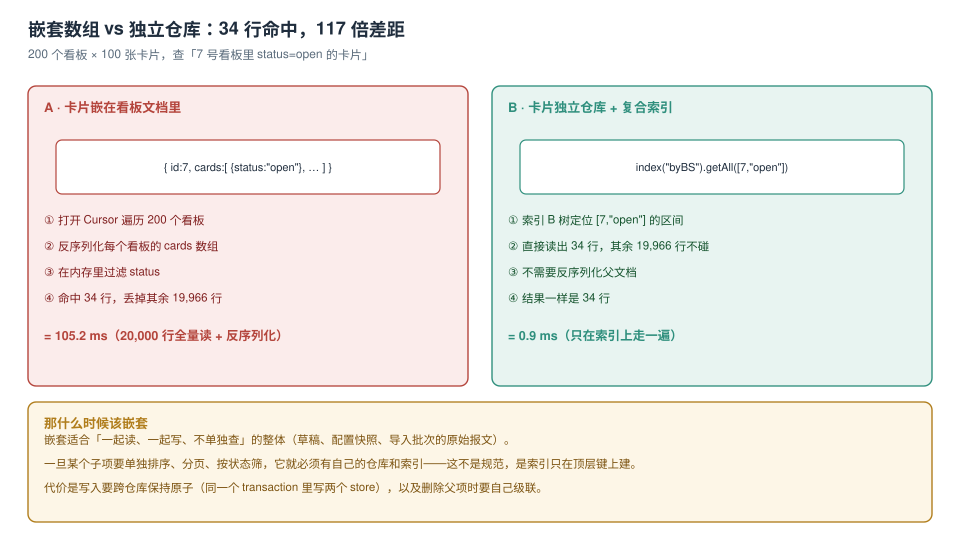

# 建模：仓库、主键与嵌套的取舍

IndexedDB 没有 `JOIN`、没有外键、没有「表设计范式」的教科书。它只有三样东西：**对象仓库（object store）**、**主键（keyPath / keyGenerator）**、**索引（index）**。建模做错的代价不是「以后改改」，而是**每一次查询都得全表扫**——而浏览器是唯一没有 `EXPLAIN` 的数据库，你连「它在扫」都不一定知道。

本页只回答三个问题：一行数据该归哪个仓库、主键用什么、子项是嵌进去还是拆出来。



本页判据族 `IDB-A` ~ `IDB-H`，共 8 条。定义表在第七节。

## 一、仓库的边界：按「谁会单独查它」切

这是和关系库最大的差别。关系库按「实体」切表，本地库要按**查询形状**切仓库：

| 判断 | 结论 |
| --- | --- |
| 子项会被单独排序、分页、按状态筛 | **拆成独立仓库 + 索引** |
| 子项只随父项整体读写，从不单独查 | 嵌进父文档 |
| 两个实体是一对多且子项数量有上界（如 ≤ 50） | 可以嵌，但要接受「整体替换」的写放大 |
| 子项数量无上界（评论、日志、消息） | **必须拆**，否则单条记录会涨到 MB 级 |

实测把这条差别量化出来。200 个看板 × 100 张卡片（共 20,000 张），查「7 号看板里 `status='open'` 的卡片」：

```js
// A. 卡片嵌在看板文档里：只能遍历父文档
const c = db.transaction('boards').objectStore('boards').openCursor();
// 200 次反序列化（每次带 100 张卡片）→ 内存里过滤 → 命中 34 行
// 105.2 ms

// B. 卡片独立仓库 + 复合索引：直接在索引上取区间
db.transaction('cards').objectStore('cards')
  .index('byBoardStatus').getAll([7, 'open']);
// 命中 34 行
// 0.9 ms
```

**同样的 34 行，117 倍的差距**。差距不在「过滤算法」，而在「读了多少行」：A 读了 20,000 行（全部反序列化），B 读了 34 行。

::: warning 「先嵌着，以后再说」的真实成本
嵌套不是不能改，而是**改的时候要做一次全量迁移**：新增仓库 + 遍历父文档 + 拆子项 + 写版本升级。而这次迁移发生在「用户已经有一年数据」的时候。所以判断的时机是在**建模时**，不是发现慢的时候。
:::

## 二、主键：三种形态与各自的坑

```js
// ① 业务键（keyPath）
db.createObjectStore('orders', { keyPath: 'id' });

// ② 自增（keyGenerator）
db.createObjectStore('drafts', { autoIncrement: true });

// ③ 复合键（数组 keyPath）
db.createObjectStore('tags', { keyPath: ['itemId', 'tag'] });
```

| 形态 | 适合 | 坑 |
| --- | --- | --- |
| 业务键 `keyPath` | 服务端已经有稳定 ID（UUID、订单号） | 业务键变了就要删旧 + 写新，而 `put` 只按主键覆盖 |
| 自增 `autoIncrement` | 纯本地数据（草稿、日志） | **不能和服务端 ID 混用**：同步回来时要么改成业务键，要么维护一张映射 |
| 复合键 `['a','b']` | 天然多对多（标签、成员关系） | 主键的**排序按数组逐位比较**，`['10'] < ['9']` 这类字符串比较陷阱同样存在 |

### 主键的排序规则会咬人

IDB 的键按类型排序，同类型内按值排序，而**字符串是逐字符比较**：

```js
// 想按 id 升序取「前 10 条」
store.getAll(IDBKeyRange.bound('1', '10'));
// 实际拿到的是 '1', '10', '100', '101'… 而不是 1..10
```

两个解法，选一个并写进建模文档：

- 主键用**数值**（`Number(id)`）或**零填充字符串**（`'000001'`），保证字典序等于数值序；
- 需要按时间排序时，主键用 **`createdAt` 毫秒数**，而不是 `Date` 字符串。

::: danger 四个建模期就会埋下的错
1. **用自增主键存服务端数据**：服务端返回 `id=42`，本地自增也给了 `42`，两条不同记录互相覆盖——而且 `put` 不报错。
2. **把 `Date` 对象当键**：`{ keyPath: 'createdAt' }` 里放 `new Date()` 是合法的（`Date` 是有效键类型），但一旦某处写成 ISO 字符串，同一仓库里就出现两种键类型，排序结果没有任何意义。
3. **主键里放 `undefined`**：`put({id: undefined})` 在 `keyPath: 'id'` 下抛 `DataError`，但如果是自增仓库，它会**默默生成一个新键**——于是「更新」变成了「新增」。
4. **复合键的成员顺序写反**：`['itemId','tag']` 与 `['tag','itemId']` 是两个不同的键，`get` 会找不到。
:::

## 三、嵌套的三种代价

嵌进去省了仓库和索引，但要还三笔账：

| 代价 | 表现 | 量级 |
| --- | --- | --- |
| **写放大** | 改一张卡片要重写整个看板文档（含 100 张卡片） | 单条记录从 200 B 涨到 20 KB |
| **无法局部查询** | 任何「按子项字段筛」都要全表读 | 见上文的 117 倍 |
| **级联要自己写** | 删父项不会删子项（如果子项在别的仓库） | 遗漏就是孤儿数据 |

写放大的实测很直白：同一份 10 MB 数据，分成 **200 条 × 50 KB** 与 **10,000 条 × 1 KB**：

```js
// 200 × 50 KB 单事务写入：78.1 ms
// 10,000 × 1 KB 单事务写入：783.1 ms
```

大记录**更快**（同样的字节数，提交次数一样，但记录数少 50 倍，索引维护与序列化的次数也少 50 倍）。所以「嵌套导致写放大」的准确说法是：**当你要改的只是子项的一小部分时**，重写整个大文档是浪费——如果一次改动本来就覆盖整个文档（保存草稿、提交表单快照），嵌套反而是最优解。

## 四、级联：拆开之后必须自己管

拆成两个仓库后，「删除看板」不再是 `delete(7)`：

```js
// 一个事务里同时删父与子，否则会留下孤儿卡片
await new Promise((res, rej) => {
  const tx = db.transaction(['boards', 'cards'], 'readwrite');
  tx.objectStore('boards').delete(boardId);
  const idx = tx.objectStore('cards').index('byBoard');
  const cur = idx.openKeyCursor(IDBKeyRange.only(boardId));
  cur.onsuccess = e => {
    const c = e.target.result;
    if (!c) return;
    tx.objectStore('cards').delete(c.primaryKey);   // 用 primaryKey 删，不是 cursor.key
    c.continue();
  };
  tx.oncomplete = res; tx.onerror = () => rej(tx.error); tx.onabort = () => rej(tx.error);
});
```

三个细节值得单独记：

1. **两个仓库必须在同一个 `transaction` 里**，这才有原子性；分成两次事务，中间崩了就是孤儿数据。
2. 删子项要用 `cursor.primaryKey`，不是 `cursor.key`——后者是**索引键**（`boardId`），拿它去 `delete` 会删掉主键恰好等于该值的另一条记录。
3. 孤儿数据不会自己消失，所以清理任务里必须有一条「孤儿对账」：`cards` 里 `boardId` 不在 `boards` 中的行数。

## 五、一页建模清单

建模完成时，这张表应该能填满：

| 项 | 你的答案 | 判据 |
| --- | --- | --- |
| 有几个仓库，各自的拥有者是谁 | | `IDB-A` |
| 每个仓库的主键类型与排序依据 | | `IDB-B` |
| 每条查询对应的仓库 + 索引 | | `IDB-C` |
| 哪些子项嵌在父文档里，为什么 | | `IDB-D` |
| 一对多的级联删除在哪段代码 | | `IDB-E` |
| 每条记录的字节上界 | | `IDB-F` |
| 哪些字段会变（会变的不进主键） | | `IDB-G` |
| 孤儿数据的对账 SQL/JS | | `IDB-H` |

## 六、一个完整的建模示例

一个「离线任务看板」的最小模型：

```js
// version 1
const req = indexedDB.open('board', 1);
req.onupgradeneeded = e => {
  const db = e.target.result;

  // 看板：业务键，数量少，整体读写
  db.createObjectStore('boards', { keyPath: 'id' });

  // 卡片：数量无上界，要单独分页与筛选 → 独立仓库
  const cards = db.createObjectStore('cards', { keyPath: 'id' });
  cards.createIndex('byBoard', 'boardId');                     // 取某看板全部
  cards.createIndex('byBoardStatus', ['boardId', 'status']);   // 按状态筛
  cards.createIndex('byBoardPos', ['boardId', 'pos']);         // 拖动排序

  // 离线队列：自增，天然按到达顺序
  db.createObjectStore('outbox', { autoIncrement: true });
};
```

`boards` 里存的只是卡片 ID 的**顺序数组**（`order: ['c3','c1','c2']`），不是卡片本身——顺序是看板的属性，卡片是卡片。这样「拖动排序」只改 `boards` 里一个数组（一条小记录），不重写任何卡片。

::: tip 判断「该不该嵌」的一句话
**问：这个子项会不会被单独改？** 会 → 拆。不会 → 嵌。
:::

## 七、本页判据

| 编号 | 判据 | 看什么现象 | 不满足时改哪里 |
| --- | --- | --- | --- |
| `IDB-A` | 每个仓库有单一拥有者 | 建模表里每个仓库只对应一个业务概念 | 按查询形状重切 |
| `IDB-B` | 主键类型单一且排序符合业务预期 | 同一仓库没有字符串与数值混用 | 统一成数值或零填充字符串 |
| `IDB-C` | 每条查询都能写出它的索引 | 查询清单里没有「全表扫」项 | 补索引或改建模 |
| `IDB-D` | 嵌套的子项有明确的「不单独查」理由 | 建模表第 4 行有具体理由 | 拆成独立仓库 |
| `IDB-E` | 一对多有级联删除且在同一事务 | 能找到「两个仓库一个 transaction」的代码 | 见第四节 |
| `IDB-F` | 单条记录有字节上界 | 建模表里写了最大记录大小 | 超 100 KB 就拆 |
| `IDB-G` | 会变的字段不在主键里 | 主键字段在业务上不可变 | 换主键，用映射表 |
| `IDB-H` | 有孤儿数据对账 | 有一条 count 查询能算出孤儿行数 | 补对账 + 清理 |

## 验证方式

建好模型后，用同一段脚本验三件事（在真实源上跑）：

```js
(async () => {
  const db = await new Promise((res, rej) => {
    const r = indexedDB.open('board', 1);
    r.onsuccess = e => res(e.target.result);
    r.onerror = () => rej(r.error);
  });
  console.log('stores', [...db.objectStoreNames]);
  for (const name of db.objectStoreNames) {
    const s = db.transaction(name).objectStore(name);
    console.log(name, 'keyPath', s.keyPath, 'auto', s.autoIncrement,
                'indexes', [...s.indexNames]);
  }
  // 孤儿对账：cards 里 boardId 不在 boards 中的行数
  const boardIds = new Set();
  await new Promise(r => {
    const c = db.transaction('boards').objectStore('boards').openKeyCursor();
    c.onsuccess = e => { const x = e.target.result; if (!x) return r(); boardIds.add(x.key); x.continue(); };
  });
  let orphans = 0, total = 0;
  await new Promise(r => {
    const c = db.transaction('cards').objectStore('cards').openCursor();
    c.onsuccess = e => { const x = e.target.result; if (!x) return r(); total++; if (!boardIds.has(x.value.boardId)) orphans++; x.continue(); };
  });
  console.log('cards', total, 'orphans', orphans);   // orphans 必须为 0
})();
```

预期：`stores` 与你设计的仓库一一对应；每个仓库的 `keyPath` 与 `indexes` 和建模表一致；`orphans` 为 `0`。

## 参考资料

- MDN：*IDBObjectStore.createIndex*（`keyPath` 数组、`multiEntry`、`unique`）、*IDBKeyRange*（`bound` / `only` / `lowerBound`）
- W3C：*Indexed Database API 3.0*（键的排序规则、`valid key` 的定义、`DataError` 的触发条件）
- MDN：*IDBCursor.primaryKey*（与 `cursor.key` 的区别）
- 本仓库：[索引](../IndexDesign/index.md)、[事务](../Transaction/index.md)、[PWA 离线数据](../../PWA/OfflineData/index.md)
