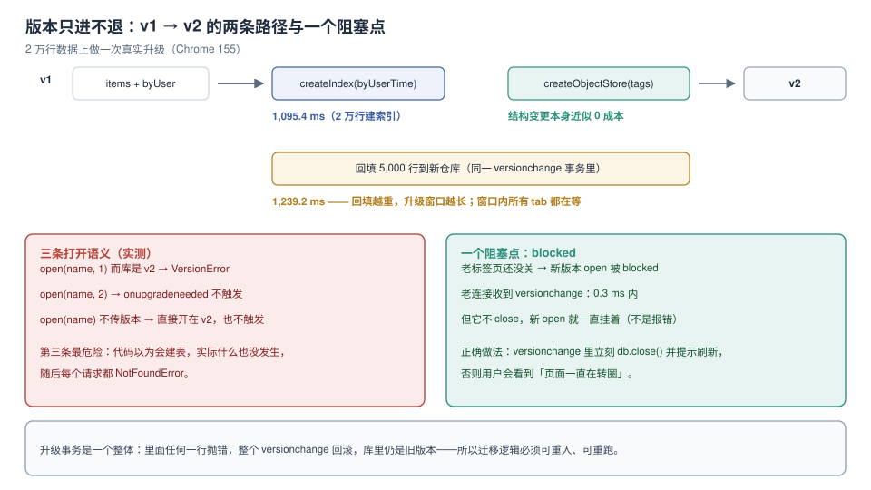

# 版本升级：只进不退的阶梯

服务端改表，你有 `ALTER TABLE`、有回滚脚本、有 DBA 值班。客户端改结构，你只有一个整数：`indexedDB.open(name, version)`。这个整数**只能往上走**，降一级就报错；而比它更麻烦的是「忘了写它」——代码静默开在最新版上，`onupgradeneeded` 一次都不触发，然后每个请求都 `NotFoundError`。

本页把升级路径上的每一段都量出来：加索引 **1,095.4 ms**（2 万行）、回填 5,000 行 **1,239.2 ms**、老标签页的 `versionchange` 通知 **0.3 ms** 内到达——但它不关连接，新版本就一直挂着。



本页判据族 `VUP-A` ~ `VUP-H`，共 8 条。定义表在第六节。

## 一、版本是一个整数，不是一个结构快照

```js
const DB_VERSION = 3;                    // 常量，单一来源
const req = indexedDB.open('board', DB_VERSION);
req.onupgradeneeded = e => {
  const db = e.target.result;
  const tx = e.target.transaction;       // 注意：e.transaction 是 undefined

  if (e.oldVersion < 1) {                // 从 0 开始：首次建库
    db.createObjectStore('boards', { keyPath: 'id' });
  }
  if (e.oldVersion < 2) {                // v1 → v2
    tx.objectStore('boards').createIndex('byArchived', 'archived');
  }
  if (e.oldVersion < 3) {                // v2 → v3
    db.createObjectStore('outbox', { autoIncrement: true });
  }
};
```

三个必须遵守的写法：

1. **`e.oldVersion` 判断，而不是 `if (version === N)`**。用户可能从 v1 直接跳到 v3，只写 `if (version === 3)` 会让 v1 用户跳过 v2 的结构。
2. **`e.target.transaction` 而不是 `e.transaction`**。后者不存在（`undefined`），在升级里拿它 `.objectStore()` 会抛 `TypeError`，整个 versionchange 中止——表现是「打开数据库失败，`AbortError`」，而堆栈指向一行看起来没问题的代码。这是本专题实测时踩到的第一个坑。
3. **版本常量只在一个文件里定义**。`open('board', 2)` 与 `open('board', 3)` 混在代码库里，等于给自己埋了一个 `VersionError`。

## 二、三条打开语义（实测）

同一份库，当前是 v2：

| 写法 | 结果 | 危险度 |
| --- | --- | --- |
| `open('board', 1)` | **`VersionError`** | 低——至少报错 |
| `open('board', 2)` | 成功；`onupgradeneeded` **不触发** | 低 |
| `open('board')`（不传版本） | 成功，开在 **v2**；`onupgradeneeded` **不触发** | **高** |

第三条是最常见的生产事故来源：

```js
// 某处封装偷懒，没传版本
const db = await openDB('board');          // 开在最新版，没升级
db.transaction('outbox').objectStore('outbox').put(x);
// → NotFoundError: Failed to execute 'transaction': One of the specified object stores was not found
```

而 `if (e.oldVersion < 3)` 里的建表代码**从来没有执行过**——因为 `onupgradeneeded` 压根没触发。所以读代码时要专门找「`open` 没带第二个参数」的位置。

::: danger 升级里最容易犯的四个错
1. **`e.transaction`**：不存在，见上。正确写法 `e.target.transaction`。
2. **在升级里 `await`**：versionchange 事务同样会自动提交，`await` 一下后面的 `createIndex` 就抛 `TransactionInactiveError`，整个升级回滚。
3. **升级里做网络请求**：升级事务持有排他锁，所有标签页都在等它；一个慢请求会让「新版本打不开」持续几秒到永久。
4. **删了旧仓库就以为数据没了影响**：`deleteObjectStore` 是即时的，一旦版本提交就**不可回滚**（升级事务失败才会回滚）。删之前先确认没有回滚需求。
:::

## 三、升级事务是原子的，但可能很慢

整个 `onupgradeneeded` 里的所有操作在**同一个 versionchange 事务**里，任何一处抛错 → 全部回滚 → 库仍是旧版本。这是好事（不会留下半成品结构），但它有两个代价：

| 操作 | 2 万行数据上的耗时 | 说明 |
| --- | --- | --- |
| `createObjectStore` + `createIndex`（空仓库） | 近似 0 | 只改元数据 |
| **给已有 2 万行建索引** | **1,095.4 ms** | 要扫全表、建 B 树 |
| **回填 5,000 行到新仓库** | **1,239.2 ms** | 游标遍历 + 逐条 `put` |

```js
// 给已有数据加复合索引（v1 → v2）
req.onupgradeneeded = e => {
  e.target.transaction.objectStore('items')
    .createIndex('byUserTime', ['userId', 'createdAt']);
};
```

注意：`createIndex` 是**同步返回**的，但它的实际工作发生在事务提交时——所以你不能在它之后 `await` 一个 `count()` 来「确认索引建好了」，那个 `count()` 会在同一个事务里排队，看到的仍是旧索引状态。

### 回填要分批，且要可续

回填 5,000 行用 1.2 秒还行，5 万行就是十几秒——这十几秒里**所有标签页的 `open` 都在排队**（`blocked`）。正确做法是把回填**移出升级事务**：

```js
// 升级里只建结构（快），回填交给普通事务分批做
req.onupgradeneeded = e => {
  const db = e.target.result;
  if (e.oldVersion < 2) {
    db.createObjectStore('cards_v2', { keyPath: 'id' });
    db.createObjectStore('migrate', { keyPath: 'k' });   // 迁移游标：记录做到哪
  }
};
req.onsuccess = () => {
  const db = req.result;
  // 后台分批：每次 500 条，写一个检查点
  backfillInBatches(db, { batch: 500 });
};
```

代价是「升级完成但数据没迁完」这个中间状态必须能被业务容忍（读路径要能同时读新旧两处），这就是下一节的兼容问题。

## 四、blocked：升级会被老标签页挡住

```js
const hold = await open('board', 2);       // 老标签页持有的连接
hold.onversionchange = () => { /* 默认什么都不做 */ };

open('board', 3, e => e.target.result.createObjectStore('x'));   // 新标签页
// → onblocked 触发；直到 hold.close() 之前，这个 open 一直不返回
```

实测读数：

| 观察点 | 结果 |
| --- | --- |
| 老连接收到 `versionchange` 的时刻 | **0.3 ms** 内 |
| 新 `open` 的结果 | **悬挂**（既不成功也不失败），直到老连接关闭 |
| 老连接关闭后 | 升级立刻执行，`open` 成功 |

所以「升级卡住、页面一直转圈」的根因不是 bug，而是**默认行为**。正确写法：

```js
db.onversionchange = () => {
  db.close();                                  // 立刻释放，别让新版本等
  showToast('应用已更新，请刷新页面');           // 告诉用户发生了什么
};
```

同时新标签页这边要有超时兜底：

```js
const req = indexedDB.open('board', 3);
const timer = setTimeout(() => {
  showBlockedHint('请关闭本站的其他标签页以完成更新');
}, 3000);
req.onsuccess = () => clearTimeout(timer);
req.onblocked = () => showBlockedHint('另一个标签页正在使用数据库');
```

## 五、跨版本兼容：双写与双读

升级不是一次动作，而是一个**窗口期**：新代码上线了，但部分用户还停在旧标签页（旧版本代码 + 旧结构）。这期间会发生三种错配：

| 错配 | 现象 | 处置 |
| --- | --- | --- |
| 新代码 + 旧结构 | 新字段读不到 → 显示 `undefined` | 读路径给默认值，别假设字段存在 |
| 旧代码 + 新结构 | 旧代码写入缺新字段 | 新字段一律可空，或用触发器式的默认值 |
| 两个标签页同时升 | 一个 blocked，一个成功 | 见上一节的 `versionchange` 处理 |

最稳的做法是把「加字段」和「用字段」分成两次发布：

1. **发布 A**：只加结构（可空）+ 双写（新字段与旧字段都写）+ 读路径优先新字段、回退旧字段；
2. **观察一个版本周期**，确认没有旧结构的数据再进来；
3. **发布 B**：读路径只认新字段，删除旧字段的写入。

这和服务端的 expand-contract 是同一个套路（对照[数据库变更与在线 Schema 演进](../../../DB/SchemaEvolution/index.md)），只是客户端的「在线」意味着**你无法控制所有客户端何时升级**。

## 六、本页判据

| 编号 | 判据 | 看什么现象 | 不满足时改哪里 |
| --- | --- | --- | --- |
| `VUP-A` | 版本号是单一常量 | 全库只有一个 `DB_VERSION` 定义 | 收敛到一处 |
| `VUP-B` | 升级用 `e.oldVersion` 分段 | `if (e.oldVersion < N)` 覆盖每一级 | 改成分段判断 |
| `VUP-C` | 升级里用 `e.target.transaction` | 没有 `e.transaction` 的单数写法 | 逐处替换 |
| `VUP-D` | 升级里没有 `await` 与网络请求 | versionchange 块内是纯同步调用 | 移出升级 |
| `VUP-E` | 重活（索引 / 回填）有耗时预算 | 能在文档里写出「用户等多久」 | 分批 + 检查点 |
| `VUP-F` | 有 `onversionchange` 自动 `close()` | 每个 `open` 后都挂了该回调 | 补回调 |
| `VUP-G` | 有 `onblocked` 与超时提示 | 3 秒后能看到用户可见提示 | 补提示 |
| `VUP-H` | 跨版本兼容有双写/双读窗口 | 发布计划里有两个阶段 | 拆发布 |

## 验证方式

一段脚本验完全部三条语义（在有数据的库上跑）：

```js
(async () => {
  const open = (v) => new Promise((res, rej) => {
    const r = v === undefined ? indexedDB.open('miglab') : indexedDB.open('miglab', v);
    let fired = false;
    r.onupgradeneeded = e => { fired = true; e.target.result.createObjectStore('s' + e.newVersion, { keyPath: 'id' }); };
    r.onsuccess = e => res({ db: e.target.result, fired });
    r.onerror = () => rej(r.error.name);
    r.onblocked = () => console.log('blocked');
  });

  const a = await open(1); console.log('v1 upgrade fired', a.fired); a.db.close();
  const b = await open(2); console.log('v2 upgrade fired', b.fired); b.db.close();
  const c = await open(2); console.log('same version fired', c.fired); c.db.close();
  const d = await open();  console.log('no version fired', d.fired, 'at', d.db.version);
  try { await open(1); } catch (e) { console.log('downgrade →', e); }   // VersionError
})();
```

预期：`v1/v2` 的 `fired` 为 `true`，`same version` 与 `no version` 都为 `false`，最后一行打出 `VersionError`。

再验 `blocked`：开两个标签页，标签页 A 打开库并**不关闭**，标签页 B 用更高版本号打开——B 会挂住并打出 `blocked`，A 的控制台会收到 `versionchange`。

## 参考资料

- W3C：*Indexed Database API 3.0*（`IDBVersionChangeEvent` 的 `oldVersion` / `newVersion`、`blocked` 与 `versionchange` 的触发条件）
- MDN：*IDBFactory.open*（版本参数省略时的行为、`VersionError`）
- MDN：*IDBDatabase.onversionchange*（推荐在回调里 `close()` 的原因）
- 本仓库：[数据库变更与在线 Schema 演进](../../../DB/SchemaEvolution/index.md)、[事务](../Transaction/index.md)、[清理](../Eviction/index.md)
