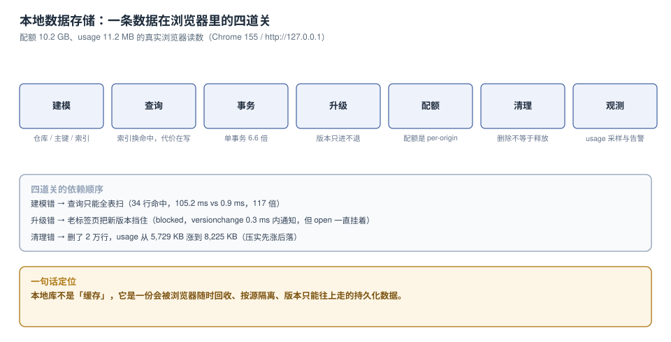

# 本地数据存储与容量治理

前端把数据放进浏览器，通常只需要一行 `indexedDB.open()`。真正让人加班的是后面这四件事：写进去却读不出来、版本一升老用户全白屏、某天开始随机报 `QuotaExceededError`、以及列表页越用越卡。这四个症状看着无关，其实是同一条链上的四个环节——**建模、查询、事务、升级**决定了数据「对不对、快不快」，**配额与清理**决定了数据「还在不在」。

本专题只讲这条链，而且只用一种证据：在真实浏览器里跑出来的读数。

::: tip 一句话理解
本地库不是「缓存」，它是一份**会被浏览器随时回收、按源隔离、版本只能往上走**的持久化数据。你写进去的每一条，都要能被读出来、被升级、被清理，并且这三件事都要有判据。
:::

::: info 本专题与相邻专题的分工
本专题回答「**本地库本身怎么建、怎么改、怎么清**」，不回答「离线应用怎么做」。十处最容易混淆的邻居，边界一次写死：

| 相邻专题 | 那边回答什么 | 本专题回答什么 |
| --- | --- | --- |
| [PWA 离线数据](../../Frontend/PWA/OfflineData/index.md) | 离线写路径：先落盘再发送、Background Sync、队列与幂等 | 落盘那张表本身的结构、索引、事务与容量 |
| [PWA 缓存策略](../../Frontend/PWA/CachingStrategy/index.md) | 请求级缓存：预缓存、运行时缓存、失效 | `Cache Storage` 与 IDB 的配额竞争关系 |
| [本地态与远端态](../../Frontend/StateDataFlow/LocalRemote/index.md) | 内存缓存的 `staleTime` / `gcTime` | 持久化层的重建与容量 |
| [多端同步与收敛](../../Frontend/StateDataFlow/RealtimeSync/index.md) | 冲突的四种策略与断线追平 | 「本地写下去」这一步的原子性 |
| [浏览器原理 · 存储](../../Frontend/Basic/Browser/Storage/index.md) | 四种存储的 API 面与基本用法 | 同四种存储的**成本、边界与失效方式** |
| [错误监控与体验度量](../../Frontend/ErrorTelemetry/index.md) | 前端异常采集与上报通道 | 本地库失败率这类「不该上报成功」的指标怎么定义分母 |
| [数据库连接池](../../DB/ConnectionPool/index.md) | 服务端连接的借还与膝点 | 浏览器侧没有连接池，但有「事务生命周期」 |
| [数据库变更与在线 Schema 演进](../../DB/SchemaEvolution/index.md) | 服务端改表：在线 DDL、回填、锁 | 客户端改结构：版本阶梯、blocked、重入 |
| [分区与冷热分离](../../DB/PartitionArchival/index.md) | 服务端按时间分区与归档 | 客户端按档过期与 `clear()` 语义 |
| [隐私工程](../../Others/PrivacyEngineering/index.md) | 删除传播的九位置、证据链 | 其中「浏览器本地」这一处的删除与残留对账 |
:::

::: warning 本专题为什么不按大版本建目录
本库对「有大版本代际差异」的主题按版本目录组织（如 [Spring5/Spring6](../../Backend/Java/Frame/Spring/index.md)、[MySQL57/MySQL84](../../DB/SchemaEvolution/MySQL84/index.md)、[Nacos2/Nacos3](../../Ops/ConfigManagement/index.md)），旧版本保留并标注状态。本专题**不建版本目录**，三条理由：

1. **它是一门「一类工程问题」，不是一款产品的文档**：IndexedDB 的语义由 W3C 规范定义，十年来没有代际变化；变的是**各浏览器的实现细节**（配额算法、回收策略、`commit()` 的支持度）。
2. **并存的差异是「引擎」而不是「版本」**：Chrome / Firefox / Safari 的差异用一张对照表就能覆盖（见[四种载体](Overview/index.md)与[配额](Quota/index.md)），不值得为每个引擎开一套章节。
3. **版本差异已经收敛进表格**：凡涉及「哪个版本才支持」的地方，正文都用「最低版本」列或行内标注（如 `IDBTransaction.commit()` 在 Safari 的可用性），不需要另立目录。

若将来出现规范级断层（例如 IndexedDB 被新的存储标准取代），再按 `IndexedDB2/` 这类版本目录补建，且**不覆盖本目录**。
:::

## 目录

- [四种载体与三条边界](Overview/index.md)- [建模：仓库、主键与嵌套的取舍](SchemaModeling/index.md)
- [索引：读省下来的，写要还](IndexDesign/index.md)
- [事务：一次提交写几条](Transaction/index.md)
- [版本升级：只进不退的阶梯](Upgrade/index.md)
- [配额：按源分配的那只桶](Quota/index.md)
- [清理：删除不等于释放](Eviction/index.md)
- [观测：三个信号与三种分母](Observability/index.md)
- [实战：一套可验收的本地库](Practice/index.md)
- [常见问题与分诊](FAQ/index.md)

## 专题地图

## 判据纪律

沿用全库写法：**每页 8 条**，编号形如 `IDB-A`，逐页前缀唯一，可被 `utils/audit` 下的判据类巡检机械核对。每条判据都要能回答三件事：**看什么现象、判成什么、不满足时改哪里**。

| 页 | 判据族 | 条数 | 这一族管什么 |
| --- | --- | --- | --- |
| 四种载体与三条边界 | `LDS-A` ~ `LDS-H` | 8 | 载体选择、同步阻塞、Worker 可达性、配额池 |
| 建模 | `IDB-A` ~ `IDB-H` | 8 | 仓库边界、主键类型、嵌套与拆分、级联 |
| 索引 | `IDX-A` ~ `IDX-H` | 8 | 索引与查询一一对应、列序、写放大、多值索引 |
| 事务 | `TXN-A` ~ `TXN-H` | 8 | 提交粒度、自动提交、abort 回滚、跨仓库原子 |
| 版本升级 | `VUP-A` ~ `VUP-H` | 8 | 版本常量、升级事务、blocked、可重入 |
| 配额 | `STQ-A` ~ `STQ-H` | 8 | 按源配额、best-effort、持久化申请、写满处置 |
| 清理 | `EVC-A` ~ `EVC-H` | 8 | 分档过期、检查点、clear 语义、残留对账 |
| 观测 | `LSO-A` ~ `LSO-H` | 8 | 三个信号、错误名标签、分母选择、告警门槛 |
| 实战 | `LSP-A` ~ `LSP-H` | 8 | 六步基线、十条验收、负向断言、复跑方式 |
| 常见问题 | `LSQ-A` ~ `LSQ-H` | 8 | 症状分诊、自查清单、常见错误建议 |

合计 **10 族 80 条**。

## 事实与版本速览（2026-10 核对）

| 项 | 现状 | 对本专题的影响 |
| --- | --- | --- |
| 实测浏览器 | **Chrome 155.0.8059.85**（headless，macOS x64） | 所有读数都在这个版本上跑出来；不同版本的具体毫秒数会变，倍数关系稳定 |
| 测量方式 | CDP `Runtime.evaluate` 驱动页面脚本，源为 `http://127.0.0.1:8765` | 必须是**真实源**：`about:blank` 与 `data:` 是不透明源，IDB 直接抛 `SecurityError` |
| `navigator.storage.estimate()` | 本机 `quota` **10,251 MB**、`usage` **11.2 MB** | 配额按**源**计，与磁盘剩余空间相关，不是固定 5 MB |
| `localStorage` 上限 | 本机写到 **2.25 MB** 时报 `QuotaExceededError` | 计费单位是 UTF-16 码元，ASCII 的 1 KB 占 2 KB 额度 |
| `navigator.storage.persisted()` | 本机 `false` | 默认 best-effort：磁盘告急时浏览器可以整库清掉 |
| IndexedDB 版本语义 | 只能升不能降；`open()` 不传版本时**不会**触发 `onupgradeneeded` | 「忘了传版本」是 `NotFoundError` 的头号来源 |
| OPFS | Chrome / Firefox / Safari 均已支持 | 大文件走它，结构化查询仍归 IDB |

::: warning 关于「实测」的诚实标注
本专题的数字分两类，正文逐处标注：

- **本机可复跑**：Chrome **155** headless + CDP 驱动页面脚本，macOS x64，脚本写进页面**但不入库**。
  同一段脚本在本机重跑，毫秒数会有 ±10% 的浮动，**倍数与排序稳定**。
- **规格口径**：配额算法、`persist()` 的授予条件、各浏览器的回收策略属于实现细节，
  以官方文档为准，本专题只写「能观测到的现象」，不猜内部阈值。

三处必须说清的局限：① 读数来自 headless，**真实设备上的存储介质（SSD / eMMC）差异会成倍影响绝对值**；
② 只有一次测量的项（如 `blocked` 通知耗时）不适合当 SLA，它要说明的是「有通知」而不是「0.3 ms」；
③ 浏览器是唯一没有 `EXPLAIN` 的数据库——本专题用「读了多少行」代替执行计划，这也是一种近似。
:::

## 三条底线

1. **一次 `put` 的位置决定它会不会丢**：把 2,000 条写进一个事务是 **167.2 ms**，逐条提交是 **1,098.2 ms**（慢 6.6 倍）；而在事务里 `await` 了别的东西，第二次写会直接抛 `TransactionInactiveError`——**没有报错的路径比报错的路径更危险**，因为前者只是「少了一条数据」。
2. **删除不等于释放**：删掉 2 万行花了 **1,660.7 ms**，`usage` 反而从 **5,729 KB 涨到 8,225 KB**，800 ms 后才落到 3,990 KB。用「删完看 usage」验收清理，会得到一个和事实相反的结论。
3. **版本只能往上走**：用旧版本号 `open` 报 `VersionError`；**不传版本号则静默开在最新版且不触发升级**——代码以为建了表，实际什么都没发生，随后每个请求都 `NotFoundError`。

## 场景跳转

| 你现在的处境 | 从这里开始 |
| --- | --- |
| 正在选「数据放哪」 | [四种载体与三条边界](Overview/index.md) |
| 表结构已经建了，但列表页越来越慢 | [建模](SchemaModeling/index.md) → [索引](IndexDesign/index.md) |
| 偶发「写进去读不到」 | [事务](Transaction/index.md) → [FAQ](FAQ/index.md) 第一行 |
| 要加字段 / 改结构 | [版本升级](Upgrade/index.md) |
| 开始出现 `QuotaExceededError` | [配额](Quota/index.md) → [清理](Eviction/index.md) |
| 想给本地库加监控 | [观测](Observability/index.md) |
| 要从零搭一套并验收 | [实战](Practice/index.md) 的十条验收 |

## 参考资料

- MDN：*IndexedDB API*（`IDBFactory.open` 的版本语义、`IDBTransaction` 的生命周期、`IDBIndex` 的 `keyPath` 与 `multiEntry`）、*Storage API*（`estimate()` / `persist()` / `persisted()`）
- WHATWG：*Storage Standard*（按源的存储桶、best-effort 与 persistent 两档、回收顺序）
- W3C：*Indexed Database API 3.0*（`createIndex` 的唯一约束、`getAll` 的 `query` 与 `count`、`versionchange` 与 `blocked` 事件）
- Chrome 文档：*Storage quotas and eviction criteria*（配额与回收策略的官方说明）
- 本仓库相邻专题：[PWA 离线数据](../PWA/OfflineData/index.md)、[本地态与远端态](../StateDataFlow/LocalRemote/index.md)、[浏览器原理 · 存储](../Basic/Browser/Storage/index.md)
