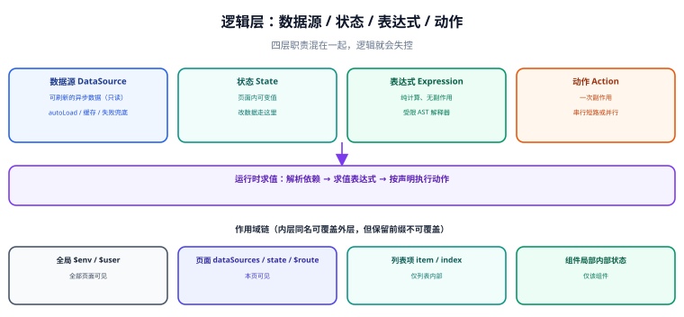

# 数据源与联动：表达式、变量与动作

**一个只能摆静态组件的低代码平台，业务人员用它搭完第一张页面就不会再用第二次。** 真正让平台有价值的，是「数据能进来、组件能互相影响、动作能编排」这三件事——它们共同构成了低代码的**逻辑层**，也是协议里最难设计、最容易失控的部分。



## 一句话定位

**逻辑层的本质是「给一份静态描述补上「什么会变、什么触发什么」」。** 数据源回答「数据从哪来」，状态回答「当前是什么情况」，表达式回答「怎么从数据算出要显示的值」，动作回答「用户操作后发生什么」。

## 四层职责

| 层 | 是什么 | 例子 | 存哪 |
| --- | --- | --- | --- |
| **数据源（DataSource）** | 一份**可刷新的异步数据**定义 | 「查用户列表：`GET /api/users`」 | 页面级 `dataSources` |
| **状态（State）** | 页面内的**可变值** | 当前选中的 tab、输入框的临时值 | 页面级 `state` |
| **表达式（Expression）** | 从数据 / 状态算出值的**纯计算** | <span v-pre>`"{{ state.keyword ? '搜索中' : '全部' }}"`</span> | 属性值内联 |
| **动作（Action）** | 一次**可执行的副作用** | 「点按钮 → 校验 → 提交 → 刷新列表 → 提示」 | 事件配置 |

::: danger 数据源与状态不能混为一谈
把「接口返回的列表」直接写进 `state`、由用户操作随意修改，是逻辑层最常见的设计错误。它带来两个后果：

1. **刷新语义丢失**：数据源知道自己「怎么重新拉一次」，而 state 里的一个数组不知道。
2. **一致性丢失**：接口返回的东西被改了，界面上看起来「保存成功了」，其实只改了本地。

**纪律：数据源的数据只读，需要修改就改「状态」或触发「新的数据源刷新」。**
:::

## 数据源定义

一份数据源描述要能回答四个问题：**怎么请求、什么时候请求、结果放哪、失败怎么办**。

```json [数据源定义]
{
  "dataSources": [
    {
      "id": "ds_userList",
      "name": "用户列表",
      "type": "http",
      "request": {
        "url": "/api/users",
        "method": "GET",
        "params": { "page": "{{ state.page }}", "size": 20 }
      },
      "autoLoad": true,
      "cache": { "ttl": 0 },
      "onError": { "action": "notify", "args": { "type": "error", "message": "加载失败" } }
    }
  ]
}
```

| 字段 | 作用 | 常见错误 |
| --- | --- | --- |
| `request.params` | 请求参数，支持表达式 | 把表达式写成字符串拼接，无法随状态变化刷新 |
| `autoLoad` | 是否在页面加载时自动请求 | 编辑态也 `true` → 编辑器打爆后端（见 [渲染引擎](../RenderEngine/index.md)） |
| `cache.ttl` | 命中缓存的时长 | 对「写后必读」的接口配了缓存 → 看到旧数据 |
| `onError` | 失败时的兜底动作 | 没有兜底 → 失败静默，界面永远转圈 |

::: tip 参数依赖必须能被自动识别
好的实现能**从 `params` 里解析出依赖的变量**（<span v-pre>`{{ state.page }}` → 依赖 `state.page`</span>），从而在 `page` 变化时自动重拉。这比让用户手写「什么时候刷新」可靠得多，也是「数据源」与「直接写 fetch」的本质区别。
:::

## 作用域与变量解析

变量解析必须定义清楚「从里往外找还是从外往里找」，否则会出现「同名变量取到了哪个」不可预测的问题。

```
全局配置（env / 用户信息）
   └─ 页面（dataSources、state、页面参数）
        └─ 列表项作用域（列表渲染时的 item / index）
             └─ 组件局部（组件自己的内部状态）
```

| 作用域 | 可见性 | 典型变量 |
| --- | --- | --- |
| 全局 | 全部页面可见 | `$env`（环境）、`$user`（当前用户） |
| 页面 | 本页可见 | `dataSources.*`、`state.*`、`$route` |
| 列表项 | **仅列表内部可见** | `item`、`index` |
| 组件局部 | 仅该组件内部 | 组件未暴露的内部状态 |

::: warning 变量查找规则要写进协议，而不是靠实现约定
「内层同名优先于外层」是直觉上合理的规则，但**必须在协议文档里写死**。否则会出现：「我把一个变量命名成 `item`，列表里的表达式就全部变了含义」这类无从排查的问题。

**建议：保留前缀（`$`、`dataSources`、`state`）不允许被用户变量覆盖**，只有 `item` / `index` 这类列表局部变量允许被内层覆盖。
:::

## 表达式：能力与边界

表达式是低代码里最需要「限制」的一块——**放得太开就是「用 JSON 写 JavaScript」，收得太紧就表达不了业务**。

| 能力 | 建议 | 理由 |
| --- | --- | --- |
| 取值 / 运算 / 三元 / 逻辑 | ✅ 支持 | 覆盖 80% 的场景 |
| 字符串与数组方法（`map`/`filter`/`join`） | ✅ 支持（只读） | 展示层常需要简单转换 |
| 函数定义 / 闭包 | ❌ 禁止 | 一旦允许写函数，表达式就变成了脚本 |
| 网络请求 / DOM 操作 | ❌ 禁止 | 副作用必须走「动作」，不能藏在表达式里 |
| `new` / `eval` / 原型链访问 | ❌ 禁止 | 安全边界（见 [交付与运行时](../Runtime/index.md)） |

一个既能用又安全的表达式求值骨架：

```js
// 用受限的解释器，而不是 new Function / eval
import { parse } from "jsep";
import { evaluate } from "./safe-eval";

const ALLOWED_CALLS = new Set(["length", "toUpperCase", "toLowerCase", "join", "slice", "filter", "map"]);

export function evalExpression(expr, scope) {
  const ast = parse(expr);
  return walk(ast);

  function walk(n) {
    switch (n.type) {
      case "MemberExpression": {
        const obj = walk(n.object);
        const key = n.computed ? walk(n.property) : n.property.name;
        if (key === "__proto__" || key === "constructor" || key === "prototype") {
          throw new Error(`禁止访问 ${key}`);
        }
        return obj?.[key];
      }
      case "CallExpression": {
        const name = n.callee.type === "MemberExpression" ? n.callee.property.name : n.callee.name;
        if (!ALLOWED_CALLS.has(name)) throw new Error(`不允许调用 ${name}`);
        return evaluate(n, scope);   // 仅执行白名单中的方法
      }
      default:
        return evaluate(n, scope);
    }
  }
}
```

::: danger 三条必须拦死的东西
1. **`__proto__` / `constructor` / `prototype`**：这是原型链污染与沙箱逃逸的必经之路，必须在 `MemberExpression` 层直接拒绝（不能只在关键字里黑名单 `eval`）。
2. **函数构造**：`Function` / `eval` / `setTimeout("...")` 这类能把字符串变成代码的入口，一个都不能留。
3. **原型链上的方法**：允许 `arr.map` 就意味着可以 `arr.constructor.constructor("return this")()`——所以对「方法调用」也要按名白名单，而不是按对象类型放行。
:::

## 动作编排：事件 → 动作序列

动作是「用户操作之后发生什么」的声明。它的执行模型有两种，要选对：

| 模型 | 语义 | 适合 |
| --- | --- | --- |
| **串行 + 短路** | 前一个动作失败就不执行后面的 | 表单提交：校验 → 提交 → 提示 → 关闭 |
| **并行 + 全部执行** | 同时执行、互不影响 | 关闭弹窗 + 打点 + 通知外部页面 |

```json [按钮的点击动作]
{
  "events": {
    "onClick": [
      { "action": "validate", "args": { "target": "node_form" } },
      { "action": "request", "args": { "dataSource": "ds_submit" } },
      { "action": "refresh", "args": { "dataSource": "ds_userList" } },
      { "action": "notify", "args": { "type": "success", "message": "保存成功" } },
      { "action": "closeModal", "args": { "id": "modal_1" } }
    ]
  }
}
```

内置动作的最小集合（超出这个集合就应该让用户写代码，而不是继续堆砌）：

| 动作 | 作用 | 必带参数 |
| --- | --- | --- |
| `request` | 触发某个数据源 | `dataSource` |
| `refresh` | 重新拉取某个数据源 | `dataSource` |
| `setState` | 修改页面状态 | `key`、`value` |
| `navigate` | 路由跳转 | `url` 或 `route` |
| `notify` | 弹出提示 | `type`、`message` |
| `openModal` / `closeModal` | 弹窗控制 | `id` |
| `validate` | 触发校验 | `target` |
| `setFieldValue` | 给表单字段赋值 | `target`、`field`、`value` |

::: warning 动作的「目标」要用 id 引用，不能用「当前作用域」隐式推断
「把值赋给表单里的那个输入框」——如果这个「那个」是靠组件在树里的相对位置推断的，那用户拖动一次就会失效。**所有动作的目标都必须是显式的 id 或数据源名。**
:::

## 加载与错误的可视化

数据是异步的，界面就必须有「三态」：加载中、成功、失败。三态没做全的页面，在弱网下看起来就是「坏了」。

| 状态 | 必须提供的表现 | 常见缺失 |
| --- | --- | --- |
| 加载中 | 骨架屏 / Spin / 禁用提交按钮 | 无提示，用户重复点击 → 重复提交 |
| 成功 | 正常渲染 | — |
| 空数据 | 明确的空状态文案 | 一片空白，用户以为是加载失败 |
| 失败 | 错误提示 + **重试入口** | 只弹一个 toast，用户无法重试 |

::: tip 把「防重复提交」做成平台的默认行为
表单提交按钮在请求进行中应该**自动禁用**——这件事不该要求每个使用者记得配。平台在 `request` 动作执行期间，应当把触发它的组件标记为 pending。这是「平台比手写更省心」的典型体现：**把容易漏掉的正确做法变成默认值。**
:::

## 验证方式：联动逻辑的五条判据

```shell
# ① 参数变化能自动刷新（依赖解析正确）
node -e "
const {createStore}=require('./runtime'); const s=createStore(require('./fixtures/deps.json'));
s.setState('page',2);
console.log(s.dirty.includes('ds_userList') ? 'PASS 依赖识别正确' : 'FAIL 未识别 state.page 依赖');
"

# ② 编辑态不自动加载数据源
node -e "
const {createStore}=require('./runtime'); let n=0; global.fetch=()=>{n++;return Promise.resolve({json:()=>({})})};
createStore(require('./fixtures/with-ds.json'), {mode:'edit'});
console.log(n===0 ? 'PASS 编辑态零请求' : 'FAIL 编辑态发了 '+n+' 次');
"

# ③ 表达式沙箱拦住危险访问
node -e "
const {evalExpression}=require('./runtime');
const bad=['a.__proto__','a.constructor','[].constructor.constructor(\"return this\")()'];
const leaked=bad.filter(e=>{try{evalExpression(e,{a:{}});return true}catch{return false}});
console.log(leaked.length===0 ? 'PASS 沙箱拦截生效' : 'FAIL 逃逸：'+leaked);
"

# ④ 动作串行短路：校验失败后续动作不执行
node -e "
const {runActions}=require('./runtime'); const log=[];
runActions([{action:'validate',args:{pass:false}},{action:'request',args:{dataSource:'ds_x'}}],{log});
console.log(log.length===0 ? 'PASS 短路生效' : 'FAIL 校验失败仍执行了 '+log);
"

# ⑤ 失败有重试入口（DOM 断言）
node -e "
const {render}=require('./renderer'); const h=render(require('./fixtures/ds-error.json'));
console.log(/重试/.test(h) ? 'PASS 提供重试' : 'FAIL 无重试入口');
"
```

预期：五条全 `PASS`。**第 ③ 条是安全判据，必须接进 CI** —— 它拦的是「低代码平台变成一个任意代码执行入口」这类最严重的问题。

## 参考资料

- [JSONata：JSON 查询与转换表达式语言](https://jsonata.org/)
- [CEL（Common Expression Language）规范](https://github.com/google/cel-spec/blob/master/doc/langdef.md)
- [jsep：轻量表达式解析器](https://github.com/EricSmekens/jsep)
- [OWASP：Prototype Pollution](https://owasp.org/www-community/vulnerabilities/Prototype_pollution)
- [Amis：数据域与表达式](https://aisuda.bce.baidu.com/amis/zh-CN/docs/concepts/expression)
- [Alibaba LowCodeEngine：数据源与变量](https://lowcode-engine.cn/site/docs/specs/datasource-spec)
