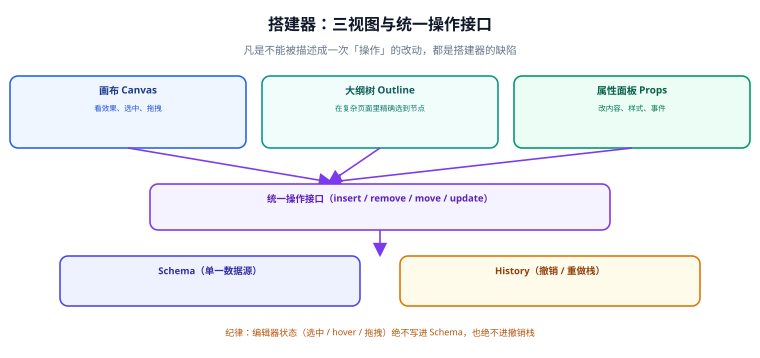

# 搭建器：画布、属性与撤销重做

**搭建器（Designer）是低代码平台里代码量最大、bug 最集中、也最容易被低估的一层。** 它看起来只是「拖拽 + 改属性」，实际上要做好四件互相关联的事：三视图同步、拖拽模型、原子化操作、撤销重做。这四件事里任何一件做错，使用者都会在十分钟内放弃这个平台。



## 一句话定位

**搭建器 = 一个「Schema 的可视化编辑器」。** 它的唯一产出是：用户点一下、拖一下，Schema 发生了一次可描述、可撤销、可重放的变更。**凡是不能被描述成一次「操作」的改动，都是搭建器的缺陷。**

## 三视图同步：同一份数据的三个投影

| 视图 | 展示什么 | 用户的用法 | 典型交互 |
| --- | --- | --- | --- |
| **画布（Canvas）** | 真实渲染结果 | 看效果、选中、拖拽 | 点击选中、拖入新组件 |
| **大纲树（Outline）** | 节点层级结构 | 在复杂页面里精确选到深层节点 | 点击定位、拖拽调整层级 |
| **属性面板（Props）** | 当前选中节点的可配属性 | 改内容、样式、事件 | 表单编辑 |

三视图必须**由同一份状态派生**，而不是各自维护一份。判断方法很简单：**在画布上选中一个节点，大纲树是否高亮同一节点、属性面板是否显示同一节点的属性**——任何一处不同步都是架构问题，不是 bug。

```js
// ✅ 单一状态源 + 派生视图
const store = {
  schema: { /* 节点树 */ },
  selectedIds: [],     // 唯一的选择来源
  hoveredId: null,
};

// 画布：高亮 selectedIds；大纲树：高亮 selectedIds；属性面板：读 selectedIds[0]
// 任何一处点击 → 只改 store.selectedIds → 三个视图自动一致

// ❌ 反例：画布维护 canvasSelected，大纲树维护 treeSelected，属性面板维护 currentProp
// 三者靠事件互相通知 → 一定会出现「点了画布，属性面板还是上一个节点」
```

::: danger 选中状态不能存进 Schema
把 `selected` 写进节点、再让三视图各自读节点上的 `selected`，是初学搭建器最常见的做法。它会在两个地方爆炸：① 撤销重做把「选中」也当成了一次变更，用户按 Ctrl+Z 会撤销掉「选中」而不是「改动」；② 保存时把选中状态存进数据库，别人打开页面时看到一个蓝框。

**纪律：编辑器状态（选中 / hover / 拖拽中 / 折叠）全部单独存，与 Schema 完全隔离。**
:::

## 拖拽模型：四件事必须想清楚

拖拽看起来是「把 A 放到 B 里」，实际上要回答四个问题，每一个答错都会出现「拖不进去」或「拖进去了但位置不对」：

| 问题 | 判据 | 常见错误 |
| --- | --- | --- |
| **能不能放**（合法性） | 目标是否 `isContainer`、是否禁止嵌套自身 | 允许把「表格」拖进「表格的列」里 |
| **放在哪**（落点计算） | 根据鼠标与目标子节点矩形，算出「前 / 后 / 里」三种意图 | 只支持「里」，用户无法在容器首尾插入 |
| **插到哪**（位置索引） | 计算 `parentId` + `index` | 只记录 `parentId`，结果总是插到末尾 |
| **重复怎么办**（幂等） | 落到同一位置的重复触发要能被识别 | 一次拖拽触发两次 `drop` → 插入两个相同节点 |

落点计算的最小实现（「前 / 后 / 里」三分）：

```js
function calcDropIntent(targetRect, pointer, isContainer) {
  const y = pointer.y - targetRect.top;
  const h = targetRect.height;
  const edge = Math.min(h * 0.25, 8);       // 首尾各留 25% 或 8px 作为「前 / 后」区
  if (isContainer && y > edge && y < h - edge) return "inside";
  return y <= edge ? "before" : "after";
}
```

::: tip 拖拽的「合法性」要在两个地方各判一次
- **拖起时**（dragstart）：给出「这个组件不能拖进自己」之类的**预览提示**（如禁用光标）。
- **落下时**（drop）：**再判一次**，并直接拒绝非法操作。

只判一次是不够的：拖起时的判断基于当时的 DOM 状态，落下时 DOM 可能已经变了（比如另一个协作者改了页面）。**落下时的校验才是唯一可靠的那次。**
:::

## 原子化操作：撤销重做的前提

撤销重做**不是**「把 Schema 的每个历史版本存起来」，而是「记录每一次操作，可以正向执行也可以反向撤销」。所以要求每一次改动都必须是一个**可逆的原子操作**：

```ts [designer/operations.ts]
type Op =
  | { type: "insert"; parentId: string; index: number; node: Node }
  | { type: "remove"; parentId: string; index: number; node: Node }   // node 一并存下，才可逆
  | { type: "move";   from: { parentId: string; index: number };
                      to:   { parentId: string; index: number }; node: Node }
  | { type: "updateProps"; nodeId: string; before: object; after: object }
  | { type: "updateStyle"; nodeId: string; before: object; after: object };

export function apply(store, op) { /* 正向 */ }
export function revert(store, op) { /* 反向，不需要「旧快照」 */ }
```

三个关键设计：

| 设计 | 做法 | 为什么 |
| --- | --- | --- |
| **反向操作不需要快照** | 每个操作自带「反向所需的最小信息」（如 `remove` 存下被删节点） | 快照方案内存爆炸且无法合并 |
| **`updateProps` 存 before/after** | 只存发生变化的属性 | 拖动滑块会产生上百次操作，必须能合并 |
| **操作合并（batch / merge）** | 连续同类操作（如连续拖动、连续输入）合并成一条 | 否则撤销一次只回退一个字符 |

::: danger 撤销重做的三类高频缺陷
1. **直接改 Schema 不走操作接口。** 只要有一处代码写 `node.props.label = "x"` 而没有生成操作，这条改动就**不可撤销**——用户会发现「按了 Ctrl+Z，页面动了一下但那个改动还在」。
2. **把选中状态当成操作。** 拖动滑块时选中的变化被记成操作，撤销栈里堆满「选中」。
3. **撤销之后** `selectedIds` **指向了已不存在的节点。** 撤销一次删除操作后，属性面板会读到 `undefined` 而崩掉。**撤销后必须做一次「选择有效性校验」**，失效就清空选择。
:::

## 操作历史的存储与合并

```js
class History {
  constructor(limit = 100) { this.undoStack = []; this.redoStack = []; this.limit = limit; }

  push(op, { mergeKey } = {}) {
    const top = this.undoStack[this.undoStack.length - 1];
    // 同一个节点的同一属性、且在「合并窗口」内 → 合并 instead of 新增
    if (mergeKey && top && top.mergeKey === mergeKey && Date.now() - top.at < 500) {
      top.op.after = op.after; top.at = Date.now(); return;
    }
    this.undoStack.push({ op, mergeKey, at: Date.now() });
    if (this.undoStack.length > this.limit) this.undoStack.shift();
    this.redoStack.length = 0;      // 新操作必然清空重做栈
  }

  undo(store) { const h = this.undoStack.pop(); if (!h) return; revert(store, h.op); this.redoStack.push(h); }
  redo(store) { const h = this.redoStack.pop(); if (!h) return; apply(store, h.op); this.undoStack.push(h); }
}
```

::: tip `mergeKey` 怎么定
用「操作类型 + 节点 id + 属性名 + 目标父节点 + 目标索引」拼成字符串。注意**要把索引也拼进去**——否则「先拖到 A 下，再拖到 B 下」这类不同位置的操作会被错误合并。

合并窗口（示例 500ms）不宜太长：太长会把「两次有意的相同改动」并成一次，用户按一次撤销会回退掉两次操作。
:::

## 快捷键与多选

| 能力 | 快捷键约定 | 实现要点 |
| --- | --- | --- |
| 撤销 / 重做 | `Ctrl/Cmd + Z` / `Ctrl/Cmd + Shift + Z` | 全局监听，但要**在输入框内禁用**（否则会和文本撤销冲突） |
| 复制 / 粘贴 | `Ctrl/Cmd + C` / `V` | 粘贴时要**重新分配 id**，否则 id 冲突 |
| 删除 | `Delete` / `Backspace` | 删除不可删节点（如页面根节点）要静默忽略而不是报错 |
| 多选 | `Shift + 点击` / 框选 | 多选后属性面板显示「多个组件」或公共属性 |
| 微调位置 | 方向键 / `Shift + 方向键` | 与画布滚动冲突时优先响应元素移动 |

::: warning 输入框里的快捷键冲突
用户正在属性面板的输入框里按 `Ctrl+Z`，期望的是「撤销这次输入」，而不是「撤销上一次拖拽」。实现上必须判断 `event.target` 是否为可编辑元素（`input` / `textarea` / `contenteditable`），是则直接放行给浏览器。
:::

## 验证方式：搭建器的六条判据

```shell
# ① 三视图同步（在浏览器控制台执行，前提是平台暴露了调试句柄）
node -e "
const d = window.__designer;
d.select('node_2');
const ok = d.outlineHighlight === 'node_2' && d.propsPanelNodeId === 'node_2';
console.log(ok ? 'PASS 三视图同步' : 'FAIL 三视图不同步');
"

# ② 每次改动都可撤销：连续 3 次操作后连撤 3 次必须回到初始态
node -e "
const {makeDesigner}=require('./designer');
const d = makeDesigner(); const init = d.serialize();
d.insertNode('node_form','Input'); d.updateProps(d.lastId,{label:'a'}); d.moveNode(d.lastId,'node_form',0);
d.undo(); d.undo(); d.undo();
console.log(JSON.stringify(d.serialize())===JSON.stringify(init) ? 'PASS 撤销可回到初始态' : 'FAIL 撤销不完整');
"

# ③ 撤销栈不记录选中
node -e "
const {makeDesigner}=require('./designer'); const d=makeDesigner(); const n=d.undoStack.length;
d.select('node_1'); d.select('node_2');
console.log(d.undoStack.length===n ? 'PASS 选中不入撤销栈' : 'FAIL 选中被记成操作');
"

# ④ 撤销后选择失效会被清理
node -e "
const {makeDesigner}=require('./designer'); const d=makeDesigner();
const id=d.insertNode('node_form','Input'); d.select(id); d.undo();
console.log(d.selectedIds.length===0 ? 'PASS 撤销后选择已清理' : 'FAIL 悬空选择');
"

# ⑤ 粘贴会重新分配 id
node -e "
const {makeDesigner}=require('./designer'); const d=makeDesigner();
const a=d.insertNode('node_form','Input'); d.copy(a); const b=d.paste('node_form');
console.log(a!==b ? 'PASS 粘贴新 id' : 'FAIL id 冲突');
"

# ⑥ 拖入自身被拒绝
node -e "
const {makeDesigner}=require('./designer'); const d=makeDesigner();
const a=d.insertNode('node_form','Form');
console.log(d.canDrop(a,a)===false ? 'PASS 拒绝拖入自身' : 'FAIL 允许自嵌套');
"
```

预期：六条全 `PASS`。**第 ③ 与第 ④ 条是这类编辑器最常见的两个 bug**，建议写进回归用例。

## 参考资料

- [HTML Drag and Drop API](https://developer.mozilla.org/zh-CN/docs/Web/API/HTML_Drag_and_Drop_API)
- [GrapesJS：编辑器架构与命令系统](https://grapesjs.com/docs/modules/Commands.html)
- [Alibaba LowCodeEngine：设计器（designer）](https://github.com/alibaba/lowcode-engine/tree/main/packages/designer)
- [ProseMirror：撤销重做的实现思路（编辑器领域的经典）](https://prosemirror.net/docs/guide/#commands)
- [Immutable Update 与结构共享](https://react.dev/learn/updating-objects-in-state)
