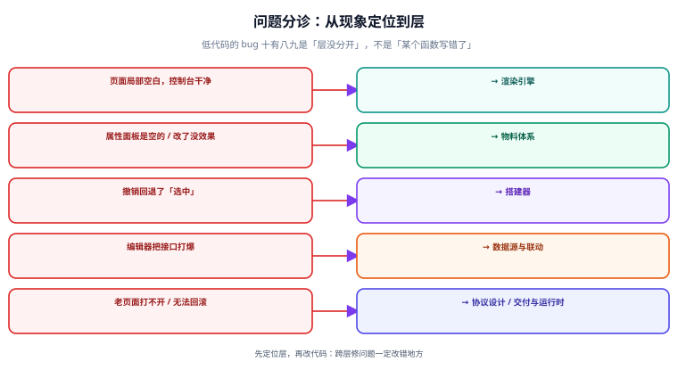

# 常见问题与最佳实践

本页把低代码平台从立项到上线的常见问题按「现象」组织成一张分诊表，再给出十二个高频问答与平台上线自查清单。**遇到问题先查表定位层，再往下看对应小节。**



## 一、分诊表：先定位「哪一层出了问题」

| 现象 | 最可能的层 | 直接去看 |
| --- | --- | --- |
| 页面局部空白，控制台无报错 | **渲染层**（组件映射缺失） | [渲染引擎](../RenderEngine/index.md)「组件找不到」 |
| 拖上去的组件属性面板是空的 | **物料层**（`meta` 缺属性声明） | [物料体系](../Materials/index.md) |
| 属性面板能改，但改了没效果 | **物料层**（`meta` 与 `impl` 不一致） | [物料体系](../Materials/index.md) 的 danger |
| 改了属性，撤销一次回退好几个字符 | **搭建层**（操作合并窗口太长） | [搭建器](../Designer/index.md) 的 `mergeKey` |
| 按 Ctrl+Z 撤销的是「选中」不是「改动」 | **搭建层**（选中状态进了 Schema / 撤销栈） | [搭建器](../Designer/index.md) 的 danger |
| 编辑器打开后接口被打爆 | **逻辑层**（编辑态也自动加载数据源） | [数据源与联动](../DataBinding/index.md) |
| 联动配了但没生效 | **逻辑层**（参数依赖没被识别） | [数据源与联动](../DataBinding/index.md)「参数依赖」 |
| 老页面打不开 / 一片空白 | **协议层**（Schema 版本不兼容，缺迁移） | [协议设计](../Schema/index.md)「迁移」 |
| 出码产物跑不起来 | **交付层**（出码只搬字面量，未处理表达式） | [交付与运行时](../Runtime/index.md) |
| 改了配置线上立刻变，没法回滚 | **交付层**（覆盖式保存，没有发布指针） | [交付与运行时](../Runtime/index.md)「Schema 的存储」 |

## 二、十二个高频问题

### Q1：业务人员说「拖不动」，怎么排查？

按「能不能放 → 放在哪 → 有没有反应」三步查：

1. **能不能放**：目标容器 `isContainer` 是否为 `true`？是否有「禁止嵌套自身」的规则误伤？
2. **放在哪**：落点计算是否只支持「里」不支持「前后」？（见 [搭建器](../Designer/index.md) 的三分算法）
3. **有没有反应**：`drop` 事件是否被内部元素 `stopPropagation` 拦截？这类问题在「组件内部有 iframe 或 canvas」时高发。

### Q2：为什么页面里有一块空白，却什么都没有报错？

九成是**渲染器找不到组件**：`componentName` 拼错、物料没注册、或物料加载失败。React 会静默跳过、Vue 会渲染成注释节点。

**修法**：渲染器必须把「找不到的组件」记账并上报（见 [渲染引擎](../RenderEngine/index.md)），编辑器里红框提示、生产环境打点告警。**不要靠肉眼找空白。**

### Q3：Schema 里能不能存函数？

不能。Schema 必须能 `JSON.stringify` 后原样还原，函数、`Date`、`Map`、`undefined` 都会在序列化时丢失或变形。

**如果确实需要逻辑**，把它表达成「动作序列」（见 [数据源与联动](../DataBinding/index.md)）或「表达式字符串」，让运行时去执行。**「Schema 里塞函数」等于放弃了 Schema 的可分析性**，出码、校验、迁移全部失效。

### Q4：为什么「先做编辑器，协议边做边改」是个坑？

因为编辑器会**按自己的需要改协议**：拖拽需要位置信息，属性面板需要分组，撤销需要增量——于是协议里慢慢长满了「只有编辑器认识」的字段。等到要出码时才发现：**这份 Schema 根本描述不了一个页面，它描述的是「编辑器的内部状态」。**

**正确顺序**：协议 → 最小渲染器（能手写 JSON 渲染）→ 物料 → 搭建器。判据是「不启动编辑器就能渲染」。

### Q5：物料应该有多少个才够？

**没有数量指标，只有覆盖指标。** 一个可用的判据是：**「最近 20 个需求里，靠现有物料能完成的占比」**。低于 60% 说明物料不够用（使用者会绕开平台），高于 95% 可能物料过多（面板难找、维护负担大）。

`80% 左右`、且**新增物料的频率在下降**，通常说明物料库进入了健康状态。

### Q6：编辑器卡顿，是渲染性能问题还是状态管理问题？

用判据区分：

```js
// 在控制台里改一个属性，看有多少个节点重渲染
// 若「改一个属性 → 整棵树重渲」→ 状态管理问题（引用传染）
// 若「改一个属性 → 只有它自己重渲，但仍卡」→ 渲染性能问题（DOM 太多）
```

前者修法是把状态规范化（按 id 索引）配合 `memo`；后者才需要虚拟滚动或懒渲染。**先测再改**，两类问题的解法完全不通用。

### Q7：Schema 要不要存到数据库？存成什么格式？

**要，存成 JSON 列**（MySQL `JSON` / PostgreSQL `jsonb`）。理由：Schema 是文档型数据，结构随协议版本演进，用宽表存会在每次协议升级时改表结构。

配套三条：① **追加版本，不覆盖**；② **发布与草稿分离**（两个指针）；③ **关键索引建在 `page_key` 上**，不要试图对 `schema_json` 内部字段建索引。

### Q8：低代码页面怎么做测试？

三层，按性价比排序：

| 层 | 测什么 | 例子 |
| --- | --- | --- |
| **契约测试** | 同一份 Schema 在不同解释器 / 版本下渲染结果一致 | 升级渲染器后，历史页面快照对比 |
| **Schema 校验测试** | 协议合规、id 唯一、组件名已知 | 接进 CI，任何 Schema 变更都跑 |
| **关键路径 E2E** | 搭出来的页面能提交、能校验、能提示 | 覆盖 3~5 条主链路即可 |

**不要试图给「搭建过程」写单测**（拖拽的 UI 测试维护成本远大于收益），把力气花在「产物的正确性」上。

### Q9：表达式为什么不能用 `eval` / `new Function`？

因为低代码平台允许**非研发人员写入内容**。用 `eval` 等于把「配置权」升级成了「任意代码执行权」——一个能写配置的人就能读用户数据、发任意请求、篡改页面。

**正确做法**：受限 AST 解释器 + 方法名白名单，并显式拒绝 `__proto__` / `constructor` / `prototype`（见 [数据源与联动](../DataBinding/index.md)）。

### Q10：出错率最高的配置是什么？

按真实统计，「数据源配置」和「表达式」占问题的大头，共同原因是**缺乏即时反馈**：用户写了一个错误的 URL 或表达式，平台要到运行时才报错。

**解法**：把校验前移 —— 表达式编辑器实时解析并提示语法错误；数据源配置实时校验参数占位符是否存在；保存时做一次「引用的变量 / 组件 id 是否都存在」的全量校验（这与 [协议校验](../Schema/index.md) 是同一套机制）。

### Q11：什么时候应该把页面「出码」而不是继续解释运行？

三个信号出现任意一个就出码：

1. **页面是核心资产**，要求包体积、首屏、可读代码。
2. **有合规 / 审计要求**，必须能拿到源码。
3. **配置改动频率降下来了**（比如一个季度才改一次），解释运行的「改即生效」优势不再重要。

反过来，**字段每周都在变**的后台，出码只会让「改一次走一次发布流程」，反而更慢。

### Q12：多人同时编辑一个页面，怎么办？

**先别做。** 协同编辑涉及冲突检测（OT / CRDT）与「谁的撤销算谁的」这类极复杂的问题，成本远超收益。

务实的替代方案：**乐观锁 + 编辑提示**。保存时带上取出的版本号，版本不一致就拒绝并提示「页面已被他人修改，请刷新后重试」。这条机制的实现成本极低，却能挡住 95% 的并发事故。

## 三、平台上线自查清单

在把平台推给第一批使用者之前，逐条确认：

| # | 检查项 | 判据 |
| --- | --- | --- |
| 1 | 协议有版本且能迁移 | 取一份 3 个版本前的 Schema，打开后渲染结果正常 |
| 2 | 协议可机器校验 | 元 Schema 校验 + id 唯一 + 组件名已知，三条进 CI |
| 3 | 渲染器不认识编辑器 | `grep` 渲染器目录，无编辑器依赖 |
| 4 | 未知组件可见 | 构造未知组件，编辑器红框、生产环境打点 |
| 5 | 单组件错误不白屏 | 制造一个抛错物料，页面其余部分正常 |
| 6 | 编辑态不发请求 | 打开编辑器，网络面板零业务请求 |
| 7 | 撤销重做完整 | 10 次操作 ↔ 10 次撤销回到初始态；选中不入栈 |
| 8 | 物料默认值可渲染 | 遍历全部物料，无控制台错误 |
| 9 | 表达式沙箱不可逃逸 | `__proto__` / `constructor` 被拒 |
| 10 | 数据源安全在服务端 | 把配置里的 URL 换成恶意地址，服务端拒绝 |
| 11 | 有版本与发布指针 | 能一键回滚到上一版本，刷新即生效 |
| 12 | 有审计日志 | 「谁在什么时候发布了哪个版本」可查 |

::: danger 十二条里最容易被跳过的是第 1 与第 11 条
「协议有版本」和「能回滚」在项目初期看起来都是「以后再说」的事，但它们是**唯一无法事后补上**的两项——协议已经在库里存了几百份文档，补版本要写迁移；线上已经被覆盖式保存改过，历史数据已经丢了。

**这两条要在项目第一天就做，成本是一个下午；在半年后补，成本是一个季度。**
:::

## 四、最佳实践十二条

1. **协议先行，且能被 JSON Schema 描述。** 协议是唯一不能返工的东西。
2. **渲染器不认识具体的组件名。** 一切走注册表。
3. **物料先写 `meta` 再写实现。** 否则属性面板会暴露实现细节。
4. **编辑器的每次改动都走操作接口。** 这是撤销重做的唯一前提。
5. **编辑器状态与 Schema 严格隔离。** 选中 / hover / 拖拽状态不落库。
6. **表达式用受限解释器，绝不用 `eval`。** 平台的安全边界就是这一条。
7. **编辑态默认不发真实请求。**
8. **数据源只读，修改走状态或新请求。** 避免「以为保存了」。
9. **追加版本 + 发布指针，不覆盖。** 回滚能力来自这里。
10. **出码走 AST，不拼字符串。** 并且以「产物不依赖平台运行时」为验收判据。
11. **能包设计系统就包，不要并行造一套 UI。**
12. **把「容易漏掉的正确做法」变成平台的默认值**（如提交中禁用按钮、失败给重试入口）。

## 参考资料

- [Alibaba LowCodeEngine：常见问题与最佳实践](https://lowcode-engine.cn/site/docs/guide/quickStart/intro)
- [Amis：使用手册与 FAQ](https://aisuda.bce.baidu.com/amis/zh-CN/docs/index)
- [OWASP：Prototype Pollution Prevention](https://cheatsheetseries.owasp.org/cheatsheets/Prototype_Pollution_Prevention_Cheat_Sheet.html)
- [JSON Schema：Best Practices](https://json-schema.org/learn/getting-started-step-by-step)
- [Martin Fowler：Internal DSL](https://martinfowler.com/bliki/InternalDslStyle.html)
