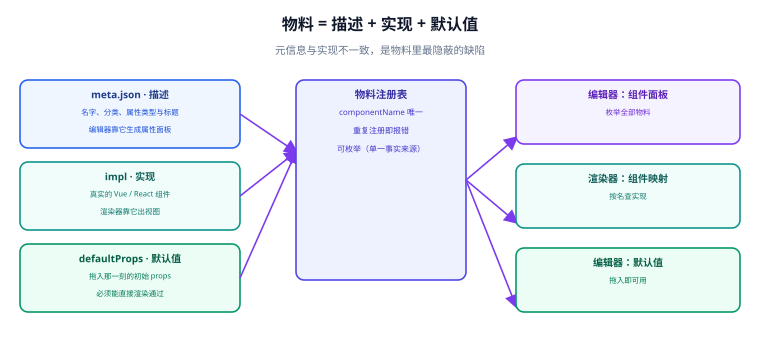

# 物料体系：组件即积木

**低代码平台的表达能力，等于它的物料能力。** 协议再优雅、编辑器再顺滑，只要物料不够用，使用者最后还是要回到手写代码——而「物料不够用」几乎总是因为**物料没有规范化**：没有描述文件、没有默认值、属性和实现不一致。



## 一句话定位

**物料不是「组件库换个名字」，而是「给组件补上一份机器可读的自述」。** 一个 React 组件只知道自己怎么渲染；一个**物料**额外知道「我叫什么、我有哪些可配置属性、每个属性用什么控件编辑、默认值是什么、能否容纳子节点」——后面这些，才是编辑器能用它的前提。

## 物料协议：三部分

一份物料描述最小要有三块内容：

```json [materials/input/meta.json]
{
  "componentName": "Input",
  "title": "单行输入框",
  "category": "数据录入",
  "description": "受控的单行文本输入组件，支持前后缀与校验提示",
  "isContainer": false,
  "props": {
    "name": {
      "title": "字段名",
      "type": "string",
      "default": "",
      "setter": "StringSetter",
      "description": "提交时使用的字段键名",
      "required": true
    },
    "label": { "title": "标签", "type": "string", "default": "", "setter": "StringSetter" },
    "size": {
      "title": "尺寸",
      "type": "enum",
      "default": "medium",
      "setter": "SelectSetter",
      "options": [
        { "label": "小", "value": "small" },
        { "label": "中", "value": "medium" },
        { "label": "大", "value": "large" }
      ]
    },
    "disabled": { "title": "禁用", "type": "boolean", "default": false, "setter": "BooleanSetter" }
  },
  "defaultProps": { "name": "", "label": "", "size": "medium", "disabled": false }
}
```

三部分与各自的消费方是**一一对应**的：

| 部分 | 内容 | 谁消费 | 缺了会怎样 |
| --- | --- | --- | --- |
| **描述**（`meta`） | 名字、分类、每个属性的类型与标题 | 编辑器（组件面板、属性面板） | 属性面板里出现一坨看不懂的 JSON |
| **实现**（`impl`） | 真实的 Vue / React 组件 | 渲染器 | 拖上去是空白 |
| **默认值**（`defaultProps`） | 新拖入时的初始 props | 编辑器（拖拽那一刻） | 拖进去就报错（缺必填属性） |

::: danger `meta` 与 `impl` 不一致是最隐蔽的物料缺陷
属性面板上的文案、类型、选项全部来自 `meta`；真正生效的是 `impl`。两者不一致时，**面板看起来完全正常，配出来的效果却不对**——比如 `meta` 里写着 `size` 的默认值是 `medium`，而组件实际把 `undefined` 当成了 `large`。

**判据写进 CI：用 `defaultProps` 逐个渲染物料，不该有控制台警告或错误。** 这一条能拦住「默认值写错」「必填属性缺失」「类型不匹配」三类问题。
:::

## 属性类型与设置器（Setter）对照表

`type` 决定数据的形状，`setter` 决定「用什么控件编辑它」。两者必须配套，否则会出现「用文本框编辑一个颜色」这类体验灾难。

| `type` | 数据结构 | 推荐 setter | 编辑控件 |
| --- | --- | --- | --- |
| `string` | `"abc"` | `StringSetter` | 单行输入 |
| `number` | `12` | `NumberSetter` | 数字输入 |
| `boolean` | `true` | `BooleanSetter` | 开关 |
| `enum` | `"medium"` | `SelectSetter` | 下拉 |
| `color` | `"#ff0000"` | `ColorSetter` | 取色器 |
| `style` | `{ marginTop: 8 }` | `StyleSetter` | 可视化盒模型编辑 |
| `expression` | <span v-pre>`"{{ user.name }}"`</span> | `ExpressionSetter` | 表达式编辑器（带变量提示） |
| `json` | `{ ... }` | `JSONSetter` | JSON 编辑器（带校验） |
| `node` | `{ id, componentName, ... }` | `SlotSetter` | 内嵌一个迷你会话搭建区 |

::: tip 设置器是「物料体系」里最值钱的资产
组件可以买、可以抄，但**贴合自己业务语义的设置器抄不到**。比如一个「部门选择器」的 setter（读组织架构树、支持多选与数据权限），价值远高于对应的组件本身。做平台时优先把「业务语义强」的属性做成专用 setter，而不是全用 JSON 编辑器糊过去。
:::

## 注册与加载：三种策略

| 策略 | 做法 | 适合 | 代价 |
| --- | --- | --- | --- |
| **全量加载** | 启动时把全部物料打进包 | 物料少（< 50 个）、内部平台 | 包体积随物料线性增长 |
| **分目录加载** | 按分类（表单 / 图表 / 布局）拆包，按需加载 | 物料多、分类清晰 | 需要「加载中」占位，编辑器要处理异步 |
| **远程物料** | 物料元信息与实现从 CDN / 物料中心拉取 | 多团队共建、物料独立发版 | 引入版本兼容与安全面（远程代码执行） |

远程物料是能力上限最高、风险也最高的一种：**它等于让平台的运行时代码可以被远程替换**。做之前必须想清楚三件事：

1. **签名与来源校验**：物料包必须验签，只允许白名单来源。
2. **版本兼容**：物料声明的 `engineVersion` 与当前引擎不匹配时，必须**拒绝加载而不是降级运行**。
3. **降级路径**：物料加载失败时，页面要能用「未知组件」占位继续渲染，不能整页报错。

## 物料库的治理

物料一多，问题就从「有没有」变成「乱不乱」。四条治理规则：

| 规则 | 具体做法 | 不做的后果 |
| --- | --- | --- |
| **命名唯一且语义化** | `componentName` 全局唯一、人类可读（`Input` 而不是 `C1`） | 跨团队重名冲突 |
| **分类收敛** | 分类数量控制在 6~10 个，新增分类要走评审 | 面板变成一团乱麻 |
| **废弃走标记** | 废弃物料保留但不出现在面板，历史页面仍能渲染 | 直接删除 → 老页面整块空白 |
| **版本可追溯** | 物料带版本，页面记录用到的物料版本 | 物料升级后无法定位「谁受影响」 |

```json [materials.json（物料清单，供 CI 校验）]
{
  "engineVersion": "1.2.0",
  "materials": [
    { "name": "Input",  "version": "1.0.0", "category": "数据录入", "status": "active" },
    { "name": "Select", "version": "1.1.0", "category": "数据录入", "status": "active" },
    { "name": "Table",  "version": "1.0.0", "category": "数据展示", "status": "active" },
    { "name": "Button", "version": "2.0.0", "category": "通用",     "status": "active" },
    { "name": "LegacyDatePicker", "version": "0.9.x", "category": "数据录入", "status": "deprecated" }
  ]
}
```

::: danger 别让「让物料能进面板」这件事没有门槛
如果没有评审，「我要加个组件」会变成每个需求都夹带一个物料，半年后物料面板里会有 200 个组件、其中 150 个只用过一次。**准入门槛应当包含：至少两个业务场景需要它、属性有明确语义、有默认值、无控制台警告。**
:::

## 物料开发规范：一份可验收的清单

写一个物料时，按这个顺序做，每一步都有可验证的收尾：

1. **确定它是组件还是属性。** 能被单独选中的才是物料；否则它是某个物料的属性（见 [渲染引擎](../RenderEngine/index.md) 的插槽小节）。
2. **先写 `meta`，再写实现。** 反过来做会导致「实现写了什么就暴露什么」，属性面板里塞满内部实现细节。
3. **`defaultProps` 必须能直接渲染通过。** 这是「拖进去就能用」的底线。
4. **受控属性一律走标准协议。** `value` / `onChange` 命名一致，不要一个组件叫 `modelValue`、另一个叫 `value`——除非物料协议里显式声明了两套映射。
5. **不写 `id`、不写定位、不抛异常。** 物料内部不要依赖自己在 DOM 中的位置，也不要在渲染期间抛错（错误边界只能兜住渲染，兜不住事件回调）。

一个可复用的自检脚本（每个物料跑一次）：

```shell
# 逐个物料：默认值能渲染、无控制台错误、无未声明属性
node -e '
const { renderToString } = require("react-dom/server");
const meta = require("./materials/input/meta.json");
const Comp = require("./materials/input/impl").default;
const errs = [];
const origErr = console.error; console.error = (...a) => errs.push(a.join(" "));
try { renderToString(<Comp {...meta.defaultProps} />); } catch (e) { errs.push("THROW: " + e.message); }
console.error = origErr;
console.log(errs.length ? "FAIL " + meta.componentName + " :: " + errs.join(" | ") : "PASS " + meta.componentName);
'
```

预期：每个物料一行 `PASS`。**把它接进 CI，物料库的质量就不会随时间腐化。**

## 物料与设计系统的关系

很多团队问「有了设计系统还要不要做物料」。答案是**要，但物料应该是设计系统的投影，而不是另一套东西**：

| 关系 | 做法 | 收益 |
| --- | --- | --- |
| 设计令牌（Token）→ 物料的默认值 | 物料 `defaultProps` 从 token 生成 | 「改主题」只需改 token |
| 设计系统组件 → 物料的实现 | 物料 `impl` 直接包设计系统组件 | 视觉一致，不重复实现 |
| 设计系统的分类 → 物料的分类 | 分类对齐，减少认知负担 | 设计稿与面板结构一致 |
| 组件 API 的变体枚举 → 物料的 setter 枚举 | 物料 setter 的可选值**从组件的联合类型生成**，不手写第二份 | 面板里选不到「代码里不存在的变体」，非法组合从 166 种降到 0 |
| 设计系统的版本语义 → 物料的兼容窗口 | 物料 `meta.version` 记录它编译时的组件库版本，运行时按 range 校验 | 升级组件库时能算出「哪些物料要重编」 |

这里最容易做错的是第三行：把 setter 的可选值手写一遍，等价于给组件的 props 又维护了一张表。一旦组件加了 `size: "xs"`，面板里选不到；删了一个变体，面板里还能选出来（存进 Schema 后渲染报错）。**正确做法是从类型生成 setter 选项**，与 [设计系统与组件库工程 · 文档与代码同源](../../DesignSystem/DocsSync/index.md) 里那条「props 表由类型生成」是同一条纪律。

第四条判据的来源是组件库的发布治理：破坏性变更（判据见 [版本、废弃与发布治理](../../DesignSystem/ReleaseGovernance/index.md)）会改变物料的渲染结果，所以物料必须知道自己编译在哪个版本上——否则一次 minor 升级会让一批搭建好的页面静默变形。

::: warning 反过来的做法代价很高
「低代码平台自己做一套组件，跟设计系统并行」是常见的起步方式，但它在半年后会变成两套需要同步维护的 UI。**能包设计系统的组件就包，只有低代码才需要的部分（如容器、插槽占位）才自己写。**
:::

## 验证方式：物料库的四条判据

```shell
# ① 每个物料的 meta 与 impl 都能被解析
ls materials/*/meta.json | wc -l && ls materials/*/impl.* | wc -l    # 两个数字必须相等

# ② 无重复 componentName（跨目录也要查）
python -c "import json,glob,collections;ns=[json.load(open(p))['componentName'] for p in glob.glob('materials/*/meta.json')];d=[k for k,v in collections.Counter(ns).items() if v>1];print('DUP:',d)"

# ③ 每个物料的 defaultProps 都能渲染通过（见上一节脚本）
for m in materials/*/; do node scripts/check-material.js "$m"; done | grep -v PASS && echo "有物料未通过" || echo "PASS 全部物料可渲染"

# ④ 废弃物料仍可被旧 Schema 解析（用一份引用了 deprecated 物料的 Schema 试渲染）
node -e "const {render}=require('./renderer');const h=render(require('./fixtures/uses-legacy-datepicker.json'));console.log(h.includes('未知组件')?'FAIL 废弃物料不可渲染':'PASS 废弃物料仍可渲染')"
```

预期：① 两数相等；② 输出 `DUP: []`；③ 无失败行；④ PASS。

## 参考资料

- [Alibaba LowCodeEngine：物料规范](https://lowcode-engine.cn/site/docs/specs/material-spec)
- [LowCodeEngine：物料体系与设置器](https://github.com/alibaba/lowcode-engine/tree/main/packages/editor-setters)
- [Amis：组件文档（属性即协议）](https://aisuda.bce.baidu.com/amis/zh-CN/components/page)
- [Storybook：组件文档与属性表](https://storybook.js.org/docs/writing-docs/autodocs)
