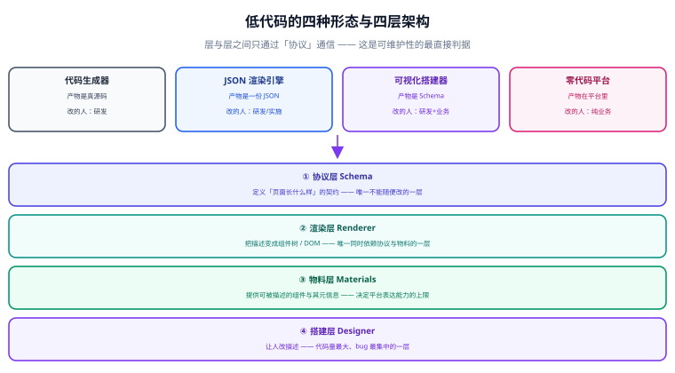

# 总览：低代码的边界与四种形态

**低代码平台的本质是「把页面变成数据」。** 一旦页面是一份结构化描述，它就能被程序读、被程序改、被程序校验、被程序生成——拖拽只是「人怎么改这份数据」的一种交互方式，不是平台的核心。本页先把「低代码 / 零代码 / 代码生成器」这三个常被混用的词拆开，再给出四层架构与五条「什么时候不该上低代码」。



## 一句话定位

**写代码是「人把意图翻译成机器能执行的指令」，低代码是「人直接给出机器能理解的意图」。** 前者表达能力无上限但门槛高，后者门槛低但**表达能力有天花板**——低代码平台做的每一件事，本质上都是在「抬高这个天花板」和「降低这个门槛」之间找一个点。

## 四个常被混用的概念

| 概念 | 产物是什么 | 改的人是谁 | 表达能力 | 典型实现 |
| --- | --- | --- | --- | --- |
| **代码生成器** | 真实源码（`.vue`、`.java`） | 研发 | 无上限（就是普通工程） | RuoYi、velocity 模板 |
| **JSON 渲染引擎** | 一份 JSON 描述 | 懂 JSON 的研发 / 实施 | 受组件与表达式能力限制 | Amis、Formily |
| **可视化搭建器** | 结构化 Schema（可出码） | 研发 + 业务 | 受物料与编排能力限制 | LowCodeEngine、Appsmith |
| **零代码平台** | 平台内的数据（不可导出） | 纯业务 | 最窄，但最易用 | 各类 SaaS 表单 / 审批平台 |

::: warning 为什么必须区分这四者
它们的**代价结构完全不同**：代码生成器的代价在「生成之后就无法回退到可视化」（一次性），JSON 引擎的代价在「要教会使用者 JSON 语义」，零代码平台的代价在「**平台绑定**：数据在别人手里，导不出来」。把零代码当低代码采购，最后往往卡在「我要加一个平台没提供的交互」；把代码生成器当低代码采购，最后卡在「运营连改个字段都要提单」。
:::

一个务实的结论：**这四者不是替代关系，是光谱上的四个点，同一个团队可以同时用。** 内部工具用零代码，中后台用 JSON 引擎，核心业务页面用可视化搭建器 + 出码，复杂交互回到手写。

## 四层架构

低代码平台无论做多大，内部都能拆成这四层，**层与层之间只通过「协议」通信**——这是判断一个平台是否可维护的最直接标准。

| 层 | 职责 | 输入 | 输出 | 出问题时的表现 |
| --- | --- | --- | --- | --- |
| ① **协议层**（Schema） | 定义「页面长什么样」的契约 | 人的拖拽 / 配置 | 一份可序列化的描述 | 描述歧义 → 渲染结果与预期不符 |
| ② **渲染层**（Renderer） | 把描述变成真实视图 | 描述 + 物料表 | 组件树 / DOM | 组件映射缺失 → 整块空白 |
| ③ **物料层**（Materials） | 提供可被描述的组件与其元信息 | 组件的描述文件 | 出现在左侧组件面板 | 元信息与实现不一致 → 属性面板文案错 |
| ④ **搭建层**（Designer） | 让人改描述 | 人的点击 / 拖拽 | 新的描述 | 撤销重做失效、三视图不同步 |

::: tip 一句话理解四层
**协议层回答「长什么样」，渲染层回答「怎么变出来」，物料层回答「能用哪些积木」，搭建层回答「人怎么改」。** 四层里**唯一不能随便改的是协议层**——它一变，所有已存的描述都要迁移。
:::

```text
  人（业务 / 研发）
        │  拖拽、配置
        ▼
  ┌─────────────┐   产出   ┌──────────────────┐
  │  ④ 搭建层    │ ───────► │  ① 协议层 Schema  │
  └─────────────┘          └──────────────────┘
        ▲                            │
        │ 元信息                      │ 解释
  ┌─────────────┐                     ▼
  │  ③ 物料层    │ ── 组件映射 ──► ┌─────────────┐
  └─────────────┘                  │  ② 渲染层    │ ──► 视图
                                   └─────────────┘
```

这个形状解释了一件事：**渲染层是唯一同时依赖协议层与物料层的地方**。所以「产品说要支持一个新组件」时，要动的从来不止物料层——物料要注册、渲染映射要加、搭建层要能拖、协议要有地方放它的属性。

## 三种落地形态怎么选

同样是搭平台，起点不同，做法完全不同。选错起点是低代码项目最常见的失败原因。

| 形态 | 起点 | 适合谁 | 代价 |
| --- | --- | --- | --- |
| **从渲染引擎起步** | 先定协议 + 写渲染器，界面靠手写 JSON | 前端能力弱、后端 / 全栈团队 | 初期没有拖拽，使用门槛高；但**协议先成型**，后面加搭建器很顺 |
| **从搭建器起步** | 先做拖拽界面，协议边做边改 | 有前端团队、要给业务人员用 | 极易出现「协议跟着 UI 走」——**协议被 UI 绑架**，后期出码 / 迁移全返工 |
| **从物料起步** | 先做一批规范化物料与设计系统 | 已有设计系统、要做标准化 | 物料做完但没有可搭的引擎，前端投入看不到产出 |

**推荐的顺序是「协议 → 渲染 → 物料 → 搭建」**：先把描述定下来并用一个最小渲染器证明它是自洽的（能用 JSON 手写出一张能跑的页面），再补物料，最后做拖拽界面。理由很朴素：**渲染器能用 JSON 手写驱动，等于协议已经可验证**；反过来先做搭拽，你验证的只是「拖得动」，不是「描述是对的」。

## 五条「什么时候不该上低代码」

低代码是**用表达能力换交付速度**的交易。当以下任意一条成立时，这笔交易是亏的：

1. **页面是核心资产且要求极致体验。** 首页、营销页、强交互的编辑器类产品，它们的价值就在「体验比竞品好一点」上，而低代码产出的页面对 DOM 结构、包体积、动效精细度的控制力天然更弱。这类页面**手写更快也更好**。
2. **交互形态高度定制、复用率极低。** 如果每个页面都是全新的交互逻辑，物料永远不够用，结果就是「用低代码写代码」——既没有复用收益，又多了一层描述与解释的开销。
3. **团队没有前端研发能力去维护平台。** 平台本身是一个前端产品：协议要演进、渲染器要修 bug、物料要维护、编辑器要适配浏览器。**买 SaaS 可以，但自建平台省不掉这支人力。**
4. **有合规 / 可审计要求且平台不可导出。** 数据在平台里、导不出来、改不了实现，一旦要求「代码审计」或「私有化替换」，会直接卡死。
5. **真正的瓶颈不在「写页面」这一环。** 很多团队抱怨交付慢，实际瓶颈是需求不清、接口不齐、测试环境不稳。低代码只加速了「写页面」，对真正的瓶颈毫无作用。

::: danger 最常见的误判：把「工具问题」当成「效率问题」
「上了低代码，交付能快几倍」这类承诺几乎都不成立，因为**它只压缩了编码时间，没有压缩需求澄清、联调、测试、上线的时间**。一个诚实的预期是：**标准化程度越高、页面越同质，收益越大；反之收益可能为负**（要学平台、要迁就平台）。立项前先量一下「重复的页面有多少、重复的比例有多高」，比听任何承诺都有用。
:::

## 平台的三个能力台阶

从「能用」到「好用」，低代码平台通常要跨三个台阶，每个台阶的判据都很具体：

| 台阶 | 能力 | 可验证的判据 |
| --- | --- | --- |
| 一、**能搭** | 拖拽出页面、能预览、能保存 | 用平台搭一张双列表单页，保存后刷新不丢、预览与实际渲染一致 |
| 二、**能配** | 数据源、表达式、组件联动可用 | 「省份 → 城市」级联不用写代码即可实现 |
| 三、**能交付** | 出码 / 灰度 / 版本 / 回滚 | 同一份 Schema 出码后单独构建产物可运行；Schema 升级后旧页面仍可打开 |

绝大多数自建平台长期停在台阶二——**不是技术做不到，而是「版本与迁移」这件事没有人负责**。这也是本专题把 [交付与运行时](../Runtime/index.md) 单列一页的原因。

## 一张图判断你的场景该做到哪一层

| 场景 | 建议做到 | 理由 |
| --- | --- | --- |
| 内部运营后台、字段常改 | 台阶二即可 | 页面同质度高，改动集中在表单与列表 |
| 面向客户的配置化页面 | 台阶三 | 需要版本与回滚，客户不会容忍「改了直接生效」 |
| 大屏 / 看板 | 台阶二 + 强大可视化物料 | 价值在物料与图表能力，不在编排 |
| 审批 / 工单 | 别自建，用现成流程引擎 + 表单设计器 | 流程语义复杂，自建成本极高 |

## 验证方式：用四个命令确认「你的平台确实在按层工作」

在自建平台的仓库里跑下面四条，能暴露绝大多数「层级没分开」的问题：

```shell
# ① 协议层是否独立：渲染器能否在不启动编辑器的情况下渲染一份手写 Schema
grep -rn "from.*designer\|from.*editor" src/renderer/ && echo "FAIL: 渲染器依赖了编辑器" || echo "PASS"

# ② 物料层是否声明式：物料是否只有元信息、没有硬编码进渲染器
grep -rn "componentName ===" src/renderer/ | head && echo "注意：出现硬编码分支，说明物料映射没走注册表"

# ③ 搭建层是否只依赖协议：编辑器的写入是否都经过统一的 Schema 操作接口
grep -rn "schema\.\(nodes\|props\)\s*=\s*" src/designer/ | head && echo "注意：绕过操作接口直接改 Schema，撤销重做必然失效"

# ④ 产物是否可离线运行：出码产物是否可以不依赖平台运行时
ls dist/ && grep -rn "@lowcode\|platform-runtime" dist/*.js | head && echo "注意：出码产物仍依赖平台运行时"
```

预期：① 输出 PASS；②③ 无输出（或只在注册表附近出现）；④ 出码产物不引用平台运行时。**只要 ② 或 ③ 有输出，就说明这个平台的分层已经开始塌陷**——这类问题越晚修越贵。

## 参考资料

- [Alibaba LowCodeEngine：架构设计](https://lowcode-engine.cn/site/docs/guide/quickStart/intro)
- [Amis：设计理念与协议](https://aisuda.bce.baidu.com/amis/zh-CN/docs/index)
- [Martin Fowler：Low-Code 与内部 DSL 的关系](https://martinfowler.com/bliki/InternalDslStyle.html)
- [JSON Schema：Why JSON Schema](https://json-schema.org/overview/what-is-jsonschema)
