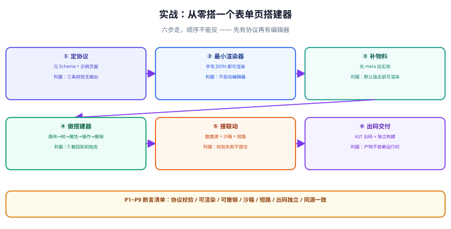

# 实战：从零搭一个表单页搭建器

本页把前五页的判据串成一条可执行的路径：**用六个步骤做出一个「能拖、能配、能联动、能出码」的最小表单页搭建器**。每一步都有可验证的收尾，**不要跳步**——尤其是「先协议后编辑器」这个顺序，反过来一定返工。



## 目标与边界

**目标**：做出一个能搭出「用户信息登记表单」的搭建器 —— 拖入字段、配置标题与校验、配置提交接口、预览、导出为可运行的 React 组件。

**明确不做**（写下来，避免范围膨胀）：

| 不做 | 理由 |
| --- | --- |
| 不做多页面 / 路由编排 | 那是「应用搭建器」的范畴，本实战只做单页表单 |
| 不做远程物料 | 引入签名、版本、安全面，与「最小可用」目标不符 |
| 不做协同编辑 | 涉及冲突合并与 OT/CRDT，独立课题 |
| 不做富文本与图表物料 | 物料数量不是本实战要证明的东西 |

## 技术前提

| 项 | 选择 | 理由 |
| --- | --- | --- |
| 渲染宿主 | React 18+ | 错误边界、`memo` 语义明确 |
| 表达式解析 | `jsep`（自写求值） | 体积小、AST 可控，便于做白名单 |
| 出码 | Babel AST | 避免字符串拼接出码 |
| 状态管理 | 原生 + 规范化结构 | 编辑器的状态结构特殊，通用状态库反而别扭 |
| 校验 | JSON Schema（`ajv`） | 协议自带机器可校验性 |

::: tip 为什么不用现成的低代码框架
可以用（LowCodeEngine / Amis 都是成熟选择，生产项目优先用现成的）。**本实战的目的是把机制走一遍**——自己写一遍渲染器与撤销重做，你才知道现成框架里那些约束为什么存在，出问题时也才定位得动。
:::

## 第一步：定协议

先把 `page.schema.json` 的结构与元 Schema 写出来，**这一步不写任何 UI 代码**。

```json [page.schema.json（示例页面）]
{
  "$schema": "./lowcode.schema.v1.json",
  "version": "1.0.0",
  "meta": { "title": "用户信息登记" },
  "dataSources": [
    {
      "id": "ds_submit",
      "type": "http",
      "request": { "url": "/api/users", "method": "POST", "body": "{{ state.form }}" },
      "autoLoad": false
    }
  ],
  "state": { "form": {} },
  "root": {
    "id": "root",
    "componentName": "Page",
    "props": { "title": "用户信息登记" },
    "children": [
      {
        "id": "form_1",
        "componentName": "Form",
        "props": {},
        "children": [
          { "id": "f_name",  "componentName": "Input",  "props": { "name": "username", "label": "姓名", "required": true }, "children": [] },
          { "id": "f_phone", "componentName": "Input",  "props": { "name": "phone", "label": "手机号" }, "children": [] },
          { "id": "btn_1",   "componentName": "Button", "props": { "text": "提交" },
            "events": { "onClick": [
              { "action": "validate", "args": { "target": "form_1" } },
              { "action": "request",  "args": { "dataSource": "ds_submit" } },
              { "action": "notify",   "args": { "type": "success", "message": "提交成功" } }
            ] },
            "children": [] }
        ]
      }
    ]
  }
}
```

**验收判据**：

```shell
# 协议自校验：结构合规 + id 唯一 + 组件名已知
npx ajv-cli validate -s lowcode.schema.v1.json -d page.schema.json \
  && node scripts/check-ids.js page.schema.json \
  && node scripts/check-components.js page.schema.json
```

预期：三条都无输出即通过。**若此时协议还有歧义（比如 `children` 到底能不能省略），就在这一步改，而不是等到编辑器做完。**

## 第二步：写最小渲染器

渲染器只做三件事：查注册表、求值 props、递归 children。**先不要做编辑器相关的任何东西。**

```jsx [src/renderer.jsx]
const registry = new Map();
export const register = (name, impl) => {
  if (registry.has(name)) throw new Error(`重复注册：${name}`);
  registry.set(name, impl);
};

export function Renderer({ schema, ctx = {} }) {
  return <Node node={schema.root} ctx={ctx} />;
}

function Node({ node, ctx }) {
  const Comp = registry.get(node.componentName);
  if (!Comp) { ctx.onMissing?.(node.componentName, node.id); return ctx.mode === "edit" ? <div className="lc-unknown">未知组件：{node.componentName}</div> : null; }
  const props = { ...(node.props || {}), style: toStyle(node.style), key: node.id, "data-node-id": node.id };
  return <ErrorBoundary fallback={<div className="lc-error">组件渲染失败</div>}>
    <Comp {...props}>{(node.children || []).map((c) => <Node key={c.id} node={c} ctx={ctx} />)}</Comp>
  </ErrorBoundary>;
}
```

**验收判据**：**用一份手写 JSON 就能渲染出页面**（此时还没有编辑器）。

```shell
node -e "
const {Renderer,register}=require('./src/renderer'); register('Page',PageImpl); register('Input',InputImpl);
const html=require('react-dom/server').renderToString(<Renderer schema={require('./page.schema.json')} />);
console.log(html.includes('姓名') && html.includes('提交') ? 'PASS 协议可驱动渲染' : 'FAIL 渲染失败');
"
```

::: tip 这一步的隐藏价值
「不启动编辑器就能渲染」意味着**渲染器不认识编辑器**——分层是对的。如果这一步做不到（渲染器必须依赖编辑器的某个对象），说明协议被编辑器绑架了，现在改还来得及。
:::

## 第三步：补物料

先写 `meta`，再写实现。最少四个物料：`Page`（容器）、`Form`（容器）、`Input`（叶子）、`Button`（叶子）。

```json [materials/input/meta.json（节选）]
{
  "componentName": "Input",
  "title": "单行输入",
  "category": "数据录入",
  "isContainer": false,
  "props": {
    "name":     { "title": "字段名", "type": "string",  "default": "",       "setter": "StringSetter",  "required": true },
    "label":    { "title": "标签",   "type": "string",  "default": "字段",   "setter": "StringSetter" },
    "required": { "title": "必填",   "type": "boolean", "default": false,    "setter": "BooleanSetter" }
  },
  "defaultProps": { "name": "", "label": "字段", "required": false }
}
```

**验收判据**：每个物料的 `defaultProps` 都能渲染通过，且无控制台错误。

```shell
for m in materials/*/; do node scripts/check-material.js "$m"; done | tee /tmp/mat.txt
grep -c '^PASS' /tmp/mat.txt && ! grep -q '^FAIL' /tmp/mat.txt && echo "PASS 物料全部可渲染" || echo "FAIL 有物料未通过"
```

预期：`PASS` 数量等于物料数量，无 `FAIL` 行。

## 第四步：做搭建器

这是工作量最大的一步。按顺序做，每做完一小块就自测：

| 顺次 | 做出来什么 | 验收 |
| --- | --- | --- |
| 4.1 | 画布渲染 Schema（复用第二步的渲染器，`mode: "edit"`） | 打开编辑器能看到页面 |
| 4.2 | 点击选中（用 `data-node-id` 反查） | 点节点出现选中框，`selectedIds` 正确 |
| 4.3 | 大纲树 | 树结构与 Schema 一致，点击与画布双向联动 |
| 4.4 | 属性面板（按 `meta.props` 动态生成表单） | 改属性 → 画布即时更新 |
| 4.5 | 操作层（`insert/remove/move/updateProps`） | 每个操作都能 `apply` / `revert` |
| 4.6 | 撤销重做 | 连做 5 次操作，连撤 5 次回到初始态 |

**验收判据**（4.6 是最关键的一条）：

```shell
node -e "
const {makeDesigner}=require('./src/designer');
const d=makeDesigner(require('./page.schema.json')); const init=d.serialize();
for(let i=0;i<5;i++){ const id=d.insertNode('form_1','Input'); d.updateProps(id,{label:'字段'+i}); }
for(let i=0;i<5;i++) d.undo();
console.log(JSON.stringify(d.serialize())===JSON.stringify(init) ? 'PASS 撤销回到初始态' : 'FAIL 撤销不完整');
"
```

::: danger 这一步最容易走错的两条路
1. **直接改 Schema 不走操作层。** 属性面板为了省事直接 `node.props.x = v`，结果撤销失效。**从第一天就用操作层**，后期不用返工。
2. **把选中状态放进 Schema。** 前面强调过，这里再强调一次：**撤销栈里出现「选中」是最典型的 bug。**
:::

## 第五步：接数据源与联动

让表单能真的提交，并让「手机号」字段在提交失败时高亮。

| 要做的 | 判据 |
| --- | --- |
| 数据源定义可解析并执行 | `ds_submit` 能发出请求（用 mock 服务验证） |
| 表达式求值走沙箱 | `__proto__` / `constructor` 被拒绝 |
| 动作串行短路 | `validate` 失败时 `request` 不执行 |
| 三态可视化 | 请求中按钮禁用、失败有提示与重试入口 |

**验收判据**：

```shell
node -e "
const {runActions}=require('./src/runtime'); const log=[];
runActions([{action:'validate',args:{pass:false}},{action:'request',args:{dataSource:'ds_submit'}}],{log});
console.log(log.length===0?'PASS 短路生效':'FAIL 校验失败仍提交');

const {evalExpression}=require('./src/runtime');
let blocked=false; try{ evalExpression('a.__proto__',{a:{}}) }catch{ blocked=true }
console.log(blocked?'PASS 沙箱拦截':'FAIL 沙箱可逃逸');
"
```

## 第六步：出码与交付

把 Schema 编译成一个独立的 React 组件，**产物不依赖平台运行时**。

```shell
# ① 出码
node scripts/codegen.js page.schema.json > out/Page.jsx

# ② 独立构建（产物里不能出现平台运行时）
cd out && pnpm build && grep -rn "platform-runtime" dist/ && echo "FAIL 依赖运行时" || echo "PASS 产物独立"

# ③ 同源对照：解释渲染与出码产物的可见文本必须一致
node scripts/compare-text.js page.schema.json out/dist/index.html
```

**验收断言清单**（六步走完，逐条打勾）：

| 编号 | 断言 | 判据 |
| --- | --- | --- |
| P1 | 协议自校验通过 | `ajv` / id 唯一 / 组件名已知，三条无输出 |
| P2 | 手写 JSON 即可渲染 | 不启动编辑器能渲染出页面 |
| P3 | 物料默认值可渲染 | 每个物料 `PASS`，无控制台错误 |
| P4 | 每次改动可撤销 | 5 次操作 ↔ 5 次撤销，回到初始态 |
| P5 | 选中不进撤销栈 | 连续选中后撤销栈长度不变 |
| P6 | 表达式沙箱不可逃逸 | `__proto__` / `constructor` 被拒 |
| P7 | 动作串行短路 | 校验失败时不发请求 |
| P8 | 出码产物独立 | 产物不引用平台运行时，能单独构建运行 |
| P9 | 同源一致 | 解释渲染与出码产物可见文本一致 |

::: warning 实测列不能抄期望值
P1~P9 中，凡是需要「真跑一遍」的（P2 / P3 / P4 / P6 / P7 / P8 / P9），**必须在本机跑出结果再标注**。跑不了就写「未跑 + 原因」，**不要因为「按设计应该通过」就标 ✅**。这条纪律的价值在于：它让「平台到底能不能用」这个问题有一个诚实的答案。
:::

## 下一步可以做什么

按收益排序，而不是按难易：

1. **把属性面板的 Setter 体系做起来**（[物料体系](../Materials/index.md) 里最值钱的部分）。
2. **加版本与发布**（[交付与运行时](../Runtime/index.md)）：追加版本 + 发布指针 + 一键回滚。
3. **把编辑器状态拆出去**做成可持久化的协作基础（多人编辑的前置）。
4. **补性能**：规范化状态 + `memo`，解决「改一个属性全页重渲」。

## 参考资料

- [React：`react-dom/server` 服务端渲染](https://react.dev/reference/react-dom/server)
- [jsep：表达式解析](https://github.com/EricSmekens/jsep)
- [Ajv：JSON Schema 校验](https://ajv.js.org/)
- [Babel：AST 与代码生成](https://babeljs.io/docs/babel-types)
- [Amis：从 JSON 到页面](https://aisuda.bce.baidu.com/amis/zh-CN/docs/start/getting-started)
